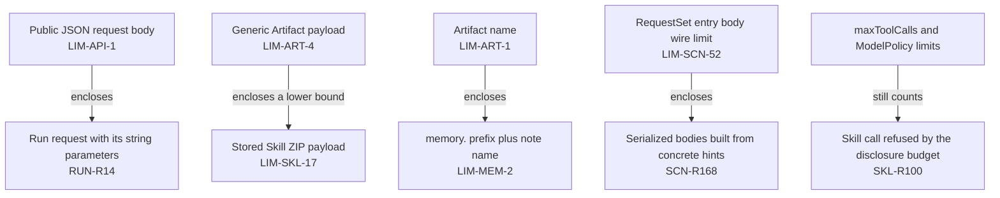

# Limits

Requirement prefix: `LIM` · [Specification index](../README.md)

## Purpose and scope

This document is the registry of every numeric bound and cardinality target in
Contractor. It owns:

- the registry entry, its `LIM-<area>-<n>` identifier and its fields;
- the notation of entry values: units of measure, ranges, defaults, relative
  bounds and budgets;
- the rules that apply to every bound: single ownership, citation of bounds
  owned elsewhere, layering of bounds, several enforcement points and the
  scope of a bound.

The value of each bound, what it measures, where it is checked and what happens
when it is reached belong to the owning requirement in its domain document; the
[registry](#registry) links every entry to that requirement. Error and stop
codes returned at a bound are registered in [errors](errors.md), and the outcome
classes of failed calls and mutations in the [failure model](failure-model.md).
The place of registries in the specification is set out in the
[conventions](../conventions.md#registries).

## Concepts

Terms are defined once in the [glossary](../glossary.md); this document owns
the following ones.

- **Bound.** A numeric maximum, minimum or allowed range on one named quantity:
  a size, count, depth, duration or resource. Limits, ceilings and budgets are
  bounds.
- **Cardinality target.** A bound on how many members a collection or
  selection may contain, such as active notes per Memory Namespace (LIM-MEM-8),
  skills per AgentTemplate (LIM-SKL-1) or entries in a Skill ZIP (LIM-SKL-18).
- **Registry entry.** The one row for a bound in this registry, identified as
  `LIM-<area>-<n>`, where `<area>` is the requirement prefix of the owning
  document and `<n>` numbers the bounds that document owns.
- **Owning requirement.** The one requirement that states a bound's value and
  its rule.
- **Enforcement point.** A component that checks a bound, such as the Server
  before scheduling or the Runtime for one allocation.
- **Default.** The value a configurable bound takes when its setting is
  omitted; it lies within the setting's allowed values.
- **Budget.** A bound on a quantity consumed cumulatively: across calls over an
  allocation's lifetime, across the files of one scan, across the work of one
  extraction, or summed over the Workers of a selection.
- **Reservation.** Capacity set aside inside a shared ceiling or budget before
  the content that uses it is admitted.

## Model

### Registry entry

| Field | Content |
| --- | --- |
| ID | `LIM-<area>-<n>` |
| Value | The bound with its unit, and its default where the bound is configurable |
| Applies to | The quantity that is bounded |
| Enforced by | Every enforcement point of the bound |
| Owner | A link to the owning requirement |

### Value forms

| Form | Written as | Example entries |
| --- | --- | --- |
| Maximum | "at most N" | RuntimeConfig JCS encoding (LIM-RCF-7), memory note name (LIM-MEM-2) |
| Inclusive range | `a–b`, `a..b`, "from a through b", or an exceptional value plus a range such as `0` or `1..N` | `flushTimeoutSeconds` (LIM-RCF-9), Automate workers (LIM-HTP-28), `maxInputs` (LIM-SCN-57), `definition_line` (LIM-CAN-30) |
| Default and allowed values | A default plus the allowed range of the setting | Worker export settings (LIM-RCF-12 to LIM-RCF-15), export retry backoff (LIM-RCF-16, LIM-RCF-17) |
| Operator-configurable default | "N by default", with a positive operator-configured value or an operator maximum | Podman sandbox resources and timeouts (LIM-EXE-2 to LIM-EXE-11) |
| Relative bound | A bound against another setting or a deadline, alone or together with a fixed cap | `maxPendingBytes` against `batchSizeBytes` and `initialBackoffMilliseconds` against the maximum backoff ([RCF-R99](../configuration/runtime-config.md), [RCF-R103](../configuration/runtime-config.md)); Caido poll and wait against the allocation deadline (LIM-HTP-29); sandbox preparation against the allocation prepare and lease deadlines and stop grace against the remaining teardown deadline ([EXE-R18](../tools/code-execution.md)); each scan invocation against the remaining Stage deadline ([SCN-R199](../tools/scanners.md)) |
| Per-member and aggregate | A bound on each member together with a bound on the total, or on several scopes | `otlp-headers@1` values and total (LIM-RCF-21, LIM-RCF-22); Skill package members and ZIP (LIM-SKL-15 to LIM-SKL-19); resolved Skill bytes per AgentTemplate and per Run union (LIM-SKL-22 to LIM-SKL-25); Automate payloads (LIM-HTP-26, LIM-HTP-27); aggregate source bytes and one analyzed source file (LIM-CAN-4, LIM-CAN-5); RequestSet header value and total header bytes (LIM-SCN-55, LIM-SCN-56) |
| Budget | A cumulative quantity consumed over a lifetime, a scan or a selection | Skill disclosure budget (LIM-SKL-26), shallow scan CPU budget (LIM-CAN-11), concrete-hint work budget (LIM-SCN-45), `maxTotalSeconds` (LIM-SCN-59) |

### Units of measure

| Quantity | Units used |
| --- | --- |
| Size of text | UTF-8 bytes, ASCII bytes or ASCII characters, Unicode scalar values, characters |
| Size of an encoded form | Bytes of a named encoding: RFC 8785 JCS, compact UTF-8 JSON, canonical JSON, a result after JSON encoding, a serialized document or plan |
| Size of a package | Stored bytes and decompressed bytes, declared and actually streamed |
| Count | Entries, items, terms, refs, notes, files, symbols, nodes, paths, candidates, jobs, attempts, spans, headers |
| Depth | Levels of a parsed document or of reference resolution; nodes of a call path |
| Time | Milliseconds and seconds, as wall time, CPU time or a deadline |
| Resource | vCPU, bytes of memory or address space, processes |

### Outcomes at a bound

Each owning requirement states what happens when its bound is reached. The
specification uses these outcomes:

| Outcome | Example owning requirements |
| --- | --- |
| Checked before the bounded work starts | [SKL-R8](../tools/skills.md), [SKL-R77](../tools/skills.md) |
| The call or write is rejected with an error code | [MEM-R25](../tools/memory.md), [MEM-R45](../tools/memory.md) (`memory_namespace_full`), [SKL-R100](../tools/skills.md) (`SKILL_DISCLOSURE_LIMIT`) |
| Fails explicitly instead of returning unaccounted partial data | [SCN-R169](../tools/scanners.md), [SKL-R100](../tools/skills.md) |
| The running execution is terminated | [EXE-R70](../tools/code-execution.md) |
| Admission stops early and the result is marked incomplete | [WRK-R99](../execution/worker.md), [WRK-R101](../execution/worker.md) |

### Layered bounds

The examples below illustrate LIM-R6 and LIM-R9 and come from the owning
requirements; an arrow points from the enclosing bound to the bound or work it
encloses, or from a bound to work that still counts against it.

## Requirements

**LIM-R1.** Every numeric bound and cardinality target is stated by exactly
one owning requirement and has exactly one registry entry `LIM-<area>-<n>`,
where `<area>` is the requirement prefix of the owning document.

Rationale: a value that several components enforce stays consistent only when
it is defined in one place.

**LIM-R2.** A requirement that depends on a bound owned by another document
cites that bound's registry entry and does not define a second value for it.
For example, Run parameters rely on the public JSON request-body bound
([RUN-R14](../execution/runs.md)), memory note names are sized to the Artifact
name bound ([MEM-R26](../tools/memory.md)) and the stored Skill ZIP bound sits
below the generic Artifact payload bound ([SKL-R34](../tools/skills.md)).

**LIM-R3.** An entry's value states its unit. A size bound states the
representation it counts wherever its owning requirement specifies one (UTF-8
bytes, ASCII bytes, Unicode scalar values, characters, the bytes of a canonical
or encoded form, stored or decompressed bytes), and a count states what it
counts.

**LIM-R4.** KiB, MiB and GiB are binary multiples: 1 KiB is 1,024 bytes, 1 MiB
is 1,048,576 bytes and 1 GiB is 1,073,741,824 bytes. For example, 8 MiB is
8,388,608 bytes and 64 MiB is 67,108,864 bytes.

**LIM-R5.** A range written `a–b`, `a..b` or "from a through b" includes both
ends.

**LIM-R6.** Bounds of different layers apply together. A bound owned by one
document never relaxes a bound that encloses it: the inner bound may be lower
than the enclosing one, and work within the inner bound must still fit the
enclosing bound. The [layered bounds](#layered-bounds) show examples.

**LIM-R7.** When more than one component enforces a bound, its entry names
every enforcement point.

**LIM-R8.** A bound constrains only the quantity its entry names and
guarantees nothing about a quantity derived from it
([SCN-R198](../tools/scanners.md)).

**LIM-R9.** Separate bounds on related quantities are counted separately and
leave each other unchanged ([WRK-R37](../execution/worker.md),
[SKL-R100](../tools/skills.md)).

**LIM-R10.** Each enforcement point enforces the registered value
independently ([SKL-R77](../tools/skills.md),
[RCF-R87](../configuration/runtime-config.md)).

**LIM-R11.** A maximum does not reserve capacity; a reservation exists only
where its owning requirement states one ([WRK-R100](../execution/worker.md),
[WRK-R101](../execution/worker.md), [SKL-R98](../tools/skills.md)).

## Registry

One row per bound, ordered by entry ID. The Owner column links each entry to
its owning requirement.

<!-- registry-table -->

| ID | Value | Applies to | Enforced by | Owner |
| --- | --- | --- | --- | --- |
| `LIM-API-1` | 1 MiB | Every public JSON request body, unless a resource declares a smaller bound (such as the login body) | Server public API ingress | [API-R4](../api/public-api.md) |
| `LIM-API-2` | 32 bytes | Cryptographically random session value created by each successful login (carried unpadded base64url in __Host-contractor_session) | Server browser authentication | [API-R15](../api/public-api.md) |
| `LIM-API-3` | 8 hours | Browser session idle limit | Server in-memory session store | [API-R19](../api/public-api.md) |
| `LIM-API-4` | 24 hours | Browser session absolute limit | Server in-memory session store | [API-R19](../api/public-api.md) |
| `LIM-API-5` | 8 live sessions | Live browser sessions; a ninth successful login revokes the oldest | Server in-memory session store | [API-R19](../api/public-api.md) |
| `LIM-API-6` | 32 bytes | Session-bound random CSRF token | Server browser authentication | [API-R22](../api/public-api.md) |
| `LIM-API-7` | 255 invalidations | Typed Operations invalidations retained for the operations stream (latest only) | Server live event WebSocket (process-local) | [API-R59](../api/public-api.md) |
| `LIM-API-8` | 16 KiB | Live event client frame | Server live event WebSocket | [API-R61](../api/public-api.md) |
| `LIM-API-9` | 64 KiB | Live event Server frame | Server live event WebSocket | [API-R61](../api/public-api.md) |
| `LIM-API-10` | 8 sockets | Live event sockets per authenticated session | Server live event WebSocket | [API-R62](../api/public-api.md) |
| `LIM-API-11` | 32 subscriptions | Subscriptions per live event socket | Server live event WebSocket | [API-R62](../api/public-api.md) |
| `LIM-API-12` | 256 frames | Per-connection output queue (whichever of LIM-API-12 and LIM-API-13 is reached first) | Server live event WebSocket | [API-R64](../api/public-api.md) |
| `LIM-API-13` | 1 MiB | Per-connection output queue (whichever of LIM-API-12 and LIM-API-13 is reached first) | Server live event WebSocket | [API-R64](../api/public-api.md) |
| `LIM-API-14` | 20 seconds | Time without outbound traffic after which Server sends a ping | Server live event WebSocket | [API-R65](../api/public-api.md) |
| `LIM-API-15` | 60 seconds | Time within which a connection must answer before Server closes it | Server live event WebSocket | [API-R65](../api/public-api.md) |
| `LIM-API-16` | 500 ms | Initial UI reconnect delay (exponential backoff with full jitter) | Web UI live event client | [API-R66](../api/public-api.md) |
| `LIM-API-17` | 30 seconds | Maximum UI reconnect delay (delay doubles up to this value, full jitter) | Web UI live event client | [API-R66](../api/public-api.md) |
| `LIM-API-18` | 200 items (default 50) | Page of every public collection that takes the shared `limit` parameter; the stores behind it accept the 201-row read that includes the look-ahead row | Server public API, its stores and the CLI | [API-R67](../api/public-api.md) |
| `LIM-API-19` | 1 to 256 characters in `[A-Za-z0-9][A-Za-z0-9_.:-]*` | Public `ResourceId`, `Revision` and live event `SafeIdentifier` values (Run, StageExecution, allocation, Project, Audit and Eval identities, Artifact revisions, event stream identities) | Server handlers, live event protocol and stores at write (contracts.ValidResourceID) | [API-R70](../api/public-api.md) |
| `LIM-API-20` | 1 to 128 characters in `[A-Za-z0-9][A-Za-z0-9_.-]*` | Public `ConfigId` and `ArtifactName` values (principal user ID, diagnostic code, Artifact namespace and name, Stage and logical Agent names) | Server handlers, authentication and stores (contracts.ValidName) | [API-R70](../api/public-api.md) |
| `LIM-API-21` | 1 second | Interval after which a Run with live subscriptions catches up without a wake-up while Server has no established Run event notification listener | Server live event WebSocket | [API-R72](../api/public-api.md) |
| `LIM-API-22` | 15 seconds | Interval after which a Run with live subscriptions catches up without a wake-up while the Run event notification listener is established; bounds the delivery delay of a lost notification | Server live event WebSocket | [API-R72](../api/public-api.md) |
| `LIM-ART-1` | 1 to 128 characters | ArtifactRef `namespace` and `name` (case-sensitive ASCII, `[A-Za-z0-9][A-Za-z0-9_.-]{0,127}`) | Workflow validation, wire DTOs, ArtifactStore, public and private Artifact APIs | [ART-R11](../artifacts/artifact-store.md) |
| `LIM-ART-2` | at most 255 characters | Artifact media type (canonical lowercase `type/subtype`, no parameters, RFC 6838 restricted-name parts) | Artifact API / ArtifactStore; the same cases (api/testdata/v1alpha1/media-type-cases.json) are shared by Audit packages, schemas, Runtime and UI | [ART-R63](../artifacts/artifact-store.md) |
| `LIM-ART-3` | 1 to 256 refs per request (integer `limit`, required) | Private allocation listing `GET /private/v1/allocations/{allocationID}/artifacts`, both the paged model-visible form and the `namePrefix` form; bounds the response independently of the Run's binding count | Server private Artifact API and ArtifactStore (MaxBindingListLimit), Runtime ArtifactClient (MAX_BINDING_LIST_LIMIT); the value is pinned by api/testdata/v1alpha1/artifact-list-cases.json | [ART-R47](../artifacts/artifact-store.md) |
| `LIM-ART-4` | 64 MiB (67,108,864 bytes) | Generic Artifact payload, including source ZIPs and source archive uploads | Public and private Artifact APIs, Artifact clients, persistence | [ART-R65](../artifacts/artifact-store.md) |
| `LIM-ART-5` | 1 to 512 characters, unpadded base64url `[A-Za-z0-9_-]` | Opaque `cursor` query and `nextCursor` field of the paged private allocation listing | Server private Artifact API and wire contract (contracts.ValidateArtifactListCursor, artifact.schema.json), Runtime ArtifactClient, ArtifactListResult and list_artifacts; pinned by api/testdata/v1alpha1/artifact-list-cases.json | [ART-R48](../artifacts/artifact-store.md) |
| `LIM-ART-6` | at most 50,000 binding revisions | Binding revisions of one RunScope outside the Scheduler-managed `outputs` Namespace; they also bound the Run's bindings, candidate versions and owned lineage edges, and so the work of its purge transaction | PostgreSQL at every revision insert, under the RunScope row lock (the only copy of the value); the private Artifact API reports it as artifact_limit_exceeded | [ART-R118](../artifacts/artifact-store.md) |
| `LIM-ASC-1` | 1..10 attempts, and no larger than execution.maxSubmittedRuns | maxRunAttempts of a prepare role (ordinary Run submissions per role, independent of Stage retries inside a Run) | AuditProfile configuration validation; shared Server ceiling MaxAuditRunAttempts | [ASC-R20](../audits/scans.md) |
| `LIM-ASC-2` | 16 roles | Workflow roles in total per AuditProfile | AuditProfile configuration validation | [ASC-R22](../audits/scans.md) |
| `LIM-ASC-3` | 32 inputs | Baseline inputs per AuditProfile | AuditProfile configuration validation | [ASC-R23](../audits/scans.md) |
| `LIM-ASC-4` | 128 mappings | Input, parameter and output mappings per Workflow binding | AuditProfile configuration validation | [ASC-R24](../audits/scans.md) |
| `LIM-ASC-5` | 128 descriptors | Accepted output descriptors per role | AuditProfile configuration validation | [ASC-R25](../audits/scans.md) |
| `LIM-ASC-6` | 0..64 MiB | Size of a public retained output descriptor (cumulative bytes also consume the evidence budget and are bounded by the artifact layer and chosen parser) | Server acceptance of retained outputs | [ASC-R26](../audits/scans.md) |
| `LIM-ASC-7` | 1 submission key and at most 1 Run | Each preparation attempt | Audit Controller | [ASC-R30](../audits/scans.md) |
| `LIM-ASC-8` | at most 1 accepted attempt | Each prepare role | Audit Controller (atomic acceptance of preparation outputs) | [ASC-R37](../audits/scans.md) |
| `LIM-ASC-9` | 1 assigned item and 1 scanner Worker | The openapi-scan@1 executor Stage named by auditTask.stage | Configuration catalog validation of the selected executor | [ASC-R75](../audits/scans.md) |
| `LIM-ASC-10` | 1 source operation | Each accepted OpenAPI scan item | auditdomain.BuildOpenAPIScanInventory and PrepareOpenAPIScanTask | [ASC-R85](../audits/scans.md) |
| `LIM-ASC-11` | 256 KiB | Scan settings artifact (contractor.audit.openapi-scan-settings.v1) | scanplan.DecodeAuditScanSettings | [ASC-R95](../audits/scans.md) |
| `LIM-ASC-12` | 1,000 operations | operations map of the scan settings artifact | scanplan.DecodeAuditScanSettings | [ASC-R99](../audits/scans.md) |
| `LIM-ASC-13` | 1..64 distinct names | SQLMap testParameters list in the scan settings artifact | scanplan.DecodeAuditScanSettings | [ASC-R101](../audits/scans.md) |
| `LIM-AUD-1` | exactly 1 Project (project_id) and 1 owner per Audit | Audit | Audit API and the PostgreSQL Audit record | [AUD-R1](../audits/audits.md) |
| `LIM-AUD-2` | exactly 1 mapping per required child input or parameter | AuditProfile Workflow role binding (inputs and parameters maps) | Configuration loader (AuditProfile validation) | [AUD-R35](../audits/audits.md) |
| `LIM-AUD-3` | 64 items | AuditProfile execution.batchSize | Server AuditProfile validation and Audit Controller batching | [AUD-R46](../audits/audits.md) |
| `LIM-AUD-4` | exactly 1 standard.json per source directory | Immediate directories below configs/audit-standards | Server startup standard catalog loader | [AUD-R49](../audits/audits.md) |
| `LIM-AUD-5` | exactly 1 standards entry | AuditProfile using the standard-mappings@1 inventory | Configuration loader (AuditProfile validation) | [AUD-R66](../audits/audits.md) |
| `LIM-AUD-6` | exactly 1 one-entry mapping per selected entry ID | inventory.standardSelection entryIds | Server startup AuditProfile validation | [AUD-R71](../audits/audits.md) |
| `LIM-AUD-7` | at most 1 Run and 1 execution-input manifest per AuditExecution; at most 1 AuditExecution per Run | AuditExecution and WorkflowRun association | PostgreSQL uniqueness on non-null run_id; Audit Controller | [AUD-R108](../audits/audits.md) |
| `LIM-AUD-8` | 1 to batchSize items per check execution | Check AuditExecution membership (AuditExecutionItem rows) | Audit Controller | [AUD-R109](../audits/audits.md) |
| `LIM-AUD-9` | 16 MiB compressed | Audit package (contractor.audit.package.v1) | Server Audit package validation (deployments may lower it) | [AUD-R128](../audits/audits.md) |
| `LIM-AUD-10` | 32 MiB expanded | Audit package (contractor.audit.package.v1) | Server Audit package validation (deployments may lower it) | [AUD-R128](../audits/audits.md) |
| `LIM-AUD-11` | 1,024 members | Audit package (contractor.audit.package.v1) | Server Audit package validation (deployments may lower it) | [AUD-R128](../audits/audits.md) |
| `LIM-AUD-12` | 16 MiB per opaque member | Opaque member of an Audit package | Server Audit package validation (deployments may lower it) | [AUD-R128](../audits/audits.md) |
| `LIM-AUD-13` | 512 KiB | manifest.json of an Audit package | Server Audit package validation (deployments may lower it) | [AUD-R128](../audits/audits.md) |
| `LIM-AUD-14` | 8 MiB per parsed JSON or YAML document | JSON or YAML document inside an Audit package | Server Audit package validation (deployments may lower it) | [AUD-R128](../audits/audits.md) |
| `LIM-AUD-15` | 512 bytes per package path | Member path of an Audit package | Server Audit package validation (deployments may lower it) | [AUD-R128](../audits/audits.md) |
| `LIM-AUD-16` | 16 components per package path | Member path of an Audit package | Server Audit package validation (deployments may lower it) | [AUD-R128](../audits/audits.md) |
| `LIM-AUD-17` | depth 64 | JSON/YAML nesting inside an Audit package | Server Audit package validation (deployments may lower it) | [AUD-R128](../audits/audits.md) |
| `LIM-AUD-18` | depth 32 | Local-ref resolution inside an Audit package | Server Audit package validation (deployments may lower it) | [AUD-R128](../audits/audits.md) |
| `LIM-AUD-19` | 4,096 inventory items | Inventory carried by Audit packages | Server Audit package validation and inventory generation (deployments may lower it) | [AUD-R128](../audits/audits.md) |
| `LIM-AUD-20` | 64 MiB across all generated item packages | All item packages generated for one inventory | Server Audit package validation and inventory generation (deployments may lower it) | [AUD-R128](../audits/audits.md) |
| `LIM-AUD-21` | exactly 1 evidence record per opaque content member | Opaque content members of a check-results package | Audit importer | [AUD-R131](../audits/audits.md) |
| `LIM-AUD-22` | finite numbers within ±9007199254740991 (exact integer range) | Numbers in OpenAPI JSON or YAML documents read by openapi-operations@1 | openapi-operations@1 inventory generator | [AUD-R146](../audits/audits.md) |
| `LIM-AUD-23` | 0 to 31,536,000 seconds (365 days); 0 disables the deadline | deadlineSeconds override on Audit start and resume | Audit API | [audits](../audits/audits.md) |
| `LIM-AUD-24` | 200 events per page | GET /v1/audits/{auditId}/events | Audit API | [AUD-R210](../audits/audits.md) |
| `LIM-AUD-25` | 1 to 100,000 items (`maxItemsTotal`, profile-pinned) | Items of one Audit across all Rounds | AuditProfile validation, Audit store limits validation, start and the next-Round builder | [AUD-R224](../audits/audits.md) |
| `LIM-AUD-26` | 1 to 10,000 items (`maxItemsPerRound`, profile-pinned), at most `maxItemsTotal` | Items of one Round | AuditProfile validation, Audit store limits and Round materialization validation | [AUD-R224](../audits/audits.md) |
| `LIM-AUX-1` | equal to the current global maxConcurrentRuns | Per-Audit dispatch look-ahead: reserved submission intents plus associated nonterminal child Runs | Audit Controller, transactionally in PostgreSQL across Controller instances | [AUX-R3](../audits/execution.md) |
| `LIM-AUX-2` | 1 stable idempotency key per submission intent | Child Run submission intent, until the original Run is recovered | Audit Controller and trusted Run Service | [AUX-R26](../audits/execution.md) |
| `LIM-AUX-3` | exactly 1 AuditCollectionReceipt per execution and exact terminal Run version | Collection of an observed AuditExecution | Audit Controller collection (uniqueness constraint) | [AUX-R31](../audits/execution.md) |
| `LIM-AUX-4` | exactly 1 result per input item | Check result set after a technically succeeded Run | Audit importer | [AUX-R36](../audits/execution.md) |
| `LIM-AUX-5` | 1 result item per evidence record | Evidence records of a check-results package | Audit importer | [AUX-R42](../audits/execution.md) |
| `LIM-AUX-6` | maxEvidenceBytes bytes (profile-pinned; no fixed value stated) | Retained evidence bytes per Audit, each distinct retained revision charged once | Audit importer and the collection transaction | [AUX-R45](../audits/execution.md) |
| `LIM-AUX-7` | bounded number per transaction (value not specified) | Proposal and evidence revisions retained per collection transaction | Audit Controller collection | [AUX-R49](../audits/execution.md) |
| `LIM-AUX-8` | exactly 1 execution per discovery role per accepted Round, or bounded retry | Discovery role executions while a Round is accepted | Audit Controller | [AUX-R57](../audits/execution.md) |
| `LIM-AUX-9` | 10,000 held finding receipts per pass | Inbox scan of the next-Round builder | Audit Controller next-Round builder | [AUX-R60](../audits/execution.md) |
| `LIM-AUX-10` | profile per-Round limit and the Audit's remaining total, never more than 4,096 inventory items | Items per Round admitted by start, input preview and the next-Round builder | Audit start, input preview and next-Round builder | [AUX-R62](../audits/execution.md) |
| `LIM-AUX-11` | bounded number of nonterminal Audits per periodic claim (value not specified) | Audits claimed and reconciled by one Controller pass | Audit Controller | [AUX-R69](../audits/execution.md) |
| `LIM-AUX-12` | at most 1 assessment execution after the check barrier | Assessment executions created by reconcile steps for a Round | Audit Controller (unique execution identity) | [AUX-R73](../audits/execution.md) |
| `LIM-AUX-13` | maxSubmittedRuns child Run attempts (profile-pinned; no fixed value stated) | Cumulative child Run attempts per Audit, including retries and later rounds | Audit Controller budget reservation in the submission-intent transaction | [AUX-R78](../audits/execution.md) |
| `LIM-AWC-1` | exactly 1 logical Worker per workerCompletion contract | The Worker selected by workerCompletion stage and agent: one passthrough@1 Worker responsible for the entire assigned task set | Server validation of the AuditProfile check binding and every reachable escalation variant | [AWC-R8](../audits/worker-completion.md) |
| `LIM-AWC-2` | 16 KiB per summary | submit_check_result summary of one check result | Runtime result collector (audit-results@2) | [AWC-R60](../audits/worker-completion.md) |
| `LIM-AWC-3` | 512 coverage values per bounded list | Each bounded coverage-value list of a check result (requested, completed and gaps) | Runtime result collector (audit-results@2) | [AWC-R60](../audits/worker-completion.md) |
| `LIM-AWC-4` | 128 proposal keys per item | submit_check_result proposal_keys of one item (the existing importer limit) | Runtime result collector (audit-results@2) and the Audit importer | [AWC-R60](../audits/worker-completion.md) |
| `LIM-AWC-5` | 256 evidence records per batch | Evidence records across the whole assigned batch | Runtime result collector (audit-results@2) | [AWC-R60](../audits/worker-completion.md) |
| `LIM-AWC-6` | 8 MiB | Canonical collected-data budget of one invocation's collection, charged by prospective total size | Runtime result collector using the publisher's canonical encoder | [AWC-R60](../audits/worker-completion.md) |
| `LIM-AWC-7` | 2 reminders per invocation | Bounded continuation at the completion gate, independent of item count | Runtime Audit-check completion strategy | [AWC-R73](../audits/worker-completion.md) |
| `LIM-AWC-8` | 2 writes per publication (at most 1 additional write) | Create-only CAS writes of the identical sealed check-results bytes | Runtime finalizer (Audit strategy) | [AWC-R92](../audits/worker-completion.md) |
| `LIM-AWC-9` | 2 read-backs per publication | Bounded exact-content read-backs of the result binding | Runtime finalizer (Audit strategy) | [AWC-R92](../audits/worker-completion.md) |
| `LIM-AWC-10` | 4 x requestTimeoutSeconds + 1 s | Total publication time across all write and read-back attempts, also under the Planner deadline | Runtime finalizer (Audit strategy) | [AWC-R93](../audits/worker-completion.md) |
| `LIM-AWC-11` | acceptedCount 0..64; totalCount 1..64; reminderCount 0..2 | Fields of the completion diagnostics object | Runtime (producer) and report consumers, which reject malformed diagnostics, including an unknown kind or phase (AWC-R115) | [AWC-R112](../audits/worker-completion.md) |
| `LIM-AWC-12` | 4 KiB | Optional completion object in ExecutionReport and live allocation metrics | Wire boundary validation of reports and live metrics | [AWC-R116](../audits/worker-completion.md) |
| `LIM-BLB-1` | 4 active full-payload transfer operations per Server process | Public and private Artifact transfers and trusted full-content reads and writes, including a Git import, which holds one slot from before fetch until publication or response; metadata-only queries and forks do not consume a slot; nested trusted calls share the outer slot | Server per-process Artifact transfer budget (slot acquired before body buffering or blob reads) | [BLB-R24](../artifacts/blob-storage.md) |
| `LIM-BLB-2` | 1 payload backend per installation | All Artifact payloads of an installation and every Server process or replica sharing its registry | Server startup (backend selection plus persisted backend-kind check in PostgreSQL) | [BLB-R2](../artifacts/blob-storage.md) |
| `LIM-CAN-1` | 1 code-analysis session per allocation | code-analysis@1 sessions | Runtime code-analysis Toolset | [CAN-R25](../tools/code-analysis.md) |
| `LIM-CAN-2` | at most 1 Trailmark child and 1 graph per session, for the current digest | Trailmark children and graphs of one code-analysis session | Runtime code-analysis session | [CAN-R28](../tools/code-analysis.md) |
| `LIM-CAN-3` | 20,000 files | candidate managed-text source files per snapshot | Runtime code-analysis engines (Tree-sitter and Trailmark admission) | [CAN-R33](../tools/code-analysis.md) |
| `LIM-CAN-4` | 128 MiB | aggregate source bytes parsed/materialized per snapshot | Runtime code-analysis engines (Tree-sitter and Trailmark admission) | [CAN-R33](../tools/code-analysis.md) |
| `LIM-CAN-5` | 4 MiB | one analyzed source file (bounds one uninterrupted Tree-sitter parser call) | Runtime code-analysis engines (Tree-sitter and Trailmark admission) | [CAN-R33](../tools/code-analysis.md) |
| `LIM-CAN-6` | 20,000 files | compact cache entries retained for one digest | Runtime shallow Tree-sitter cache | [CAN-R33](../tools/code-analysis.md) |
| `LIM-CAN-7` | 100,000 symbols | compact symbols retained for one digest | Runtime shallow Tree-sitter surface | [CAN-R33](../tools/code-analysis.md) |
| `LIM-CAN-8` | 200 items | ordinary code-analysis result page; ordinary collection `limit` parameter 1..200 | Runtime code-analysis Toolset | [CAN-R33](../tools/code-analysis.md) |
| `LIM-CAN-9` | 256 KiB | one model-visible code-analysis result after JSON encoding | Runtime code-analysis Toolset | [CAN-R33](../tools/code-analysis.md) |
| `LIM-CAN-10` | 256 Unicode scalar values | code-analysis symbol/query string | Runtime code-analysis Toolset | [CAN-R33](../tools/code-analysis.md) |
| `LIM-CAN-11` | 10 seconds, checked between bounded files | CPU budget of one shallow scan | Runtime shallow Tree-sitter surface | [CAN-R33](../tools/code-analysis.md) |
| `LIM-CAN-12` | 10 seconds hard wall time | one Trailmark graph query | Runtime parent of the Trailmark child | [CAN-R33](../tools/code-analysis.md) |
| `LIM-CAN-13` | 120 seconds | first Trailmark graph build for one digest | Runtime parent of the Trailmark child | [CAN-R33](../tools/code-analysis.md) |
| `LIM-CAN-14` | 1 GiB | Trailmark child address space | Runtime parent of the Trailmark child (OS memory and process-group boundary) | [CAN-R33](../tools/code-analysis.md) |
| `LIM-CAN-15` | 50 paths | path results returned by one traversal; path `limit` parameter 1..50 | Trailmark child traversal | [CAN-R33](../tools/code-analysis.md) |
| `LIM-CAN-16` | 20 nodes | call-path depth; `max_depth` parameter 1..20 | Trailmark child traversal | [CAN-R33](../tools/code-analysis.md) |
| `LIM-CAN-17` | 1,000,000 successor examinations | one path query, across all of its sources | Trailmark child traversal | [CAN-R33](../tools/code-analysis.md) |
| `LIM-CAN-18` | 16 KiB | one parent/child protocol request | Runtime parent and Trailmark child framed protocol | [CAN-R33](../tools/code-analysis.md) |
| `LIM-CAN-19` | 2 MiB | one parent/child protocol response | Runtime parent and Trailmark child framed protocol | [CAN-R33](../tools/code-analysis.md) |
| `LIM-CAN-20` | 2 KiB | one code-analysis cursor | Runtime code-analysis Toolset | [CAN-R42](../tools/code-analysis.md) |
| `LIM-CAN-21` | 12 lines and 4 KiB | optional definition preview of one `search_def` row | Runtime shallow Tree-sitter surface | [CAN-R55](../tools/code-analysis.md) |
| `LIM-CAN-22` | 1..10,000 | `complexity_hotspots` `threshold` parameter (default 10) | Runtime code-analysis Toolset | [CAN-R75](../tools/code-analysis.md) |
| `LIM-CAN-23` | at most 1 replay | automatic replay of a definitely-unprocessed read-only graph operation after one clean child start or rebuild | Runtime parent of the Trailmark child | [CAN-R148](../tools/code-analysis.md) |
| `LIM-CAN-24` | 4 MiB UTF-8 | one file parsed/updated by taint-annotations@1 | Runtime taint-annotations Toolset | [CAN-R118](../tools/code-analysis.md) |
| `LIM-CAN-25` | 256 Unicode scalar values | `symbol` argument of an annotation operation | Runtime taint-annotations Toolset | [CAN-R118](../tools/code-analysis.md) |
| `LIM-CAN-26` | 128 ASCII characters | one emitted annotation token (`target`, argument, call or kind) | Runtime taint-annotations Toolset | [CAN-R118](../tools/code-analysis.md) |
| `LIM-CAN-27` | 32 entries | `args` entries of `annotate_trace` | Runtime taint-annotations Toolset | [CAN-R118](../tools/code-analysis.md) |
| `LIM-CAN-28` | 32 entries | `calls` entries of `annotate_trace` | Runtime taint-annotations Toolset | [CAN-R118](../tools/code-analysis.md) |
| `LIM-CAN-29` | 4 KiB UTF-8 | one canonical annotation line | Runtime taint-annotations Toolset | [CAN-R118](../tools/code-analysis.md) |
| `LIM-CAN-30` | 0 or 1..2147483647 | `definition_line` argument of an annotation operation | Runtime taint-annotations Toolset | [CAN-R118](../tools/code-analysis.md) |
| `LIM-CAN-31` | 1 annotation session per allocation | taint-annotations@1 sessions | Runtime taint-annotations Toolset | [CAN-R122](../tools/code-analysis.md) |
| `LIM-CAT-1` | 128 characters | Configuration id: the selector id part, manifest metadata.name and the public ConfigurationName/Selector schemas | Server, public schemas, Runtime and UI (shared cases in api/testdata/v1alpha1/config-identity-cases.json) | [CAT-R20](../configuration/catalog.md) |
| `LIM-CAT-2` | 64 characters | Configuration version: the selector version part, manifest metadata.version and the public ConfigVersion/Selector schemas | Server, public schemas, Runtime and UI (shared cases in api/testdata/v1alpha1/config-identity-cases.json) | [CAT-R20](../configuration/catalog.md) |
| `LIM-CAT-3` | 200 Unicode code points | Catalog discovery query parameter q on GET /v1/workflows and GET /v1/configurations/{kind} | Server | [CAT-R63](../configuration/catalog.md) |
| `LIM-CAT-4` | 2 MiB (2,097,152 bytes) | One Run's Workflow snapshot, counted on the Server's JSON encoding of the resolved Workflow, never on the jsonb text PostgreSQL returns | WorkflowCatalog load (each Workflow without Run overrides); Run Workflow resolution after Run overrides (Run creation, eval preflight, repeat draft); Audit-managed Run creation; Run store insert; Scheduler snapshot decoding | [CAT-R76](../configuration/catalog.md) |
| `LIM-CAT-5` | 4 MiB (4,194,304 bytes) per file | One YAML manifest or instruction resource read by the configuration loader | Server configuration loader at startup, on the reload before a managed publication and in config validate | [CAT-R77](../configuration/catalog.md) |
| `LIM-CTL-1` | 10 seconds | Runtime Agent heartbeat interval, returned by Control Plane on registration | Control Plane (authority, returned on registration); Runtime Agent (sends heartbeats) | [CTL-R39](../execution/control-plane.md) |
| `LIM-CTL-2` | 60 seconds | Confirmed Runtime Agent control lease on Control Plane and the symmetric Runtime Agent watchdog | Control Plane Runtime Agent Registry; Runtime Agent watchdog | [CTL-R39](../execution/control-plane.md) |
| `LIM-CTL-3` | 64 refs | RuntimeAdapter list (supportedRuntimeAdapters / supported_runtime_adapters) of one registration; sorted unique exact refs | Control Plane private registration validation | [CTL-R33](../execution/control-plane.md) |
| `LIM-CTL-4` | 1 slot (at most 1 in-process Worker instance) | One Runtime Agent process | Control Plane placement and reservation; Runtime Agent | [CTL-R112](../execution/control-plane.md) |
| `LIM-CTL-5` | 16 UTF-8 bytes | Agent Card secret scan: minimum secret length matched anywhere inside a card value (shorter secrets match a value only exactly, except the fixed value at a trusted path), and the minimum secret length scanned for in every object key. | Runtime Agent before returning a WorkerHandle; Server (Control Plane) before accepting it | [CTL-R110](../execution/control-plane.md) |
| `LIM-CTL-6` | 1 A2A Task at a time | One Worker allocation (sequential Tasks only) | Runtime Agent / Worker | [CTL-R113](../execution/control-plane.md) |
| `LIM-CTL-7` | 1 allocation and 1 WorkerHandle | One declared Stage Agent name (Stage binding) | Control Plane | [CTL-R105](../execution/control-plane.md) |
| `LIM-CTL-8` | 15 seconds | Allocation resource sampling interval requested in AllocationSpec performanceMetrics.intervalSeconds | Control Plane (writes the request into AllocationSpec); Runtime collector (samples) | [CTL-R133](../execution/control-plane.md) |
| `LIM-CTL-9` | 128 refs of at most 256 characters per capability list; 1 to 256 tool names of at most 128 characters per Toolset capability; 256-character instance and allocation IDs | One Runtime Agent registration (supportedRuntimes, supportedToolsets, supportedSandboxProfiles, tools, instanceId, allocationId) and heartbeat (instanceId, allocationId) | Control Plane private registration and heartbeat validation; Runtime capability discovery and wire models; Operations read model | [CTL-R148](../execution/control-plane.md) |
| `LIM-DEL-1` | 1 revision advance per affected owner Audit per successful Run deletion | Revision of every affected owner Audit (managed execution's Audit, native proposal-receipt Audits, destination Audits retaining imported proposals, including terminal Audits) during terminal Run hard deletion | Server Run deletion transaction | [DEL-R23](../artifacts/retention-and-deletion.md) |
| `LIM-DEL-2` | 1,000 binding revisions | One purge batch: the binding revisions it removes, and the candidate versions or blobs one purge statement locks or deletes; one ProjectScope purge transaction removes at most one batch | Server Artifact purger (Run, ProjectScope and Audit namespace purges) | [DEL-R59](../artifacts/retention-and-deletion.md) |
| `LIM-DEL-3` | 1,000 receipts and 64 MiB of stored report projections and evidence, but at least one receipt | One batch of finding proposal receipts that one Project purge transaction deletes, taken in receipt order; the byte bound counts the stored size of each receipt's report projection and evidence, and the first receipt of a batch goes even when it alone exceeds it | Server finding intake receipt purge, called by the Project deletion controller | [DEL-R61](../artifacts/retention-and-deletion.md) |
| `LIM-EVF-1` | 1–128 ASCII characters | `Id` common type (ordinary member, case, variant and other IDs) | playground-v2 format validation (JSON Schema plus semantic validation) | [EVF-R19](../evals/format.md) |
| `LIM-EVF-2` | at most 128 ASCII characters in total | `VersionedId` (registered provider and scorer IDs) | playground-v2 format validation | [EVF-R20](../evals/format.md) |
| `LIM-EVF-3` | 1 MiB per document | one JSON/YAML evaluation document, including its scorer/provider configuration and failure messages | playground-v2 format validation | [format](../evals/format.md) |
| `LIM-EVF-4` | nesting depth 32 | one JSON/YAML evaluation document | playground-v2 format validation | [EVF-R30](../evals/format.md) |
| `LIM-EVF-5` | 1,000 cases | cases per suite | playground-v2 format validation | [EVF-R30](../evals/format.md) |
| `LIM-EVF-6` | 16 variants | variants per experiment | playground-v2 format validation | [EVF-R30](../evals/format.md) |
| `LIM-EVF-7` | 1–100 repetitions | experiment `repetitions` | playground-v2 format validation | [format](../evals/format.md) |
| `LIM-EVF-8` | 10,000 expanded members | expanded member matrix of one experiment plan (format ceiling; each document's byte limit still applies) | playground-v2 planner (expanded-matrix validation before any submit) | [format](../evals/format.md) |
| `LIM-EVF-9` | 128 roles | input/output roles | playground-v2 format validation | [EVF-R30](../evals/format.md) |
| `LIM-EVF-10` | 1,024 evidence refs | evidence refs per result | playground-v2 format validation | [format](../evals/format.md) |
| `LIM-EVF-11` | exactly 2 variants | an A/B comparison | playground-v2 experiment validation and comparison | [EVF-R73](../evals/format.md) |
| `LIM-EVF-12` | at least 1 required check | suite scoring (`all_required_pass` decision) | playground-v2 format validation | [EVF-R51](../evals/format.md) |
| `LIM-EVF-13` | exactly 1 of `workflow` or `audit_profile` | Contractor binding settings | Contractor provider closed settings schema | [EVF-R60](../evals/format.md) |
| `LIM-EVM-1` | 1 authoritative frozen plan per native experiment | Native experiment plan (no second editable public manifest) | EvalStore / native plan preparation | [EVM-R28](../evals/managed-evals.md) |
| `LIM-EVM-2` | 0 or 1 verified execution receipt per member | Expected member submissions | Common Contractor submission service | [EVM-R33](../evals/managed-evals.md) |
| `LIM-EVM-3` | 1,000 expanded members (maximum) | Native experiment matrix on Create and draft update | Contractor Server (native Create and draft update); Evals UI checks the same estimate before saving | [EVM-R63](../evals/managed-evals.md) |
| `LIM-EVM-4` | 1 MiB conservative serialized-plan estimate (maximum) | Native experiment matrix on Create and draft update (member and execution-order rows, comparison pin maps, fixed plan overhead) | Contractor Server (native Create and draft update); Evals UI checks the same estimate before saving | [EVM-R63](../evals/managed-evals.md) |
| `LIM-EVM-5` | 1,000 members (default) | maxMembers budget of a new native experiment | Evals UI | [EVM-R65](../evals/managed-evals.md) |
| `LIM-EVM-6` | 1 member per (case, sample, variant) | Common evaluation denominator for Workflow and Audit experiments | Managed Eval plan/registration and read model | [EVM-R69](../evals/managed-evals.md) |
| `LIM-EVM-7` | 1 authoritative cumulative snapshot per unique Run or stage execution | Token measures across roles and retries | Native collection / read model | [EVM-R75](../evals/managed-evals.md) |
| `LIM-EVM-8` | 1 isolated execution Project of kind project per Audit member | Audit bindings | Common Contractor submission service | [EVM-R151](../evals/managed-evals.md) |
| `LIM-EVM-9` | [0,1] (reviewed initial preset 1 and 0) | minCandidateEndToEndPass and maxQualityDrop comparison gates | Native experiment setup | [EVM-R177](../evals/managed-evals.md) |
| `LIM-EVM-10` | >= 0 | maxTotalTokensRatio comparison gate | Native experiment setup | [EVM-R177](../evals/managed-evals.md) |
| `LIM-EVM-11` | 20 shared equal-width bins (maximum) | Token and duration distribution charts | Server chart materialization | [EVM-R195](../evals/managed-evals.md) |
| `LIM-EVM-12` | 100 exact pair IDs/values per page (maximum) | Pair-difference chart rows | Server chart materialization | [EVM-R199](../evals/managed-evals.md) |
| `LIM-EVM-13` | 200 time buckets (maximum) | Progress chart display | Server chart materialization | [EVM-R201](../evals/managed-evals.md) |
| `LIM-EVM-14` | 25 items (default page size) | All managed Eval list endpoints (keyset pagination) | Contractor Server public API | [EVM-R210](../evals/managed-evals.md) |
| `LIM-EVM-15` | 100 items (maximum page size; oversized limit is 422) | All managed Eval list endpoints (keyset pagination) | Contractor Server public API | [EVM-R210](../evals/managed-evals.md) |
| `LIM-EVM-16` | 1 exact binding per arm | A/B arms of a Workflow or Audit experiment | Native preparation / external registration | [EVM-R53](../evals/managed-evals.md) |
| `LIM-EVM-17` | 1 materialized summary read per request | Managed Eval list, pair and chart reads | Contractor Server read model | [EVM-R217](../evals/managed-evals.md) |
| `LIM-EXE-1` | 1 container per allocation | Rootless Podman containers created for an allocation that selects `podman@1` (a single container, not a multi-container pod) | Runtime Agent Podman lifecycle | [EXE-R1](../tools/code-execution.md) |
| `LIM-EXE-2` | 2 vCPU by default; positive operator-configured limit | CPU limit of the `podman@1` container | Container runtime and OS; validated at Runtime startup | [EXE-R18](../tools/code-execution.md) |
| `LIM-EXE-3` | 2 GiB by default; positive operator-configured hard limit | Memory hard limit of the `podman@1` container | Container runtime and OS; validated at Runtime startup | [EXE-R18](../tools/code-execution.md) |
| `LIM-EXE-4` | 256 PIDs by default | Process limit of the container, counting command children and the inert container PID 1, not the host guardian | Container runtime and OS; validated at Runtime startup | [EXE-R18](../tools/code-execution.md) |
| `LIM-EXE-5` | 256 MiB by default | Private `/tmp` tmpfs of the container | Container runtime and OS; validated at Runtime startup | [EXE-R18](../tools/code-execution.md) |
| `LIM-EXE-6` | 60 seconds | Default `exec_command` `timeout_seconds` | Runtime `exec_command` tool | [EXE-R18](../tools/code-execution.md) |
| `LIM-EXE-7` | 300 seconds by default | Operator command maximum for `timeout_seconds` | Runtime startup settings; `exec_command` argument validation | [EXE-R18](../tools/code-execution.md) |
| `LIM-EXE-8` | 32 KiB each | stdout and stderr previews in the command observation | Runtime execution output handling | [EXE-R18](../tools/code-execution.md) |
| `LIM-EXE-9` | 1 MiB per command | Combined stdout and stderr output of one command; exceeding it terminates execution | Runtime execution output handling | [EXE-R18](../tools/code-execution.md) |
| `LIM-EXE-10` | 30 seconds maximum by default | Podman preparation timeout, bounded by allocation prepare/lease deadlines | Runtime allocation preparation | [EXE-R18](../tools/code-execution.md) |
| `LIM-EXE-11` | 5 seconds maximum by default | Container stop grace, bounded by the remaining teardown deadline | Runtime Podman stop | [EXE-R18](../tools/code-execution.md) |
| `LIM-EXE-12` | 64 KiB | `exec_command` `command` (UTF-8 shell program) | Runtime `exec_command` argument validation | [EXE-R54](../tools/code-execution.md) |
| `LIM-EXE-13` | 1 second | Minimum `exec_command` `timeout_seconds` | Runtime `exec_command` argument validation | [EXE-R56](../tools/code-execution.md) |
| `LIM-EXE-14` | 3600 seconds | Ceiling of the operator command maximum | Runtime startup settings validation | [EXE-R56](../tools/code-execution.md) |
| `LIM-EXE-15` | stop grace plus 1 second, at most half the command budget | Cleanup reserve taken from the `exec_command` budget | Runtime `exec_command` tool | [EXE-R57](../tools/code-execution.md) |
| `LIM-EXE-16` | 1 active command per allocation | Concurrent `exec_command` executions in one allocation | Runtime execution handle | [EXE-R62](../tools/code-execution.md) |
| `LIM-EXE-17` | 1 cleanup task per release | Allocation release cleanup of a `podman@1` allocation | Runtime AllocationService | [EXE-R96](../tools/code-execution.md) |
| `LIM-EXE-18` | 10 seconds, and at most the confirmed control lease | Runtime-renewed liveness deadline of the host guardian | Host guardian | [EXE-R108](../tools/code-execution.md) |
| `LIM-FND-1` | 512 UTF-8 bytes per value | Each value of FindingProposal `limitations` (values are distinct and nonblank) | Server finding intake, which rejects the proposal before publishing its receipt | [FND-R10](../findings/findings.md) |
| `LIM-FND-2` | 256 locations per finding | Typed `locations` of one FindingProposal (matches the per-finding evidence capacity) | FindingProposal location validation; the enforcing component is not specified | [FND-R39](../findings/findings.md) |
| `LIM-FND-3` | 4096 UTF-8 bytes | `file` of a Source location (matches the retained path bound) | FindingProposal location validation; the enforcing component is not specified | [FND-R39](../findings/findings.md) |
| `LIM-FND-4` | 8192 UTF-8 bytes | `url` of a Web location; mirrors LIM-HTP-8 (the HTTP tool URL bound) | FindingProposal location validation; the enforcing component is not specified | [FND-R39](../findings/findings.md) |
| `LIM-FND-5` | 64 ASCII bytes | `method` of a Web location (matches the bounded HTTP method field) | FindingProposal location validation; the enforcing component is not specified | [FND-R39](../findings/findings.md) |
| `LIM-FND-6` | 1–9007199254740991 (JSON/JavaScript exact integers) | `line` and `range` endpoints of a Source location | FindingProposal location validation; the enforcing component is not specified | [FND-R39](../findings/findings.md) |
| `LIM-FND-7` | 1 MiB per attempt | Outgoing request body recorded in each `http_exchange` attempt; mirrors LIM-HTP-5 (the `http_request` encoded request body bound) | FindingProposal `http_exchange` validation in the Runtime HTTP finding evidence model and in Server proposal validation | [FND-R53](../findings/findings.md) |
| `LIM-FND-8` | 64 KiB per header block | Each request or response header block in `http_exchange`; the request block is the complete set of headers actually sent. This is the only registry entry for the 64 KiB block: `http_request` cites it (HTP-R24, HTP-R25, HTP-R58) and no LIM-HTP entry exists for it | `http_request` (refuses before sending a request whose complete block would exceed it, HTP-R25; fails `http_response_invalid` on a larger response block, HTP-R58), and FindingProposal `http_exchange` validation in the Runtime HTTP finding evidence model and in Server proposal validation | [findings](../findings/findings.md) |
| `LIM-FND-9` | 13 records (at most ten redirects plus three attempts) | Request records in one `http_exchange`; mirrors LIM-HTP-7 (10 redirects) and LIM-HTP-9 (two retries after the first attempt) | FindingProposal `http_exchange` validation in the Runtime HTTP finding evidence model and in Server proposal validation | [FND-R53](../findings/findings.md) |
| `LIM-FND-10` | 8 MiB | Encoded proposal submission, including the embedded `http_exchange` snapshot | Server finding intake (private proposal route); an oversized finding fails explicitly | [FND-R55](../findings/findings.md) |
| `LIM-FND-11` | 1–160 ASCII bytes, pattern [A-Za-z0-9][A-Za-z0-9._:-]* | ID values in finding collection metadata (Audit-domain identifier contract) | Server collection publisher, the Go and Python collection codecs and Runtime reader preparation | [FND-R77](../findings/findings.md) |
| `LIM-FND-12` | at most 64 Audit IDs per entry (sorted, unique) | Optional `audit_holds` of a collection entry | Server collection publisher, the Go and Python collection codecs and Runtime reader preparation | [FND-R82](../findings/findings.md) |
| `LIM-FND-13` | 1–9007199254740991 | Review observation `revision` in a collection entry | Server collection publisher, the Go and Python collection codecs and Runtime reader preparation | [FND-R86](../findings/findings.md) |
| `LIM-FND-14` | 1–64 sources | `sources` of one finding collection | Server collection publisher, the Go and Python collection codecs and Runtime reader preparation | [FND-R97](../findings/findings.md) |
| `LIM-FND-15` | 0–256 entries | `entries` of one finding collection | Server collection publisher, the Go and Python collection codecs and Runtime reader preparation | [FND-R97](../findings/findings.md) |
| `LIM-FND-16` | 0–1023 documents | `documents` of one finding collection | Server collection publisher, the Go and Python collection codecs and Runtime reader preparation | [FND-R97](../findings/findings.md) |
| `LIM-FND-17` | 0–256 evidence links per entry | `evidence` of one collection entry | Server collection publisher, the Go and Python collection codecs and Runtime reader preparation | [FND-R97](../findings/findings.md) |
| `LIM-FND-18` | 0–32 review observations per entry | `reviews` of one collection entry | Server collection publisher, the Go and Python collection codecs and Runtime reader preparation | [FND-R97](../findings/findings.md) |
| `LIM-FND-19` | 1 MiB | `collection.json` of one finding collection | Server collection publisher, the Go and Python collection codecs and Runtime reader preparation | [FND-R97](../findings/findings.md) |
| `LIM-FND-20` | 1 byte–8 MiB per proposal document | Proposal documents embedded in a finding collection | Server collection publisher, the Go and Python collection codecs and Runtime reader preparation | [FND-R97](../findings/findings.md) |
| `LIM-FND-21` | 0–16 MiB per evidence document | Evidence documents embedded in a finding collection | Server collection publisher, the Go and Python collection codecs and Runtime reader preparation | [FND-R97](../findings/findings.md) |
| `LIM-FND-22` | at most 16 MiB | Sum of all document bytes in one finding collection | Server collection publisher, the Go and Python collection codecs and Runtime reader preparation | [FND-R97](../findings/findings.md) |
| `LIM-FND-23` | at most 16 MiB, including metadata and headers | Complete finding collection ZIP | Server collection publisher, the Go and Python collection codecs and Runtime reader preparation | [FND-R97](../findings/findings.md) |
| `LIM-FND-24` | 1–128 ASCII bytes, Audit-domain identifier pattern | Selector identities (source, receipt and finding IDs) in POST /v1/finding-collections; the `clientKey` bound is LIM-ART-1, owned by the artifact store | Server collection publication (400 for invalid selectors, checked while the request is validated and normalized, before the replay lookup) | [FND-R101](../findings/findings.md) |
| `LIM-FND-25` | at most 256 selectors across all sources | One POST /v1/finding-collections request; the expansion of finding contributions must also fit the package entry and byte bounds | Server collection publication (400, checked while the request is validated and normalized, before the replay lookup) | [FND-R103](../findings/findings.md) |
| `LIM-FND-26` | default 20 items, range 1–100 items | `limit` argument of `list_findings` | Runtime `list_findings` reader | [FND-R129](../findings/findings.md) |
| `LIM-FND-27` | 512 UTF-8 bytes | `title_preview` text of a `list_findings` item, cut only at a code point boundary | Runtime `list_findings` reader | [FND-R132](../findings/findings.md) |
| `LIM-FND-28` | 2048 bytes | `description_preview` text of a `list_findings` item, cut only at a code point boundary | Runtime `list_findings` reader | [FND-R132](../findings/findings.md) |
| `LIM-FND-29` | 256 KiB | Canonical JSON response of one `list_findings` call, including the final cursor | Runtime `list_findings` reader (explicit limit error when one complete item cannot fit) | [FND-R134](../findings/findings.md) |
| `LIM-FND-30` | 1024 bytes | Decoded cursor JSON of `list_findings` | Runtime `list_findings` reader | [FND-R138](../findings/findings.md) |
| `LIM-FND-31` | 1366 ASCII bytes | Encoded `list_findings` cursor (unpadded base64url) | Runtime `list_findings` reader | [FND-R138](../findings/findings.md) |
| `LIM-GIT-1` | 512 UTF-8 bytes | Path length of one entry in the imported source tree | Server Git importer | [GIT-R26](../artifacts/git-import.md) |
| `LIM-GIT-2` | 1 key per owner | Optional Git SSH private keys per owner | Server Git key settings (/v1/settings/git-key) | [GIT-R37](../artifacts/git-import.md) |
| `LIM-GIT-3` | 32 KiB | SSH private-key input | Server Git key settings (PUT /v1/settings/git-key) | [GIT-R40](../artifacts/git-import.md) |
| `LIM-GIT-4` | depth 1 | Shallow fetch depth requested for the chosen advertised ref | Server Git reader client | [GIT-R61](../artifacts/git-import.md) |
| `LIM-GIT-5` | 64 KiB | Import request JSON | Server Git import API | [GIT-R66](../artifacts/git-import.md) |
| `LIM-GIT-6` | 120 seconds | Whole import, including resolution, fetch, ZIP creation and publication; Server, client and proxy timeouts are aligned with it | Server Git import service | [GIT-R66](../artifacts/git-import.md) |
| `LIM-GIT-7` | 128 MiB | Cumulative received Git protocol and pack bytes per import | Server Git reader | [GIT-R66](../artifacts/git-import.md) |
| `LIM-GIT-8` | 256 MiB | Cumulative decoded Git object bytes per import, including delta results, delta programs and intermediate results | Server Git reader | [GIT-R66](../artifacts/git-import.md) |
| `LIM-GIT-9` | 4 MiB | One advertisement or ACK negotiation | Server Git reader protocol parser | [GIT-R66](../artifacts/git-import.md) |
| `LIM-GIT-10` | 10,000 references | Advertised references, including peeled entries | Server Git reader protocol parser | [GIT-R66](../artifacts/git-import.md) |
| `LIM-GIT-11` | 50,000 objects | Packed objects per import | Server Git reader pack scanner | [GIT-R66](../artifacts/git-import.md) |
| `LIM-GIT-12` | 64 MiB | One decoded object or delta result | Server Git reader | [GIT-R66](../artifacts/git-import.md) |
| `LIM-GIT-13` | 50 | Delta depth | Server Git reader | [GIT-R66](../artifacts/git-import.md) |
| `LIM-GIT-14` | 8 | Annotated-tag depth | Server Git reader | [GIT-R66](../artifacts/git-import.md) |
| `LIM-GIT-15` | 64 MiB | Published source ZIP payload | Server Git importer | [GIT-R66](../artifacts/git-import.md) |
| `LIM-GIT-16` | 10,000 entries | Source ZIP entries; every traversed tree entry, including directories, counts | Server Git importer | [GIT-R66](../artifacts/git-import.md) |
| `LIM-GIT-17` | 64 MiB | Source ZIP expanded bytes | Server Git importer | [GIT-R66](../artifacts/git-import.md) |
| `LIM-GIT-18` | 4 MiB | One source file in the source ZIP | Server Git importer | [GIT-R66](../artifacts/git-import.md) |
| `LIM-GIT-19` | 1 active import per Server process | Git import admission (the import also holds one shared Artifact transfer slot, BLB-R27) | Server Git import service | [GIT-R69](../artifacts/git-import.md) |
| `LIM-HTP-1` | 1..120 s; default: the allocation request timeout | `worker.caido` `requestTimeoutSeconds` for Caido GraphQL requests | caido-graphql@1 adapter (`worker.caido` configuration) | [HTP-R12](../tools/http-caido.md) |
| `LIM-HTP-2` | 64 headers and query keys | headers and query keys of one `http_request` | http-tools@1 (`http_request`) | [HTP-R23](../tools/http-caido.md) |
| `LIM-HTP-3` | 48 KiB | session default headers plus request headers of one request | http-tools@1 (`http_request`) | [HTP-R24](../tools/http-caido.md) |
| `LIM-HTP-5` | 1 MiB | encoded `http_request` body | http-tools@1 (`http_request`) | [HTP-R27](../tools/http-caido.md) |
| `LIM-HTP-6` | 1..120 s, capped by allocation settings; default min(allocation request timeout, 120 s) | `http_request` call deadline (connect, send, every redirect hop and retry, retry waits, complete body read) and each network operation | http-tools@1 (`http_request`) | [HTP-R28](../tools/http-caido.md) |
| `LIM-HTP-7` | 10 redirects | redirects followed by one `http_request` | http-tools@1 (`http_request`) | [HTP-R31](../tools/http-caido.md) |
| `LIM-HTP-8` | 8192 UTF-8 bytes | final httpx-built URL of each hop after encoding | http-tools@1 (`http_request`) | [HTP-R32](../tools/http-caido.md) |
| `LIM-HTP-9` | 2 retries after the first attempt | automatic retries of one idempotent `http_request` | http-tools@1 (`http_request`) | [HTP-R54](../tools/http-caido.md) |
| `LIM-HTP-10` | 0.25 s (first retry), 0.5 s (second retry) | wait before each `http_request` retry | http-tools@1 (`http_request`) | [HTP-R54](../tools/http-caido.md) |
| `LIM-HTP-11` | 5 s | largest target `Retry-After` that replaces a shorter retry wait | http-tools@1 (`http_request`) | [HTP-R54](../tools/http-caido.md) |
| `LIM-HTP-12` | 100..599 | accepted response status codes | http-tools@1 (`http_request`) | [HTP-R58](../tools/http-caido.md) |
| `LIM-HTP-14` | 8192 characters | text preview in the `http_request` response record | http-tools@1 (`http_request`) | [HTP-R60](../tools/http-caido.md) |
| `LIM-HTP-15` | 16 MiB | response body, applied separately to bytes received and to the decoded body | http-tools@1 (`http_request`) | [HTP-R62](../tools/http-caido.md) |
| `LIM-HTP-16` | 8192 text characters or binary bytes | one `http_read_body` call | http-tools@1 (`http_read_body`) | [HTP-R68](../tools/http-caido.md) |
| `LIM-HTP-17` | 128 summaries | allocation HTTP history (`http_history`) | http-tools@1 (`http_history`) | [HTP-R70](../tools/http-caido.md) |
| `LIM-HTP-18` | 128 outgoing exchanges (latest) | outgoing exchange store of one allocation | http-tools@1 | [HTP-R71](../tools/http-caido.md) |
| `LIM-HTP-19` | 16 MiB | one Caido GraphQL response, received and decoded | caido-graphql@1 adapter | [HTP-R87](../tools/http-caido.md) |
| `LIM-HTP-20` | 1 MiB | raw request supplied to Caido replay or a workflow | caido@1 tools and the caido-graphql@1 adapter | [HTP-R87](../tools/http-caido.md) |
| `LIM-HTP-21` | 8192 characters | inline raw preview in a Caido tool result | caido@1 tools and the caido-graphql@1 adapter | [HTP-R87](../tools/http-caido.md) |
| `LIM-HTP-22` | 100 entries | one Caido history, results or findings page | caido@1 tools and the caido-graphql@1 adapter | [HTP-R87](../tools/http-caido.md) |
| `LIM-HTP-23` | 256 terms | Caido scope allowlist plus denylist (`caido_scope(action="create")`) | caido@1 (`caido_scope`) | [HTP-R87](../tools/http-caido.md) |
| `LIM-HTP-24` | 8192 UTF-8 bytes | HTTPQL or filter text | caido@1 tools and the caido-graphql@1 adapter | [HTP-R87](../tools/http-caido.md) |
| `LIM-HTP-25` | 32 targets | Automate targets | caido@1 (`caido_automate_run`) | [HTP-R87](../tools/http-caido.md) |
| `LIM-HTP-26` | 1000 values and 1 MiB total | one simple Automate payload list | caido@1 (`caido_automate_run`) | [HTP-R87](../tools/http-caido.md) |
| `LIM-HTP-27` | 8192 UTF-8 bytes | one Automate payload or target | caido@1 (`caido_automate_run`) | [HTP-R87](../tools/http-caido.md) |
| `LIM-HTP-28` | 1..50 workers | Automate workers | caido@1 (`caido_automate_run`) | [HTP-R87](../tools/http-caido.md) |
| `LIM-HTP-29` | at most the allocation deadline and 60 s | one Caido poll or wait | caido@1 tools and the caido-graphql@1 adapter | [HTP-R87](../tools/http-caido.md) |
| `LIM-HTP-30` | 6144 binary bytes (encoded as base64) | binary preview returned by Caido request detail | caido@1 (`caido_request_detail`) | [HTP-R90](../tools/http-caido.md) |
| `LIM-HTP-31` | 0..60000 ms | Automate request delay | caido@1 (`caido_automate_run`) | [HTP-R106](../tools/http-caido.md) |
| `LIM-HTP-32` | 0 retries | Caido request retries configured for an Automate run | caido@1 (`caido_automate_run`) | [HTP-R106](../tools/http-caido.md) |
| `LIM-MEM-1` | 32 KiB | Complete canonical JSON payload of one Memory note, including the schemaVersion, name and ordinal fields; for append_memory, the resulting note | MemoryTools adapters (Server-side Planner adapter and Python Worker adapter) | [MEM-R25](../tools/memory.md) |
| `LIM-MEM-2` | 121 ASCII bytes | Memory note name (keeps the memory.-prefixed binding within the 128-character Artifact name limit LIM-ART-1) | MemoryTools adapters (Server-side Planner adapter and Python Worker adapter) | [MEM-R26](../tools/memory.md) |
| `LIM-MEM-3` | 512 UTF-8 bytes | Memory note description | MemoryTools adapters (Server-side Planner adapter and Python Worker adapter) | [MEM-R27](../tools/memory.md) |
| `LIM-MEM-4` | 0 to 3 unique tags | Tags of one Memory note | MemoryTools adapters (Server-side Planner adapter and Python Worker adapter) | [MEM-R28](../tools/memory.md) |
| `LIM-MEM-5` | 64 ASCII bytes | One Memory note tag | MemoryTools adapters (Server-side Planner adapter and Python Worker adapter) | [MEM-R28](../tools/memory.md) |
| `LIM-MEM-6` | 0..9007199254740991 (2^53-1) | Canonical JSON value of a Memory note ordinal (an unsigned 64-bit creation order; normally assigned values stay in 0..127) | MemoryTools adapters (Server-side Planner adapter and Python Worker adapter) | [MEM-R36](../tools/memory.md) |
| `LIM-MEM-7` | 1 to 3 unique valid tags | search_memory tags argument | MemoryTools adapters (Server-side Planner adapter and Python Worker adapter) | [MEM-R43](../tools/memory.md) |
| `LIM-MEM-8` | 128 active notes | One Memory Namespace (old revisions do not count; creating a 129th note returns memory_namespace_full) | MemoryTools adapters (Server-side Planner adapter and Python Worker adapter) | [MEM-R45](../tools/memory.md) |
| `LIM-MEM-9` | 129 bindings | Enumeration of the literal memory. name prefix through the ArtifactStore or Artifact API; a result of 129 is rejected as corrupt | MemoryTools adapters (Server-side Planner adapter and Python Worker adapter) | [MEM-R47](../tools/memory.md) |
| `LIM-OBS-1` | 1 X-Request-ID per HTTP response | every public and private HTTP response | Server public ingress and private Control Plane, lifecycle, Artifact and A2A hops | [OBS-R1](observability.md) |
| `LIM-OBS-2` | at most 1 exhausted dimension | worker_budget of an ADK Worker invocation (exhausted: model_calls, tool_calls or total_tokens) | ADK Worker runtime | [OBS-R22](observability.md) |
| `LIM-OBS-3` | 16 UTF-8 bytes | secret length from which a secret matches anywhere in text; shorter secrets match only a complete string | Worker redaction and Server persistence boundary | [OBS-R31](observability.md) |
| `LIM-OBS-4` | at most 1,000 tool-call records per participant | ExecutionReport tool_calls | Planner and Worker report producers; Server report persistence | [OBS-R40](observability.md) |
| `LIM-OBS-5` | at most 100 errors per participant | ExecutionReport errors | Planner and Worker report producers; Server report persistence | [OBS-R40](observability.md) |
| `LIM-OBS-6` | at most 4,096 UTF-8/JSON bytes | each tool argument summary or error message in an execution report | Worker before reporting and Server persistence boundary | [OBS-R40](observability.md) |
| `LIM-OBS-7` | at most 1 MiB | one final allocation report (AllocationFinalReport) | Runtime Agent report producer and Server report ingestion | [OBS-R40](observability.md) |
| `LIM-OBS-8` | 30 days | retention of durable execution telemetry of terminal StageExecutions | Server telemetry retention cleanup | [OBS-R43](observability.md) |
| `LIM-OBS-9` | at most 64 attributes per span | exported OTLP spans | otlp-http@1 Planner (Server) and Worker (Runtime) exporters | [OBS-R49](observability.md) |
| `LIM-OBS-10` | at most 256 UTF-8 bytes | each telemetry metadata string | otlp-http@1 Planner and Worker exporters | [OBS-R49](observability.md) |
| `LIM-OBS-11` | at most 2,048 span records | each Planner or Worker exporter queue | otlp-http@1 Planner and Worker exporters | [OBS-R51](observability.md) |
| `LIM-OBS-12` | at most 64 MiB of encoded pending data | each Planner or Worker exporter queue (per exporter, not process-wide) | otlp-http@1 Planner and Worker exporters | [OBS-R51](observability.md) |
| `LIM-OBS-13` | at most 256 KiB of UTF-8 per field | each captured input or output content field | otlp-http@1 Planner and Worker exporters | [OBS-R60](observability.md) |
| `LIM-OBS-14` | uint64 maximum (2^64-1), saturating | adapters["otlp-http@1"].droppedSpans counters | Worker otlp-http@1 exporter | [OBS-R83](observability.md) |
| `LIM-OBS-15` | at most 1 OTLP request per Planner invocation | Planner telemetry export after the Planner returns | Server Planner telemetry exporter | [OBS-R99](observability.md) |
| `LIM-OPS-1` | 15 s sampling interval | Server process, HTTP snapshot and pgx pool sampling; NVIDIA GPU sampling | Server performance samplers | [OPS-R86](../operations/operations.md) |
| `LIM-OPS-2` | 60 minutes | In-memory fine history of Server process/HTTP/pool and GPU frames | Server performance sampler buffers | [OPS-R86](../operations/operations.md) |
| `LIM-OPS-3` | 60 s | PostgreSQL activity and cumulative statistics collection | Server PostgreSQL performance collector | [OPS-R86](../operations/operations.md) |
| `LIM-OPS-4` | 5 minutes | PostgreSQL database-size query (pg_database_size) | Server PostgreSQL performance collector | [OPS-R86](../operations/operations.md) |
| `LIM-OPS-5` | 1 minute | Server/DB performance history write (minute aggregates) | Performance history writer | [OPS-R86](../operations/operations.md) |
| `LIM-OPS-6` | 7 days | Retention of performance_minutes records, including per-device GPU summaries | Performance history cleanup and history read API (expired rows excluded) | [OPS-R86](../operations/operations.md) |
| `LIM-OPS-7` | 1..32 WorkflowRuns, default 1 | Scheduler settings maxConcurrentRuns | Operations settings API (PUT validation), PostgreSQL check constraint on scheduler_settings, Operations Settings UI input | [OPS-R47](../operations/operations.md) |
| `LIM-OPS-8` | 2 missed intervals | Staleness of a performance sample group | Operations UI | [OPS-R93](../operations/operations.md) |
| `LIM-OPS-9` | 240 completed 15-second frames plus 1 active frame | Live in-memory performance frames | Server performance sampler | [OPS-R95](../operations/operations.md) |
| `LIM-OPS-10` | 32 KiB encoded | Each live frame or minute record | Server performance sampler and history writer | [OPS-R95](../operations/operations.md) |
| `LIM-OPS-11` | 8 MiB | Total retained live frames | Server performance sampler | [OPS-R95](../operations/operations.md) |
| `LIM-OPS-12` | Bucket upper bounds 0.005, 0.01, 0.025, 0.05, 0.1, 0.25, 0.5, 1, 2.5, 5, 10, 30, 60 s and +Inf (14 buckets) | HTTP latency histogram | Server HTTP accounting middleware | [OPS-R106](../operations/operations.md) |
| `LIM-OPS-13` | 1 s total DB wait | /readyz check of the working DB connection path | Server readiness handler | [OPS-R116](../operations/operations.md) |
| `LIM-OPS-14` | MaxConns=1, MinConns=0 | Additional performance diagnostic PostgreSQL pool | Server PostgreSQL performance collector | [OPS-R117](../operations/operations.md) |
| `LIM-OPS-15` | 250 ms per attempt | Collector connection or acquisition | Server PostgreSQL performance collector | [OPS-R127](../operations/operations.md) |
| `LIM-OPS-16` | 100 ms | Collector lock timeout | Server PostgreSQL performance collector | [OPS-R127](../operations/operations.md) |
| `LIM-OPS-17` | 750 ms (statistics), 1500 ms (size and history maintenance) | Collector statement timeout | Server PostgreSQL performance collector | [OPS-R127](../operations/operations.md) |
| `LIM-OPS-18` | 1 s (statistics), 2 s (size and history maintenance) | Collector client query deadline | Server PostgreSQL performance collector | [OPS-R127](../operations/operations.md) |
| `LIM-OPS-19` | 5 s | Complete minute collection cycle | Server PostgreSQL performance collector | [OPS-R127](../operations/operations.md) |
| `LIM-OPS-20` | 2 s | Deadline of each nvidia-smi probe | Server GPU sampler | [OPS-R137](../operations/operations.md) |
| `LIM-OPS-21` | 16 KiB | Retained stdout of an nvidia-smi probe | Server GPU sampler | [OPS-R137](../operations/operations.md) |
| `LIM-OPS-22` | 8 devices | Devices retained from one nvidia-smi probe | Server GPU sampler | [OPS-R137](../operations/operations.md) |
| `LIM-OPS-23` | 8 device identities (most recently observed) | GPU devices displayed on the Performance page | Operations Performance UI | [OPS-R147](../operations/operations.md) |
| `LIM-OPS-24` | 10 pending minute records | Performance history writer queue | Performance history writer | [OPS-R153](../operations/operations.md) |
| `LIM-OPS-25` | At most once a minute, at most 1,000 expired rows per run | performance_minutes cleanup | Performance history cleanup | [OPS-R155](../operations/operations.md) |
| `LIM-OPS-26` | Current process's last hour | Performance history queries with step 15s | GET /v1/operations/performance/history | [OPS-R165](../operations/operations.md) |
| `LIM-OPS-27` | 7 days and at most 1,000 points | Durable performance history queries | GET /v1/operations/performance/history | [OPS-R165](../operations/operations.md) |
| `LIM-OPS-28` | Default 50, maximum 100 per page | Allocation history page size | GET /v1/operations/allocation-history | [OPS-R168](../operations/operations.md) |
| `LIM-OPS-29` | Uncovered gap no greater than twice the 15-second interval | complete status of runtime.resources | Runtime resource collector (status classification) | [OPS-R178](../operations/operations.md) |
| `LIM-OPS-30` | 15 s, only while visible | Polling of current performance snapshots | Operations Performance page | [OPS-R189](../operations/operations.md) |
| `LIM-OPS-31` | Default 30 s, allowed 1..60 s | CPU profile duration | Go diagnostic listener | [OPS-R204](../operations/operations.md) |
| `LIM-OPS-32` | Default 1 s, allowed 1..10 s | Execution trace duration | Go diagnostic listener | [OPS-R204](../operations/operations.md) |
| `LIM-OPS-33` | 1 shared CPU/trace active-session slot plus at most 1 additional instantaneous or delta profile request, no waiting queue | Concurrent profile requests | Go diagnostic listener | [OPS-R206](../operations/operations.md) |
| `LIM-PER-1` | one active Server/Scheduler process per PostgreSQL database | Server processes sharing one PostgreSQL database; the active Server is also the database's one active Control Plane instance | Server, through the session-level PostgreSQL advisory lease | [PER-R1](persistence.md) |
| `LIM-PER-2` | 1 failed liveness probe | detection of lease-session loss on the active Server (a single failing probe is loss) | Server (Control Plane lease monitor) | [PER-R5](persistence.md) |
| `LIM-PER-3` | 10 seconds | tolerance window within which a lease-session liveness probe may run and a lost session fails | Server (Control Plane lease monitor) | [PER-R5](persistence.md) |
| `LIM-PER-4` | 10 s | server-side TCP keepalive idle time of the lease session | PostgreSQL server-side keepalives, set by the Server on the lease session | [PER-R6](persistence.md) |
| `LIM-PER-5` | 5 s | server-side TCP keepalive interval of the lease session | PostgreSQL server-side keepalives, set by the Server on the lease session | [PER-R6](persistence.md) |
| `LIM-PER-6` | 3 probes | server-side TCP keepalive probe count of the lease session | PostgreSQL server-side keepalives, set by the Server on the lease session | [PER-R6](persistence.md) |
| `LIM-PER-7` | 30 s | TCP user timeout of the lease session | PostgreSQL server-side keepalives, set by the Server on the lease session | [PER-R6](persistence.md) |
| `LIM-PER-8` | about half a minute (about 30 s) | release of the advisory lease after the active Server's host disappears without closing the connection | PostgreSQL (through the lease-session TCP keepalives) | [PER-R6](persistence.md) |
| `LIM-PLN-1` | exactly 1 prepared logical Worker | passthrough@1 and streamline@1 Planners for one Stage | WorkflowCatalog load and every Workflow snapshot decoder, from the registered PlannerFactory descriptor ([CAT-R79](../configuration/catalog.md)); Planner construction (PlannerFactory) over the prepared Worker set | [PLN-R7](../execution/planners.md) |
| `LIM-PLN-2` | at least 1 logical Worker (fixed, non-empty mapping) | router@1 logical Worker mapping; worker_name constrained to the exact Stage binding keys | WorkflowCatalog load and every Workflow snapshot decoder, from the registered PlannerFactory descriptor ([CAT-R79](../configuration/catalog.md)); router@1 Planner and its function schema | [PLN-R9](../execution/planners.md) |
| `LIM-PLN-3` | at most 32 subtasks | one Planner invocation's subtask plan (streamline@1, router@1) | Server Planner adapter (add_subtask) | [PLN-R27](../execution/planners.md) |
| `LIM-PLN-4` | at most 1 active dispatch | one Planner plan (activeDispatch) | Server Planner adapter | [PLN-R30](../execution/planners.md) |
| `LIM-PLN-5` | 1 tool call executed per model turn | model-backed Planner (streamline@1, router@1) tool calls; parallel selections are rejected | Server Planner adapter | [PLN-R41](../execution/planners.md) |
| `LIM-PLN-6` | 1..100 items per call, default 100 | limit argument of list_read_files and list_unread_files projection tools | Server-side Planner projection tools | [PLN-R60](../execution/planners.md) |
| `LIM-PLN-7` | 2 seconds, or `a2a.pollInterval` when that is longer | delay between GetTask polls of one running A2A Task; starts at `a2a.pollInterval` and doubles after every poll that finds the Task running | A2A WorkerInvoker | [PLN-R114](../execution/planners.md) |
| `LIM-PRJ-1` | at most 1 HTTP target per Project (one application URL plus one RuntimeCredential reference) | Project http_target / public field httpTarget | Server (Project API, Project resource shape) | [PRJ-R64](../artifacts/projects.md) |
| `LIM-PRJ-2` | exactly 1 bounded publication result per present declared output of a successful Project Run (0 for a legitimately absent optional output) | Automatic Project output publication receipts | Server (terminal Run transaction) | [PRJ-R56](../artifacts/projects.md) |
| `LIM-PRJ-3` | at least 1 character (non-empty) | Project name | Server (Project API) | [PRJ-R2](../artifacts/projects.md) |
| `LIM-PRJ-4` | 5 counted transient publication failures; the next replay attempts no publication | Terminal transactions of one finalizing StageExecution of a successful Project Run aborted by a transient output publication failure | Workflow Scheduler (finalization recovery and the terminal Run transaction) | [PRJ-R58](../artifacts/projects.md) |
| `LIM-RCF-1` | 512 bytes (trimmed UTF-8) | Text of each failureSignatures.modelUnavailable entry (messageEquals or litellmWrapped) | Server configuration loading (LLMGatewayConfig validation) | [RCF-R20](../configuration/runtime-config.md) |
| `LIM-RCF-2` | 32 distinct entries per list | failureSignatures.modelUnavailable and failureSignatures.permanentCodes lists | Server configuration loading (LLMGatewayConfig validation) | [RCF-R23](../configuration/runtime-config.md) |
| `LIM-RCF-3` | 1–16,384 UTF-8 bytes | Secret token returned by the Gateway credential manager for an LLM credential | Server credential creation | [RCF-R39](../configuration/runtime-config.md) |
| `LIM-RCF-4` | 1 admin key binding per exact Gateway ref (duplicates invalid) | --llm-gateway-admin-bindings-file bindings | Server startup | [RCF-R58](../configuration/runtime-config.md) |
| `LIM-RCF-5` | 1–16,384 UTF-8 bytes after removing at most one trailing LF | LiteLLM admin key file content | Server startup | [RCF-R59](../configuration/runtime-config.md) |
| `LIM-RCF-6` | exactly 64 lowercase hexadecimal characters | LiteLLM token_id stored as remote_key_id | Server LiteLLM virtual-key manager | [RCF-R70](../configuration/runtime-config.md) |
| `LIM-RCF-7` | 128 KiB | RFC 8785 JCS encoding of a complete normalized RuntimeConfig document | Server RuntimeConfig publication (before persistence) | [RCF-R82](../configuration/runtime-config.md) |
| `LIM-RCF-8` | 2,048 UTF-8 bytes | RuntimeConfig endpoint or proxy URL | Server RuntimeConfig publication (before persistence) | [RCF-R83](../configuration/runtime-config.md) |
| `LIM-RCF-9` | 1–10 s (integer), default 10 s | flushTimeoutSeconds of telemetry blocks | Server RuntimeConfig publication | [RCF-R84](../configuration/runtime-config.md) |
| `LIM-RCF-10` | 1–3 unique values from llm-gateway, tool-http, tool-subprocess | worker.httpProxy targets | Server RuntimeConfig publication | [RCF-R85](../configuration/runtime-config.md) |
| `LIM-RCF-11` | 64 KiB and 1–8 CERTIFICATE PEM blocks | caBundlePem | Server RuntimeConfig publication and Runtime (shared ca-bundle-cases fixture) | [RCF-R86](../configuration/runtime-config.md) |
| `LIM-RCF-12` | 1–64 MiB, default 8 MiB (8388608 bytes) | worker.telemetry.export.batchSizeBytes | Server RuntimeConfig publication | [RCF-R99](../configuration/runtime-config.md) |
| `LIM-RCF-13` | 1–10 total attempts per batch, default 2 | worker.telemetry.export.maxAttempts | Server RuntimeConfig publication | [RCF-R99](../configuration/runtime-config.md) |
| `LIM-RCF-14` | 1–2048 spans, default 2048 | worker.telemetry.export.maxPendingSpans | Server RuntimeConfig publication | [RCF-R99](../configuration/runtime-config.md) |
| `LIM-RCF-15` | at least batchSizeBytes, at most 64 MiB, default 64 MiB (67108864 bytes) | worker.telemetry.export.maxPendingBytes | Server RuntimeConfig publication | [RCF-R99](../configuration/runtime-config.md) |
| `LIM-RCF-16` | 1–60000 ms and no greater than the maximum, default 100 ms | worker.telemetry.export.retry.initialBackoffMilliseconds | Server RuntimeConfig publication | [RCF-R103](../configuration/runtime-config.md) |
| `LIM-RCF-17` | 1–60000 ms, default 1000 ms | worker.telemetry.export.retry.maxBackoffMilliseconds | Server RuntimeConfig publication | [RCF-R103](../configuration/runtime-config.md) |
| `LIM-RCF-18` | 32 KiB (canonical JSON) | One encrypted runtime-credential plaintext | Server runtime-credential creation | [RCF-R112](../configuration/runtime-config.md) |
| `LIM-RCF-19` | 1–32 unique field names | otlp-headers@1 header mapping | Server runtime-credential creation | [RCF-R113](../configuration/runtime-config.md) |
| `LIM-RCF-20` | 64 ASCII bytes | otlp-headers@1 header field name | Server runtime-credential creation | [RCF-R113](../configuration/runtime-config.md) |
| `LIM-RCF-21` | 1–4,096 bytes | otlp-headers@1 header value | Server runtime-credential creation | [RCF-R113](../configuration/runtime-config.md) |
| `LIM-RCF-22` | 16 KiB | otlp-headers@1 total header size | Server runtime-credential creation | [RCF-R113](../configuration/runtime-config.md) |
| `LIM-RCF-23` | username 1–256 UTF-8 bytes; password 1–8,192 bytes | Basic-auth runtime credential (e.g. http-proxy-basic@1) | Server runtime-credential creation | [RCF-R114](../configuration/runtime-config.md) |
| `LIM-RCF-24` | 1–8,192 bytes | Bearer token of a bearer runtime credential (e.g. http-proxy-bearer@1, caido-bearer@1) | Server runtime-credential creation | [RCF-R114](../configuration/runtime-config.md) |
| `LIM-RCF-25` | 1–63 ASCII bytes | Runtime label name | Server (Run creation, binding and Agent-label mutations) | [RCF-R117](../configuration/runtime-config.md) |
| `LIM-RCF-26` | 32 unique labels | Runtime labels per Run and per Runtime Agent | Server (Run creation and Agent-label mutation) | [RCF-R119](../configuration/runtime-config.md) |
| `LIM-RCF-27` | exactly 1 active default binding | Control Plane label bindings | Control Plane database (migration and binding mutations) | [RCF-R122](../configuration/runtime-config.md) |
| `LIM-RCF-28` | at least 120 s, default 180 s | RuntimeSettings.requestTimeoutSeconds (allocation-local outbound request budget) | Server | [RCF-R161](../configuration/runtime-config.md) |
| `LIM-RCF-29` | positive integer at most 2^31-1 | gatewayPolicy tpmLimit, rpmLimit and maxParallelRequests | Server credential creation (before any Gateway call) | [RCF-R63](../configuration/runtime-config.md) |
| `LIM-REV-1` | 1 initial coverage row per selected requirement or operation | Audit coverage at start (requirement rows start as not-tested) | Audit Controller (coverage) | [REV-R13](../audits/review-and-reports.md) |
| `LIM-REV-2` | 1 Audit revision advance per event (each review.expired and each review.requested) | Review renewal of expired item requests by Resume or the Controller | Audit API (Resume) and Audit Controller, in PostgreSQL | [REV-R39](../audits/review-and-reports.md) |
| `LIM-REV-3` | 2 exact report links | Atomic publication on human report acceptance | Audit API | [REV-R47](../audits/review-and-reports.md) |
| `LIM-REV-4` | 1 review.expired event per exit, recorded after the lifecycle event | Exit from waiting_review by owner cancellation, owner deletion or deletion of the owning Project while a report request is pending | Audit lifecycle transition (Audit API, Project deletion) | [REV-R49](../audits/review-and-reports.md) |
| `LIM-REV-5` | 1 review.expired event per expired request | Pending finding-triage requests for an earlier finding revision, expired when a collected check result advances the finding revision | Audit Controller (result collection), same transaction | [REV-R67](../audits/review-and-reports.md) |
| `LIM-REV-6` | exactly 1 required primary Workflow output (more than one is ambiguous and verifies nothing) | Direct verification opt-in output declaring application/vnd.contractor.audit.direct-verifications+json | Server (import into an Audit; trusted collection and assessment) | [REV-R118](../audits/review-and-reports.md) |
| `LIM-REV-7` | 100,000 findings | Findings of one Audit report | Audit importer (report finalization) | [REV-R194](../audits/review-and-reports.md) |
| `LIM-REV-8` | 64 MiB machine report; 64 KiB Markdown summary | report.json and report.md of one Audit | Audit importer (report finalization) | [REV-R194](../audits/review-and-reports.md) |
| `LIM-REV-9` | 200 entries per page; a findings page ends with the finding whose report projection brings its projections to 8 MiB; 32 pages per finalization attempt; 4,096 pages per report build | Report finalization pages | Audit importer and the Audit store (page recording) | [REV-R196](../audits/review-and-reports.md) |
| `LIM-RTA-1` | 12 s | Each ordinary startup factory probe; filesystem factory probes that reuse the frozen workspace provider stay within it | Runtime Agent capability discovery | [RTA-R13](../execution/runtime-agent.md) |
| `LIM-RTA-2` | 30 s | Complete startup probe phase when Podman is disabled, including workspace-provider initialization | Runtime Agent capability discovery | [RTA-R13](../execution/runtime-agent.md) |
| `LIM-RTA-3` | 60 s | Total budget of opt-in Podman discovery | Runtime Agent capability discovery (Podman discovery) | [RTA-R13](../execution/runtime-agent.md) |
| `LIM-RTA-4` | 30 s | Shared Podman profile and execution probe | Runtime Agent capability discovery (Podman discovery) | [RTA-R13](../execution/runtime-agent.md) |
| `LIM-RTA-5` | 8 s | Cleanup reserve inside the shared Podman profile and execution probe (LIM-RTA-4) | Runtime Agent capability discovery (Podman discovery) | [RTA-R13](../execution/runtime-agent.md) |
| `LIM-RTA-6` | 10 s (default of CONTRACTOR_SHUTDOWN_GRACE_SECONDS) | Stopping and destroying the Worker after local lease loss; also the bound before forced termination | Runtime Agent local watchdog | [RTA-R24](../execution/runtime-agent.md) |
| `LIM-RTA-7` | 1 A2A address | Stable authenticated A2A address per Runtime Agent | Runtime Agent A2A server | [RTA-R71](../execution/runtime-agent.md) |
| `LIM-RTA-8` | 1 skill | Contractor stage-content skills exposed on the allocation Agent Card | Runtime Agent Agent Card construction | [RTA-R73](../execution/runtime-agent.md) |
| `LIM-RTA-9` | 1 sampler (with a constant-size accumulator) | Cancellable resource sampler per measured allocation | Runtime Agent resource collector | [RTA-R97](../execution/runtime-agent.md) |
| `LIM-RUN-1` | exactly 1 Idempotency-Key per create-Run request | POST /v1/runs (and the Project create-Run endpoint that reuses the header) | Server create-Run handler | [RUN-R17](../execution/runs.md) |
| `LIM-RUN-2` | at most 1,024 attempts representable | StageExecution attempt numbers of a WorkflowRun, including manual-continuation attempts | Server (manual continuation / Scheduler attempt numbering) | [RUN-R54](../execution/runs.md) |
| `LIM-RUN-3` | at most 32 entries | WorkflowRun metadata-label map | Server create-Run validation and label storage; Runtime validates the wire bounds of runMetadataLabels | [RUN-R61](../execution/runs.md) |
| `LIM-RUN-4` | 1–63 ASCII bytes | WorkflowRun metadata-label key | Server create-Run validation and label storage; Runtime validates the wire bounds | [RUN-R62](../execution/runs.md) |
| `LIM-RUN-5` | at most 256 bytes of UTF-8 after JSON decoding | WorkflowRun metadata-label value | Server create-Run validation and label storage; Runtime validates the wire bounds | [RUN-R63](../execution/runs.md) |
| `LIM-RUN-6` | exactly 1 value per (run_id, key) | Stored WorkflowRun metadata labels | PostgreSQL label storage | [RUN-R72](../execution/runs.md) |
| `LIM-RUN-7` | at most 1 PostgreSQL query per related collection, independent of the number of Stages | One Run detail read (allocations, metrics, Planner plans, Planner sessions) | Server Run detail reader (`runservice`) and its batch readers | [RUN-R89](../execution/runs.md) |
| `LIM-RUN-8` | at most 4,096 bytes | AttemptDiagnostics entry message | Server Run status projection | [RUN-R91](../execution/runs.md) |
| `LIM-RUN-9` | at most the newest 128 entries | AttemptDiagnostics entries returned in Run status | Server Run status projection | [RUN-R92](../execution/runs.md) |
| `LIM-SCH-1` | at most 1 active StageExecution | WorkflowRun | Workflow Scheduler (Run claim and atomic progression transaction) | [SCH-R114](../execution/scheduler.md) |
| `LIM-SCH-2` | at most 1 root Planner instance, 1 Planner invocation and 1 Planner Session, and exactly 1 Planner invocation and 1 Planner Session in `running` and normal `finalizing`; for an ADK-backed strategy at most 1 live in-memory ADK conversation | StageExecution | Workflow Scheduler | [scheduler](../execution/scheduler.md) |
| `LIM-SCH-4` | exactly 1 accepted StageResult or StageTermination, never both | terminal StageExecution | Workflow Scheduler (finalizing/aborting compare-and-set from running) | [scheduler](../execution/scheduler.md) |
| `LIM-SCH-5` | integer >= 1 | escalation action maxAttempts (counts only new escalated executions) | Workflow validation; Workflow Scheduler escalation counter | [SCH-R84](../execution/scheduler.md) |
| `LIM-SCH-6` | at most maxConcurrentRuns lanes (setting range and default owned by operations/operations.md, LIM-OPS-7) | Scheduler execution lanes per Server process; distinct WorkflowRuns holding lanes outside the decrease-drain interval | Scheduler supervisor | [SCH-R115](../execution/scheduler.md) |
| `LIM-SCH-7` | at most 1 Run claim per lane; at most 1 lane per Run | execution lane and WorkflowRun | PostgreSQL FOR UPDATE SKIP LOCKED claim boundary | [SCH-R116](../execution/scheduler.md) |
| `LIM-SCH-8` | 30 seconds; at most 1 claim per window for a Run that stays blocked | time a deferred Run (paused or capacity-ineligible, SCH-R122) ranks behind pending work after it defers | Scheduler claim ordering query | [SCH-R123](../execution/scheduler.md) |
| `LIM-SCH-11` | at most 1 leased probe | blocked model-availability route (recovery gate) | Server recovery gate | [SCH-R106](../execution/scheduler.md) |
| `LIM-SCH-12` | exactly 1 immutable transition decision | source StageExecution whose StageResult is accepted, or whose interrupted StageTermination is committed, while the Run is running | Workflow Scheduler progression transaction (keyed by source stage_execution_id) | [SCH-R77](../execution/scheduler.md) |
| `LIM-SCH-13` | exactly 1 `next` or `fail` action | `then` of a retry or escalate action | Workflow validation | [SCH-R81](../execution/scheduler.md) |
| `LIM-SCH-14` | exactly 1 StageTermination and 0 accepted StageResult | `aborting` StageExecution | Workflow Scheduler (aborting transition) | [SCH-R43](../execution/scheduler.md) |
| `LIM-SCH-15` | 3 renewals per claim lease (one every third of `scheduler.claimDuration`) while renewals succeed; after a failure, one retry per `scheduler.pollInterval` until the last lease has a third of it left | Run claim renewals of one execution lane | Scheduler lane | [SCH-R166](../execution/scheduler.md) |
| `LIM-SCH-16` | at most 64 Runs and 64 MiB of stored snapshot text (two Runs per possible lane, LIM-OPS-7; every lane at LIM-CAT-4) | decoded Workflow snapshots one Scheduler keeps for reuse across Run steps | Workflow Scheduler snapshot cache (least recently used Run evicted first) | [SCH-R167](../execution/scheduler.md) |
| `LIM-SCN-1` | exactly 1 selected tool | tools selected by a tool@1 AgentTemplate | tool@1 AgentTemplate validation | [SCN-R2](../tools/scanners.md) |
| `LIM-SCN-2` | 32 keys | execution.arguments object | tool@1 AgentTemplate validation | [SCN-R6](../tools/scanners.md) |
| `LIM-SCN-3` | 1-64 characters (pattern [A-Za-z_][A-Za-z0-9_]{0,63}) | execution argument names | tool@1 AgentTemplate validation | [SCN-R6](../tools/scanners.md) |
| `LIM-SCN-4` | 1-128 non-whitespace characters | name of parameter and artifact argument bindings | tool@1 AgentTemplate validation | [SCN-R6](../tools/scanners.md) |
| `LIM-SCN-5` | 8192 UTF-8 bytes | literal string argument values | tool@1 AgentTemplate validation | [SCN-R8](../tools/scanners.md) |
| `LIM-SCN-6` | ±9007199254740991 | integral literal numbers (exactly representable integer range) | tool@1 AgentTemplate validation | [SCN-R8](../tools/scanners.md) |
| `LIM-SCN-7` | 16 additional result bindings | additional result bindings of a tool Worker | tool Worker (Runtime), before invocation | [SCN-R14](../tools/scanners.md) |
| `LIM-SCN-8` | 1-3600 seconds | execution.timeoutSeconds | tool Worker (Runtime), around the tool call | [SCN-R15](../tools/scanners.md) |
| `LIM-SCN-9` | 64 KiB of canonical JSON | bound arguments plus artifact refs and output binding | tool Worker (Runtime) | [SCN-R16](../tools/scanners.md) |
| `LIM-SCN-10` | 512 KiB | tool Worker report (application/json) | tool Worker (Runtime), report publication | [SCN-R41](../tools/scanners.md) |
| `LIM-SCN-11` | 8192 UTF-8 JSON bytes | observation.artifacts map returned by the callable | tool Worker (Runtime) | [SCN-R44](../tools/scanners.md) |
| `LIM-SCN-12` | 512 KiB read bound | verification read of each additional artifact revision | tool Worker (Runtime) via the Artifact API | [SCN-R45](../tools/scanners.md) |
| `LIM-SCN-13` | 256 KiB | SQLMap request artifact | scan_sqlmap adapter (Runtime), before scanner launch | [SCN-R62](../tools/scanners.md) |
| `LIM-SCN-14` | 64 KiB | UTF-8 body of a SQLMap request artifact | scan_sqlmap adapter (Runtime), before scanner launch | [SCN-R62](../tools/scanners.md) |
| `LIM-SCN-15` | 8192 bytes | URL of a SQLMap request artifact | scan_sqlmap adapter (Runtime), before scanner launch | [SCN-R62](../tools/scanners.md) |
| `LIM-SCN-16` | 64 headers | input headers of a SQLMap request artifact | scan_sqlmap adapter (Runtime), before scanner launch | [SCN-R62](../tools/scanners.md) |
| `LIM-SCN-17` | 128 bytes | header name in a SQLMap request artifact | scan_sqlmap adapter (Runtime), before scanner launch | [SCN-R62](../tools/scanners.md) |
| `LIM-SCN-18` | 8192 bytes | header value in a SQLMap request artifact | scan_sqlmap adapter (Runtime), before scanner launch | [SCN-R62](../tools/scanners.md) |
| `LIM-SCN-19` | 32 KiB | serialized headers of a SQLMap request, including synthesized headers | scan_sqlmap adapter (Runtime), before scanner launch | [SCN-R62](../tools/scanners.md) |
| `LIM-SCN-20` | 64 test parameters | testParameters of a SQLMap request artifact | scan_sqlmap adapter (Runtime), before scanner launch | [SCN-R62](../tools/scanners.md) |
| `LIM-SCN-21` | 128 bytes | one SQLMap test parameter name | scan_sqlmap adapter (Runtime), before scanner launch | [SCN-R62](../tools/scanners.md) |
| `LIM-SCN-22` | 1-5, default 1 | scan_sqlmap level argument (URL and request mode) | scan_sqlmap adapter (Runtime) | [SCN-R74](../tools/scanners.md) |
| `LIM-SCN-23` | 1-3, default 1 | scan_sqlmap risk argument (URL and request mode) | scan_sqlmap adapter (Runtime) | [SCN-R74](../tools/scanners.md) |
| `LIM-SCN-24` | 1-3600 seconds, default 300 | scan_sqlmap timeout_seconds (scanner deadline) | scan_sqlmap adapter (Runtime) | [SCN-R74](../tools/scanners.md) |
| `LIM-SCN-25` | 1 MiB | scanner wordlist source artifact | scan_ffuf adapter (Runtime), before scanner launch | [SCN-R86](../tools/scanners.md) |
| `LIM-SCN-26` | 10,000 payloads | payloads in one scanner wordlist | scan_ffuf adapter (Runtime), before scanner launch | [SCN-R86](../tools/scanners.md) |
| `LIM-SCN-27` | 4096 UTF-8 bytes | one wordlist payload, excluding its line delimiter | scan_ffuf adapter (Runtime), before scanner launch | [SCN-R86](../tools/scanners.md) |
| `LIM-SCN-28` | 1-1000 payloads per second, default 10 | scan_ffuf rate argument | scan_ffuf adapter (Runtime) | [SCN-R97](../tools/scanners.md) |
| `LIM-SCN-29` | 1-3600 seconds, default 300 | scan_ffuf timeout_seconds (total artifact-read, preparation and scan deadline) | scan_ffuf adapter (Runtime) | [SCN-R97](../tools/scanners.md) |
| `LIM-SCN-30` | 64 entries | each scan_ffuf match_status, filter_status, filter_size, filter_words or filter_lines argument | scan_ffuf adapter (Runtime) | [SCN-R98](../tools/scanners.md) |
| `LIM-SCN-31` | 1024 ASCII bytes | each scan_ffuf match_status, filter_status, filter_size, filter_words or filter_lines argument | scan_ffuf adapter (Runtime) | [SCN-R98](../tools/scanners.md) |
| `LIM-SCN-32` | 10 digits | each number in a scan_ffuf match_status, filter_status, filter_size, filter_words or filter_lines argument | scan_ffuf adapter (Runtime) | [SCN-R98](../tools/scanners.md) |
| `LIM-SCN-33` | 100-599 | HTTP status values in scan_ffuf match and filter arguments | scan_ffuf adapter (Runtime) | [SCN-R98](../tools/scanners.md) |
| `LIM-SCN-34` | 0-1000000000 | byte, word and line counts in scan_ffuf filters | scan_ffuf adapter (Runtime) | [SCN-R98](../tools/scanners.md) |
| `LIM-SCN-35` | 1 thread | ffuf invocation | scan_ffuf adapter (Runtime) | [SCN-R100](../tools/scanners.md) |
| `LIM-SCN-36` | 10 seconds | HTTP timeout of each ffuf request | scan_ffuf adapter (Runtime) | [SCN-R100](../tools/scanners.md) |
| `LIM-SCN-37` | 100 matches | projected ffuf JSONL matches in the observation | scan_ffuf adapter (Runtime) | [SCN-R103](../tools/scanners.md) |
| `LIM-SCN-38` | 128 KiB | encoded ffuf match data in the observation | scan_ffuf adapter (Runtime) | [SCN-R103](../tools/scanners.md) |
| `LIM-SCN-39` | 2 MiB | OpenAPI source bytes for preparation | Preparation library internal/scanplan | [SCN-R167](../tools/scanners.md) |
| `LIM-SCN-40` | 256 KiB | preparation options | Preparation library internal/scanplan | [SCN-R167](../tools/scanners.md) |
| `LIM-SCN-41` | 64 | parsed OpenAPI document depth (whole document) | Preparation library internal/scanplan | [SCN-R167](../tools/scanners.md) |
| `LIM-SCN-42` | 100,000 nodes | parsed OpenAPI document nodes (whole document) | Preparation library internal/scanplan | [SCN-R167](../tools/scanners.md) |
| `LIM-SCN-43` | 4,096 resolutions | local reference resolutions for the selected operation | Preparation library internal/scanplan | [SCN-R167](../tools/scanners.md) |
| `LIM-SCN-44` | 32 | reference depth | Preparation library internal/scanplan | [SCN-R167](../tools/scanners.md) |
| `LIM-SCN-45` | 100,000 nodes | shared concrete-hint extraction work budget | Preparation library internal/scanplan | [SCN-R167](../tools/scanners.md) |
| `LIM-SCN-46` | 64 | concrete-hint extraction depth | Preparation library internal/scanplan | [SCN-R167](../tools/scanners.md) |
| `LIM-SCN-47` | 1-1,000 after defaulting | Options.MaxRequests | Preparation library internal/scanplan | [SCN-R167](../tools/scanners.md) |
| `LIM-SCN-48` | at most 1 request | operation-scoped RequestSet; samples for the selected operation | Preparation library internal/scanplan | [SCN-R167](../tools/scanners.md) |
| `LIM-SCN-49` | 4 MiB | serialized RequestSet | Preparation library internal/scanplan | [SCN-R167](../tools/scanners.md) |
| `LIM-SCN-50` | 4,096 gaps | gaps in a RequestSet | Preparation library internal/scanplan | [SCN-R167](../tools/scanners.md) |
| `LIM-SCN-51` | 8,192 ASCII bytes | URL of a RequestSet entry | Preparation library internal/scanplan | [SCN-R167](../tools/scanners.md) |
| `LIM-SCN-52` | 64 KiB | body of a RequestSet entry (wire limit for serialized bodies) | Preparation library internal/scanplan | [SCN-R167](../tools/scanners.md) |
| `LIM-SCN-53` | 64 headers | headers of a RequestSet entry | Preparation library internal/scanplan | [SCN-R167](../tools/scanners.md) |
| `LIM-SCN-54` | 128 bytes | header name of a RequestSet entry | Preparation library internal/scanplan | [SCN-R167](../tools/scanners.md) |
| `LIM-SCN-55` | 8,192 bytes | header value of a RequestSet entry | Preparation library internal/scanplan | [SCN-R167](../tools/scanners.md) |
| `LIM-SCN-56` | 32 KiB | total header bytes of a RequestSet entry | Preparation library internal/scanplan | [SCN-R167](../tools/scanners.md) |
| `LIM-SCN-57` | 1-1,000 inputs | scanPlan.maxInputs (prepared requests or nonempty target lines) | scan-plan@1 Planner (BuildPlan and the scan plan codec) | [SCN-R172](../tools/scanners.md) |
| `LIM-SCN-58` | 1-100 jobs | scanPlan.maxJobs (selected jobs across all Workers) | scan-plan@1 Planner (BuildPlan and the scan plan codec) | [SCN-R172](../tools/scanners.md) |
| `LIM-SCN-59` | 1-86,400 seconds | scanPlan.maxTotalSeconds (summed configured Worker timeouts) | scan-plan@1 Planner (BuildPlan and the scan plan codec) | [SCN-R172](../tools/scanners.md) |
| `LIM-SCN-60` | 1-4 entries | scanPlan.tools | scan-plan@1 Planner (BuildPlan and the scan plan codec) | [SCN-R172](../tools/scanners.md) |
| `LIM-SCN-61` | 2 MiB | target list artifact | scan-plan@1 Planner (BuildPlan and the scan plan codec) | [SCN-R177](../tools/scanners.md) |
| `LIM-SCN-62` | 1,000 nonempty lines | target list artifact | scan-plan@1 Planner (BuildPlan and the scan plan codec) | [SCN-R177](../tools/scanners.md) |
| `LIM-SCN-63` | 4,000 candidates | scan plan | scan-plan@1 Planner (BuildPlan and the scan plan codec) | [SCN-R198](../tools/scanners.md) |
| `LIM-SCN-64` | 100 selected jobs | scan plan | scan-plan@1 Planner (BuildPlan and the scan plan codec) | [SCN-R198](../tools/scanners.md) |
| `LIM-SCN-65` | 4 MiB | serialized scan plan | scan-plan@1 Planner (BuildPlan and the scan plan codec) | [SCN-R198](../tools/scanners.md) |
| `LIM-SCN-66` | 100 bytes | report.from.name prefix of the scan-plan@1 aggregate report | scan-plan@1 Stage configuration | [SCN-R211](../tools/scanners.md) |
| `LIM-SCN-67` | ±9007199254740991 (exact integer range of IEEE 754 doubles) | numbers in a JSON or YAML preparation source | Preparation library internal/scanplan | [SCN-R124](../tools/scanners.md) |
| `LIM-SCN-68` | at most 1 retry | each failed ffuf HTTP request, without another rate-limiter tick | ffuf, within the scan_ffuf deadline (Runtime) | [SCN-R102](../tools/scanners.md) |
| `LIM-SEC-1` | 256 bits (exactly 32 decoded bytes) | Credential-encryption master key in the --credential-master-key-file (RFC 4648 base64) | Server startup (master key loader) | [SEC-R17](security.md) |
| `LIM-SEC-2` | at most 1 trailing newline | Content of the credential master key file | Server startup (master key loader) | [SEC-R17](security.md) |
| `LIM-SEC-3` | 1 active master key | Credential-encryption keyring | Server | [SEC-R20](security.md) |
| `LIM-SEC-4` | exactly 1 local principal | Local-auth bootstrap (--local-auth-file) | Server authentication | [SEC-R38](security.md) |
| `LIM-SEC-5` | 1 through 64 ASCII characters | Local principal username | Server local-auth loader | [SEC-R40](security.md) |
| `LIM-SEC-6` | Argon2id version 19, 64 MiB memory, 3 iterations, parallelism 1, 16-byte salt, 32-byte output | Password hash (PHC string) in the local-auth file | Server local-auth loader | [SEC-R42](security.md) |
| `LIM-SEC-7` | 12 through 1,024 UTF-8 bytes | Local principal password | contractor server auth hash-password and Server login | [SEC-R48](security.md) |
| `LIM-SEC-8` | 8 KiB | Raw JSON login request body | Server login handler (before password verification) | [SEC-R49](security.md) |
| `LIM-SEC-9` | 5 failed attempts per rolling minute | Failed login attempts per client IP | Server in-memory login limiter | [SEC-R51](security.md) |
| `LIM-SEC-10` | 30 failed attempts per rolling minute | Failed login attempts process-wide | Server in-memory login limiter | [SEC-R51](security.md) |
| `LIM-SEC-11` | 1 through 63 bytes | Each ASCII label of a target host name | Runtime target policy (shared host syntax rule) | [SEC-R65](security.md) |
| `LIM-SEC-12` | 253 bytes plus an optional final dot | Total length of a target host name | Runtime target policy (shared host syntax rule) | [SEC-R65](security.md) |
| `LIM-SEC-13` | 64 strict CIDR networks | Allowed target networks (--allowed-target-network / CONTRACTOR_ALLOWED_TARGET_NETWORKS) | Runtime Agent startup | [SEC-R75](security.md) |
| `LIM-SKL-1` | 32 skill refs | Agent Skill refs declared by one AgentTemplate (`spec.skills`) | Server: AgentTemplate configuration loading; validated before resolving or forking any package | [SKL-R8](../tools/skills.md) |
| `LIM-SKL-2` | 128 distinct skill refs | Union of skill refs retained by one WorkflowRun snapshot | Server, before resolving or forking any package | [SKL-R8](../tools/skills.md) |
| `LIM-SKL-3` | 8 path components | Resource path inside a skill package | Package validators (contractor-skill helper, Server SkillCatalog, Runtime Agent) | [SKL-R24](../tools/skills.md) |
| `LIM-SKL-4` | 512 ASCII bytes including `/` | Resource path inside a skill package | Package validators (contractor-skill helper, Server SkillCatalog, Runtime Agent) | [SKL-R24](../tools/skills.md) |
| `LIM-SKL-5` | 1 to 128 characters (pattern `[a-z0-9][a-z0-9._-]{0,127}`) | One resource path component | Package validators (contractor-skill helper, Server SkillCatalog, Runtime Agent) | [SKL-R24](../tools/skills.md) |
| `LIM-SKL-6` | 1,024 UTF-8 bytes | `SKILL.md` frontmatter `description` | Package validators | [SKL-R28](../tools/skills.md) |
| `LIM-SKL-7` | 512 UTF-8 bytes | `SKILL.md` frontmatter `license` | Package validators | [SKL-R28](../tools/skills.md) |
| `LIM-SKL-8` | 500 UTF-8 bytes | `SKILL.md` frontmatter `compatibility` | Package validators | [SKL-R28](../tools/skills.md) |
| `LIM-SKL-9` | 32 entries | `SKILL.md` frontmatter `metadata` map | Package validators | [SKL-R29](../tools/skills.md) |
| `LIM-SKL-10` | 1 to 64 ASCII characters | `metadata` key | Package validators | [SKL-R29](../tools/skills.md) |
| `LIM-SKL-11` | 1,024 bytes | `metadata` value (UTF-8 string) | Package validators | [SKL-R29](../tools/skills.md) |
| `LIM-SKL-12` | 32 KiB | Bytes between the two `SKILL.md` frontmatter delimiters | Package validators | [SKL-R30](../tools/skills.md) |
| `LIM-SKL-13` | 128 YAML nodes | Bounded YAML tokenization of the frontmatter | Package validators | [SKL-R30](../tools/skills.md) |
| `LIM-SKL-14` | nesting depth 3 | Bounded YAML tokenization of the frontmatter | Package validators | [SKL-R30](../tools/skills.md) |
| `LIM-SKL-15` | 256 KiB | Complete `SKILL.md` | Package validators | [SKL-R33](../tools/skills.md) |
| `LIM-SKL-16` | 1 MiB | One regular reference or asset member | Package validators | [SKL-R33](../tools/skills.md) |
| `LIM-SKL-17` | 16 MiB | Stored Skill ZIP payload (below the generic 64 MiB ArtifactStore limit LIM-ART-4) | Package validators | [SKL-R34](../tools/skills.md) |
| `LIM-SKL-18` | 2,000 entries including directories | Entries of one Skill ZIP | Package validators; the Server counts actual central-directory records before parsing any member | [SKL-R34](../tools/skills.md) |
| `LIM-SKL-19` | 32 MiB | Total declared and actually streamed decompressed bytes of one package | Package validators, enforced while streaming | [SKL-R34](../tools/skills.md) |
| `LIM-SKL-20` | 128 seed directories | Bundled skill sources under `configs/skills` | Server SkillCatalog at startup | [SKL-R51](../tools/skills.md) |
| `LIM-SKL-21` | 256 MiB | Total canonical ZIP bytes of all bundled skill sources | Server SkillCatalog at startup | [SKL-R51](../tools/skills.md) |
| `LIM-SKL-22` | 64 MiB stored package bytes | Resolved skill set of one AgentTemplate | Server before scheduling; Runtime independently per allocation | [SKL-R77](../tools/skills.md) |
| `LIM-SKL-23` | 128 MiB decompressed bytes | Resolved skill set of one AgentTemplate | Server before scheduling; Runtime independently per allocation | [SKL-R77](../tools/skills.md) |
| `LIM-SKL-24` | 256 MiB stored package bytes | Complete skill union of one Run | Server before scheduling | [SKL-R77](../tools/skills.md) |
| `LIM-SKL-25` | 512 MiB decompressed bytes | Complete skill union of one Run | Server before scheduling | [SKL-R77](../tools/skills.md) |
| `LIM-SKL-26` | 16 MiB per allocation lifetime | Disclosure budget shared by `list_skills`, `load_skill` and `load_skill_resource` | Runtime-owned ADK callback before native dispatch | [SKL-R98](../tools/skills.md) |
| `LIM-SYS-1` | 1 host (one VM or one physical host) per target deployment | target deployment | not specified (deployment topology) | [SYS-R9](../overview.md) |
| `LIM-SYS-2` | 1 active Server/Control Plane on the deployment host | Server/Control Plane instances of a deployment | session-level PostgreSQL advisory lease (PER-R2); per PostgreSQL database the bound is LIM-PER-1 | [SYS-R10](../overview.md) |
| `LIM-SYS-3` | 1 or more Runtime Agent processes; in the single-VM baseline a second one only if concurrency is needed | Runtime Agent processes on the deployment host | not specified (deployment topology) | [overview](../overview.md) |
| `LIM-SYS-5` | 1 process for a Runtime Agent and its Worker runtime (Worker runtime in-process) | Runtime Agent and its Worker runtime | Runtime Agent | [SYS-R12](../overview.md) |
| `LIM-TLS-1` | at least 1 exported tool that honors its complete contract | a Toolset ref advertised in a Runtime Agent's capability snapshot | Runtime Agent (ToolsetFactory registry and startup probes) | [TLS-R15](../tools/toolsets.md) |
| `LIM-TLS-2` | exactly 1 English description | each selected callable (model-visible tool) | Toolset implementation (callable Runtime tool `description` exposed as `__doc__`; native Skill tool declarations) | [TLS-R29](../tools/toolsets.md) |
| `LIM-TPL-1` | 1 to 64 characters | Agent Skill `name` in AgentTemplate `spec.skills` (lowercase ASCII letters, digits, hyphen-separated components) | AgentTemplateCatalog (syntax validation at configuration load) | [TPL-R13](../configuration/agent-templates.md) |
| `LIM-TPL-2` | maxOutputTokens < contextWindowTokens (tokens), when both are present | ModelPolicy `maxOutputTokens` | ModelPolicyCatalog | [TPL-R23](../configuration/agent-templates.md) |
| `LIM-TPL-3` | 1 to 1,000 model calls (positive integer) | ModelPolicy `maxModelCalls`, cumulative per Planner or Worker invocation | ModelPolicyCatalog | [TPL-R25](../configuration/agent-templates.md) |
| `LIM-TPL-4` | 1 to 10,000 tool calls (positive integer) | ModelPolicy `maxToolCalls`, cumulative per Worker invocation | ModelPolicyCatalog | [TPL-R25](../configuration/agent-templates.md) |
| `LIM-TPL-5` | 1 to 10,000 Worker calls (positive integer) | ModelPolicy `maxWorkerCalls`, cumulative per Planner invocation | ModelPolicyCatalog | [TPL-R25](../configuration/agent-templates.md) |
| `LIM-TPL-6` | 1 to 100,000,000 tokens (positive integer) | ModelPolicy `maxTotalTokens`, cumulative per Planner or Worker invocation | ModelPolicyCatalog | [TPL-R25](../configuration/agent-templates.md) |
| `LIM-TPL-7` | 1 to 100,000,000 tokens (positive integer) | ModelPolicy `contextWindowTokens` (pinned input-plus-output context capacity) | ModelPolicyCatalog | [TPL-R25](../configuration/agent-templates.md) |
| `LIM-TPL-8` | >= 0, finite JSON number | ModelPolicy `temperature` when present | ModelPolicyCatalog | [TPL-R26](../configuration/agent-templates.md) |
| `LIM-TPL-9` | exactly 1 model call | Worker summarizer ModelPolicy `maxModelCalls` (summarizer invoked at most once) | Configuration resolution (consumer compatibility) and Worker Runtime (one-call bound, see LIM-WRK-21) | [TPL-R31](../configuration/agent-templates.md) |
| `LIM-TPL-10` | strictly between 0 and 1 (exclusive); default 0.9 | AgentTemplate `summarizer.contextWindowRatio` | AgentTemplateCatalog (resolution defaults it; required in normalized AllocationSpec) | [TPL-R47](../configuration/agent-templates.md) |
| `LIM-TPL-11` | > 0 tokens and lower than the normal Worker ModelPolicy `maxTotalTokens` | AgentTemplate `summarizer.cumulativeBudget` | AgentTemplateCatalog | [TPL-R47](../configuration/agent-templates.md) |
| `LIM-TPL-12` | non-blank, at most 8,000 Unicode characters including whitespace and newlines | Configured Worker summarizer instructions text | not specified (resolved by the AgentTemplateCatalog instruction-file loader; Runtime verifies the pinned text) | [TPL-R50](../configuration/agent-templates.md) |
| `LIM-UI-1` | exactly 1 absolute apiBaseUrl | /runtime-config.json runtime config served by Node | Web UI build and Node static server | [UI-R9](../ui/ui.md) |
| `LIM-UI-2` | 1 session re-read and 1 retry of a guarded request | unsafe request answered with 403 | SPA transport adapter (session handling) | [UI-R34](../ui/ui.md) |
| `LIM-UI-3` | 1 card per logical Workflow name | Project and Catalog Workflow discovery cards | Web UI Workflow discovery | [UI-R61](../ui/ui.md) |
| `LIM-UI-4` | up to 50 Audits (newest page) | Project Overview Audit read, shared by the cross-project lists and the Projects list counts | Web UI Project Overview | [UI-R112](../ui/ui.md) |
| `LIM-UI-5` | 3 Audits waiting for review | Project Overview | Web UI Project Overview | [UI-R112](../ui/ui.md) |
| `LIM-UI-6` | 5 recent Runs | Project Overview | Web UI Project Overview | [UI-R112](../ui/ui.md) |
| `LIM-UI-7` | 3 successful Runs | Project Overview | Web UI Project Overview | [UI-R112](../ui/ui.md) |
| `LIM-UI-8` | 5 recent Artifacts, plus up to 3 each in sources and openapi | Project Overview Artifact sample | Web UI Project Overview | [UI-R112](../ui/ui.md) |
| `LIM-UI-9` | 25 Runs per page | Project Runs section | Web UI Project Runs section | [UI-R121](../ui/ui.md) |
| `LIM-UI-10` | exactly 1 local file per selection | shared file-drop component for UserScope and ProjectScope uploads | Web UI file-drop component | [UI-R132](../ui/ui.md) |
| `LIM-UI-11` | 50 events per read | Audit All activity | Web UI Audit activity view | [UI-R153](../ui/ui.md) |
| `LIM-UIJ-1` | 7 days | Audit Start/Continue time-limit dialog: seven-day preset, which is also the UI default for Start and for resuming after the time limit | Web UI (Audit time-limit dialog) | [journeys](../ui/journeys.md) |
| `LIM-UIJ-2` | 24 hours | Audit Start/Continue time-limit dialog: 24-hour preset | Web UI (Audit time-limit dialog) | [UIJ-R77](../ui/journeys.md) |
| `LIM-WFL-1` | exactly 1 entry Stage per Workflow | Workflow `entryStage` | WorkflowCatalog (Workflow schema validation) | [WFL-R3](../configuration/workflows.md) |
| `LIM-WFL-2` | at most 160 Unicode code points | `spec.presentation.displayName` | WorkflowCatalog loader (validation only; strings preserved as authored) | [WFL-R7](../configuration/workflows.md) |
| `LIM-WFL-3` | at most 2000 Unicode code points | `spec.presentation.description` | WorkflowCatalog loader (validation only; strings preserved as authored) | [WFL-R7](../configuration/workflows.md) |
| `LIM-WFL-4` | at least 1 binding | Stage `agents` mapping | WorkflowCatalog (Workflow schema validation) | [WFL-R22](../configuration/workflows.md) |
| `LIM-WFL-5` | integer of at least 2 attempts, counting the initial StageExecution | retry action `maxAttempts` | WorkflowCatalog (validation); Workflow Scheduler (attempt counting) | [WFL-R46](../configuration/workflows.md) |
| `LIM-WFL-6` | at least 1 unique media type | artifact slot `mediaTypes` (Workflow inputs, Workflow outputs, Stage result artifacts) | WorkflowCatalog (Workflow schema validation) | [WFL-R54](../configuration/workflows.md) |
| `LIM-WFL-7` | at most 1 ArtifactRef | one artifact slot binding | Trusted Run-creation operation for Workflow inputs (ART-R76: Workflow Scheduler for a standalone Run, the Project endpoint for a Project Run); Workflow Scheduler for Stage result and Workflow output binding | [WFL-R57](../configuration/workflows.md) |
| `LIM-WFL-8` | 1 to 128 characters in `[A-Za-z0-9][A-Za-z0-9_.-]*` | Stage name, logical Agent name | WorkflowCatalog loader and persisted snapshot decoders; ExecutionConfig manifest schema; Control Plane placement and private AllocationSpec validation (Go, Runtime, allocation.schema.json); Planner dispatch and Run event store | [WFL-R84](../configuration/workflows.md) |
| `LIM-WRK-1` | max_retries=3: 1 initial HTTP attempt plus at most 3 transport retries | LLM Gateway client transport attempts for one logical model call | Python Runtime Gateway client (openai-compatible@1 adapter) | [WRK-R11](../execution/worker.md) |
| `LIM-WRK-2` | 120 seconds (a finite server-requested delay above this stops transport retries) | Server retry delay from retry-after-ms or Retry-After | Python Runtime Gateway client | [WRK-R12](../execution/worker.md) |
| `LIM-WRK-3` | requestTimeoutSeconds + 60 seconds | Whole Gateway transport attempt series, retry waits included | Python Runtime (outer deadline) | [WRK-R13](../execution/worker.md) |
| `LIM-WRK-4` | 1..128 bytes, matching [A-Za-z0-9][A-Za-z0-9._:-]{0,127} | WorkerModelResult.subtask_id | Runtime result validation | [WRK-R30](../execution/worker.md) |
| `LIM-WRK-5` | 64 KiB of UTF-8 | WorkerModelResult.result and the terminal Worker text checked before the result finalizer (WRK-R37, WRK-R47) | Runtime result validation | [WRK-R30](../execution/worker.md) |
| `LIM-WRK-6` | 1 to 64 characters matching [a-z][a-z0-9_]{0,63} | WorkerFailure.code | WorkerCompletion validation (Runtime and Server) | [WRK-R36](../execution/worker.md) |
| `LIM-WRK-7` | 4,096 UTF-8 bytes | WorkerFailure.message (sanitized, non-empty) | WorkerCompletion validation (Runtime and Server) | [WRK-R36](../execution/worker.md) |
| `LIM-WRK-8` | 1..128 bytes | WorkerCompletion.invocation_id | WorkerCompletion validation (Runtime and Server) | [WRK-R36](../execution/worker.md) |
| `LIM-WRK-9` | 256 KiB of compact UTF-8 JSON each | StageContentRequest, WorkerCompletion, Planner-facing WorkerResult and the resulting StageResult | Runtime (Python) and Server (Go) validators; for StageResult one Server validator shared by every Planner, the Workflow Scheduler and RunStore | [WRK-R37](../execution/worker.md) |
| `LIM-WRK-10` | 256 KiB encoded | Result-finalizer input document (subtaskId, resultText) | Runtime | [WRK-R46](../execution/worker.md) |
| `LIM-WRK-11` | exactly 1 provider call | Result finalizer per ordinary completion | Runtime | [WRK-R48](../execution/worker.md) |
| `LIM-WRK-12` | 16 UTF-8 bytes | Credential length from which a value is rejected anywhere in result text (shorter only as the whole text; the LLM Gateway token at any length), and the length from which a RuntimeSettings credential or private endpoint is replaced with [REDACTED] in the summarizer input (WRK-R146) | Runtime secret-retention scan and summarizer projection | [WRK-R61](../execution/worker.md) |
| `LIM-WRK-13` | at most 1 ADK session | Allocation in shared session mode | Runtime | [WRK-R71](../execution/worker.md) |
| `LIM-WRK-14` | 4 MiB of combined JSON | Eligible non-Contractor State carried between isolated-mode invocations | Runtime | [WRK-R73](../execution/worker.md) |
| `LIM-WRK-15` | 10,000 paths and 2 MiB of encoded path detail | Workspace observation checkpoint scope | Runtime instrumentation (WorkspaceObservationReducer) | [WRK-R98](../execution/worker.md) |
| `LIM-WRK-16` | 10,000 paths | Workspace observation interaction detail | Runtime instrumentation (WorkspaceObservationReducer) | [WRK-R98](../execution/worker.md) |
| `LIM-WRK-17` | 4 MiB, response envelope included | Encoded AgentStateSnapshot and agent-state response body | Runtime State admission and agent-state endpoint | [WRK-R100](../execution/worker.md) |
| `LIM-WRK-18` | 25 paths | WorkspaceObservationSummary.files_read | Runtime (lean@1 projection) | [WRK-R102](../execution/worker.md) |
| `LIM-WRK-19` | 1 active invocation | Worker invocations per allocation | Runtime Agent single-invocation lock | [WRK-R124](../execution/worker.md) |
| `LIM-WRK-20` | 512 KiB | Terminal summarizer event projection | Runtime | [WRK-R147](../execution/worker.md) |
| `LIM-WRK-21` | exactly 1 logical call | Terminal summarizer per invocation | Runtime | [WRK-R151](../execution/worker.md) |
| `LIM-WSP-1` | 1 to 32 sources | WorkspaceContext.sources of a Stage context.workspace | Workflow configuration validation | [WSP-R11](../tools/workspace.md) |
| `LIM-WSP-2` | 32 path components | each workspace source target | Workflow configuration validation | [WSP-R13](../tools/workspace.md) |
| `LIM-WSP-3` | 1024 UTF-8 bytes | each workspace source target | Workflow configuration validation | [WSP-R13](../tools/workspace.md) |
| `LIM-WSP-4` | operator-configured positive count of entries (`maxFiles`; examples: 50000 for local storage, 10000 for memory storage) | complete normalized managed tree: regular files, explicit directories, directories implied by nested member names and opaque leaves | Runtime workspace provider (hydration, complete acquisition, mutation preflight); advertised in workspaceCapabilities | [WSP-R29](../tools/workspace.md) |
| `LIM-WSP-5` | operator-configured positive byte count (`maxExpandedBytes`; examples: 2147483648 bytes for local storage, 268435456 bytes for memory storage) | expanded archive input bytes, including skipped binary files in memory storage, and bytes of regular files read by complete acquisition | Runtime workspace provider; advertised in workspaceCapabilities | [WSP-R29](../tools/workspace.md) |
| `LIM-WSP-6` | operator-configured positive byte count (`maxManagedTextBytes`; examples: 268435456 bytes for local storage, 67108864 bytes for memory storage) | managed-text bytes of the workspace | Runtime workspace provider (hydration, acquisition, mutation preflight, overlay replay result); advertised in workspaceCapabilities | [WSP-R29](../tools/workspace.md) |
| `LIM-WSP-7` | operator-configured positive byte count (`maxFileBytes`; examples: 16777216 bytes for local storage, 4194304 bytes for memory storage) | one file; larger regular files on a local direct disk become opaque leaves | Runtime workspace provider; advertised in workspaceCapabilities | [WSP-R29](../tools/workspace.md) |
| `LIM-WSP-8` | 1,000,000 candidate line pairs per path | workspace diff matching | Runtime workspace diff renderer | [WSP-R124](../tools/workspace.md) |
| `LIM-WSP-9` | 3 context lines | the single exact replacement hunk used for inputs above LIM-WSP-8 | Runtime workspace diff renderer | [WSP-R124](../tools/workspace.md) |
| `LIM-WSP-10` | 5 seconds for repetitive files above 4 MiB, including patch rendering | workspace diff rendering (regression budget) | workspace diff regression test | [WSP-R125](../tools/workspace.md) |
| `LIM-WSP-11` | 100 entries (default `limit`) | page size of `ls`, `glob`, `grep` and `changed_paths` | filesystem@1 and workspace-changes@1 tools | [WSP-R132](../tools/workspace.md) |
| `LIM-WSP-12` | 200 lines (default `max_lines`) | page size of `read_file` | filesystem@1 read_file | [WSP-R132](../tools/workspace.md) |
| `LIM-WSP-13` | 65536 bytes (default `max_bytes`) | output of `diff` | workspace-changes@1 diff | [WSP-R134](../tools/workspace.md) |
| `LIM-WSP-14` | 16 MiB | overlay workspace state export and decode budget, independent of the generic Artifact payload ceiling (LIM-ART-4, currently 64 MiB); the exporter uses the minimum of this ceiling and the generic Artifact transport limit | Runtime overlay exporter and state decoder | [WSP-R141](../tools/workspace.md) |
| `LIM-WSP-15` | 30 seconds (default); finite and positive | process-local `operation_timeout_seconds` of local direct filesystem work | Runtime workspace provider; set by --workspace-operation-timeout-seconds or CONTRACTOR_WORKSPACE_OPERATION_TIMEOUT_SECONDS | [WSP-R155](../tools/workspace.md) |

<!-- /registry-table -->
