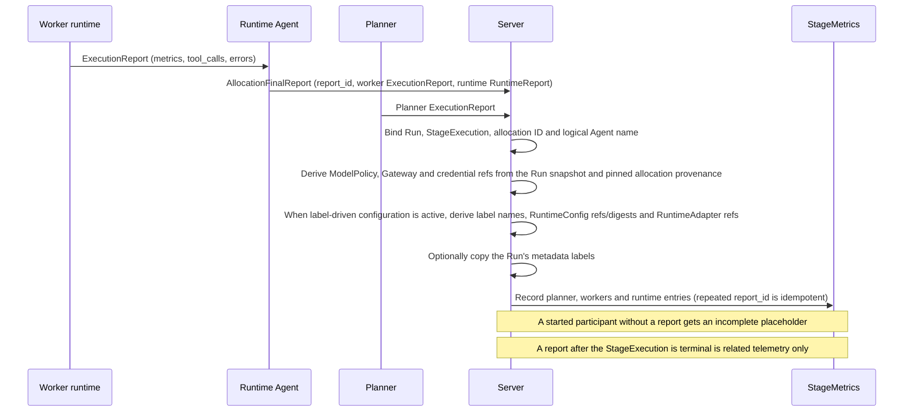
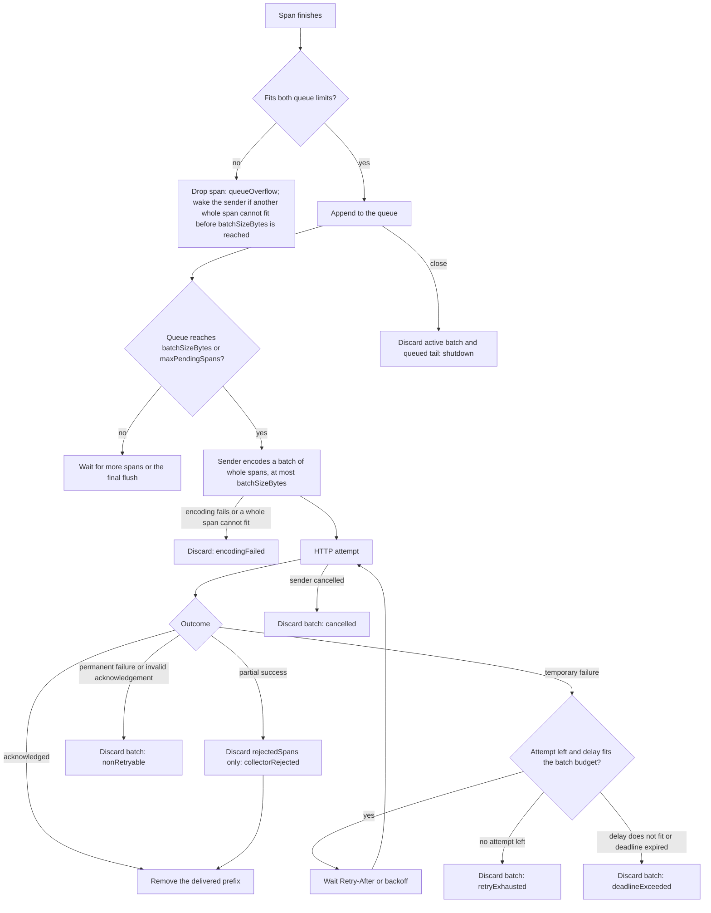
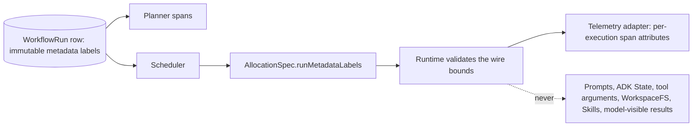

# Observability

Requirement prefix: `OBS` · [Specification index](../README.md)

## Purpose and scope

This document owns the observability rules that every domain relies on:

- request correlation through `X-Request-ID` and the content of server-side 5xx
  diagnostics;
- execution reports: the `ExecutionReport`, `RuntimeReport`,
  `AllocationFinalReport` and `StageMetrics` shapes, the trusted Server
  envelope, usage attribution, the meaning and capture rules of reports,
  redaction of tool arguments and errors with the shared secret-substitution
  policy, report bounds and the retention of durable telemetry;
- external trace export through `otlp-http@1`: span and attribute content,
  content capture and sensitive-output tools, the Worker exporter's queue,
  batching, retry, acknowledgement and flush behaviour, its dropped-span
  counters, and Planner telemetry built in the Server;
- propagation of WorkflowRun metadata labels into telemetry.

It leaves to other documents:

- StageMetrics as a StageExecution field, separate from the stored terminal
  facts: [Scheduler](../execution/scheduler.md)
  ([SCH-R51](../execution/scheduler.md));
- metadata labels themselves, their bounds, the UI treatment of label values
  and the public `AttemptDiagnostics` projection of report errors in Run status:
  [Runs](../execution/runs.md) ([RUN-R77](../execution/runs.md),
  [RUN-R91](../execution/runs.md), [RUN-R92](../execution/runs.md));
- selection of the telemetry adapter (`worker.telemetry`, `planner.telemetry`),
  the export settings with their defaults and allowed values, credential
  records and label-resolution provenance:
  [Runtime configuration](../configuration/runtime-config.md)
  ([RCF-R97](../configuration/runtime-config.md),
  [RCF-R98](../configuration/runtime-config.md),
  [RCF-R99](../configuration/runtime-config.md));
- the Worker instrumentation plugin, its reducers and the summarizer aggregate:
  [Worker](../execution/worker.md) ([WRK-R80](../execution/worker.md),
  [WRK-R155](../execution/worker.md));
- the content of durable Planner facts: [Planners](../execution/planners.md);
- closing and releasing allocation adapters on the Runtime side:
  [Runtime Agent](../execution/runtime-agent.md)
  ([RTA-R58](../execution/runtime-agent.md));
- what the metrics of each toolset may contain: the documents listed under
  [Telemetry rules owned by other documents](#telemetry-rules-owned-by-other-documents);
- performance collection, the optional `RuntimeReport.resources` extension,
  Server and database performance history with its startup switch, HTTP
  listener metrics and profiling: [Operations](../operations/operations.md)
  ([OPS-R69](../operations/operations.md),
  [OPS-R70](../operations/operations.md),
  [OPS-R99](../operations/operations.md),
  [OPS-R100](../operations/operations.md));
- trust boundaries and the handling of RuntimeSettings secrets:
  [Security](security.md);
- the REST error envelope: [Public API](../api/public-api.md).

## Concepts

Terms are collected in the [glossary](../glossary.md); this document owns the
following ones.

- **Request ID.** The bounded `X-Request-ID` value that correlates one HTTP
  request across hops and diagnostics.
- **Execution report.** The framework-neutral `ExecutionReport` that a Planner
  or an in-process Worker runtime produces: aggregate metrics, tool-call records
  and errors.
- **Runtime report.** The `RuntimeReport` of allocation lifecycle facts that the
  Runtime Agent around a Worker observes, including Runtime adapter metrics.
- **Final allocation report.** The `AllocationFinalReport` that carries one
  allocation's Worker execution report and Runtime report.
- **Participant.** The Planner or one logical Worker of a StageExecution; each
  participant reports separately.
- **Trusted Server envelope.** The identities, attribution and correlation
  metadata that the Server binds to a report from its own records, never from
  the report payload.
- **Incomplete placeholder.** The report, with unknown fields, that Scheduler
  records for an expected participant that started but produced no report.
- **Related telemetry.** A report delivered after its StageExecution is
  terminal, retained without changing the frozen terminal facts.
- **Runtime adapter metrics.** Per-adapter counters in a Runtime report, keyed
  by the exact RuntimeAdapter ref.
- **Content capture.** The opt-in `captureContent=true` mode in which prompts,
  responses and tool arguments and results are exported to the telemetry sink.
- **Trusted sink.** A telemetry backend that content capture trusts with
  unredacted content.
- **Sensitive-output tool.** A tool that declares `contractor_sensitive_output`
  because its results carry command output, captured HTTP traffic or HTTP
  session material.
- **Metadata-only instrumentation.** Instrumentation that exports no content,
  whatever the content-capture setting.
- **Local discard.** A span that the Worker exporter itself drops, counted in
  `droppedSpans`.
- **PlannerTelemetryAdapter registry.** The Server-owned, versioned registry of
  the telemetry adapters a Planner may use.
- **Closed instrumentation vocabulary.** The fixed set of Planner span kinds and
  metadata attributes; content never enters it.

## Model

### Report shapes

A Planner and the in-process Worker runtime produce the same
`ExecutionReport`. The Runtime Agent that surrounds a Worker produces a
separate `RuntimeReport`. One `AllocationFinalReport` carries a Worker's
execution report and its Runtime report, and the StageExecution's
`StageMetrics` holds the Planner report, one execution report per logical
Worker and one Runtime report per logical Worker.

```python
class ExecutionError(BaseModel):
    code: str
    message: str
    retryable: bool | None = None


class ToolMetrics(BaseModel):
    calls: int | None = None
    succeeded: int | None = None
    failed: int | None = None


class WorkerBudgetMetrics(BaseModel):
    max_model_calls: int
    max_tool_calls: int | None = None
    max_total_tokens: int
    observed_model_calls: int
    observed_tool_calls: int
    observed_total_tokens: int
    token_usage_unavailable: int
    exhausted: Literal["model_calls", "tool_calls", "total_tokens"] | None = None


class ExecutionMetrics(BaseModel):
    duration_ms: int | None = None
    model_calls: int | None = None
    input_tokens: int | None = None
    output_tokens: int | None = None
    total_tokens: int | None = None
    tools: dict[str, ToolMetrics] = Field(default_factory=dict)
    worker_budget: WorkerBudgetMetrics | None = None


class ToolCallRecord(BaseModel):
    call_id: str
    tool: str
    arguments: dict[str, Any] | None = None
    arguments_truncated: bool = False
    outcome: Literal["succeeded", "failed"]
    duration_ms: int | None = None
    result_size_bytes: int | None = None
    error: ExecutionError | None = None


class ExecutionReport(BaseModel):
    report_id: str
    complete: bool
    metrics: ExecutionMetrics
    tool_calls: list[ToolCallRecord] = Field(default_factory=list)
    errors: list[ExecutionError] = Field(default_factory=list)
    truncated: bool = False


class RuntimeAdapterMetrics(BaseModel):
    operations: int
    failed_operations: int
    flush_attempted: bool | None = None
    flush_succeeded: bool | None = None
    last_error_code: str | None = None


class RuntimeReport(BaseModel):
    complete: bool
    duration_ms: int | None = None
    stop_reason: str | None = None
    adapters: dict[str, RuntimeAdapterMetrics] = Field(default_factory=dict)


class AllocationFinalReport(BaseModel):
    report_id: str
    allocation_id: AllocationID
    started_at: datetime
    finished_at: datetime
    worker: ExecutionReport
    runtime: RuntimeReport


class StageMetrics(BaseModel):
    planner: ExecutionReport | None = None
    workers: dict[AgentName, ExecutionReport] = Field(default_factory=dict)
    runtime: dict[AgentName, RuntimeReport] = Field(default_factory=dict)
```

`ExecutionMetrics` also carries the optional summarizer aggregate specified in
[WRK-R155](../execution/worker.md). The Worker Runtime report of an
`otlp-http@1` adapter adds the optional `droppedSpans` counters
(OBS-R81).

### Report flow

The trusted Server envelope, not the reporting participant, supplies every
identity and attribution field.



### Worker trace export

An allocation-scoped Worker `otlp-http@1` exporter queues finished spans and
sends them in bounded batches through one asynchronous sender. Every local
discard is counted under one `droppedSpans` reason.



### Metadata labels in telemetry



## Requirements

### Request correlation

**OBS-R1.** Every public and private HTTP response carries one bounded
`X-Request-ID` (LIM-OBS-1).

**OBS-R2.** Public ingress always generates its own request ID.

**OBS-R3.** Private Control Plane, lifecycle, Artifact and A2A hops
propagate one syntactically valid incoming value and replace a missing,
duplicated or malformed value.

**OBS-R4.** The Server's private Control Plane and Artifact APIs
propagate an incoming value only from a peer that presented a verified Runtime
Agent certificate. A request that fails mTLS gets a generated value, so an
unauthenticated caller cannot choose its logged ID.

**OBS-R5.** REST error objects repeat the request ID as `requestId`
([Public API](../api/public-api.md)). A2A keeps its protocol error envelope and
carries correlation in the HTTP header.

### Server-side diagnostics

**OBS-R6.** Server-side 5xx diagnostics record the request ID, boundary,
method, status and safe error type. They do not record raw URL paths, request
bodies, artifact bytes, provider exception messages, RuntimeSettings or tokens.

Rationale: an operator gets a stable lookup key without a user-controlled path
or a nested tool argument becoming a logging channel.

### Execution reports and the trusted envelope

**OBS-R7.** The Planner and the in-process Worker runtime use the same
framework-neutral report shape, `ExecutionReport`. Allocation lifecycle facts
observed by the surrounding Runtime Agent remain a separate `RuntimeReport`,
because their source and completeness differ.

**OBS-R8.** The trusted Server envelope binds each report to the
Run, the StageExecution, the globally unique allocation ID and the logical Agent
name. A Worker-supplied payload cannot select or override those identities.

**OBS-R9.** `report_id` makes repeated delivery of a report
idempotent (FAIL-OBS-1).

**OBS-R10.** The envelope derives ModelPolicy attribution from the
Run's immutable ResolvedExecutionConfig. The Planner's LLMGatewayConfig and
LLMCredential refs also come from that Run snapshot.

**OBS-R11.** For a logical Worker, the final LLMGatewayConfig
and LLMCredential refs come from the Server-pinned allocation configuration
provenance, because the default, Run and Agent infrastructure layers may
override the Workflow route
([Runtime configuration](../configuration/runtime-config.md)).

**OBS-R12.** None of the ModelPolicy, LLMGatewayConfig or
LLMCredential refs is accepted from a Runtime report. They let Operations
aggregate calls and tokens by policy, route and credential without persisting
or exposing the secret value.

**OBS-R13.** When label-driven infrastructure configuration is
active, the envelope also derives the sorted Run and Agent label names, the
exact RuntimeConfig refs and digests and the RuntimeAdapter refs from
Server-owned resolution provenance. Runtime reports cannot claim or replace
them. Endpoint credentials and resolved secret-bearing RuntimeSettings remain
absent. The pinning and merge contract is owned by
[Runtime configuration](../configuration/runtime-config.md).

**OBS-R14.** The envelope may additionally copy the WorkflowRun's
immutable metadata labels ([Runs](../execution/runs.md)) as trusted correlation
metadata. These labels describe the Run, are not accepted from Runtime reports
and are not metric dimensions (OBS-R108).

### Usage attribution

**OBS-R15.** Attribution records the ModelPolicy, LLMGatewayConfig and
credential refs together with the WorkflowRun, the StageExecution and the
Planner or Worker role.

**OBS-R16.** Provider-reported tokens and calls are operational
measurements, not billing-grade proof.

**OBS-R17.** Gateway-reported spend and rate state may be displayed as
operational information, but a Gateway quota rejection follows the ordinary
bounded LLM error path (FAIL-OBS-2).

**OBS-R18.** ModelPolicy call and token ceilings remain
independently enforced, because they bound one Planner or Worker execution
rather than account consumption.

### Report content

**OBS-R19.** `complete` describes report completeness, not
execution success.

**OBS-R20.** A known zero is `0`; an unobserved or unsupported value is
`null` or absent.

**OBS-R21.** `metrics` contains only aggregate values. Tool
arguments and errors are diagnostic records, not counters.

**OBS-R22.** `worker_budget` is present for an ADK Worker invocation.
It records the exact configured ceilings, the operations actually started, the
sum of available provider token usage, the count of responses without usage and
at most one exhausted dimension (LIM-OBS-2). `max_tool_calls` is absent only
for a compatible tool-free policy. `worker_budget` contains no prompt, response
or tool payload.

**OBS-R23.** Every started tool call is recorded exactly once (FAIL-OBS-3).

**OBS-R24.** A tool call cancelled while it runs, including an Agent
Skill or `audit-results@2` call and a call still pending when the Worker closes,
fails with the retryable `tool_call_cancelled` unless its toolset records a
domain error (FAIL-OBS-3).

**OBS-R25.** Full tool results are not retained by default. Durable or
large results belong in the ArtifactStore
([Artifact store](../artifacts/artifact-store.md)); metrics may retain their
size and outcome without their body (LIFE-OBS-1).

**OBS-R26.** External observability exporters are optional
adapters over Contractor-owned reports; no LangChain- or Langfuse-style service
is required.

### Redaction of tool arguments and errors

**OBS-R27.** Tool arguments are recursively redacted before they leave
the Worker and again at the Server persistence boundary. They are bounded
(LIM-OBS-6) and carry an explicit truncation marker.

**OBS-R28.** MemoryTools applies a stricter projection: note
content, description and tags are always dropped rather than merely truncated.
Only the operation, the logical Worker (`worker_name`) when applicable, the note
name, byte sizes, outcome and duration may remain. The memory-specific
diagnostic and content contracts are in [Memory](../tools/memory.md).

**OBS-R29.** Agent Skill tools apply a similar stricter projection:
only the validated logical skill name, the bounded normalized reference or asset
path, outcome, duration, result size and stable error code may remain.
Instructions, resource and package bytes, extracted paths and generated context
are always dropped ([SKL-R114](../tools/skills.md)).

**OBS-R30.** RuntimeSettings tokens and other known deployment
secrets are always removed, even when a tool argument or error accidentally
contains them.

**OBS-R31.** One secret-matching policy applies to metrics, allocation
checks and Worker results: a secret of at least 16 UTF-8 bytes (LIM-OBS-3)
matches wherever it occurs, while a shorter one, such as a proxy username or a
short header value, matches only a complete string, so it never garbles
ordinary text. In metrics a match is replaced by `[REDACTED]`. How a Worker
result that contains a secret is handled is specified in the Worker document
([WRK-R60](../execution/worker.md), [WRK-R61](../execution/worker.md)). How an
allocation check applies it is specified in the Control Plane document
([CTL-R110](../execution/control-plane.md)).

**OBS-R32.** Tool names and error codes are Runtime vocabulary
and are never redacted. An error code that is not an identifier, or that
contains a long secret, is recorded as `tool_call_failed` (FAIL-OBS-3).

### Runtime adapter metrics

**OBS-R33.** Runtime adapter metrics are keyed by the exact
RuntimeAdapter ref selected by trusted Server provenance.

**OBS-R34.** Adapter counters are non-negative and saturating.
`flush_*` fields are absent for an adapter without a flush operation.

**OBS-R35.** Adapter error codes are a bounded allowlist and
never contain an endpoint, provider body or exception message.

**OBS-R36.** The Server accepts adapter metrics only for refs present
in the pinned allocation provenance. Unknown keys and malformed counters are
discarded as incomplete telemetry with a bounded safe diagnostic; they cannot
relabel attribution or block semantic terminalization and allocation release
(FAIL-OBS-1).

### Report collection

**OBS-R37.** For every expected participant that started but produced
no report, Scheduler records an incomplete placeholder with unknown fields.
Absence from a `StageMetrics` map means the participant was not started or was
not applicable (FAIL-OBS-1).

**OBS-R38.** Report collection is best-effort and cannot raise into the
Planner or change a semantically valid StageResult or a durable
StageTermination (FAIL-OBS-1).

**OBS-R39.** A report delivered after the StageExecution is terminal
may be retained as related telemetry but never mutates the frozen StageResult or
StageTermination (FAIL-OBS-1).

### Report bounds and retention

**OBS-R40.** The bounded report policy is fixed: at most 1,000
tool-call records (LIM-OBS-4) and 100 errors (LIM-OBS-5) per participant, at
most 4,096 UTF-8/JSON bytes per argument summary or error message (LIM-OBS-6)
and at most 1 MiB per final allocation report (LIM-OBS-7). The report shape
does not depend on these values, so they can become deployment policy without
a change to the shape.

**OBS-R41.** Overflow removes the oldest detail, preserves aggregate
counters and sets `truncated`.

**OBS-R42.** JSON sizes count compact UTF-8 bytes without HTML
escaping; U+2028 and U+2029 count as three-byte UTF-8 characters. Error-message
sizes count UTF-8 text bytes, independently of their JSON escaping. These rules
apply both to final reports and live Worker State, including per-tool errors.
The shared `execution-error-cases.json` fixture pins both diagnostic bounds.

**OBS-R43.** Durable telemetry expires after 30 days (LIM-OBS-8). Cleanup
is batch-bounded and may delete only telemetry that belongs to a terminal
StageExecution (LIFE-OBS-2).

**OBS-R44.** Each telemetry table has a bounded deletion budget.
Full batches are drained with a short pause before the next retention interval,
so a metrics backlog cannot starve reports.

### Trace export with `otlp-http@1`

The `otlp-http@1` adapter itself and its selection are specified in
[RCF-R98](../configuration/runtime-config.md).

**OBS-R45.** `otlp-http@1` exports OTLP/HTTP protobuf traces to the
configured complete traces endpoint. It does not export OpenTelemetry metrics or
logs and does not replace Contractor's durable `ExecutionReport`.

**OBS-R46.** Telemetry instrumentation emits bounded
framework-neutral spans and events for model calls, selected tool calls, the A2A
task lifecycle and Worker errors.

**OBS-R47.** Bounded resource attributes contain the Contractor
service and version, the Run, StageExecution and allocation or Planner session
correlation IDs, the logical Worker name, the exact adapter and configuration
refs and safe label names.

**OBS-R48.** Span attributes may contain the operation kind, model alias,
tool name, outcome, duration and token and count aggregates.

**OBS-R49.** One span has at most 64 attributes (LIM-OBS-9). Metadata
strings are at most 256 UTF-8 bytes (LIM-OBS-10).

**OBS-R50.** Transport credentials and provider error bodies are
never added automatically.

**OBS-R51.** Export uses a bounded queue. Each Planner and Worker exporter
queue holds at most 2,048 span records (LIM-OBS-11) and 64 MiB of encoded
pending data (LIM-OBS-12).

**OBS-R109.** A record that would exceed either bound is dropped and counted;
overflow increments adapter failures without blocking model or tool execution
(FAIL-OBS-4).

The Worker's queue limits are configured within these bounds in
`worker.telemetry.export` ([RCF-R99](../configuration/runtime-config.md)).

**OBS-R52.** There is no durable exporter spool and no infinite retry. A
process crash may lose unflushed external telemetry, while Contractor's own
durable lifecycle remains authoritative (LIFE-OBS-3).

### Content capture

**OBS-R53.** Content capture is off by default
(`captureContent=false`): prompts, model responses, artifact bytes and content,
tool arguments and results and RuntimeSettings secrets are absent from exported
telemetry.

**OBS-R54.** Setting `captureContent=true`, independently on Worker
telemetry, Planner telemetry or both, explicitly trusts the configured sink with
unredacted content. No secret-content filter is applied to captured content.
With capture enabled, content may itself contain secrets and
is not filtered, so secrets included in messages or tool results can be
exported.

**OBS-R55.** Content capture does not include automatic export of
client configuration or authentication headers.

**OBS-R56.** Tools whose results carry command output, captured
HTTP traffic or HTTP session material declare sensitive output
(`contractor_sensitive_output`). A Worker that selects any such tool uses
metadata-only instrumentation for the whole allocation, even when
`captureContent=true`.

Rationale: later model requests, result finalizers and summaries can repeat the
earlier output.

**OBS-R57.** `exec_command` declares sensitive output on the tool. The
`http-tools@1` and `caido@1` toolset factories declare it for every tool they
export (`sensitive_output_tools`); the Runtime derives the set from the
registered toolsets and passes it to the Worker.

**OBS-R58.** Captured model input includes conversation messages,
system instructions and tool declarations; captured output includes the model
response. Worker tool spans include arguments and results. Planner invocation
and passthrough dispatch spans include their semantic input and output. Worker
result-finalizer and terminal-summarizer model calls also capture input and
output.

**OBS-R59.** Model spans use OpenTelemetry GenAI semantic conventions
v1.41.1: `gen_ai.operation.name=chat`, `gen_ai.provider.name=contractor.gateway`
(the client-visible proxy, without guessing the upstream provider), and
`gen_ai.request.model` containing the requested model alias. Captured content
uses JSON-serialized `gen_ai.input.messages`, `gen_ai.output.messages`,
`gen_ai.system_instructions` and `gen_ai.tool.definitions`, preserving roles,
text, reasoning and function calls/results. A missing output finish reason is
explicitly `unknown`. Per-call reported counts use integer
`gen_ai.usage.input_tokens`, `gen_ai.usage.output_tokens` and
`gen_ai.usage.cache_read.input_tokens`; unavailable counts are absent and no
duplicate total attribute is emitted. Non-model content uses
`contractor.input` and `contractor.output`. Neither exporter emits collector
vendor attributes or requires a collector SDK. Go and Python validate
[`telemetry-genai-cases.json`](../../../api/testdata/telemetry-genai-cases.json).

The content shapes and their JSON-string encoding follow the
[pinned GenAI conventions](https://github.com/open-telemetry/semantic-conventions/blob/v1.41.1/docs/gen-ai/gen-ai-spans.md).

**OBS-R60.** Each captured content field is bounded to 256 KiB of
UTF-8 (LIM-OBS-13), separately from the metadata-string bound. Oversized content
uses a valid schema-shaped array with a bounded text preview marked
`truncated: true` for GenAI fields; generic Contractor content uses a valid
JSON object with `truncated: true` and a preview.

**OBS-R61.** The 64 MiB pending-queue bound (LIM-OBS-12) still applies
to captured content, so content-heavy spans may be dropped. The bound is per
exporter, not a process-wide memory limit: simultaneous allocations multiply the
retained capacity, and serialization and transport may need additional memory.

**OBS-R62.** Content capture does not change durable reports,
ordinary logs or metrics.

**OBS-R63.** Existing Runs keep their pinned configuration; enabling
capture affects only new Runs resolved against the new RuntimeConfig version.

### Worker export scheduling

**OBS-R64.** A Worker exporter starts one asynchronous sender when the
queue reaches `batchSizeBytes` of encoded pending data or `maxPendingSpans`.

**OBS-R65.** Requests contain whole spans and are bounded to
`batchSizeBytes`, including the protobuf envelope.

**OBS-R66.** An overflow also wakes the sender to drain accepted spans
when another whole span cannot fit before the byte threshold is reached
(FAIL-OBS-4).

**OBS-R67.** The sender transmits ready batches sequentially while Worker
callbacks continue appending. The in-flight batch remains charged to both queue
limits. Only its prefix is removed after delivery, which preserves spans added
during the request.

**OBS-R68.** Each batch gets at most `maxAttempts` HTTP attempts; retries
preserve the payload and the span IDs.

**OBS-R69.** One absolute `flushTimeoutSeconds` budget covers a batch's
encoding, HTTP attempts and waits. Each HTTP attempt is also bounded by
`min(requestTimeoutSeconds, flushTimeoutSeconds)`.

**OBS-R70.** Final draining has its own `flushTimeoutSeconds` cap,
shortened by the enclosing allocation deadline. None of these deadlines is
extended for retries.

**OBS-R71.** Adapter operation and error counters account for each
HTTP attempt.

**OBS-R72.** Subsequent batches can proceed after a failed batch is
discarded. Cancellation is not retried (FAIL-OBS-5).

**OBS-R73.** There is no periodic timer: a sub-threshold tail waits for
more spans or the final flush.

### Worker delivery and acknowledgements

**OBS-R74.** Worker delivery retries temporary transport failures
and HTTP 429, 502, 503 and 504. Other HTTP errors, including 500, are terminal
(FAIL-OBS-5).

**OBS-R75.** A valid `Retry-After` header is honoured as seconds or as an
HTTP date. Without it, exponential backoff starts at
`initialBackoffMilliseconds` and doubles up to `maxBackoffMilliseconds`; equal
jitter selects a delay between half that ceiling and the ceiling.

**OBS-R76.** If the delay cannot fit the remaining batch budget, the
batch expires without another attempt (FAIL-OBS-5).

**OBS-R77.** Exporters accept bounded standard OTLP protobuf or JSON
acknowledgements. JSON decoding ignores unknown message fields, including
additional receipt metadata, as required by OTLP/JSON and consistent with binary
protobuf. Known fields such as `partialSuccess.rejectedSpans` retain their
validation; malformed and oversized acknowledgements are rejected. Worker
delivery treats them as terminal
(FAIL-OBS-5); Planner delivery reports its existing export failure.

**OBS-R78.** OTLP partial success is never retried: only the
`rejectedSpans` are discarded. A warning with zero rejected spans counts as
successful delivery (FAIL-OBS-5).

These rules follow the
[OTLP retry and partial-success rules](https://opentelemetry.io/docs/specs/otlp/).

**OBS-R79.** Provider error messages are not retained in
diagnostics.

**OBS-R80.** The Worker export scheduling, retry and
acknowledgement rules above do not change Planner export scheduling or
acknowledgement handling, which follow [Planner telemetry](#planner-telemetry).

### Dropped-span counters

**OBS-R81.** The Worker Runtime report adds optional
`adapters["otlp-http@1"].droppedSpans` counters, separate from HTTP operation
failures. They count spans, not requests or attempts, under these local discard
reasons:

| Counter | Local discard reason |
| --- | --- |
| `queueOverflow` | A new span cannot fit either queue limit. |
| `encodingFailed` | Encoding fails or a whole span cannot fit a bounded request. |
| `nonRetryable` | Permanent HTTP/transport failure or invalid acknowledgement. |
| `retryExhausted` | A temporary failure uses the last allowed attempt. |
| `collectorRejected` | The collector explicitly rejects this many spans. |
| `deadlineExceeded` | The batch deadline expires or cannot accommodate Retry-After/backoff. |
| `cancelled` | The sender is cancelled, including by an enclosing flush deadline. |
| `shutdown` | Close discards an active batch or queued tail, or a span finishes after close. |

**OBS-R82.** Each local discard is counted once, including during close;
successful retries add no discarded spans.

**OBS-R83.** The counters saturate at the uint64 maximum
(LIM-OBS-14) and remain in the final Runtime report after adapter cleanup
(LIFE-OBS-3).

**OBS-R84.** The counters record local discard decisions only. A lost
acknowledgement can make remote acceptance unknown, and retries can produce
duplicates; the counters do not measure confirmed collector loss or spans lost
in a process crash (FAIL-OBS-5).

**OBS-R85.** The counters include no endpoint, response body,
credential or captured content.

### Export failure, flush and teardown

**OBS-R86.** An OTLP exporter delivery error, timeout or unavailable
backend increments bounded adapter error metrics but does not change the
StageResult, the StageTermination or release eligibility (FAIL-OBS-6).

**OBS-R87.** Finalization and abort perform one best-effort flush,
bounded by both the configured timeout and the remaining finalization or abort
deadline (FAIL-OBS-6).

**OBS-R88.** For a Worker the flush joins the active sender and drains
the remaining spans in the same bounded batches; the deadline bounds the entire
drain, not each batch independently.

**OBS-R89.** Closing cancels and joins any sender before erasing its queue and
transport credentials (LIFE-OBS-3).

**OBS-R90.** The Runtime then returns the Contractor
`ExecutionReport` regardless of export success.

**OBS-R91.** Release erases all credential values, closes clients and
removes temporary proxy trust material before the slot can become idle
(LIFE-OBS-3).

### Planner telemetry

**OBS-R92.** Planner telemetry uses the same pinned Run
configuration as Worker telemetry but is constructed in the Server, not in a
Runtime Agent. Its exporter follows the same no-content default, bounded flush
and best-effort delivery rules.

**OBS-R93.** Planner telemetry never receives Agent labels or Worker
proxy settings.

**OBS-R94.** The Server owns a versioned PlannerTelemetryAdapter
registry, and publication rejects a `planner.telemetry.adapter` unknown to that
registry. This Server capability is deployment code, not a Runtime Agent
placement fact.

**OBS-R95.** One selected Planner `otlp-http@1` adapter is
invocation-local. It does not install a global OpenTelemetry provider, read
ambient proxy variables, follow redirects or retry.

**OBS-R96.** The Passthrough, Streamline and Router Planners use
a closed instrumentation vocabulary for invocation or session, model, Worker
dispatch, subtask transition and finish spans. Content never enters the closed
metadata vocabulary; explicit capture uses the separate bounded input and output
fields of OBS-R59 and OBS-R60.

**OBS-R97.** Planner session IDs are attached only after durable
session creation.

**OBS-R98.** Every span of one invocation shares safe Run,
Stage and Planner correlation and the exact pinned RuntimeConfig resource
correlation; Agent-label provenance is absent.

**OBS-R99.** After the Planner returns, the Server makes at most
one OTLP request (LIM-OBS-15). Its deadline is the minimum of the configured
flush timeout, the remaining Stage deadline and the finalization bound
(FAIL-OBS-7).

**OBS-R100.** Adapter creation, credential decryption, encoding,
delivery, queue overflow and flush failures are supplementary. They are logged
with a closed safe code and, when a Planner report identity exists, recorded as
the `telemetry.export` tool outcome in the durable `ExecutionReport`. They never
change the candidate, the retry or escalation decision, the StageTermination or
allocation release (FAIL-OBS-7).

**OBS-R101.** When no Planner telemetry is selected, no exporter, client
or request is created.

### Metadata labels

**OBS-R102.** The Server makes the immutable metadata-label map of a
WorkflowRun ([Runs](../execution/runs.md)) available to Planner and Worker
telemetry, so that an operator can correlate model traces with an eval
invocation and leg. Planner and Worker trace exporters may attach the bounded
map without exposing it to either model.

**OBS-R103.** Planner spans obtain the labels from the authoritative
WorkflowRun row.

**OBS-R104.** Scheduler copies the same bounded map into each
`AllocationSpec` as `runMetadataLabels`.

**OBS-R105.** The Runtime validates the wire bounds and exposes labels
only to its telemetry adapter, as per-execution span attributes. They are not
process-wide resource attributes, because one Runtime process serves different
Runs over time.

**OBS-R106.** The Runtime never injects metadata labels into
prompts, ADK State, tool arguments, WorkspaceFS, Skills or model-visible
results.

**OBS-R107.** Telemetry uses a namespaced attribute projection such
as `contractor.run.label.eval.id`. An exporter-specific adapter may additionally
map the conventional eval labels to native trace tags when that mapping loses no
values. The exact original map remains authoritative in the Server.

**OBS-R108.** Metadata labels are not metric dimensions.

Rationale: keys such as `eval.id`, `eval.case` and `run_id` are high-cardinality
and would create unsafe time-series growth. The existing Run and Stage
correlation IDs and trace attributes are sufficient for detailed drill-down.

## Interfaces

- `X-Request-ID` on every public and private HTTP response (OBS-R1), and
  `requestId` in REST error objects of
  [`contractor-public-v1.yaml`](../../../api/openapi/contractor-public-v1.yaml)
  (OBS-R5); the error envelope itself is specified in
  [Public API](../api/public-api.md).
- Execution report shapes: [Report shapes](#report-shapes).
- OTLP/HTTP protobuf trace export to the configured complete traces endpoint
  (OBS-R45); accepted acknowledgements (OBS-R77); the content attributes
  `gen_ai.*`, `contractor.input` and `contractor.output` (OBS-R59); the label attribute
  namespace `contractor.run.label.*` (OBS-R107).
- Configuration consumed here and specified in
  [Runtime configuration](../configuration/runtime-config.md):
  `worker.telemetry` and `planner.telemetry` with `captureContent` and
  `flushTimeoutSeconds`; `worker.telemetry.export` (`batchSizeBytes`,
  `maxAttempts`, `maxPendingSpans`, `maxPendingBytes`;
  [RCF-R99](../configuration/runtime-config.md)) and its `retry` object
  (`initialBackoffMilliseconds`, `maxBackoffMilliseconds`;
  [RCF-R103](../configuration/runtime-config.md));
  `requestTimeoutSeconds`.

## Limits, failures and errors

Limits ([registry](limits.md)):

- LIM-OBS-1 — one `X-Request-ID` per HTTP response (OBS-R1).
- LIM-OBS-2 — at most one exhausted dimension in `worker_budget`
  (OBS-R22).
- LIM-OBS-3 — 16 UTF-8 bytes, the secret length from which a secret matches
  anywhere in the text (OBS-R31).
- LIM-OBS-4 — at most 1,000 tool-call records per participant
  (OBS-R40).
- LIM-OBS-5 — at most 100 errors per participant (OBS-R40).
- LIM-OBS-6 — at most 4,096 UTF-8/JSON bytes per argument summary or error
  message (OBS-R40, OBS-R27).
- LIM-OBS-7 — at most 1 MiB per final allocation report (OBS-R40).
- LIM-OBS-8 — durable telemetry retention of 30 days (OBS-R43).
- LIM-OBS-9 — at most 64 attributes per span (OBS-R49).
- LIM-OBS-10 — metadata strings of at most 256 UTF-8 bytes (OBS-R49).
- LIM-OBS-11 — at most 2,048 span records per exporter queue (OBS-R51).
- LIM-OBS-12 — at most 64 MiB of encoded pending data per exporter queue
  (OBS-R51, OBS-R61).
- LIM-OBS-13 — at most 256 KiB of UTF-8 per captured content field
  (OBS-R60).
- LIM-OBS-14 — dropped-span counters saturate at the uint64 maximum
  (OBS-R83).
- LIM-OBS-15 — at most one OTLP request after a Planner returns
  (OBS-R99).
- The Worker export settings and their ranges belong to
  [Runtime configuration](../configuration/runtime-config.md); the
  `AttemptDiagnostics` bounds to [Runs](../execution/runs.md)
  ([LIM-RUN-8](limits.md), [LIM-RUN-9](limits.md)).

Failure outcomes ([failure model](failure-model.md)):

- FAIL-OBS-1 — delivery and collection of execution reports
  (OBS-R9, OBS-R36, OBS-R37,
  OBS-R38, OBS-R39).
- FAIL-OBS-2 — an LLM call rejected by a Gateway quota (OBS-R17).
- FAIL-OBS-3 — a started tool call that is cancelled or fails (OBS-R23,
  OBS-R24, OBS-R32).
- FAIL-OBS-4 — appending a span to a full exporter queue (OBS-R109,
  OBS-R66).
- FAIL-OBS-5 — Worker OTLP batch delivery (OBS-R72,
  OBS-R74, OBS-R76, OBS-R77, OBS-R78,
  OBS-R84).
- FAIL-OBS-6 — the final telemetry flush at finalization or abort
  (OBS-R86, OBS-R87).
- FAIL-OBS-7 — Planner telemetry export by the Server
  (OBS-R99, OBS-R100).

Entity lifecycle ([lifecycle](lifecycle.md)):

- LIFE-OBS-1 — full tool results in execution telemetry (OBS-R25).
- LIFE-OBS-2 — durable execution telemetry (OBS-R43).
- LIFE-OBS-3 — the Worker exporter's queue, sender and transport credentials
  (OBS-R52, OBS-R89, OBS-R91, OBS-R83).

Error codes ([registry](errors.md)): `tool_call_cancelled` (OBS-R24)
and `tool_call_failed` (OBS-R32).

## Security

- The Server's private Control Plane and Artifact APIs propagate an incoming
  request ID only from a peer with a verified Runtime Agent certificate
  (OBS-R4); server-side diagnostics exclude paths, bodies, provider messages
  and secrets (OBS-R6).
- Report identities and attribution come from the trusted Server envelope, never
  from a Runtime report (OBS-R8, OBS-R12,
  OBS-R13).
- Tool arguments are redacted before leaving the Worker and again at the
  Server persistence boundary, known secrets are removed from tool arguments
  and errors, and one secret-matching policy covers metrics, allocation checks
  and Worker results (OBS-R27 to OBS-R32).
- Exported telemetry is content-free unless content capture explicitly trusts
  the sink, and sensitive-output tools force metadata-only instrumentation
  (OBS-R53, OBS-R54, OBS-R56).
- Metadata labels never reach a model (OBS-R106).
- Trust boundaries, mTLS identity and the handling of RuntimeSettings secrets
  are in [Security](security.md).

## Observability

This whole document is the shared observability model.

### Telemetry rules owned by other documents

| Topic | Owner |
| --- | --- |
| StageMetrics is a separate StageExecution field populated while finalizing or aborting and never rewrites the StageResult or StageTermination | [SCH-R51](../execution/scheduler.md) |
| `AttemptDiagnostics` in owner Run status: content, ordering and bounds | [RUN-R91](../execution/runs.md), [RUN-R92](../execution/runs.md) |
| Metadata labels as telemetry-visible safe metadata, the UI warning against secrets, and labels never used as authorization, scheduling or Run success signals | [RUN-R77](../execution/runs.md) |
| `otlp-http@1` as the initial backend-neutral telemetry adapter | [RCF-R98](../configuration/runtime-config.md) |
| `WorkerInstrumentationPlugin` and its reducers | [WRK-R80](../execution/worker.md) |
| The `ExecutionMetrics` summarizer aggregate | [WRK-R155](../execution/worker.md) |
| Durable Planner facts from projection tools | [Planners](../execution/planners.md) |
| Memory adapter diagnostics and memory content under content capture | [Memory](../tools/memory.md) |
| The retained Skill projection and disclosed skill text under content capture | [SKL-R113](../tools/skills.md) to [SKL-R115](../tools/skills.md) |
| Workspace metric content | [WSP-R176](../tools/workspace.md), [WSP-R177](../tools/workspace.md) |
| HTTP and Caido metric content and the durable metrics planes | [HTTP and Caido tools](../tools/http-caido.md) |
| Code-analysis and taint-annotation metric content | [CAN-R141](../tools/code-analysis.md) to [CAN-R145](../tools/code-analysis.md) |
| Podman sandbox metrics and metadata-only instrumentation of execution-enabled Workers | [Code execution](../tools/code-execution.md) |
| Performance collection, `RuntimeReport.resources`, Server and database performance history, HTTP listener dimensions; performance telemetry never affects placement, outcomes, leases, fencing or release | [OPS-R69](../operations/operations.md), [OPS-R70](../operations/operations.md), [OPS-R99](../operations/operations.md), [OPS-R100](../operations/operations.md) |
| Closing allocation adapters after the flush and keeping them closed at release | [RTA-R58](../execution/runtime-agent.md) |

## Invariants

These properties follow from the cited requirements, which are authoritative.

1. An unauthenticated caller cannot choose the request ID that the Server's
   private Control Plane or Artifact API logs (OBS-R4); test
   `TestPrivateArtifactTrustsIncomingRequestIDOnlyAfterMTLS` in
   [`internal/httpapi/privateartifacts/handler_test.go`](../../../internal/httpapi/privateartifacts/handler_test.go).
2. Telemetry never decides a semantic outcome: report collection, adapter
   metrics and trace export never change a valid StageResult, a durable
   StageTermination, a Planner candidate, a retry or escalation decision or
   allocation release (OBS-R36, OBS-R38, OBS-R39,
   OBS-R86, OBS-R100).
3. Every started tool call appears exactly once in its report, and a call
   pending when the Worker closes is recorded as `tool_call_cancelled`
   (OBS-R23, OBS-R24); test
   `test_plugin_close_records_pending_tool_calls_as_cancelled` in
   [`runtime/tests/test_instrumentation.py`](../../../runtime/tests/test_instrumentation.py).
4. Exported spans contain no prompts, responses, artifact content or tool
   arguments and results unless content capture is enabled for that telemetry
   and, for a Worker, the Worker selected no sensitive-output tool (OBS-R53,
   OBS-R54, OBS-R56); tests
   `test_otlp_protobuf_is_bounded_content_free_and_header_scoped` in
   [`runtime/tests/test_otlp_adapter.py`](../../../runtime/tests/test_otlp_adapter.py)
   and `test_adk_worker_suppresses_captured_content_for_sensitive_output_tools`
   in [`runtime/tests/test_adk_runtime.py`](../../../runtime/tests/test_adk_runtime.py).
5. A permanent export failure is never retried, and no retry extends a batch
   deadline (OBS-R74, OBS-R70, OBS-R76); tests
   `test_permanent_http_failures_never_retry` and
   `test_retry_after_cannot_extend_deadline` in
   [`runtime/tests/test_otlp_retries.py`](../../../runtime/tests/test_otlp_retries.py).
6. Each local span discard is counted once, and the counters saturate
   (OBS-R82, OBS-R83); tests
   `test_overflow_and_shutdown_are_counted_once` and
   `test_drop_counters_saturate_and_reports_are_detached` in
   [`runtime/tests/test_otlp_retries.py`](../../../runtime/tests/test_otlp_retries.py).
7. Repeated report delivery is idempotent, persisted reports are redacted and
   durable telemetry expires in bounded batches (OBS-R9,
   OBS-R27, OBS-R43, OBS-R44); tests
   `TestMetricsPostgresIdempotencyRedactionAggregationAndRetention` in
   [`internal/telemetry/postgres_integration_test.go`](../../../internal/telemetry/postgres_integration_test.go)
   and `TestRetentionDrainsFullBatchesBeforeLongWait` in
   [`internal/telemetry/retention_test.go`](../../../internal/telemetry/retention_test.go).
8. Metadata labels reach telemetry only as bounded attributes and never reach a
   model (OBS-R102, OBS-R106).

## Non-goals

- Incremental report delivery per A2A Task. It could reduce data loss from a
  hard Worker crash without changing the terminal report schema.
- Secret filtering of captured content and a separate retention policy for it;
  neither is a prerequisite for the trusted-sink mode (OBS-R54).
- Export of OpenTelemetry metrics or logs, a durable exporter spool and infinite
  retry (OBS-R45, OBS-R52).
- A required external observability service (OBS-R26).
- Metadata labels as metric dimensions (OBS-R108).
- Route-specific HTTP metric breakdowns, owned by
  [Operations](../operations/operations.md).
