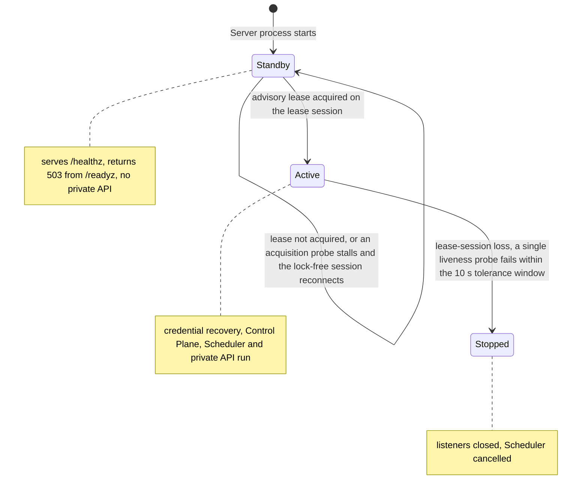
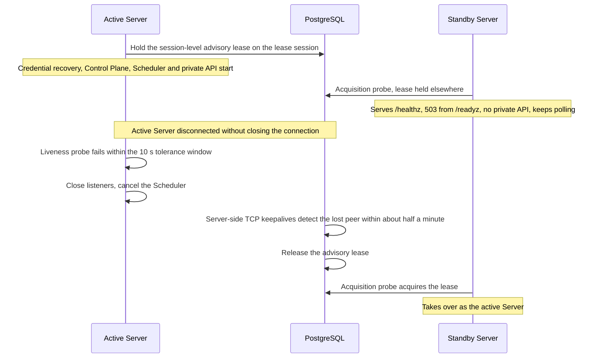
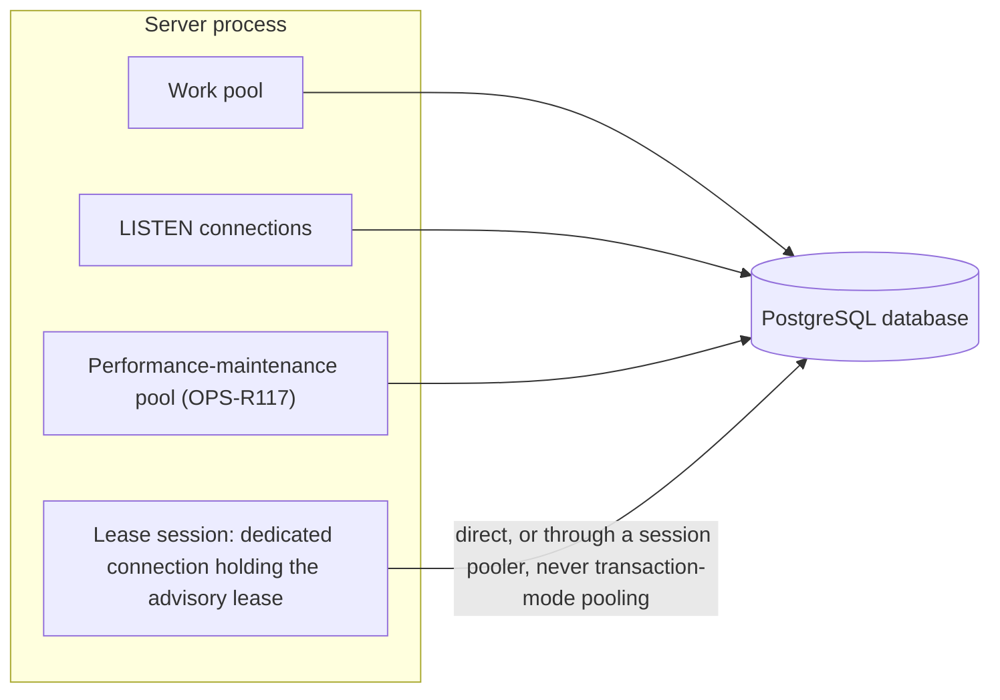

# Persistence

Requirement prefix: `PER` · [Specification index](../README.md)

## Purpose and scope

This document owns the persistence rules that belong to no single domain: one
active Server per PostgreSQL database, the session-level PostgreSQL advisory
lease that enforces it, the standby Server, detection of lease-session loss and
its time bounds, the connection pooling that the lease needs, and what must
not stand in for that lease: an unfenced shared `runtime_agents` table or a
durable Runtime Agent principal. It owns the one classification of a failed
PostgreSQL call into an outcome class, how SQL names the members of `jsonb`
documents the Server encodes from Go types, and the owner package of every
table and view, the only package whose SQL may write it. It owns the one flow
and the one receipt table of keyed mutations, how advisory lock keys are
built, and the shape and lease rule of controller claims. It also indexes the
PostgreSQL state and the transaction and serialization rules that domain
documents own, so each can be found from here while it is stated only in its
owner.

It leaves to other documents:

- the single-host deployment topology and its Runtime Agent processes:
  [Overview](../overview.md);
- the live Runtime Agent Registry, control leases, durable Runtime Agent
  principals, the binding-then-principal lock order and the in-memory Registry
  lock: [Control plane](../execution/control-plane.md);
- Stage admission and the owner queue pause: [Scheduler](../execution/scheduler.md);
- WorkflowRun metadata labels: [Runs](../execution/runs.md);
- Artifact scopes, CAS writes, output freezing and the StageResult acceptance
  transaction: [Artifact store](../artifacts/artifact-store.md);
- `workflow_run_events` and live event delivery:
  [Public API](../api/public-api.md);
- LLM credential records and their recovery journal:
  [Runtime config](../configuration/runtime-config.md);
- the `/healthz` and `/readyz` dependency checks, active-active Server
  replicas, the `scheduler_settings` singleton, the performance-maintenance
  connection pool and `performance_minutes`:
  [Operations](../operations/operations.md);
- shared registries: [limits](limits.md), [errors](errors.md),
  [failure model](failure-model.md) and [lifecycle](lifecycle.md).

## Concepts

Terms are defined once in the [glossary](../glossary.md); this document owns
the following ones.

| Term | Meaning here |
| --- | --- |
| Advisory lease | The session-level PostgreSQL advisory lease a Server holds on a dedicated connection to be the one active Server, and the one active Control Plane instance, for its database. It is not the Runtime Agent control lease of the [Control plane](../execution/control-plane.md). |
| Lease session | The dedicated PostgreSQL connection that holds the advisory lease. |
| Active Server | The Server process that holds the advisory lease of a database and therefore runs credential recovery, the process-local Control Plane, the Scheduler and the private API. |
| Standby Server | A Server process on the same database that does not hold the advisory lease. |
| Lease-session loss | A single liveness probe of the lease session that fails within the tolerance window. |
| Tolerance window | The bounded time a lease-session liveness probe may run. |

## Model

### Server roles

A Server process is a standby until it holds the advisory lease, and the active
Server stops when it detects lease-session loss:

### Takeover after the active Server is disconnected

### Server connections to PostgreSQL

The lease session is a dedicated connection. The Server's other PostgreSQL
pools, including the performance-maintenance pool, are specified in
[Operations](../operations/operations.md) (OPS-R117).

### Table owners

Every table and view has one owner package, the only package whose SQL may
write it ([PER-R23](#requirements)). The table ownership registry
[`internal/persistence/table_ownership.txt`](../../../internal/persistence/table_ownership.txt)
assigns the owners, grants the reads that other packages make and lists the
known foreign accesses; this index names the same owners. The documents that
own the rules of particular state are indexed in the next section.

| Owner package | Tables and views |
| --- | --- |
| `internal/agentprincipal` | `runtime_agent_principals` |
| `internal/artifacts` | `artifact_binding_revisions`, `artifact_bindings`, `artifact_blob_settings`, `artifact_blobs`, `artifact_lineage`, `artifact_scopes`, `artifact_versions` |
| `internal/auditstore/internal/pgstore` | `audit_artifact_links`, `audit_controller_claims`, `audit_events`, `audit_execution_items`, `audit_executions`, `audit_finding_assessments`, `audit_finding_contributions`, `audit_findings`, `audit_items`, `audit_live_item_reviews` (view), `audit_report_pages`, `audit_review_decisions`, `audit_review_requests`, `audit_rounds`, `audits` |
| `internal/credentials` | `credential_operations`, `git_ssh_keys`, `llm_credentials`, `runtime_credentials` |
| `internal/evalstore` | `eval_collections`, `eval_commands`, `eval_controller_claims`, `eval_dataset_revisions`, `eval_evidence_refs`, `eval_execution_tombstones`, `eval_experiments`, `eval_frozen_plans`, `eval_member_projections`, `eval_members`, `eval_plan_resources`, `eval_progress_observations`, `eval_projection_queue`, `eval_records`, `eval_selections`, `eval_submissions`, `eval_suboperations`, `eval_view_charts`, `eval_view_pairs` |
| `internal/findingintake` | `finding_proposal_audit_holds`, `finding_proposal_receipts` |
| `internal/gatewayrecovery` | `gateway_allocation_routes`, `gateway_recovery_failures`, `gateway_recovery_routes`, `gateway_recovery_waits`, `gateway_run_routes` |
| `internal/performance` | `performance_minutes` |
| `internal/persistence/postgres` | `contractor_schema_migrations` (the migration ledger), `mutation_receipts` |
| `internal/projectstore` | `projects` |
| `internal/runstore` | `owner_queue_controls`, `planner_sessions`, `run_stage_resumptions`, `stage_allocations`, `stage_executions`, `stage_transition_decisions`, `workflow_run_events`, `workflow_run_output_publications`, `workflow_runs` |
| `internal/runtimeconfig` | `runtime_config_versions`, `runtime_label_bindings` |
| `internal/settingsstore` | `scheduler_settings` |
| `internal/telemetry` | `allocation_execution_reports`, `planner_execution_reports`, `stage_metrics` |

### PostgreSQL state and its owners

| State | Owner |
| --- | --- |
| The advisory lease | This document ([PER-R2](#requirements)) |
| `workflow_run_events`, the Run replay authority, and its insert-trigger notification | [Public API](../api/public-api.md) (API-R54, API-R55) |
| `llm_credentials` and the `credential_operations` internal recovery journal | [Runtime config, LLM credential record](../configuration/runtime-config.md#llm-credential-record) (RCF-R33, RCF-R71) |
| WorkflowRun metadata labels | [Runs](../execution/runs.md) (RUN-R72, RUN-R73) |
| The `scheduler_settings` singleton and its seed row | [Operations](../operations/operations.md) (OPS-R48, OPS-R49, OPS-R50) |
| `mutation_receipts`, the receipt of every keyed mutation, and the advisory lock keys | This document ([PER-R24](#keyed-mutations-and-controller-claims)) |
| The shape and lease rule of `audit_controller_claims` and `eval_controller_claims` | This document ([PER-R25](#keyed-mutations-and-controller-claims)) |
| `performance_minutes` | [Operations](../operations/operations.md) (OPS-R150, OPS-R151, OPS-R152) |
| Not PostgreSQL state: the live Runtime Agent Registry | [Control plane](../execution/control-plane.md) (CTL-R62) |

## Requirements

### One active Server per database

**PER-R1.** The supported deployment has one active Server/Scheduler process
per PostgreSQL database (LIM-PER-1) and one or more Runtime Agent processes;
that Server is the one active Control Plane instance of the database. The host
topology is [SYS-R10](../overview.md).

**PER-R2.** Before credential recovery, the process-local Control Plane, the
Scheduler or the private API starts, the Server must hold a session-level
PostgreSQL advisory lease on a dedicated connection, the lease session.

**PER-R3.** Until it acquires the advisory lease, a standby Server has only
public health and 503 readiness: it serves `/healthz`, returns 503 from
`/readyz` and has no private API. The general `/readyz` dependency check is
[OPS-R115](../operations/operations.md).

**PER-R4.** When the active Server detects lease-session loss, it closes its
listeners and cancels the Scheduler; the standby then takes over
(FAIL-PER-1).

**PER-R11.** Multiple active Control Plane replicas, shared fleet coordination
and durable liveness state must not be approximated by sharing an unfenced
`runtime_agents` table.

**PER-R12.** Durable certificate principals and their label assignments
([Control plane](../execution/control-plane.md)) are configuration records
only; they never imply that a process is live, leased or eligible.

### Lease-session loss

**PER-R5.** Lease-session loss is a single liveness probe (LIM-PER-2) that
fails within a bounded tolerance window of ten seconds (LIM-PER-3). A probe may
run that long, so a transient client-to-database stall completes late instead
of being cancelled and dropping the lock-holding session, but a genuinely lost
session fails within the window.

Rationale: the window absorbs transient stalls.

**PER-R6.** The lease session sets server-side TCP keepalives of 10 s idle
(LIM-PER-4), a 5 s interval (LIM-PER-5), 3 probes (LIM-PER-6) and a 30 s user
timeout (LIM-PER-7), so PostgreSQL releases the lease within about half a
minute (LIM-PER-8) when the active Server's host disappears without closing the
connection (LIFE-PER-1).

**PER-R7.** The tolerance window stays below that keepalive bound, so a
disconnected active Server stops before PostgreSQL releases the lock to a
standby (FAIL-PER-1).

**PER-R8.** A standby whose acquisition probe hits a transient stall
reconnects its lock-free session and keeps polling rather than exiting the
process (FAIL-PER-2).

### Connection pooling for the lease

**PER-R9.** The lease session requires direct PostgreSQL or session pooling,
not transaction-mode pooling.

**PER-R10.** Behind a session pooler, the pooler's own client keepalive
settings bound how long a vanished Server keeps the lease (LIFE-PER-1).

### JSON documents encoded from Go types

**PER-R17.** SQL that reads a member of a document the Server encodes from a
Go type and stores in a `jsonb` column (Workflow, Stage, Run, allocation,
Project-target, Audit profile and baseline snapshots and canonical
RuntimeConfig documents) takes the member name from a constant declared beside
the Go type, so a query and its encoding cannot be renamed apart. Migrations,
which cannot use the constants, are pinned by a unit test that encodes each
type, resolves every path SQL reads in it and requires the migrations to read
the same members.

Rationale: credential deletion checks find references by these members; a
renamed member would make them find none and let an in-use credential be
deleted, and only database tests would notice.

### Table ownership

**PER-R23.** Every table and view of the schema has exactly one owner package,
and only the owner's SQL writes it. A write is an insert, update, delete,
merge, truncate, copy into the relation, table lock or change of the
relation's definition, or an exclusive row lock (`FOR UPDATE`, `FOR NO KEY
UPDATE`), which serializes with the owner's own changes. Another package changes or locks a relation only
through the owner's Go API, inside the caller's transaction when it needs one;
its SQL may read the relation, shared row locks included, only where the table
ownership registry ([Table owners](#table-owners)) grants that read with its
reason. The registry also lists the known accesses: foreign accesses that
break this rule today, each with why it exists and the open task that removes
it. A known access is a debt, not a grant: it leaves the registry with the
access, and a new foreign write moves behind its owner instead of becoming a
known access. The rule covers the SQL text of production Go code; test
fixtures and the triggers and functions that migrations define are outside
it. The registry, `scripts/erd/meta.json`, the [Table owners](#table-owners)
index and the migrated schema name the same tables and views, and the ERD
draws each table in the registry's group.

Rationale: SQL needs no Go import, so the import-based layer check cannot see
one package writing or locking another package's table. Such writes split one
state machine or lock order across packages, and each copy drifts from the
owner's rules. Reopen this rule when a guarantee needs one statement to change
relations of two owners and their APIs cannot give it inside one transaction;
record the guarantee, the alternatives and the evidence in the owner's
document before the registry may grant such a write.

### Related rules owned elsewhere

- Active-active Server replicas: [OPS-R5](../operations/operations.md).

### Transactions and serialization owned elsewhere

| Rule | Owner |
| --- | --- |
| RunStore and ArtifactRegistry in one PostgreSQL transaction when the Scheduler accepts a StageResult, applies Workflow output mappings and possibly makes the WorkflowRun terminal, including across a storage split | [ART-R92](../artifacts/artifact-store.md) |
| Uniqueness wait for concurrent first writes to a scope and for identical-content writes to different bindings | [ART-R61](../artifacts/artifact-store.md) |
| Empty output set of a Run with no Artifact bindings and the absent Artifact scope row | [ART-R96](../artifacts/artifact-store.md) |
| Binding-then-principal lock order of Run creation, binding mutation, Agent-label mutation and allocation pinning | [CTL-R89](../execution/control-plane.md) |
| Serialization of Agent-label and binding mutations against allocation pinning | [CTL-R90](../execution/control-plane.md) |
| No database or network operation while holding the in-memory Runtime Registry lock | [CTL-R87](../execution/control-plane.md) |
| One database serialization boundary for the owner queue pause and normal Stage admission | [SCH-R156](../execution/scheduler.md) |

### Database failure classification

**PER-R13.** The Server classifies a failed database call in one place, into
exactly one outcome class, and every component derives its domain error and
its retry decision from that class, never from an SQLSTATE itself. A
cancelled or expired caller context takes precedence over any PostgreSQL
condition in the same error. Each SQLSTATE class, and each code listed here,
maps to one class:

| Condition | SQLSTATE | Outcome class | Retryability |
| --- | --- | --- | --- |
| Unique or exclusion violation | 23505, 23P01 | duplicate | permanent for the request; the caller replays the existing row or reports a conflict |
| Foreign-key violation, also raised by a trigger that requires a parent row | 23503 | reference violation | permanent |
| Not-null violation, a violation of a named CHECK constraint, any other integrity constraint violation or data exception | 23502, 23514 naming a constraint, other class 23, class 22 | invalid | permanent |
| Business-rule rejection raised by a trigger | 23514 naming no constraint | rejected | permanent for the state the statement observed |
| A stored bound exceeded, raised by a trigger that names the bound, such as the Run artifact revision limit | 54000 naming a constraint | limit exceeded | permanent for the state the statement observed |
| Write to a Project that is being deleted, rejected by a deletion fence | 55000 | deleting | permanent |
| Missing database privilege | 42501 | permission denied | permanent |
| Serialization failure or deadlock | 40001, 40P01 | transaction conflict | retryable: nothing committed, and the whole transaction may be replayed |
| Lock wait or statement timeout, statement cancellation, expired caller deadline | 55P03, 57014 | timeout | retryable by an idempotent callee; ambiguous at commit |
| Connection exception, insufficient resources, operator intervention, system error, any other transaction rollback, a lost or refused connection | classes 08, 53, 58, other class 57, other class 40 | unavailable | retryable by an idempotent callee; ambiguous at commit |
| Cancelled caller context | — | cancelled | not retried |
| Any other SQLSTATE, such as a syntax, undefined-object, PL/pgSQL or internal error, or one of PostgreSQL's own program limits | all other classes, including 54000 naming no constraint | internal | permanent |

A transient database failure (FAIL-PRJ-4, FAIL-SCH-15) is a transaction
conflict, a timeout or an unavailable database in this table.

**PER-R14.** A schema trigger reports a business-rule rejection as
`check_violation` (23514) without naming a constraint, and a deletion fence
reports a deleting Project as `object_not_in_prerequisite_state` (55000). A
CHECK constraint violation always names its constraint; that is what separates
rejected from invalid. An assertion of the schema's own invariants, such as
the Audit event allocator's, raises `assert_failure` (P0004) and is internal.

Rationale: PostgreSQL raises its own 55000 conditions only for DDL, for
`currval` and `lastval` before a value exists and for replication. No Server
statement does any of these outside migrations, so 55000 means deleting. The
classification test on the migrated schema detects a fence that stops raising
55000; reopen this rule if a Server statement starts using one of those
features.

**PER-R15.** A permanent class is never reported as a retryable conflict. A
domain that maps duplicate to its conflict error maps invalid and rejected to
its invalid, precondition or not-found error, never to that conflict.

**PER-R16.** A transaction conflict that outlasts the bounded transaction
retries of its operation stays a transaction conflict. The public API reports
it as the retryable `503 storage_transaction_conflict`; it never becomes a
`409 conflict` or a `500 internal_error`.

### Transactions of shared stores

**PER-R18.** A store that serves both a pool and a caller's transaction runs
an operation that needs a transaction through one rule. On a pool it starts a
fresh transaction per attempt and replays a transaction conflict (PER-R13), so
the operation must be safe to replay. On a caller's transaction it runs once
inside that transaction; the caller owns the isolation level, the commit and
any retry. A step whose row locks must last until the caller commits, such as
the Run deletion locks, exists only on a store bound to a transaction, never
on one that a pool can back.

**PER-R19.** Every transaction the Server begins runs under the operation
budget selected for its operation, including a transaction whose caller
classifies its own commit, such as a Planner Memory transaction.

**PER-R20.** A store operation that recovers from a failed statement with
further statements, such as a replay read after a unique violation, runs that
statement under a savepoint when it is in a caller's transaction. A database
error rolls back to the savepoint, so only the failed statement's writes are
undone and the recovery and the caller's transaction continue; a statement
that returns no rows keeps its writes, as it would on a pool. A recovery read
in a REPEATABLE READ transaction sees only that transaction's snapshot, so a
concurrent winner that committed after it began is found by the caller's
replay after rollback (FAIL-AUD-4), not inside the transaction.

### Indexes of foreign keys

**PER-R21.** Every foreign key has a valid index on its referencing table
whose leading keys are all of the key's columns, in any order; a partial
index counts when it holds every row whose key is set. PostgreSQL checks or
cascades a foreign key for each deleted or re-keyed referenced row by
querying the referencing table on the key columns, so without that index each
probe reads the whole table, or the whole of an index that holds the key in a
later column, and a purge costs as much as the table instead of the rows it
removes. A foreign key without that index is listed by the schema test with
its reason and with the schema object that bounds its probe: a usable index
led by some of the key's columns that selects few rows, or a trigger of the
referenced table that rejects every deletion and key change, so the probe
never runs.

### Row triggers

**PER-R22.** A row trigger fires only when what it guards or checks can
change. A guard that rejects changes to some columns fires on `UPDATE OF`
exactly the columns its function compares, and no BEFORE UPDATE trigger of its
table assigns a column, so only an UPDATE that lists a guarded column runs it;
an after-row or deferred trigger states in its WHEN condition the change it
reacts to, and fires on every INSERT when its function checks new rows. A Run
event append, which only advances the Run's event sequence, therefore fires no
trigger of `workflow_runs` except the deferred binding check of an
audit-managed Run. The deferred Audit completion check runs when a Run is
inserted and when its completion changes, not on later updates that keep it:
the completion cannot change once set, and the profile binding it is checked
against is immutable ([AWC-R7](../audits/worker-completion.md)).

### Keyed mutations and controller claims

**PER-R24.** A keyed mutation is a request its caller may repeat under an
idempotency key and whose receipt is kept apart from the entity it changes:
an owner's Audit mutation (create, start, pause, cancel, resume and delete),
a managed Eval mutation, and a Runtime label binding or Agent label set
operation. Each records one receipt in `mutation_receipts`, in the
transaction of its effect, through one flow:

1. it takes the transaction advisory lock of its key, so the requests under
   one key run one at a time;
2. it reads the receipt stored under the key: a receipt of the same request
   replays, and a receipt of another request is the idempotency conflict
   ([API-R69](../api/public-api.md)); neither runs the mutation again;
3. otherwise it runs the mutation and claims the key with the new receipt.

A key is unique within the scope of its family: an Audit key per owner and
operation, an Eval key per owner, Project, resource and operation, and a
Runtime management key across every operation, held only as the digest of the
operator's key. A family that also compares the stored operation or resource
on replay, as Runtime management does, reports a difference as the same
conflict. No receipt changes once claimed. An Audit receipt is deleted with
its Audit, an Eval receipt only in its Project's purge, so it stays
replayable after its experiment's purge
([LIFE-EVM-7](lifecycle.md)), and a Runtime management receipt is never
deleted. A request whose key is a column of the row it creates (a Run, a
Project, a RuntimeConfig version, a Runtime credential, an Audit execution,
an Eval member or an Audit review request or decision) keeps the key on that
row, and an operation that journals an outbound call keeps its journal
(`credential_operations`, `eval_suboperations`); neither is a keyed mutation
here.

Every transaction advisory lock key, of a keyed mutation or of any other
serialization, is built from a namespace and parts by one builder that writes
each value after its byte length, so two different part lists never share a
key. Two locks keep their own keys: the advisory lease of the active Server
(PER-R2), whose fixed key every Server version shares, and the migration
lock, which is scoped to the schema being migrated.

**PER-R25.** A controller that leases the subjects it reconciles, the Audit
controller ([AUX-R74](../audits/execution.md)) and the Eval coordinator
([EVM-R108](../evals/managed-evals.md)), keeps one claim row per subject in
its own claim table, and every claim table has one shape: the subject, an
epoch, and the holder with the start and the end of its lease, all three set
or none. Both controllers lease, prove and release claims through one helper.
A lease advances the epoch. A write proves that its holder still holds the
claim at its epoch and that the lease has not ended; only a release or a
purge by the holder accepts its holder's ended lease, because no other holder
can have leased the subject without advancing the epoch.

## Limits, failures and errors

Limits ([registry](limits.md)):

- LIM-PER-1 — one active Server/Scheduler process per PostgreSQL database
  (PER-R1). The single active Server/Control Plane of the deployment host is
  LIM-SYS-2 ([Overview](../overview.md)).
- LIM-PER-2 — a single failed liveness probe is lease-session loss (PER-R5).
- LIM-PER-3 — tolerance window of a liveness probe: ten seconds (PER-R5).
- LIM-PER-4 — lease-session TCP keepalive idle time: 10 s (PER-R6).
- LIM-PER-5 — lease-session TCP keepalive interval: 5 s (PER-R6).
- LIM-PER-6 — lease-session TCP keepalive probes: 3 (PER-R6).
- LIM-PER-7 — lease-session TCP user timeout: 30 s (PER-R6).
- LIM-PER-8 — release of the lease after the active Server's host disappears
  without closing the connection: within about half a minute (PER-R6).

Failure outcomes ([failure model](failure-model.md)):

- FAIL-PER-1 — the active Server's lease session (PER-R4, PER-R5, PER-R6,
  PER-R7, PER-R10).
- FAIL-PER-2 — a standby's lease acquisition probe (PER-R3, PER-R8).

Lifecycle ([lifecycle](lifecycle.md)):

- LIFE-PER-1 — the advisory lease (PER-R2, PER-R4, PER-R6, PER-R10).
- LIFE-PER-2 — the receipt of a keyed mutation (PER-R24).

Errors ([registry](errors.md)): `/readyz` returns `503` on a standby Server
until it acquires the advisory lease (PER-R3). The `/readyz` `503` for an
unusable working DB connection path is owned by
[Operations](../operations/operations.md). A transaction conflict that
outlasts its retries is the retryable `503 storage_transaction_conflict`
(PER-R16).

## Invariants

1. A PostgreSQL database has at most one active Server, and a Server starts
   credential recovery, the Control Plane, the Scheduler or the private API
   only after it holds the advisory lease (PER-R1, PER-R2); tests
   `TestPostgresControlPlaneLeaseStandbyAndTakeover` in
   [`internal/app/single_active_postgres_test.go`](../../../internal/app/single_active_postgres_test.go)
   and `TestPostgresControlPlaneLeaseHolderIgnoresOtherDatabases` in
   [`internal/app/single_active_database_postgres_test.go`](../../../internal/app/single_active_database_postgres_test.go).
2. A transient client-to-database stall that completes within the tolerance
   window does not drop the lock-holding session (PER-R5); test
   `TestPostgresControlPlaneLeaseToleratesTransientStall` in
   [`internal/app/single_active_proxy_postgres_test.go`](../../../internal/app/single_active_proxy_postgres_test.go).
3. A disconnected active Server stops before PostgreSQL releases the lock to a
   standby (PER-R7); test
   `TestPostgresControlPlaneLeaseStopsOnSustainedOutageBeforeTakeover` in
   [`internal/app/single_active_proxy_postgres_test.go`](../../../internal/app/single_active_proxy_postgres_test.go).
4. A standby survives a transient stall of its acquisition probe (PER-R8);
   test `TestPostgresControlPlaneLeaseStandbySurvivesAcquisitionStall` in
   [`internal/app/single_active_proxy_postgres_test.go`](../../../internal/app/single_active_proxy_postgres_test.go).
5. The lease session carries the keepalive values of PER-R6; test
   `TestPostgresControlPlaneLeaseSessionDetectsVanishedHolder` in
   [`internal/app/single_active_postgres_test.go`](../../../internal/app/single_active_postgres_test.go).
6. Every SQLSTATE class maps to one outcome class (PER-R13); test
   `TestClassifyMapsEverySQLStateClassToOneOutcome` in
   [`internal/persistence/postgres/sqlstate_test.go`](../../../internal/persistence/postgres/sqlstate_test.go).
   No other Go source spells an SQLSTATE, neither as a Go string nor in an
   `ERRCODE` or `SQLSTATE` clause of SQL embedded in Go, which names the
   condition instead; test `TestSQLStateLiteralsLiveOnlyInTheClassifier` in
   [`internal/persistence/sqlstate_literal_test.go`](../../../internal/persistence/sqlstate_literal_test.go).
7. What PostgreSQL and the schema's triggers report on the migrated schema
   lands in the documented class, including rejected versus invalid
   (PER-R13, PER-R14); test
   `TestClassifyPostgreSQLConditionsOnTheMigratedSchema` in
   [`internal/persistence/postgres/sqlstate_postgres_test.go`](../../../internal/persistence/postgres/sqlstate_postgres_test.go).
8. A CHECK rejection of a telemetry report stays a permanent invalid report
   (PER-R15); test `TestReportWriteKeepsDatabaseRejectionsPermanent` in
   [`internal/telemetry/write_classification_postgres_test.go`](../../../internal/telemetry/write_classification_postgres_test.go).
9. A publication whose serialization failures outlast its retries keeps the
   transaction conflict (PER-R16); test
   `TestFindingCollectionPublicationKeepsExhaustedTransactionConflicts` in
   [`internal/auditservice/finding_collection_conflict_postgres_test.go`](../../../internal/auditservice/finding_collection_conflict_postgres_test.go).
10. Audit start re-reads idempotency after a deadlock abort as after a
    serialization failure, because both are transaction conflicts (PER-R13);
    test `TestAuditStartReplaysTheWinnerAfterADeadlockAbort` in
    [`internal/auditservice/start_conflict_postgres_test.go`](../../../internal/auditservice/start_conflict_postgres_test.go).
11. Stage preparation retries a credential lookup after any transient
    database failure, including a lock timeout and a lost connection
    (PER-R13); test `TestCredentialFailuresClassifyRetryabilityAndLogSafeCause`
    in [`internal/scheduler/credential_failure_test.go`](../../../internal/scheduler/credential_failure_test.go).
12. Every JSON path SQL reads from a Go-encoded document resolves in a value
    encoded from its Go type, and the migrations read the same members
    (PER-R17); test `TestSQLReadsTheJSONMembersItsGoTypesEncode` in
    [`internal/persistence/snapshot_json_paths_test.go`](../../../internal/persistence/snapshot_json_paths_test.go).
13. A shared store's operation replays a conflict on a pool and runs once in
    a caller's transaction (PER-R18); test
    `TestPostgresWithinRetriesOnAPoolAndJoinsACallerTransaction` in
    [`internal/persistence/postgres/within_postgres_test.go`](../../../internal/persistence/postgres/within_postgres_test.go).
    The Run deletion locks exist only on transaction-bound stores; test
    `TestDeletionLocksRequireTransaction` in
    [`internal/rundeletion/deleter_postgres_test.go`](../../../internal/rundeletion/deleter_postgres_test.go).
    So do the Audit start staging lock and resume renewal; test
    `TestStartStagingLockRequiresTransaction` in
    [`internal/auditstore/internal/pgstore/transaction_bound_test.go`](../../../internal/auditstore/internal/pgstore/transaction_bound_test.go).
    The Audit reconcile snapshot is one commit on a pool and runs inside a
    caller's transaction; test
    `TestPostgresReconcileSnapshotReadsOneCommitOnAPoolAndInACallerTransaction`
    in [`internal/auditstore/internal/pgstore/reconcile_snapshot_postgres_test.go`](../../../internal/auditstore/internal/pgstore/reconcile_snapshot_postgres_test.go).
14. A transaction begun outside InTx keeps the operation budget (PER-R19);
    tests `TestPostgresBeginTxAppliesTheOperationBudget` in
    [`internal/persistence/postgres/within_postgres_test.go`](../../../internal/persistence/postgres/within_postgres_test.go)
    and `TestPostgresPlannerMemoryTransactionKeepsTheOperationBudget` in
    [`internal/memory/budget_postgres_test.go`](../../../internal/memory/budget_postgres_test.go).
15. Every Audit store recovery path runs and returns its own outcome inside a
    caller's transaction, and a concurrent create is replayed there (PER-R20);
    tests `TestPostgresRecoveryPathsRunInsideACallerTransaction` and
    `TestPostgresCreateDraftReplaysAConcurrentWinnerInsideATransaction` in
    [`internal/auditstore/internal/pgstore/transaction_recovery_postgres_test.go`](../../../internal/auditstore/internal/pgstore/transaction_recovery_postgres_test.go),
    `TestPostgresAuditPreparationStartRecoversInsideACallerTransaction` in
    [`internal/artifacts/audit_preparation_transaction_postgres_test.go`](../../../internal/artifacts/audit_preparation_transaction_postgres_test.go)
    and `TestPostgresSavepointQueryRowKeepsTheCallerTransactionUsable` in
    [`internal/persistence/postgres/savepoint_postgres_test.go`](../../../internal/persistence/postgres/savepoint_postgres_test.go).
16. Every foreign key of the migrated schema has an index led by all of its
    columns, or a listed index or trigger that bounds its probe (PER-R21);
    test `TestForeignKeysHaveProbeIndexes` in
    [`internal/persistence/postgres/foreign_key_indexes_postgres_test.go`](../../../internal/persistence/postgres/foreign_key_indexes_postgres_test.go).
    The purge of an Audit with 100,000 executions, beside another Audit's
    executions and findings, scans none of those tables sequentially and
    reads no large index whole; test
    `TestPostgresAuditPurgeAtScaleProbesForeignKeysThroughIndexes` in
    [`internal/auditstore/internal/pgstore/purge_scale_postgres_test.go`](../../../internal/auditstore/internal/pgstore/purge_scale_postgres_test.go).
17. The Planner's Run event appends fire no trigger of `workflow_runs`, a
    state change fires the lifecycle capture and an assigned guarded column
    its guard (PER-R22); test `TestPostgresRunEventAppendsFireNoWorkflowRunTrigger`
    in [`internal/runstore/run_event_triggers_postgres_test.go`](../../../internal/runstore/run_event_triggers_postgres_test.go).
    An append to a Run with an Audit completion fires only the binding
    check; test `TestAuditCompletionPostgresAtomicCreationRestartAndAllocation`
    in [`internal/runservice/audit_completion_postgres_test.go`](../../../internal/runservice/audit_completion_postgres_test.go).
    Each column-scoped guard of `workflow_runs` lists exactly the columns its
    function compares; test `TestWorkflowRunGuardsFireOnTheColumnsTheyCompare`
    in [`internal/persistence/postgres/workflow_run_triggers_postgres_test.go`](../../../internal/persistence/postgres/workflow_run_triggers_postgres_test.go).
18. Only its owner package writes a relation; every other access is a granted
    read or a known access that names an open task, and no registry entry
    outlives its access (PER-R23); tests
    `TestSQLAccessFollowsTableOwnership`,
    `TestTableOwnershipCheckRejectsAnUnlistedForeignUpdate` and
    `TestTableOwnershipCheckReportsEachRule` in
    [`internal/persistence/table_ownership_test.go`](../../../internal/persistence/table_ownership_test.go),
    and `TestSQLAccessScanReadsStatementsAsTheRepositoryWritesThem` in
    [`internal/persistence/sql_access_test.go`](../../../internal/persistence/sql_access_test.go)
    for how SQL text is read.
19. The registry, `scripts/erd/meta.json` with its groups and the
    [Table owners](#table-owners) index name the same relations and owners
    (PER-R23); test `TestTableOwnershipMatchesTheSchemaDocuments` in
    [`internal/persistence/table_ownership_test.go`](../../../internal/persistence/table_ownership_test.go).
    The migrated schema has exactly the registry's tables and views; test
    `TestPostgresIntegrationMigrationsAndConstraints` in
    [`internal/persistence/postgres/postgres_integration_test.go`](../../../internal/persistence/postgres/postgres_integration_test.go).
20. Every keyed mutation of each family locks its key, replays the same
    request without running again, refuses another request under the key and
    claims nothing when its mutation fails; a second request under a key
    waits for the first and replays it (PER-R24); tests
    `TestPostgresKeyedMutationReplaysAndRefusesUnderEveryFamily` and
    `TestPostgresKeyedMutationSerializesOneKey` in
    [`internal/persistence/postgres/receipts_postgres_test.go`](../../../internal/persistence/postgres/receipts_postgres_test.go).
    The receipt table keeps each family's key scope and retention, and no
    receipt changes; test
    `TestPostgresMutationReceiptsKeepTheirShapeAndRetention` in the same
    file. No other production code reads or writes the receipt table, and no
    other code builds an advisory lock key; test
    `TestKeyedMutationsUseTheSharedHelpers` in
    [`internal/persistence/keyed_mutation_test.go`](../../../internal/persistence/keyed_mutation_test.go).
    Two different part lists never share an advisory key; test
    `TestNewAdvisoryKeyNeverJoinsTwoPartListsIntoOneKey` in
    [`internal/persistence/postgres/advisory_test.go`](../../../internal/persistence/postgres/advisory_test.go).
21. Both controller claim tables lease, prove and release through one helper:
    a lease advances the epoch, a stale holder or epoch and an ended lease
    are lost, and a release accepts its holder's ended lease (PER-R25); test
    `TestPostgresControllerClaimsLeaseProveAndRelease` in
    [`internal/persistence/postgres/receipts_postgres_test.go`](../../../internal/persistence/postgres/receipts_postgres_test.go).

## Non-goals

- Multiple active Control Plane replicas, shared fleet coordination and durable
  liveness state; they are deferred together and must not be approximated by
  sharing an unfenced `runtime_agents` table (PER-R11).
