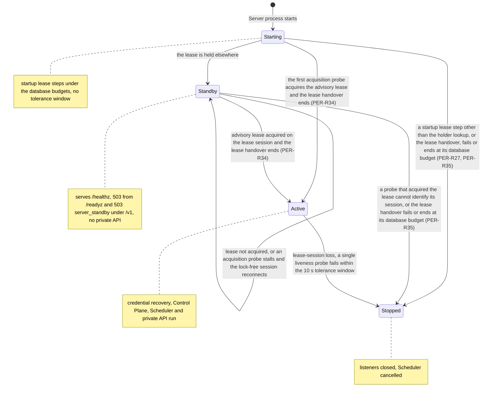
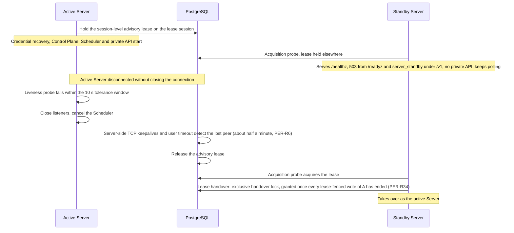
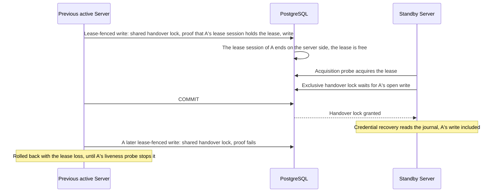
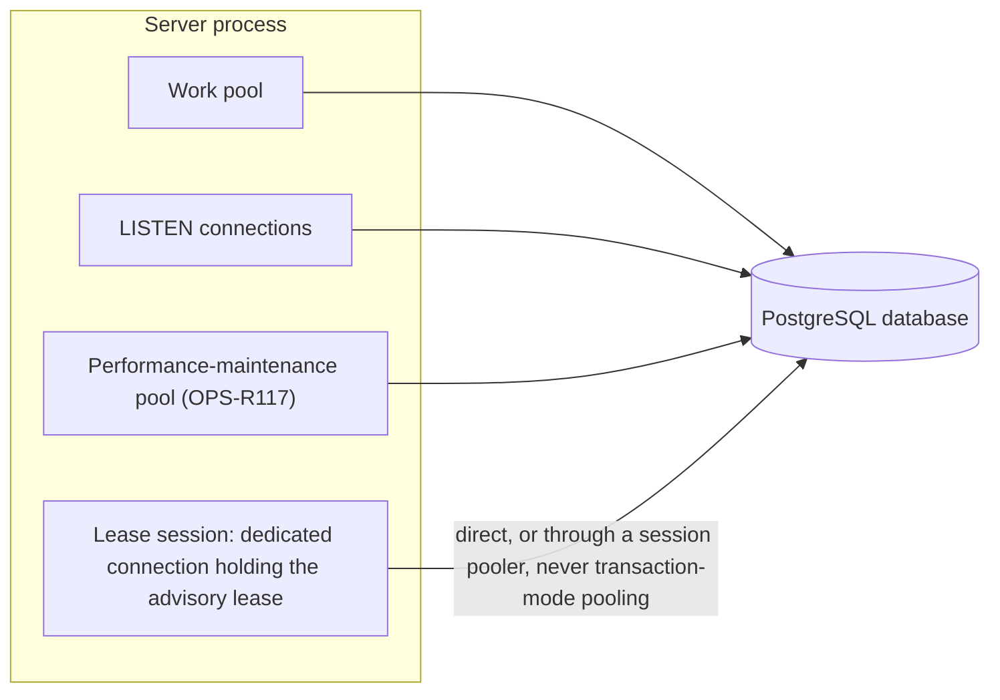

# Persistence

Requirement prefix: `PER` · [Specification index](../README.md)

## Purpose and scope

This document owns the persistence rules that belong to no single domain: one
active Server per PostgreSQL database, the session-level PostgreSQL advisory
lease that enforces it, the standby Server, detection of lease-session loss and
its time bounds, the budgets of the lease session's startup steps, the lease
handover that keeps a previous holder's lease-fenced writes from landing
behind its successor's startup, the connection pooling that the lease needs,
and what must
not stand in for that lease: an unfenced shared `runtime_agents` table or a
durable Runtime Agent principal. It owns the one classification of a failed
PostgreSQL call into an outcome class, how SQL names the members of `jsonb`
documents the Server encodes from Go types, and the owner package of every
table and view, the only package whose SQL may write it. It owns the one flow
and the one receipt table of keyed mutations, how advisory lock keys are
built, and the shape and lease rule of controller claims. It owns the schema
migrator: the one transaction of a migration run, the migration ledger that
keeps applied migrations immutable, the migration budget and what a migration
may do within it, and the rule that keeps the functions table definitions
evaluate restorable from a backup. It also indexes the
PostgreSQL state and the transaction and serialization rules that domain
documents own, so each can be found from here while it is stated only in its
owner.

It leaves to other documents:

- the single-host deployment topology and its Runtime Agent processes:
  [Overview](../overview.md);
- the live Runtime Agent Registry, control leases, durable Runtime Agent
  principals, the binding-then-principal lock order and the in-memory Registry
  lock: [Control plane](../execution/control-plane.md);
- Stage admission and the owner queue pause: [Scheduler](../execution/scheduler.md);
- WorkflowRun metadata labels: [Runs](../execution/runs.md);
- Artifact scopes, CAS writes, output freezing and the StageResult acceptance
  transaction: [Artifact store](../artifacts/artifact-store.md);
- `workflow_run_events` and live event delivery:
  [Public API](../api/public-api.md);
- LLM credential records and their recovery journal:
  [Runtime config](../configuration/runtime-config.md);
- the `/healthz` and `/readyz` dependency checks, active-active Server
  replicas, the `scheduler_settings` singleton, the performance-maintenance
  connection pool and `performance_minutes`:
  [Operations](../operations/operations.md);
- shared registries: [limits](limits.md), [errors](errors.md),
  [failure model](failure-model.md) and [lifecycle](lifecycle.md).

## Concepts

Terms are defined once in the [glossary](../glossary.md); this document owns
the following ones.

| Term | Meaning here |
| --- | --- |
| Advisory lease | The session-level PostgreSQL advisory lease a Server holds on a dedicated connection to be the one active Server, and the one active Control Plane instance, for its database. It is not the Runtime Agent control lease of the [Control plane](../execution/control-plane.md). |
| Lease session | The dedicated PostgreSQL connection that holds the advisory lease. |
| Active Server | The Server process that holds the advisory lease of a database and therefore runs credential recovery, the process-local Control Plane, the Scheduler and the private API. |
| Standby Server | A Server process on the same database that does not hold the advisory lease. |
| Lease-session loss | A single liveness probe of the lease session that fails within the tolerance window. |
| Tolerance window | The bounded time a lease-session liveness probe, a standby acquisition probe or a reconnect of the standby's lock-free lease session may run. |
| Startup lease steps | What a starting Server does on the lease session before it is active or stands by: connecting the session, configuring its keepalives, the first acquisition probe with the identification of a session that acquired the lease and, when the lease is held elsewhere, the holder lookup. |
| Lease-fenced write | A write transaction that proves, before it writes, that its Server's lease session still holds the advisory lease, under the shared lock of the lease handover, and otherwise commits nothing. |
| Lease handover | The wait of a Server that acquired the advisory lease, before its startup reads durable state, until every lease-fenced write of an earlier holder has ended. |
| Migration ledger | The table `contractor_schema_migrations`: one row per applied migration with its version, its file name and the SHA-256 of the file's bytes. |
| Migration budget | The operation budget of a migration run: its statement, lock and idle-in-transaction timeouts, its client deadlines and the deadline of the whole run. |

## Model

### Server roles

A starting Server takes its startup lease steps and is then active, or a
standby until it holds the advisory lease; the active Server stops when it
detects lease-session loss:

### Takeover after the active Server is disconnected

A server-side release breaks the order above: when PostgreSQL ends the lease
session itself, for example through `pg_terminate_backend` or a failure of
that one connection, it releases the lease at once, while the active Server
keeps its working pool and notices the loss only at its next liveness probe.
The lease handover keeps that overlap from reaching the successor's startup
(PER-R34):

### Server connections to PostgreSQL

The lease session is a dedicated connection. The Server's other PostgreSQL
pools, including the performance-maintenance pool, are specified in
[Operations](../operations/operations.md) (OPS-R117).

### Table owners

Every table and view has one owner package, the only package whose SQL may
write it ([PER-R23](#requirements)). The table ownership registry
[`internal/persistence/table_ownership.txt`](../../../internal/persistence/table_ownership.txt)
assigns the owners, grants the reads that other packages make, lists the
known foreign accesses and names the other owners' relations that migration
functions reach for a package; this index names the same owners. The documents that
own the rules of particular state are indexed in the next section.

| Owner package | Tables and views |
| --- | --- |
| `internal/agentprincipal` | `runtime_agent_principals` |
| `internal/artifacts/postgres` | `artifact_binding_revisions`, `artifact_bindings`, `artifact_blobs`, `artifact_lineage`, `artifact_scopes`, `artifact_versions` |
| `internal/auditstore/internal/pgstore` | `audit_artifact_links`, `audit_controller_claims`, `audit_events`, `audit_execution_items`, `audit_executions`, `audit_tasks`, `audit_hypotheses`, `audit_hypothesis_revisions`, `audits`, `finding_correlation_fences`, `project_findings`, `project_finding_sources`, `project_finding_audits` |
| `internal/credentials` | `credential_operations`, `git_ssh_keys`, `llm_credentials`, `runtime_credentials` |
| `internal/evalstore` | `eval_collections`, `eval_commands`, `eval_controller_claims`, `eval_dataset_revisions`, `eval_evidence_refs`, `eval_execution_tombstones`, `eval_experiments`, `eval_member_projections`, `eval_members`, `eval_plan_resources`, `eval_progress_observations`, `eval_projection_queue`, `eval_records`, `eval_submissions`, `eval_suboperations`, `eval_view_charts`, `eval_view_pairs` |
| `internal/findingintake` | `finding_proposal_audit_holds`, `finding_proposal_receipts` |
| `internal/performance` | `performance_minutes` |
| `internal/persistence/postgres` | `contractor_schema_migrations` (the migration ledger), `mutation_receipts` |
| `internal/projectstore` | `projects` |
| `internal/runstore` | `owner_queue_controls`, `planner_sessions`, `stage_allocations`, `stage_executions`, `workflow_run_events`, `workflow_run_output_publications`, `workflow_runs` |
| `internal/runtimeconfig` | `runtime_config_versions`, `runtime_label_bindings` |
| `internal/settingsstore` | `scheduler_settings`, `model_selection_settings` |
| `internal/telemetry` | `allocation_execution_reports`, `planner_execution_reports`, `stage_metrics` |

### Accepted upward reads

A package reads a relation whose owner sits higher in the layer stack of
[`internal/archtest/layers_test.go`](../../../internal/archtest/layers_test.go)
only where its registry entry names the open task that removes the read or one
of these records ([PER-R23](#requirements)). A read through a function that Go
SQL calls is a read of the calling package. Each record names the reader, the
relations it reads and their owners, the guarantee that needs the read in the
reader's own statement or transaction, the alternatives and when to reopen it.

| Record | Reader | Relations | Owners | Guarantee | Alternatives | Reopen when |
| --- | --- | --- | --- | --- | --- | --- |
| `PER-UR-1` | `internal/artifacts/postgres` (platform) | `workflow_runs` | `internal/runstore` (execution) | An Artifact operation that names a Run and a Project (output freezing, a Project input fork into a Run, a context projection, output publication, Audit import) proves in its own transaction that the Run exists and belongs to that Project, so no caller can move Artifacts between Projects. A Run's `project_id` is immutable, so the read cannot go stale. | The caller passes the Run's Project, which a caller defect could get wrong; an artifacts port that runstore implements and the composition wires, which adds a statement and an interface for one immutable column. | A Run's Project stops being the immutable `workflow_runs.project_id`. |
| `PER-UR-2` | `internal/telemetry` (platform) | `workflow_runs`, `stage_executions`, `stage_allocations` | `internal/runstore` (execution) | Resource history reads the allocations of terminal Stages of the owner's Runs, and Runtime and tool diagnostics authorize a Stage through its Run's owner, in the statement that pages the telemetry rows, so a page is one snapshot and one bounded read; report and metric retention deletes only rows of terminal Stages, decided in the deleting statement. | A runstore port that returns the authorized terminal Stages of each page, which needs a second statement per page and the same page window on both sides; history reads in runstore, which would then read telemetry's tables instead. | Authorization stops being the Run's owner, a Stage's end stops being `stage_executions.terminal_at`, or retention needs more of the Run lifecycle than a Stage's end. |
| `PER-UR-4` | `internal/runstore` (execution) | `projects` | `internal/projectstore` (product) | The Run queue page shows each Run's Project in the page's own statement; Run resumption checks that the Project is active and holds `FOR SHARE` on its row in the resuming transaction, so Project deletion, which changes that row, cannot interleave with a resumption. | A projectstore port called inside runstore's transaction for the fence and once per queue page, which keeps the same lock and adds a statement per page; a deletion fence row that runstore owns, which copies the Project lifecycle. | Project deletion stops fencing through the Project row, or `projects.lifecycle_state` changes meaning. |
| `PER-UR-5` | `internal/telemetry` (platform) | `eval_submissions`, `audit_executions` | `internal/evalstore`, `internal/auditstore/internal/pgstore` (product) | StageMetrics retention renews, instead of deleting, the metrics of a Run that an existing Eval member executed, directly or as a child Run of its Audit. `contractor_eval_run_members`, which the Eval projection trigger shares, is the one definition of that membership and runs in the retention statement. | Eval members hold their Runs' StageMetrics explicitly, as Artifact holds do, which adds a hold write to every submission; telemetry asks evalstore through a port per batch, a second statement that a new submission can race. | Eval membership of a Run gets a second definition, or Eval members hold StageMetrics explicitly. |

| `PER-UR-6` | `internal/artifacts/postgres` (platform) | `audits`, `audit_executions`, `projects` | `internal/auditstore/internal/pgstore`, `internal/projectstore` (product) | Audit forks prove immutable Project and child Run membership and active Project membership for selected input retention in the exact source-selection statement, so a trusted caller cannot join another Audit merely because it shares a Project. | Caller-only checks lose the store invariant; a port adds a query and requires the same transaction. | Audit/Run association ceases to be immutable or scope ownership moves to a lower layer. |

### PostgreSQL state and its owners

| State | Owner |
| --- | --- |
| The advisory lease | This document ([PER-R2](#requirements)) |
| `workflow_run_events`, the Run replay authority, and its insert-trigger notification | [Public API](../api/public-api.md) (API-R54, API-R55) |
| `llm_credentials` and the `credential_operations` internal recovery journal | [Runtime config, LLM credential record](../configuration/runtime-config.md#llm-credential-record) (RCF-R33, RCF-R71) |
| WorkflowRun metadata labels | [Runs](../execution/runs.md) (RUN-R72, RUN-R73) |
| The `scheduler_settings` singleton and its seed row | [Operations](../operations/operations.md) (OPS-R48, OPS-R49, OPS-R50) |
| `mutation_receipts`, the receipt of every keyed mutation, and the advisory lock keys | This document ([PER-R24](#keyed-mutations-and-controller-claims)) |
| The shape and lease rule of `audit_controller_claims` and `eval_controller_claims` | This document ([PER-R25](#keyed-mutations-and-controller-claims)) |
| `performance_minutes` | [Operations](../operations/operations.md) (OPS-R150, OPS-R151, OPS-R152) |
| Not PostgreSQL state: the live Runtime Agent Registry | [Control plane](../execution/control-plane.md) (CTL-R62) |

## Requirements

### One active Server per database

**PER-R1.** The supported deployment has one active Server/Scheduler process
per PostgreSQL database (LIM-PER-1) and one or more Runtime Agent processes;
that Server is the one active Control Plane instance of the database. The host
topology is [SYS-R10](../overview.md).

**PER-R2.** Before credential recovery, the process-local Control Plane, the
Scheduler or the private API starts, the Server must hold a session-level
PostgreSQL advisory lease on a dedicated connection, the lease session, and
must have completed the lease handover (PER-R34).

**PER-R3.** Until it acquires the advisory lease, a standby Server has only
public health and 503 readiness: it serves `/healthz`, returns 503 from
`/readyz` and has no private API. It answers every other request under `/v1`,
the event upgrade included, without authenticating or routing it, with
`503 server_standby`, retryable true, in the public error envelope with
`X-Request-ID`, `X-Contractor-API-Version` and `Cache-Control: no-store`, so a
client backs off instead of reading a missing resource until the standby takes
over (PER-R4) or the client reaches the active Server. The general `/readyz`
dependency check is [OPS-R115](../operations/operations.md).

**PER-R4.** When the active Server detects lease-session loss, it closes its
listeners and cancels the Scheduler; the standby then takes over
(FAIL-PER-1).

**PER-R11.** Multiple active Control Plane replicas, shared fleet coordination
and durable liveness state must not be approximated by sharing an unfenced
`runtime_agents` table.

**PER-R12.** Durable certificate principals and their label assignments
([Control plane](../execution/control-plane.md)) are configuration records
only; they never imply that a process is live, leased or eligible.

### Lease-session loss

**PER-R5.** Lease-session loss is a single liveness probe (LIM-PER-2) that
fails within a bounded tolerance window of ten seconds (LIM-PER-3). A probe may
run that long, so a transient client-to-database stall completes late instead
of being cancelled and dropping the lock-holding session, but a genuinely lost
session fails within the window.

Rationale: the window absorbs transient stalls.

**PER-R6.** The lease session sets server-side TCP keepalives of 10 s idle
(LIM-PER-4), a 5 s interval (LIM-PER-5), 3 probes (LIM-PER-6) and a 30 s user
timeout (LIM-PER-7) on every platform, so PostgreSQL releases the lease within
about half a minute (LIM-PER-8) when the active Server's host disappears
without closing the connection (LIFE-PER-1). PostgreSQL applies the user
timeout only where the server's operating system supports `TCP_USER_TIMEOUT`,
which is Linux; elsewhere, for example on macOS, it ignores the setting and
reads it back as `0`. There the keepalives alone bound the release: within
about half a minute when the host disappears while the lease session has no
unacknowledged data, and otherwise, on a TCP stack that suspends keepalive
probes while sent data is unacknowledged, only within that stack's
retransmission limit, which is minutes.

Rationale: the user timeout covers the case that Linux keepalives miss, a
reply still unacknowledged when the host disappears. A later release delays
only the standby's takeover; PER-R7 still holds, because the active Server
stops within its tolerance window either way. The lease-session test
(invariant 5) expects the user timeout from a Linux server and `0` from any
other, so a Linux server that stops applying it, or another platform that
starts to, fails the test. Revisit when a deployment needs the half-minute
takeover with PostgreSQL on an operating system without `TCP_USER_TIMEOUT`.

**PER-R7.** The tolerance window stays below that keepalive bound, so a
disconnected active Server stops before PostgreSQL releases the lock to a
standby (FAIL-PER-1). This order holds only for a release by the keepalives.
A server-side end of the lease session releases the lock at once, while the
active Server runs until its next liveness probe fails; PER-R34 keeps that
overlap from reaching the next active Server's startup.

**PER-R8.** A standby whose acquisition probe hits a transient stall
reconnects its lock-free session and keeps polling rather than exiting the
process (FAIL-PER-2).

### Budgets of the lease session

**PER-R27.** The lease session is opened from a copy of the working pool's
connection settings, so it carries the `database` budgets of the process
settings ([OPS-R15](../operations/operations.md), values and defaults in the
[operational timeout reference](../../operations/timeout-configuration.md)).
The startup lease steps run under the process context, which has no deadline
of its own, and the budget that owns each step bounds it:

| Startup lease step | Owning budget |
| --- | --- |
| Connecting the lease session: dial, TLS, startup handshake and authentication | `database.connectTimeout`, for each connection attempt |
| Configuring the keepalives (PER-R6), the first acquisition probe, the identification of a session that acquired the lease (PER-R34) and the holder lookup | `database.queryTimeout`, for each statement; the session also carries the server-side `database.statementTimeout`, `database.lockTimeout` and `database.idleTransactionTimeout` |

An earlier caller deadline or a cancellation, such as Server shutdown, ends a
step sooner, and no budget extends the caller's deadline. A step other than
the holder lookup that fails or ends at its budget closes the session and
stops startup with an error; the Server neither stands by nor retries the
step (FAIL-PER-4). A failed holder lookup only leaves the logged holder
unknown, and the Server stands by; its next acquisition probe reconnects a
session the lookup left unusable (PER-R8). Opening the working pool and
verifying its migrations come before these steps and are bounded by the
working pool's own budgets: `database.queryTimeout` for its first ping, and
the acquisition and query budgets for each statement of the migration check.
The lease handover that follows an acquisition runs on the working pool under
its budgets and stops startup the same way (PER-R35).

**PER-R28.** Once the Server stands by or is active, the tolerance window
(LIM-PER-3) bounds each lease-session probe instead. It bounds each standby
acquisition probe and each reconnect of the lock-free session (PER-R8); the
inherited budgets of PER-R27 still apply inside them, so whichever ends first
ends the probe or reconnect. It alone bounds each liveness probe of the
active Server (PER-R5): that probe is a protocol-level ping that the client
query budget does not shorten, so a query budget configured below the
tolerance window cannot turn a transient stall into lease-session loss. The
tolerance window does not bound the startup lease steps.

Rationale: before a Server has a role, its startup lease steps are ordinary
database calls under the operator's database budgets; the tolerance window
exists to keep a role already taken and to stop an active Server before
PostgreSQL releases its lock (PER-R7). A startup that must reach standby or
active within a fixed time, or that must stand by and retry after a failed
step instead of exiting, is a separate availability decision that would
replace this requirement.

### Lease handover

**PER-R34.** A write whose late commit would invalidate what the next active
Server's startup reads is a lease-fenced write. Its transaction, before it
writes, takes the shared transaction lock of the lease handover, an advisory
key built from the lease key (PER-R24), and then proves that its Server's lease
session, identified by its backend process ID and session start time, still
holds the advisory lease of the database. A proof that fails, because that
session ended or another session holds the lease, rolls the transaction back
with a lease-loss error, so the write commits nothing. A Server that acquired
the lease identifies its lease session in the same probe and, before its
startup reads any durable state, credential recovery first, takes the handover
lock exclusively once in a transaction of its working pool. PostgreSQL grants
that lock only after every transaction that holds the shared lock has
committed or rolled back, and a lease-fenced write that asks for the shared
lock while the exclusive request waits queues behind it and then finds the
lease held by another session. So every lease-fenced write of an earlier
holder is durable before the next active Server's startup reads begin, or
never commits. The lease-fenced writes are the managed LLM credential create
and delete intents, their completions and the abandonment of a create, and
the Runtime credential create and the delete tombstone
([RCF-R72](../configuration/runtime-config.md)).

**PER-R35.** The lease handover runs while a standby still answers as one
(PER-R3), or, after a first acquisition, before the Server serves anything.
`database.lockTimeout` bounds its lock wait and `database.queryTimeout` its
statement. A handover that fails or ends at its budget, and an acquisition
probe that acquired the lease but cannot identify its session, close the
lease session, which releases the lease, and stop startup with an error, as a
failed startup lease step does (PER-R27, FAIL-PER-4); the process
supervisor's restart is the retry. A cancellation, such as Server shutdown,
ends the handover with the cancellation, and the Server exits without an
error.

Rationale: the guarantee is that no lease-fenced write of a previous holder
becomes durable after its successor's startup read the state the write
changes; the credential operation journal is the state that needs it,
because startup recovery reads it once and then admits references
([RCF-R72](../configuration/runtime-config.md)). Three designs were weighed.
(A) A grace period after acquisition, as long as the previous holder's
detection bound: rejected, because detection bounds when the previous Server
notices, not when a COMMIT it already sent reaches PostgreSQL; a held COMMIT
or a paused process lands after any fixed delay. (B) A proof of the lease in
each fenced transaction under a shared lock that the successor takes
exclusively: chosen, because PostgreSQL's lock manager decides the order in
the same transaction as the write, it is a database proof as the epochs of
PER-R25 are, and it reuses the advisory lease and the advisory key builder
instead of adding a lease or epoch table. (C) The successor takes every
credential's deletion lock before trusting its journal read: rejected,
because it covers only credentials that exist when recovery lists them, not a
create intent, nor an intent that starts after the wait, and its cost grows
with the credential count. Evidence: a delete intent held at COMMIT across a
server-side end of its lease session committed after the successor's
recovery and Run admission, and the next start's recovery answered
`credential_in_use` ([proposal 0044](../../proposals/0044-credential-deletion-availability.md),
finding 7); invariants 28 and 29 prove the fix. Reopen this decision when a
database has more than one active Server ([OPS-R5](../operations/operations.md))
or the advisory lease is replaced, because the proof and the handover assume
one lease key with one holder at a time.

**PER-R36.** A write that is not lease-fenced may still commit after a
server-side release of its Server's lease, until that Server's liveness probe
stops it (PER-R5) or, while its process is paused, later. Startup work of the
next active Server trusts state it read once only when every write of that
state is lease-fenced; other state is fenced by a database lease of its own
or read again. The work that runs from startup:

| State or work | Why a previous holder's late write is excluded or harmless |
| --- | --- |
| LLM credential operation journal and records, Runtime credentials | Lease-fenced (PER-R34) |
| Scheduler Run claims and the work under them | A Server claims only a Run whose claim is free or expired; every Scheduler lifecycle transaction compares its acquired claim ID under the Run row lock before writing ([SCH-R119, SCH-R120](../execution/scheduler.md)), even before renewal notices replacement; the Scheduler reads Run state on every pass |
| Gateway recovery probe (process memory) | A process-local leased probe whose lease ends with its holder's request timeout ([SCH-R106](../execution/scheduler.md)); reset on Server restart |
| Audit and Eval controller claims | Claims whose epoch fences a stale holder (PER-R25) |
| Scheduler pool sizes | Read again by the bounded periodic refresh ([SCH-R133](../execution/scheduler.md)) |
| Deployment model selection | Read from PostgreSQL on every use |
| Credential references: Run creation, Audit start and resume, Eval preflight, allocation pinning, RuntimeConfig binding mutation and Project target credential attachment | Not fenced; accepted risk below |

Accepted risk: a reference transaction of the previous holder that is still
open across the handover can commit after its successor accepted the delete
of the same credential, whose reference check could not see it. When that
delete completes, the reference names an absent credential, which the next
revalidation refuses ([RCF-R47](../configuration/runtime-config.md)). When it
stays prepared after a Gateway failure, a prepared delete coexists with a
non-terminal Run that pins the credential: the running Server rejects that
Run's references to it ([RCF-R53](../configuration/runtime-config.md)), but a
restart before that Run ends fails startup recovery with `credential_in_use`.
It needs a reference COMMIT held or paused across the successor's
acquisition, handover and recovery, and a delete of exactly that credential
in that window. Detection: startup recovery names the Run. Gateway calls are
not database writes, so no transaction fences them. A retried prepared
create, whose first Gateway call removes the deterministic alias that may by
then name the key the successor created, proves the lease first and makes no
call once the lease is lost; a retried prepared delete may reach the Gateway,
which is harmless because remote deletion is idempotent and its completion
commits nothing. What remains is a process pause between that proof and the
Gateway call that outlasts the successor's acquisition, handover and
recovery. Detection: the Runs that use the credential fail authentication at
the Gateway. Reopen both by fencing the reference transactions and the
retried Gateway calls under PER-R34 when a deployment can pause a Server for
longer than its liveness probe, or when either interleaving is observed.

### Connection pooling for the lease

**PER-R9.** The lease session requires direct PostgreSQL or session pooling,
not transaction-mode pooling.

**PER-R10.** Behind a session pooler, the pooler's own client keepalive
settings bound how long a vanished Server keeps the lease (LIFE-PER-1).

### JSON documents encoded from Go types

**PER-R17.** SQL that reads a member of a document the Server encodes from a
Go type and stores in a `jsonb` column (Workflow, Stage, Run, allocation,
Project-target, Audit profile and baseline snapshots and canonical
RuntimeConfig documents) takes the member name from a constant declared beside
the Go type, so a query and its encoding cannot be renamed apart. Migrations,
which cannot use the constants, are pinned by a unit test that encodes each
type, resolves every path SQL reads in it and requires the migrations to read
the same members.

Rationale: credential deletion checks find references by these members; a
renamed member would make them find none and let an in-use credential be
deleted, and only database tests would notice.

### Table ownership

**PER-R23.** Every table and view of the schema has exactly one owner package,
and only the owner's SQL writes it. A write is an insert, update, delete,
merge, truncate, copy into the relation, table lock or change of the
relation's definition, or an exclusive row lock (`FOR UPDATE`, `FOR NO KEY
UPDATE`), which serializes with the owner's own changes. Another package changes or locks a relation only
through the owner's Go API, inside the caller's transaction when it needs one;
its SQL may read the relation, shared row locks included, only where the table
ownership registry ([Table owners](#table-owners)) grants that read with its
reason. The registry also lists the known accesses: foreign accesses that
break this rule today, each with why it exists and the open task that removes
it. A known access is a debt, not a grant: it leaves the registry with the
access, and a new foreign write moves behind its owner instead of becoming a
known access. The rule covers the SQL that production Go code runs: its text,
and the functions that migrations define and that text calls, with the
functions those call in turn. A function that Go SQL calls writes only the
caller's relations and reads another owner's relation only where the registry
lists that read with its reason. A trigger's function acts for the owner of
the trigger's table: it writes or exclusively locks another owner's relation
only where the registry lists that write with its reason, such as the Eval
projection that a Run's change marks dirty. A read of a relation whose owner
sits higher in the layer stack names, in its registry entry, the open task that
removes it or its [accepted upward read](#accepted-upward-reads). A function body that runs dynamic
SQL (`EXECUTE`) or that the check cannot read as PL/pgSQL or SQL text is not
allowed where the rule applies. Test fixtures are outside the rule, and so
are the reads that triggers make: a trigger reads another owner's rows to
admit, validate or project a change of its own table, which cannot change
that owner's state. Reopen the trigger-read exclusion when a decision about
read dependencies between owners needs those reads. The registry,
`scripts/erd/meta.json`, the [Table owners](#table-owners) index and the
migrated schema name the same tables and views, and the ERD draws each table
in the registry's group.

Rationale: SQL needs no Go import, so the import-based layer check cannot see
one package writing or locking another package's table. Such writes split one
state machine or lock order across packages, and each copy drifts from the
owner's rules. Reopen this rule when a guarantee needs one statement to change
relations of two owners and their APIs cannot give it inside one transaction;
record the guarantee, the alternatives and the evidence in the owner's
document before the registry may grant such a write.

### Related rules owned elsewhere

- Active-active Server replicas: [OPS-R5](../operations/operations.md).

### Transactions and serialization owned elsewhere

| Rule | Owner |
| --- | --- |
| RunStore and ArtifactRegistry in one PostgreSQL transaction when the Scheduler accepts a StageResult, applies Workflow output mappings and possibly makes the WorkflowRun terminal, including across a storage split | [ART-R92](../artifacts/artifact-store.md) |
| Uniqueness wait for concurrent first writes to a scope and for identical-content writes to different bindings | [ART-R61](../artifacts/artifact-store.md) |
| Empty output set of a Run with no Artifact bindings and the absent Artifact scope row | [ART-R96](../artifacts/artifact-store.md) |
| Binding-then-principal lock order of Run creation, binding mutation, Agent-label mutation and allocation pinning | [CTL-R89](../execution/control-plane.md) |
| Serialization of Agent-label and binding mutations against allocation pinning | [CTL-R90](../execution/control-plane.md) |
| No database or network operation while holding the in-memory Runtime Registry lock | [CTL-R87](../execution/control-plane.md) |
| One database serialization boundary for the owner queue pause and normal Stage admission | [SCH-R156](../execution/scheduler.md) |

### Database failure classification

**PER-R13.** The Server classifies a failed database call in one place, into
exactly one outcome class, and every component derives its domain error and
its retry decision from that class, never from an SQLSTATE itself. A
cancelled or expired caller context takes precedence over any PostgreSQL
condition in the same error. Each SQLSTATE class, and each code listed here,
maps to one class:

| Condition | SQLSTATE | Outcome class | Retryability |
| --- | --- | --- | --- |
| Unique or exclusion violation | 23505, 23P01 | duplicate | permanent for the request; the caller replays the existing row or reports a conflict |
| Foreign-key violation, also raised by a trigger that requires a parent row | 23503 | reference violation | permanent |
| Not-null violation, a violation of a named CHECK constraint, any other integrity constraint violation or data exception | 23502, 23514 naming a constraint, other class 23, class 22 | invalid | permanent |
| Business-rule rejection raised by a trigger | 23514 naming no constraint | rejected | permanent for the state the statement observed |
| A stored bound exceeded, raised by a trigger that names the bound, such as the Run artifact revision limit | 54000 naming a constraint | limit exceeded | permanent for the state the statement observed |
| Write to a Project that is being deleted, rejected by a deletion fence | 55000 | deleting | permanent |
| Missing database privilege | 42501 | permission denied | permanent |
| Serialization failure or deadlock | 40001, 40P01 | transaction conflict | retryable: nothing committed, and the whole transaction may be replayed |
| Lock wait or statement timeout, statement cancellation, expired caller deadline | 55P03, 57014 | timeout | retryable by an idempotent callee; ambiguous at commit |
| Connection exception, insufficient resources, operator intervention, system error, any other transaction rollback, a lost or refused connection, or a connection closed before or during a call (including a lost COMMIT reply) | classes 08, 53, 58, other class 57, other class 40; closed-connection cause | unavailable | retryable by an idempotent callee; ambiguous at commit |
| Cancelled caller context | — | cancelled | not retried |
| Any other SQLSTATE, such as a syntax, undefined-object, PL/pgSQL or internal error, or one of PostgreSQL's own program limits | all other classes, including 54000 naming no constraint | internal | permanent |

A transient database failure (FAIL-PRJ-4, FAIL-SCH-15) is a transaction
conflict, a timeout or an unavailable database in this table.

A closed connection does not prove that COMMIT was unsent: PostgreSQL may
have committed before the reply was lost. pgx's `SafeToRetry` hint is not
evidence to the contrary and is never a production retry decision. The
caller reconciles through its existing receipt, natural key or replay read
before repeating a mutation; only a definite transaction conflict permits
the central transaction helper to replay the whole transaction.

Store reads, writes and locks preserve the original cause through every
wrapper. A static safe message uses `postgres.WrapError`, whose `Unwrap`
retains classification and cancellation identity without rendering SQL,
credentials or provider content. Replacing a failed database call with a new
unrelated error is rejected by the production-source check.

**PER-R14.** A schema trigger reports a business-rule rejection as
`check_violation` (23514) without naming a constraint, and a deletion fence
reports a deleting Project as `object_not_in_prerequisite_state` (55000). A
CHECK constraint violation always names its constraint; that is what separates
rejected from invalid. An assertion of the schema's own invariants, such as
the Audit event allocator's, raises `assert_failure` (P0004) and is internal.

Rationale: PostgreSQL raises its own 55000 conditions only for DDL, for
`currval` and `lastval` before a value exists and for replication. No Server
statement does any of these outside migrations, so 55000 means deleting. The
classification test on the migrated schema detects a fence that stops raising
55000; reopen this rule if a Server statement starts using one of those
features.

**PER-R15.** A permanent class is never reported as a retryable conflict. A
domain that maps duplicate to its conflict error maps invalid and rejected to
its invalid, precondition or not-found error, never to that conflict.

**PER-R16.** A transaction conflict that outlasts the bounded transaction
retries of its operation stays a transaction conflict. The public API reports
it as the retryable `503 storage_transaction_conflict`; it never becomes a
`409 conflict` or a `500 internal_error`.

### Transactions of shared stores

**PER-R18.** A store that serves both a pool and a caller's transaction runs
an operation that needs a transaction through one rule. On a pool it starts a
fresh transaction per attempt and replays a transaction conflict (PER-R13), so
the operation must be safe to replay. On a caller's transaction it runs once
inside that transaction; the caller owns the isolation level, the commit and
any retry. A step whose row locks must last until the caller commits, such as
the Run deletion locks, exists only on a store bound to a transaction, never
on one that a pool can back.

**PER-R19.** Every transaction the Server begins runs under the operation
budget selected for its operation, including a transaction whose caller
classifies its own commit, such as a Planner Memory transaction.

**PER-R20.** A store operation that recovers from a failed statement with
further statements, such as a replay read after a unique violation, runs that
statement under a savepoint when it is in a caller's transaction. A database
error rolls back to the savepoint, so only the failed statement's writes are
undone and the recovery and the caller's transaction continue; a statement
that returns no rows keeps its writes, as it would on a pool. A recovery read
in a REPEATABLE READ transaction sees only that transaction's snapshot, so a
concurrent winner that committed after it began is found by the caller's
replay after rollback (FAIL-AUD-4), not inside the transaction.

### Schema migrations

**PER-R29.** `contractor server migrate` (or `contractor-server migrate`, the
migrator) is the only process that changes the schema. A run applies every embedded migration the migration
ledger lacks, in version order, in one PostgreSQL transaction: the statements
of each file, then the file's ledger row. The schema and the ledger therefore
commit together or not at all. A statement that fails or times out, a
cancellation, a lost connection or the end of the run's deadline rolls back
every migration of the run, and the next run applies the same files; a commit
whose answer is lost leaves the database at either the old or the new
version, which the ledger records, so the next run applies only what is still
missing (FAIL-PER-5). Before it reads the ledger, a run takes the migration
lock of its target schema, the first existing schema of `search_path`
(PER-R24), by polling rather than by a blocking call, so concurrent runs on
one schema apply each migration once while other schemas of the database
migrate independently. The Server never migrates: it starts only when the
ledger records exactly the migrations it embeds, and otherwise stops with
migration drift or with the pending versions.

**PER-R30.** The ledger keeps an applied migration immutable. A run and the
Server's startup check compare every ledger row with the embedded file of its
version and refuse, as migration drift, a ledger that records a version the
binary does not embed or another name or checksum for one; a run then applies
nothing. A schema change is therefore a new migration with the next free
version: a migration file that a database has applied is not edited, not even
in a comment, renamed, renumbered or removed, and no ledger row is rewritten
or deleted. A later migration that redefines a function with `CREATE OR
REPLACE` is a successive schema version, not a duplicate to remove: the
installed schema holds one current definition.

The user-authorized pre-production fold on 2026-11-02 replaces the previous
baseline and versions 000002–000003 with one current baseline. Its installed
catalog and initial rows equal those of the repaired retired chain. The stopped
demo first completes the one-time Project Finding cutover against a verified
backup, then its ledger alone is rebound offline after installed-schema equality
and unchanged business-data signatures are proven. The release manifest records
the backup, old/new ledgers and exact checksums. This is an explicit operational
transition for that demo, with no runtime ledger repair or old-schema reader.
Every other stale ledger fails the same strict drift check. This fold does not
relax immutability for subsequent migrations.

**PER-R31.** The migration budget is the operation budget (PER-R19) of the
migrator's transaction. The operator chooses it for each run, with
`--statement-timeout` and `--lock-timeout` or with
`CONTRACTOR_MIGRATE_STATEMENT_TIMEOUT` and `CONTRACTOR_MIGRATE_LOCK_TIMEOUT`,
which the flags override; an unset value keeps its default, and the
ServerConfig `database` budgets do not apply. The migrator sets the statement,
lock and idle-in-transaction timeouts transaction-locally, never for the
session, so its commit or rollback leaves the pooled connection as it found
it. PostgreSQL applies the statement timeout (LIM-PER-9) to each statement of
a migration file separately, the lock timeout (LIM-PER-10) to each lock wait,
whether for a relation or a row, and the idle-in-transaction timeout
(LIM-PER-12) while the transaction waits for the migrator's next call. Each
timeout has one owner:

| Bound | Owner | What it ends |
| --- | --- | --- |
| Statement | PostgreSQL's statement timeout (LIM-PER-9), for every statement of a migration file and of the migrator | the statement, with SQLSTATE `57014` |
| Lock wait | PostgreSQL's lock timeout (LIM-PER-10) | the wait, with SQLSTATE `55P03` |
| Client call | the migrator's client, the statement timeout plus 5 seconds, for each of its own one-statement calls: a poll for the migration lock, the creation and read of the ledger, a ledger row and the commit | a call whose connection was lost, without a SQLSTATE; PostgreSQL reports a slow statement first |
| Migration file | none of its own: the migrator sends a file as one simple query whose client deadline is the run deadline | — |
| Run | the run deadline (LIM-PER-11), including the wait for the schema's migration lock, which therefore outlasts the lock timeout | every call still in flight, without a SQLSTATE |

A statement that outlasts the statement timeout is therefore cancelled by
PostgreSQL, and a run that outlasts its deadline, in a file or elsewhere, is
ended by the client; both fail the run as a timeout (PER-R13). The client
also bounds each connection acquisition (LIM-PER-13). Neither a migration
file nor the Server changes these settings.

Decision: a migration file is a sequence of statements, not one
operation, so the deadline of one client call, the statement timeout plus
5 seconds, is not its budget. PostgreSQL already bounds each statement of a
file, even after the client is gone, so the client deadline of the call that
carries a file only has to end a migrator whose connection was lost, which
the run deadline does. Evidence: every embedded file applies in under 0.2
seconds and all of them in about 2 seconds on an empty schema; several
files, data migrations among them, hold 30 to 110 statements, which a
per-file deadline of 125 seconds would fail on data where each statement
fits; and the
upgrade tests (PER-R33) apply files without the client deadline, so no test
ever met it on data. Alternatives considered: keeping the per-file client
deadline and an authoring rule that all statements of a file fit it (rejected:
it reuses the safety net of one call as the budget of another operation, and
no gate checks the rule); sending each statement of a file as its own call
under the per-call deadline (rejected: it needs a production statement
splitter that agrees with PostgreSQL on dollar quotes, comments and function
bodies, while the splitter of the migration checks is test support, and it
only detects a lost connection sooner). Price: a migrator whose connection is
lost while it sends a file waits until the run deadline, 15 minutes by
default, before it fails. Reopen this when a lost connection during a
migration must be detected sooner than the run deadline, for example when an
operator reports a run that hung until LIM-PER-11 after a network failure;
the replacement is a statement-per-call run with a production splitter
checked on every embedded file, or keepalives on the migrator's connection.

**PER-R32.** A migration file must fit the default migration budget on the
largest data it can meet: each statement within the statement timeout
(LIM-PER-9), and every file a run can apply together within the run deadline
(LIM-PER-11), which on a new database covers every embedded file (PER-R31).
A file has no client bound of its own: PostgreSQL bounds its statements one
by one, and the run deadline bounds what a run does in all of its files, so
a file with several heavy statements shares the run deadline with every other
pending file. Where a limit
bounds the rows or bytes a statement handles, such as the revisions of one Run
(LIM-ART-6), the file fits at that limit; over a collection that no limit
bounds, each statement reads each row a bounded number of times, in one pass
rather than once per other row, at a bounded cost per row. Raising the budget
is the operator's remedy for one slow upgrade, not a design input: a backfill
that cannot meet this is designed as a separate data migration with bounded
steps and a durable record of its progress, not written as a longer statement
or split into more statements of one file. No gate measures a migration at its
bound: the author shows the fit when writing the migration, from its statement
plans and cardinality (AGENTS.md section 3.3), and its review checks it, as
the non-goals of this document record. Because a run is one transaction, a
migration must not use a statement that PostgreSQL refuses inside a
transaction block, such as `CREATE INDEX CONCURRENTLY`, `REINDEX
CONCURRENTLY` or `VACUUM`, and contains no transaction control: an index is
built inside the run, holding its table's lock until the run commits, and
counts against the statement timeout and the run deadline. Two hazards apply to every backfill
that reads documents stored as JSON text or bytes:

- PostgreSQL rejects the valid JSON escape `\u0000` (SQLSTATE 22P05) when such
  a document is cast to `jsonb`, and every `json` operator and set-returning
  function fails on it the same way. Go encodes a NUL character in any string
  that way, so a document with free text can hold it, and one such row rolls
  back the whole run. The backfill rewrites the escape injectively before the
  cast or reads the value without a JSON cast, unless a schema the document
  was validated against excludes it. Every Eval document excludes it
  ([EVF-R236](../evals/format.md)), which is also what lets production Eval
  reads cast stored documents. Public and private JSON mutation metadata
  excludes it at the request boundary ([API-R71](../api/public-api.md)); a
  remaining PostgreSQL data exception is a permanent invalid input outcome
  under PER-R13, rather than a retryable internal error.
- PostgreSQL may pull a subquery, or a CTE referenced once, up into the
  statement that uses it and substitute its output expressions at each
  reference, so a parse in its select list, such as `convert_from(document,
  'UTF8')::jsonb`, that several lookups read parses each document once per
  lookup and can exceed the statement budget on large documents. The backfill
  parses each stored document once per row, behind a fence such as `OFFSET 0`
  or `AS MATERIALIZED`.

**PER-R33.** A migration that moves, folds or backfills data has an upgrade
test on real PostgreSQL. The test installs the schema of the preceding version
in an isolated schema, seeds the rows an older Server stored there, including
the boundary cases of the migration's rule and, where a limit bounds that
rule, data at the limit, and applies the embedded migration through the
migrator. It then compares the result with the rule computed independently of
the migration's SQL, checks that unrelated rows are unchanged and exercises
the schema the migration leaves behind; a backfill that is omitted or
miscounts makes it fail. A backfill whose statement plan determines its cost,
such as the number of document parses, has that plan pinned by the test. The
test may apply the migration through a pool without the client deadlines of
PER-R31, as the isolated test pools are: at test sizes a statement takes far
less than its call deadline and a run far less than the run deadline, so
neither could fail it, and the deadlines have their own test (invariant 26). A test that measures a file near the default
budget applies it through a pool opened as the migrator opens it. Like
PER-R32, this requirement is checked when the migration is written and
reviewed (AGENTS.md section 6, Go server), not by a gate. Upgrade tests of
the retired pre-production chain in PER-R30 are removed with that chain;
current-schema and migrator protocol tests remain. Any later data-moving
migration again requires its own upgrade test.

Rationale: one transaction keeps every database at one complete schema
version, so the ledger is the only record a run or the Server's startup check
needs, and a failed run needs no repair. Its price is that a migration cannot
build an index concurrently or commit work in steps, and that the slowest
migration file of the largest database sets the budget the operator must
grant.
Per-file transactions, a non-transactional migration step or Server-side
background backfills would lift those restrictions at the cost of
partially applied versions, a ledger that records more than complete
migrations, and reads of rows that are not yet migrated. Reopen this when a
required change cannot fit the default budget at its bound or needs a
statement PostgreSQL refuses inside a transaction; the replacement must state
its ledger handling, its behaviour on a partial failure and the backup and
data preservation of an existing database.

### Indexes of foreign keys

**PER-R21.** Every foreign key has a valid index on its referencing table
whose leading keys are all of the key's columns, in any order; a partial
index counts when it holds every row whose key is set. PostgreSQL checks or
cascades a foreign key for each deleted or re-keyed referenced row by
querying the referencing table on the key columns, so without that index each
probe reads the whole table, or the whole of an index that holds the key in a
later column, and a purge costs as much as the table instead of the rows it
removes. A foreign key without that index is listed by the schema test with
its reason and with the schema object that bounds its probe: a usable index
led by some of the key's columns that selects few rows, or a trigger of the
referenced table that rejects every deletion and key change, so the probe
never runs.

### Row triggers

**PER-R22.** A row trigger fires only when what it guards or checks can
change. A guard that rejects changes to some columns fires on `UPDATE OF`
exactly the columns its function or WHEN condition compares, reads no other
column of NEW or OLD except a value that only qualifies a change of a listed
column, such as the state in which that change is still allowed, and no
BEFORE UPDATE trigger of its table assigns a column, so only an UPDATE that
lists a guarded column runs it;
an after-row or deferred trigger states in its WHEN condition the change it
reacts to, and fires on every INSERT when its function checks new rows. A Run
event append, which only advances the Run's event sequence, therefore fires no
trigger of `workflow_runs` except the deferred binding check of an
audit-managed Run. The deferred Audit completion check runs when a Run is
inserted and when its completion changes, not on later updates that keep it:
the completion cannot change once set, and the profile binding it is checked
against is immutable ([AWC-R7](../audits/worker-completion.md)). Likewise a
StageExecution admission and a counted output publication failure, which
change neither a guarded column nor the state, fire no trigger of
`stage_executions`; the manual continuation check still runs on every INSERT
and on an UPDATE only when the resume source is assigned, and the lifecycle
capture on every INSERT and on a state change. A Stage allocation's release
attempt, release and execution report mark fire no trigger of
`stage_allocations`: the completion check looks up the Run's completion
authority when an allocation is inserted and afterwards only rejects a changed
completion, because the allocation's Stage and agent and the Stage's Run and
name are immutable, and the Run's completion is fixed when the Run is created,
before any Stage can exist ([RUN-R26](../execution/runs.md)). An Audit update that assigns neither its
phase nor a baseline column, such as an event append, fires no preparation
guard, and the guard looks for a prepare execution only to decide a changed
baseline or a return to `not-started`. The Eval output projection reacts to a
Run output that is inserted or deleted or whose revision or frozen flag
changes; the deferred Run association check of an AuditExecution runs on every
INSERT and on an UPDATE that changes a column it reads; and the Eval retention
trigger of `workflow_runs` fires only for a Run deletion that can match a
`run-create` suboperation, one with a Project, request key and request digest.
A trigger whose decision reads other tables keeps firing on every change it
may have to reject, with the reason stated beside it: Project admission runs on
every INSERT and UPDATE of a Project-scoped artifact binding, each of which is
an artifact write that a deleting Project rejects at the write itself
([DEL-R40](../artifacts/retention-and-deletion.md)).

The Eval experiment and frozen-plan guards check after an UPDATE and raise
within the same statement, rolling back all its effects on rejection. They
assign no columns. This keeps the stored generated plan digest from being
recomputed on an ordinary progress update: PostgreSQL must recompute generated
values when a table has a BEFORE UPDATE row trigger, even if that write leaves
the source column unchanged. The experiment guard checks every update because
every update must advance its observation timestamp; the plan guard names only
its immutable columns and fires only after the plan was frozen.

### Functions that table definitions evaluate

**PER-R46.** A function that a table definition makes PostgreSQL evaluate,
in a column default, a generated column, a CHECK constraint of a table or
domain, or an index expression or predicate, binds the names it uses when
it is created, and so does every function it calls in turn. A `LANGUAGE sql`
function among them has a SQL-standard body (`BEGIN ATOMIC … END` or
`RETURN`); a function in another language pins `search_path = pg_catalog`,
so it can name only built-in objects. `pg_restore` creates tables, loads
their rows and builds their indexes with an empty search path, and a body
kept as text resolves its names only when it runs: one that names another
schema object fails the restore when `CREATE TABLE` inlines it or `COPY`
evaluates it, and inside a PL/pgSQL exception handler it turns into a false
verdict that rejects every restored row. With this rule a custom-format dump
of a migrated database restores with `pg_restore --exit-on-error` into an
empty database, as the
[offline backup and restore](../../operations/artifact-blob-storage.md#offline-backup-and-restore)
procedure does. SQL-standard bodies need PostgreSQL 14 or later; the project
runs and tests on PostgreSQL 17. Checks inspecting routine behavior read the
deparsed SQL-standard body or the stored string body through one shared
reader, so neither body form is invisible. A trigger-only reader may read its
text source directly because SQL functions cannot return `trigger`.

Decision: a SQL-standard body binds the functions it calls when it is
created and records them as dependencies, so `pg_dump` creates them first
and writes their names qualified, and PostgreSQL still inlines the body into
the queries that call it. Migrations create it with the search path of the
schema they install, so it works unchanged in the per-test schemas.
Alternatives considered: `SET search_path FROM CURRENT` on each function
(rejected: it pins the schema name the migrator happened to use, changes a
setting on every call and keeps PostgreSQL from inlining a SQL function);
names qualified with a fixed schema such as `public` (rejected: they break
the per-test schemas and an installation in any other schema). Evidence: the
generated column `audit_items.retained_dependency_hold_count` made every
restore fail at `CREATE TABLE audit_items`, and the Run snapshot CHECK of
`workflow_runs` rejected every restored Run, because its PL/pgSQL validator
turned the unresolved call of the pinned-configuration validator into false.
Reopen this when a table definition needs a function that cannot have a
SQL-standard body and must call another schema function; its replacement
must still restore with an empty search path.

### Keyed mutations and controller claims

**PER-R24.** A keyed mutation is a request its caller may repeat under an
idempotency key and whose receipt is kept apart from the entity it changes:
an owner's Audit mutation (create, start, pause, cancel, resume and delete),
a Project-scoped domain mutation,
a managed Eval mutation, and a Runtime label binding or Agent label set
operation. Each records one receipt in `mutation_receipts`, in the
transaction of its effect, through one flow:

1. it takes the transaction advisory lock of its key, so the requests under
   one key run one at a time;
2. it reads the receipt stored under the key: a receipt of the same request
   replays, and a receipt of another request is the idempotency conflict
   ([API-R69](../api/public-api.md)); neither runs the mutation again;
3. otherwise it runs the mutation and claims the key with the new receipt.

A key is unique within the scope of its family: an Audit key per owner and
operation, an Eval key per owner, Project, resource and operation, and a
Runtime management key across every operation, held only as the digest of the
operator's key. A Project mutation key is scoped by owner, Project,
resource and operation; its immutable receipt leaves only in the drained
deleting Project's purge. The common Project receipt family admits domain
operations without registering their names in persistence or cleanup code.
Cleanup uses the shared row/byte budget and a Project-family index, committing
its receipt pass before artifact purge. A caller may read bounded replay policy
under the same receipt lock before the common digest comparison, so domain rule
changes or result eviction cannot reinterpret accepted intent
([SMT-R9](../artifacts/project-sitemap.md)). A family that also compares the stored operation or resource
on replay, as Runtime management does, reports a difference as the same
conflict. No receipt changes once claimed. An Audit receipt is deleted with
its Audit, an Eval receipt only in its Project's purge, so it stays
replayable after its experiment's purge
([LIFE-EVM-7](lifecycle.md)), and a Runtime management receipt is never
deleted. A request whose key is a column of the row it creates (a Run, a
Project, a RuntimeConfig version, a Runtime credential, an Audit execution,
an Eval member) keeps the key on that
row, and an operation that journals an outbound call keeps its journal
(`credential_operations`, `eval_suboperations`); neither is a keyed mutation
here.

Every transaction advisory lock key, of a keyed mutation or of any other
serialization, is built from a namespace and parts by one builder that writes
each value after its byte length, so two different part lists never share a
key. Two locks keep their own keys: the advisory lease of the active Server
(PER-R2), whose fixed key every Server version shares, and the migration
lock, which is scoped to the schema being migrated.

Optional Audit continuation uses these same Task receipts and the existing
execution output cursor. An accepted generator Task retains its consumed source
boundary; `audit_tasks_continuation_cursor` selects the last continuation
without reading unrelated initial/manual producers, and
`audit_tasks_workflow_ordinal` bounds per-Workflow source seeks. No additional receipt/lease relation is used
(ACT-R7, AUX-R112).

**PER-R25.** A controller that leases the subjects it reconciles, the Audit
controller ([AUX-R74](../audits/execution.md)) and the Eval coordinator
([EVM-R108](../evals/managed-evals.md)), keeps one claim row per subject in
its own claim table or on its primary resource row, with one shape: the subject, an
epoch, and the holder with the start and the end of its lease, all three set
or none. These controllers lease, prove and release claims through one helper.
A lease advances the epoch. A write proves that its holder still holds the
claim at its epoch and that the lease has not ended; only a release or a
purge by the holder accepts its holder's ended lease, because no other holder
can have leased the subject without advancing the epoch.

A bounded maintenance operation may renew its exact still-live claim without
advancing the epoch. Renewal cannot revive an expired, released or replaced
claim. Audit deletion renews before entering its separate cleanup budget
([REV-R160](../audits/review-and-reports.md)).

Execution-to-Eval projection writers hold their existing Run or Audit
authority before the Eval projection queue and then member projection rows.
Dirty triggers, native/external selections and view publication share this
queue-before-member order. Member collection finishes source and evidence
reads before acquiring these private projection locks; it never acquires an
Audit controller claim afterward. A definite transaction conflict retries the
whole collection with a fresh snapshot under PER-R16, and is never treated as
a damaged member when retries are exhausted.

**PER-R26.** The Audit controller and the Eval coordinator run the claims of
a pass through one claim lifecycle. Each controller leases a bounded batch
with its own admission query and batch bound, then handles each leased claim
in its own goroutine, so one slow or failing subject does not hold back
another and a pass runs at most as many handlers as it leased claims. A claim
is released only after its handler returned, also when the pass was
cancelled, and its release runs under a budget of its own that keeps the
pass's values but not its cancellation, so shutdown still gives every claim
back. A release that finds its claim lost, because the lease ended and
another holder leased the subject or the claim was already released, is not
a failure: the epoch already fences the stale holder (PER-R25). The pass ends
once every claim was released and reports, per subject in claim order, the
handler's failure joined with the release's (FAIL-PER-3). The lifecycle owns
no scheduling policy: each controller keeps its own handler budgets, wake
hints, poll interval and decision whether to pass again at once.

Rationale: the two controllers pace their passes differently on purpose. The
Audit controller passes again at once after a pass that changed something
without failing and waits for its poll interval otherwise; the Eval
coordinator waits for its poll interval or a wake hint after every pass,
because observing an active execution counts as work and must not become a
hot poll. An Audit step owns its budgets (the snapshot read's operation
budget, or the cleanup budget of a deletion step under a renewed lease) and
its release has the operation budget, while an Eval tick runs under one
operation budget and its release has a fixed five seconds. Only the
lifecycle that both repeated identically is shared; merging the policies
would change when each controller works.

**PER-R37.** Typed finding-check admission uses the existing Audit controller
claim and a private checkpoint on the closed current Round. The first durable
checkpoint precedes any source callback. It fixes the validation deadline ten
minutes from that intent and freezes a receipt-created-time/receipt-ID upper
key plus a hold-acceptance cutoff read with PostgreSQL `clock_timestamp()` while
the Audit is locked. An injected deadline clock never supplies this cutoff.
A later hold of an older receipt is a late source, including when its receipt
key precedes the traversal cursor. Generation restarts retain the original
deadline. A NULL private check index means explicit data migration is pending;
the same wait returns unchanged progress and never parses proposal prose.

**PER-R38.** One claimed admission phase reads at most 128 raw candidate or
staged item records, 512 related descriptors and 1 MiB of combined source and
generated metadata, measured before the relevant JSON hydration. Exact opaque
proposal payload reads have a separate 64 MiB phase allowance and are cached
once per distinct receipt. Context and selected check fragments are verified
against the immutable trusted byte index; unrelated checks and the presentation
report projection are not decoded. All reads and candidate savepoints use the
same transaction, including with one pool connection. A rejected candidate
rolls back its speculative forks and task artifacts while its natural decision
key may commit in the outer transaction.

**PER-R39.** One immutable prepared page chain and one root are frozen Audit
artifacts registered and charged once through existing ArtifactLinks. Each page
pins its preceding exact page digest; the root pins the complete ordered chain,
selected count, generation and profile/baseline digests. Published selection and
private staging keep independent item/page counters. The root has no second
selection-root reference and its publication grants no membership authority.

A non-current `proposed` Round stages at most one bounded stored page per phase.
The caller supplies only its next ordinal; the transaction reads the trusted
natural-key page once and revalidates original receipt/source and pinned route
before staging. Private execution rows freeze the verified page's source, item
identity, role, task, origin and pinned operation policy. The accepted plan is stored
only inside that immutable execution projection; its object/schema, 64 KiB
encoded-byte bound and owning Audit/item identity are enforced there, without a
separate plan column. Ordinary items have no prepared projection or page/cost
headers.

The final bounded staging transaction verifies that staged item/page counts
match the published chain and atomically installs the existing SQL membership
seal. Acceptance separately checks fixed-size generation, count and chain-digest
parent fields and atomically publishes the Round and current pointer; it neither
inserts nor rebuilds the complete item collection. Partial membership remains
invisible to reads and dispatch. Deletion updates physical staging
counters in the same transaction, so a withdrawn source cannot leave an
acceptable stale seal. Dispatch preflights stored selected-row bytes and
descriptor counts before hydrating only selected immutable execution entries.
It never reads whole pages to select sparse items. Lost page, root, stage or
acceptance responses resume the same generation, exact artifacts and counters
without another debit or accepted event. Checkpoint readers reject removed
selection/prepared duplicate fields rather than reinterpret historical data;
the forward transition is defined by [PER-R41](#PER-R41).

**PER-R40.** The incompatible Audit worklist execution-manifest transition
requires the previous Server to finish or cancel Audits that already have a
Round before the operator stops it and applies the forward migration. The
migration rejects an Audit in `active`, `waiting_review`, `paused`,
`finalizing`, `cancelling` or `deleting` with any Round, using only indexed
Audit/Round metadata. The check is not limited to typed finding worklists.
Drafts and preparation without Rounds may remain. Terminal historical
artifacts and records are preserved without rewriting their frozen content;
current readers accept only the current execution format. The migration's
metadata locks keep the preflight stable until commit; they do not provide a
mixed-version Server protocol or permission to restart the previous writer.

**PER-R41.** The incompatible typed-admission page-chain transition requires
the previous Server to finish or cancel Audits with admission checkpoints or
typed prepared membership before it is stopped and the forward migration is
applied. The migration rejects an Audit in `active`, `waiting_review`, `paused`,
`finalizing`, `cancelling` or `deleting` when any of its Rounds has a non-NULL
admission checkpoint, prepared generation or prepared page count. Only parent
Audit/Round metadata is inspected under transaction-scoped metadata locks;
no item, checkpoint JSON or artifact payload is parsed or rewritten. Ordinary
live Rounds with none of these typed markers, and preparation without Rounds,
may remain. Terminal checkpoints, private projections, frozen page/root bytes,
exact holds and accounting remain unchanged. The new Server accepts only the
current checkpoint and page/root format. The previous writer must remain
stopped after migration commit; the locks are not a mixed-version protocol.

**PER-R43.** The finding report projection transition requires an explicit
`preconditions` array in every retained receipt (`source-held` or `audit-held`).
The operator stops the previous Server before applying migration 000055 and
keeps that writer stopped after commit. Under a transaction-scoped receipt
metadata lock, the migration refuses with SQLSTATE `55000` if any retained
projection lacks the array or has a non-array value. Refusal rolls back the
whole migration and ledger change, preserving literal projection, proposal,
evidence, frozen report and hold bytes. Intentional discarded `{}` tombstones
are exempt; the migration neither restores nor interprets their erased content.
Successful upgrade enforces the required array for retained receipt writes and
changes no existing projection, report page, accepted report artifact or hold.
Migration statement, lock and run budgets bound this one-time preflight
(PER-R31); no new background scan or reader fallback is added.

A refusal requires explicit operator disposition before retry: preserve the
old database and its immutable reports, then use a separate fresh
pre-production database, or obtain separate authorization for a concrete data
migration/disposition that supplies truthful original conditions. This
transition performs no deletion, backfill or re-encoding, and does not
authorize deleting receipts or editing accepted evidence to bypass the guard.
Current readers strictly require the new projection; old accepted report
artifacts remain downloadable as their exact historical bytes. The metadata
lock is not a mixed-version writer protocol.

### Stored-size CHECK constraints

**PER-R44.** Every CHECK constraint that bounds a stored value with
`octet_length` has one recorded disposition in the stored-size CHECK registry
(`internal/persistence/stored_size_checks.txt`). The constraint enforces a
registered bound, and that bound's [limits registry](limits.md) entry names the
constraint among its enforcement points (LIM-R7); or it is a storage backstop
that admits more than a registered bound which the Server checks before it
writes the value, and the registry cites that entry; or it is an internal
invariant: a fixed width, a Server-generated identity of fixed width or a
consistency rule between columns. A PostgreSQL test compares the registry with
the CHECK constraints of a migrated schema and with the limits registry, so a
new stored-size CHECK cannot land without its disposition.

Rationale: the constraints came with their tables, before the limits registry
existed, and nothing recorded which of them enforce a domain bound, which only
guard storage and which state a bound no document registers.

**PER-R45.** A bound on a stored value that no domain requirement states
belongs to the store that keeps the value and is registered here, as
LIM-PER-14 to LIM-PER-21. Its CHECK constraint declares it, and the store may
check the value before it writes. That pre-check measures the compact JSON the
Server encodes, while a CHECK on a `jsonb` column counts the stored text,
`octet_length(column::text)`, which jsonb re-serialisation lengthens with a
space after every `:` and `,`; a value just within the pre-check can therefore
still be refused by the constraint, as the `invalid` outcome of PER-R13. A
domain requirement that relies on one of these bounds cites its entry
(LIM-R2).

## Limits, failures and errors

Limits ([registry](limits.md)):

- LIM-PER-1 — one active Server/Scheduler process per PostgreSQL database
  (PER-R1). The single active Server/Control Plane of the deployment host is
  LIM-SYS-2 ([Overview](../overview.md)).
- LIM-PER-2 — a single failed liveness probe is lease-session loss (PER-R5).
- LIM-PER-3 — tolerance window of a liveness probe, a standby acquisition
  probe and a standby reconnect: ten seconds (PER-R5, PER-R28).
- LIM-PER-4 — lease-session TCP keepalive idle time: 10 s (PER-R6).
- LIM-PER-5 — lease-session TCP keepalive interval: 5 s (PER-R6).
- LIM-PER-6 — lease-session TCP keepalive probes: 3 (PER-R6).
- LIM-PER-7 — lease-session TCP user timeout: 30 s, applied only where the
  PostgreSQL server's operating system supports `TCP_USER_TIMEOUT` (Linux)
  (PER-R6).
- LIM-PER-8 — release of the lease after the active Server's host disappears
  without closing the connection: within about half a minute; where the server
  lacks `TCP_USER_TIMEOUT` and a reply is unacknowledged at that moment,
  possibly only within its TCP retransmission limit (minutes) (PER-R6).
- LIM-PER-9 — statement timeout of a migration run: 120 s by default, chosen
  by the operator per run; each one-statement call of the migrator also gets
  a client deadline 5 s after it (PER-R31).
- LIM-PER-10 — lock timeout of a migration run: 10 s by default, chosen by
  the operator per run and shorter than the statement timeout (PER-R31).
- LIM-PER-11 — deadline of a whole migration run: 15 minutes, or the
  statement timeout plus 5 minutes 5 seconds when that is longer; it is also
  the client deadline of each call that carries a migration file (PER-R31,
  PER-R32).
- LIM-PER-12 — idle-in-transaction timeout of a migration run: 60 s
  (PER-R31).
- LIM-PER-13 — connection acquisition of a migration run: 5 s (PER-R31).
- LIM-PER-14 to LIM-PER-21 — stored bounds that no domain requirement states
  (PER-R45): exact Artifact references and descriptors in Audit rows
  (LIM-PER-14), Audit text (LIM-PER-15), Audit snapshots (LIM-PER-16), Audit
  item and execution JSON (LIM-PER-17), Audit links, events,
  Round result progress and report pages (LIM-PER-18), credential journal and
  metadata (LIM-PER-19), keyed mutation receipts and failed output publications
  (LIM-PER-20), and Managed Eval JSON that is not a portable evaluation document
  (LIM-PER-21).

Failure outcomes ([failure model](failure-model.md)):

- FAIL-PER-1 — the active Server's lease session (PER-R4, PER-R5, PER-R6,
  PER-R7, PER-R10).
- FAIL-PER-2 — a standby's lease acquisition probe (PER-R3, PER-R8,
  PER-R28, PER-R35).
- FAIL-PER-3 — the release of a controller claim at the end of a pass
  (PER-R25, PER-R26).
- FAIL-PER-4 — the startup lease steps of a starting Server and its lease
  handover (PER-R27, PER-R35).
- FAIL-PER-5 — a migration run (PER-R29, PER-R30, PER-R31).

Lifecycle ([lifecycle](lifecycle.md)):

- LIFE-PER-1 — the advisory lease (PER-R2, PER-R4, PER-R6, PER-R10).
- LIFE-PER-2 — the receipt of a keyed mutation (PER-R24).

Errors ([registry](errors.md)): `/readyz` returns `503` on a standby Server
until it acquires the advisory lease, and every `/v1` request the retryable
`503 server_standby` (PER-R3). The `/readyz` `503` for an
unusable working DB connection path is owned by
[Operations](../operations/operations.md). A transaction conflict that
outlasts its retries is the retryable `503 storage_transaction_conflict`
(PER-R16).

## Invariants

1. A PostgreSQL database has at most one active Server, and a Server starts
   credential recovery, the Control Plane, the Scheduler or the private API
   only after it holds the advisory lease (PER-R1, PER-R2); tests
   `TestPostgresControlPlaneLeaseStandbyAndTakeover` in
   [`internal/app/single_active_postgres_test.go`](../../../internal/app/single_active_postgres_test.go)
   and `TestPostgresControlPlaneLeaseHolderIgnoresOtherDatabases` in
   [`internal/app/single_active_database_postgres_test.go`](../../../internal/app/single_active_database_postgres_test.go).
2. A transient client-to-database stall that completes within the tolerance
   window does not drop the lock-holding session (PER-R5); test
   `TestPostgresControlPlaneLeaseToleratesTransientStall` in
   [`internal/app/single_active_proxy_postgres_test.go`](../../../internal/app/single_active_proxy_postgres_test.go).
3. A disconnected active Server stops before PostgreSQL releases the lock to a
   standby (PER-R7); test
   `TestPostgresControlPlaneLeaseStopsOnSustainedOutageBeforeTakeover` in
   [`internal/app/single_active_proxy_postgres_test.go`](../../../internal/app/single_active_proxy_postgres_test.go).
4. A standby survives a transient stall of its acquisition probe (PER-R8);
   test `TestPostgresControlPlaneLeaseStandbySurvivesAcquisitionStall` in
   [`internal/app/single_active_proxy_postgres_test.go`](../../../internal/app/single_active_proxy_postgres_test.go).
5. The lease session carries the keepalive values of PER-R6, and the user
   timeout exactly where the server supports `TCP_USER_TIMEOUT`; tests
   `TestControlPlaneLeaseUserTimeoutFollowsServerPlatform` and
   `TestPostgresControlPlaneLeaseSessionDetectsVanishedHolder` in
   [`internal/app/single_active_postgres_test.go`](../../../internal/app/single_active_postgres_test.go).
   A standby Server process answers `/v1` requests and the event upgrade with
   the retryable `server_standby` error envelope (PER-R3); test
   `TestStandbyServerAnswersPublicAPIWithRetryableEnvelope` in
   [`tests/integration/lease/standby_process_test.go`](../../../tests/integration/lease/standby_process_test.go).
6. Every SQLSTATE class maps to one outcome class (PER-R13); test
   `TestClassifyMapsEverySQLStateClassToOneOutcome` in
   [`internal/persistence/postgres/sqlstate_test.go`](../../../internal/persistence/postgres/sqlstate_test.go).
   No other Go source spells an SQLSTATE, neither as a Go string nor in an
   `ERRCODE` or `SQLSTATE` clause of SQL embedded in Go, which names the
   condition instead; test `TestSQLStateLiteralsLiveOnlyInTheClassifier` in
   [`internal/persistence/sqlstate_literal_test.go`](../../../internal/persistence/sqlstate_literal_test.go).
7. What PostgreSQL and the schema's triggers report on the migrated schema
   lands in the documented class, including rejected versus invalid
   (PER-R13, PER-R14); test
   `TestClassifyPostgreSQLConditionsOnTheMigratedSchema` in
   [`internal/persistence/postgres/sqlstate_postgres_test.go`](../../../internal/persistence/postgres/sqlstate_postgres_test.go).
   Run creation derives not-found from the reference violation of the
   Project foreign key alone, so an unknown or another owner's Project is not
   found and stores nothing ([PRJ-R5](../artifacts/projects.md)), while the
   reference violation of the trusted Audit association keeps its class
   (PER-R13); test `TestPostgresRunCreationClassifiesTheMissingProjectParent`
   in [`internal/runstore/run_creation_postgres_test.go`](../../../internal/runstore/run_creation_postgres_test.go).
8. A CHECK rejection of a telemetry report stays a permanent invalid report
   (PER-R15); test `TestReportWriteKeepsDatabaseRejectionsPermanent` in
   [`internal/telemetry/write_classification_postgres_test.go`](../../../internal/telemetry/write_classification_postgres_test.go).
9. A publication whose serialization failures outlast its retries keeps the
   transaction conflict (PER-R16); test
   `TestFindingCollectionPublicationKeepsExhaustedTransactionConflicts` in
   [`internal/auditservice/finding_collection_conflict_postgres_test.go`](../../../internal/auditservice/finding_collection_conflict_postgres_test.go).
10. Audit start re-reads idempotency after a deadlock abort as after a
    serialization failure, because both are transaction conflicts (PER-R13);
    test `TestAuditStartReplaysTheWinnerAfterADeadlockAbort` in
    [`internal/auditservice/start_conflict_postgres_test.go`](../../../internal/auditservice/start_conflict_postgres_test.go).
11. Stage preparation retries a credential lookup after any transient
    database failure, including a lock timeout and a lost connection
    (PER-R13); test `TestCredentialFailuresClassifyRetryabilityAndLogSafeCause`
    in [`internal/scheduler/credential_failure_test.go`](../../../internal/scheduler/credential_failure_test.go).
12. Every JSON path SQL reads from a Go-encoded document resolves in a value
    encoded from its Go type, and the migrations read the same members
    (PER-R17); test `TestSQLReadsTheJSONMembersItsGoTypesEncode` in
    [`internal/persistence/snapshot_json_paths_test.go`](../../../internal/persistence/snapshot_json_paths_test.go).
13. A shared store's operation replays a conflict on a pool and runs once in
    a caller's transaction (PER-R18); test
    `TestPostgresWithinRetriesOnAPoolAndJoinsACallerTransaction` in
    [`internal/persistence/postgres/within_postgres_test.go`](../../../internal/persistence/postgres/within_postgres_test.go).
    The Run deletion locks exist only on transaction-bound stores; test
    `TestDeletionLocksRequireTransaction` in
    [`internal/rundeletion/deleter_postgres_test.go`](../../../internal/rundeletion/deleter_postgres_test.go).
    So do the Audit start staging lock and resume renewal; test
    `TestStartStagingLockRequiresTransaction` in
    [`internal/auditstore/internal/pgstore/transaction_bound_test.go`](../../../internal/auditstore/internal/pgstore/transaction_bound_test.go).
    The Audit reconcile snapshot is one commit on a pool and runs inside a
    caller's transaction; test
    `TestPostgresReconcileSnapshotReadsOneCommitOnAPoolAndInACallerTransaction`
    in [`internal/auditstore/internal/pgstore/reconcile_snapshot_postgres_test.go`](../../../internal/auditstore/internal/pgstore/reconcile_snapshot_postgres_test.go).
14. A transaction begun outside InTx keeps the operation budget (PER-R19);
    tests `TestPostgresBeginTxAppliesTheOperationBudget` in
    [`internal/persistence/postgres/within_postgres_test.go`](../../../internal/persistence/postgres/within_postgres_test.go)
    and `TestPostgresPlannerMemoryTransactionKeepsTheOperationBudget` in
    [`internal/memory/budget_postgres_test.go`](../../../internal/memory/budget_postgres_test.go).
15. Every Audit store recovery path runs and returns its own outcome inside a
    caller's transaction, and a concurrent create is replayed there (PER-R20);
    tests `TestPostgresRecoveryPathsRunInsideACallerTransaction` and
    `TestPostgresCreateDraftReplaysAConcurrentWinnerInsideATransaction` in
    [`internal/auditstore/internal/pgstore/transaction_recovery_postgres_test.go`](../../../internal/auditstore/internal/pgstore/transaction_recovery_postgres_test.go),
    and `TestPostgresSavepointQueryRowKeepsTheCallerTransactionUsable` in
    [`internal/persistence/postgres/savepoint_postgres_test.go`](../../../internal/persistence/postgres/savepoint_postgres_test.go).
16. Every foreign key of the migrated schema has an index led by all of its
    columns, or a listed index or trigger that bounds its probe (PER-R21);
    test `TestForeignKeysHaveProbeIndexes` in
    [`internal/persistence/postgres/foreign_key_indexes_postgres_test.go`](../../../internal/persistence/postgres/foreign_key_indexes_postgres_test.go).
    The purge of an Audit with 100,000 executions, beside another Audit's
    executions and findings, scans none of those tables sequentially and
    reads no large index whole; test
    `TestPostgresAuditPurgeAtScaleProbesForeignKeysThroughIndexes` in
    [`internal/auditstore/internal/pgstore/purge_scale_postgres_test.go`](../../../internal/auditstore/internal/pgstore/purge_scale_postgres_test.go).
17. The Planner's Run event appends fire no trigger of `workflow_runs`, a
    state change fires the lifecycle capture and an assigned guarded column
    its guard (PER-R22); test `TestPostgresRunEventAppendsFireNoWorkflowRunTrigger`
    in [`internal/runstore/run_event_triggers_postgres_test.go`](../../../internal/runstore/run_event_triggers_postgres_test.go).
    An append to a Run with an Audit completion fires only the binding
    check; test `TestAuditCompletionPostgresAtomicCreationRestartAndAllocation`
    in [`internal/runservice/audit_completion_postgres_test.go`](../../../internal/runservice/audit_completion_postgres_test.go).
    Each column-scoped guard of `workflow_runs` and `stage_executions` reads
    through NEW and OLD, in any spelling, only the columns it lists and the
    qualifiers declared for it, and reads every listed column through NEW;
    tests
    `TestWorkflowRunGuardsFireOnTheColumnsTheyCompare` and
    `TestStageExecutionGuardsFireOnTheColumnsTheyCompare` in
    [`internal/persistence/postgres/workflow_run_triggers_postgres_test.go`](../../../internal/persistence/postgres/workflow_run_triggers_postgres_test.go).
    Each StageExecution store transition calls only the `stage_executions`
    triggers it concerns, a guarded change is still rejected and the
    lifecycle events are one per state entered; test
    `TestPostgresStageExecutionUpdatesFireOnlyTheTriggersTheyConcern` in
    [`internal/runstore/stage_triggers_postgres_test.go`](../../../internal/runstore/stage_triggers_postgres_test.go).
    The guards of `stage_allocations`, `audits`, `artifact_bindings` and
    `audit_executions` meet the same column rule, and every trigger of those
    tables and of `workflow_runs` has a stated event and column condition or
    a stated reason to fire on every change; tests
    `TestRowTriggerGuardsFireOnTheColumnsTheyCompare` and
    `TestRowTriggerInventory` in
    [`internal/persistence/postgres/row_trigger_scope_postgres_test.go`](../../../internal/persistence/postgres/row_trigger_scope_postgres_test.go).
    Each allocation write calls only the `stage_allocations` triggers it
    concerns and each guarded column changed alone is rejected; test
    `TestPostgresStageAllocationUpdatesFireOnlyTheTriggersTheyConcern` in
    [`internal/runstore/allocation_triggers_postgres_test.go`](../../../internal/runstore/allocation_triggers_postgres_test.go).
    The retired preparation guards are removed. Each AuditExecution write from intent to collection
    calls only the triggers it concerns while a changed Run association or
    receipt column is still rejected; tests
    `TestPostgresAuditExecutionWritesFireOnlyTheTriggersTheyConcern` in
    [`internal/auditstore/internal/pgstore/trigger_scope_postgres_test.go`](../../../internal/auditstore/internal/pgstore/trigger_scope_postgres_test.go).
    Each artifact write calls only the `artifact_bindings` triggers it
    concerns, the preparation guards still reject each guarded column, and a
    Project deletion that commits between a write's scope and its binding
    still rejects the write while an Audit that deletion cancels may still
    import; tests in
    [`internal/artifacts/postgres/trigger_scope_postgres_test.go`](../../../internal/artifacts/postgres/trigger_scope_postgres_test.go).
    The Eval output projection marks a member dirty for each output change
    and for no other write; test
    `TestSharedPostgresEvalProjectionFollowsOnlyRunOutputChanges` in
    [`internal/evalstore/trigger_scope_postgres_test.go`](../../../internal/evalstore/trigger_scope_postgres_test.go).
18. Only its owner package writes a relation; every other access is a granted
    read or a known access that names an open task, and no registry entry
    outlives its access (PER-R23); tests
    `TestSQLAccessFollowsTableOwnership`,
    `TestTableOwnershipCheckRejectsAnUnlistedForeignUpdate`,
    `TestTableOwnershipCheckSeesHelperArgumentsAndAppendedLocks` and
    `TestTableOwnershipCheckReportsEachRule` in
    [`internal/persistence/table_ownership_test.go`](../../../internal/persistence/table_ownership_test.go),
    and `TestSQLAccessScanReadsStatementsAsTheRepositoryWritesThem` and
    `TestSQLAccessScanFindsMigrationFunctionCalls` in
    [`internal/persistence/sql_access_test.go`](../../../internal/persistence/sql_access_test.go)
    for how SQL text is read. A trigger's write of another owner's relation
    and a called function's read of one is a listed routine access, a called
    function writes only the caller's relations, and no routine entry outlives
    its access; tests `TestMigrationRoutinesFollowTableOwnership`,
    `TestRoutineOwnershipCheckRejectsProbeRoutines` and
    `TestRoutineOwnershipCheckReportsEachRule` in
    [`internal/persistence/routine_ownership_test.go`](../../../internal/persistence/routine_ownership_test.go),
    and `TestReadBodyFindsWritesLocksReadsCallsAndDynamicSQL` in
    [`internal/persistence/explaintest/statements_test.go`](../../../internal/persistence/explaintest/statements_test.go)
    for how function bodies are read. A read of a relation whose owner sits
    higher in the layer stack names its open task or
    [accepted upward read](#accepted-upward-reads), and every accepted upward
    read is still named; tests `TestUpwardReadsNameTheirAcceptance` and
    `TestUpwardReadCheckReportsEachRule` in
    [`internal/persistence/upward_reads_test.go`](../../../internal/persistence/upward_reads_test.go).
19. The registry, `scripts/erd/meta.json` with its groups and the
    [Table owners](#table-owners) index name the same relations and owners
    (PER-R23); test `TestTableOwnershipMatchesTheSchemaDocuments` in
    [`internal/persistence/table_ownership_test.go`](../../../internal/persistence/table_ownership_test.go).
    The migrated schema has exactly the registry's tables and views; test
    `TestPostgresIntegrationMigrationsAndConstraints` in
    [`internal/persistence/postgres/postgres_integration_test.go`](../../../internal/persistence/postgres/postgres_integration_test.go).
20. Every keyed mutation of each family locks its key, replays the same
    request without running again, refuses another request under the key and
    claims nothing when its mutation fails; a second request under a key
    waits for the first and replays it (PER-R24); tests
    `TestPostgresKeyedMutationReplaysAndRefusesUnderEveryFamily` and
    `TestPostgresKeyedMutationSerializesOneKey` in
    [`internal/persistence/postgres/receipts_postgres_test.go`](../../../internal/persistence/postgres/receipts_postgres_test.go).
    The receipt table keeps each family's key scope and retention, and no
    receipt changes; test
    `TestPostgresMutationReceiptsKeepTheirShapeAndRetention` in the same
    file. No other production code reads or writes the receipt table, and no
    other code builds an advisory lock key; test
    `TestKeyedMutationsUseTheSharedHelpers` in
    [`internal/persistence/keyed_mutation_test.go`](../../../internal/persistence/keyed_mutation_test.go).
    Two different part lists never share an advisory key; test
    `TestNewAdvisoryKeyNeverJoinsTwoPartListsIntoOneKey` in
    [`internal/persistence/postgres/advisory_test.go`](../../../internal/persistence/postgres/advisory_test.go).
21. Both controller claim tables lease, prove and release through one helper:
    a lease advances the epoch, a stale holder or epoch and an ended lease
    are lost, and a release accepts its holder's ended lease (PER-R25); test
    `TestPostgresControllerClaimsLeaseProveAndRelease` in
    [`internal/persistence/postgres/receipts_postgres_test.go`](../../../internal/persistence/postgres/receipts_postgres_test.go).
22. A controller pass joins each handler before it releases that handler's
    claim, releases under a live bounded context also after the pass was
    cancelled, treats a lost claim as released, reports each subject's
    failures in claim order and handles its claims concurrently (PER-R26);
    tests `TestRunJoinsEachHandlerBeforeReleasingItsClaim`,
    `TestRunHandlesTheClaimsOfAPassConcurrently`,
    `TestRunReportsFailuresPerClaimInClaimOrder` and
    `TestRunBoundsEachReleaseByItsBudget` in
    [`internal/claimpass/claimpass_test.go`](../../../internal/claimpass/claimpass_test.go).
    On the real store a cancelled pass still releases its claim and a stale
    holder's release leaves the new holder's claim intact; tests
    `TestPostgresControllerReleasesTheClaimOfACancelledStep` and
    `TestPostgresControllerPassToleratesAClaimTakenOverDuringItsStep` in
    [`internal/auditcontroller/claim_lifecycle_postgres_test.go`](../../../internal/auditcontroller/claim_lifecycle_postgres_test.go),
    and `TestSharedPostgresCoordinatorReleasesTheClaimOfACancelledTick` and
    `TestSharedPostgresCoordinatorPassToleratesAClaimTakenOverDuringItsTick` in
    [`internal/evalservice/claim_lifecycle_postgres_test.go`](../../../internal/evalservice/claim_lifecycle_postgres_test.go).
    Each controller keeps its own pacing; tests
    `TestControllerRunPassesAgainAfterWorkAndPollsOtherwise` in
    [`internal/auditcontroller/claim_lifecycle_test.go`](../../../internal/auditcontroller/claim_lifecycle_test.go)
    and `TestCoordinatorRunWaitsForThePollIntervalOrAWakeAfterEveryPass` in
    [`internal/evalcoordinator/claim_lifecycle_test.go`](../../../internal/evalcoordinator/claim_lifecycle_test.go).
    The release step alone keeps the caller's values but not its
    cancellation, reports a definite failure and not a lost claim; test
    `TestReleaseReportsADefiniteFailureAndNotALostClaim` in
    [`internal/claimpass/claimpass_test.go`](../../../internal/claimpass/claimpass_test.go).
23. The lease session carries the working pool's connect timeout, query
    budget tracer and server-side timeouts; each startup lease step runs under
    its configured budget, or exactly under an earlier caller deadline; a
    standby acquisition probe and a standby reconnect run under the tolerance
    window when that ends first; and the liveness probe runs outside the
    client query budget (PER-R27, PER-R28); test
    `TestPostgresControlPlaneLeaseSessionInheritsStartupBudgets` in
    [`internal/app/single_active_budget_postgres_test.go`](../../../internal/app/single_active_budget_postgres_test.go).
    A stalled handshake, keepalive configuration, first acquisition or holder
    lookup ends at its configured budget under a process context without a
    deadline, or at the caller's earlier deadline or cancellation; the Server
    cancels the stalled statement with the session's backend key and closes
    the session; only after a stalled holder lookup does it stand by, logging
    an unknown holder, and its next acquisition probe reconnects the session
    (PER-R27, FAIL-PER-4); test
    `TestControlPlaneLeaseStartupStallEndsAtItsBudgetOwner` in
    [`internal/app/single_active_budget_test.go`](../../../internal/app/single_active_budget_test.go).
    The identification of a session that acquired the lease runs under the
    query budget, and the lease handover's statement under the working pool's
    (PER-R27, PER-R35); the same budget test.
24. A migration run commits every pending migration with its ledger row or
    none: a lock that a later pending migration cannot get within the chosen
    lock timeout fails the run as a timeout and leaves the ledger and the
    schema at the version the run started from, a drifted ledger is refused
    before any migration runs, and the next run applies the same migrations
    (PER-R29, PER-R30, PER-R31); test
    `TestPostgresMigrationRunCommitsEveryPendingMigrationOrNone` in
    [`internal/persistence/postgres/migration_run_postgres_test.go`](../../../internal/persistence/postgres/migration_run_postgres_test.go).
    Concurrent runs on one schema wait for its leader beyond the lock timeout
    and apply each migration once, while other schemas migrate independently
    (PER-R29); tests `TestPostgresMigrationLeaderIsScopedToTargetSchema` in
    [`internal/persistence/postgres/migration_lock_postgres_test.go`](../../../internal/persistence/postgres/migration_lock_postgres_test.go)
    and `TestPostgresMigrationLeaderWaitOutlivesDDLLockTimeout` in
    [`internal/persistence/postgres/budgets_postgres_test.go`](../../../internal/persistence/postgres/budgets_postgres_test.go).
25. The migrator and the Server's startup check classify a ledger with an
    unknown version, another name or another checksum as drift and one that
    lacks an embedded version as pending (PER-R29, PER-R30); tests
    `TestCompareMigrationLedgerClassifiesPendingAndDrift` in
    [`internal/persistence/postgres/migrate_test.go`](../../../internal/persistence/postgres/migrate_test.go)
    and `TestPostgresVerifyMigrationsRejectsMissingBehindAndDriftedLedgers` in
    [`internal/persistence/postgres/migration_verify_postgres_test.go`](../../../internal/persistence/postgres/migration_verify_postgres_test.go).
26. The migration budget takes the operator's values, defaults and bounds,
    and the client deadlines and run deadline derived from them; it is set
    transaction-locally, so the pooled connection keeps its own settings after
    commit and rollback (PER-R31); tests
    `TestMigrationBudgetsFollowConfiguredTimeouts` in
    [`internal/persistence/postgres/budgets_test.go`](../../../internal/persistence/postgres/budgets_test.go)
    and `TestPostgresMaintenanceBudgetsRestorePoolSettings` in
    [`internal/persistence/postgres/budgets_postgres_test.go`](../../../internal/persistence/postgres/budgets_postgres_test.go).
    The call that carries a migration file ends at the run deadline, not at
    the per-call deadline. On a pool opened as the migrator opens it, a file
    whose statements each fit the statement timeout but together outlast the
    per-call deadline applies with its ledger row, a statement beyond the
    statement timeout fails with SQLSTATE `57014`, the caller's deadline ends
    a file as a timeout without a SQLSTATE, and neither failure leaves the
    file or its ledger row behind (PER-R31, PER-R32); tests
    `TestMigrationBudgetsFollowConfiguredTimeouts` above and
    `TestPostgresMigrationFileOutlastsTheCallDeadline` in
    [`internal/persistence/postgres/migration_run_postgres_test.go`](../../../internal/persistence/postgres/migration_run_postgres_test.go).
    No embedded migration controls the transaction, uses a statement
    PostgreSQL refuses inside a transaction block or names a timeout setting,
    read as psql splits statements, and a file the check cannot split fails it
    (PER-R31, PER-R32); test
    `TestEmbeddedMigrationsStayInsideTheMigrationTransaction` in
    [`internal/persistence/postgres/migrate_test.go`](../../../internal/persistence/postgres/migrate_test.go).
27. A fresh database obtains the current schema and initial rows from the
    folded baseline (PER-R30). Real PostgreSQL tests exercise creation,
    replay, ledger verification and current constraints in
    `TestPostgresIntegrationMigrationsAndConstraints`; subsequent data-moving
    migrations require real-store upgrade tests under PER-R33. The baseline
    preserves domain validators, retention counters and claim fencing; their
    current-schema repository tests remain independent of retired versions.
28. A lease proof holds only for its own live lease session: it fails once
    that session ended, while another session holds the lease and for a
    backend that reuses the session's process ID. The handover is granted
    only after every fenced write in flight committed or rolled back, a fenced
    write of the previous holder after it commits nothing, a wait beyond
    `database.lockTimeout` is a definite timeout and a cancelled wait keeps
    the cancellation (PER-R34, PER-R35); tests
    `TestPostgresServerLeaseProvesOnlyItsOwnLiveSession`,
    `TestPostgresLeaseHandoverWaitsForEveryFencedWriteInFlight` and
    `TestPostgresLeaseHandoverEndsAtTheLockTimeout` in
    [`internal/persistence/postgres/lease_postgres_test.go`](../../../internal/persistence/postgres/lease_postgres_test.go).
    After a server-side end of the active Server's lease session, a standby
    that acquires the lease keeps answering `503` and returns as the active
    Server only once the previous holder's open fenced write ended, a Server
    whose first probe acquires the lease waits the same way, and a handover
    beyond its lock timeout stops startup and releases the lease (PER-R2,
    PER-R34, PER-R35, FAIL-PER-4); tests
    `TestPostgresControlPlaneLeaseStandbyTakesOverOnlyAfterTheHandover`,
    `TestPostgresControlPlaneLeaseFirstAcquisitionWaitsForTheHandover` and
    `TestPostgresControlPlaneLeaseHandoverTimeoutStopsStartup` in
    [`internal/app/single_active_handover_postgres_test.go`](../../../internal/app/single_active_handover_postgres_test.go).
29. Two credential services on one database across a lease handover: a
    previous holder's delete or create intent held at COMMIT ends before the
    successor's recovery reads the journal, which then completes it, so no
    prepared delete coexists with a Run that pins its credential; a create
    completion held at COMMIT lands before that read; managed and Runtime
    credential writes and completions the previous holder starts after the
    handover commit nothing and answer the lease loss; a retried prepared
    create of the previous holder makes no Gateway call (PER-R34, PER-R36,
    [RCF-R72](../configuration/runtime-config.md)); tests in
    [`internal/credentials/lifecycle_handover_postgres_test.go`](../../../internal/credentials/lifecycle_handover_postgres_test.go).
30. Every function that a table definition of the migrated schema evaluates,
    directly or through other functions, has a SQL-standard body or pins
    `search_path = pg_catalog`, and the check finds each kind of table
    definition and a text body behind a SQL-standard one (PER-R46); tests
    `TestPostgresTableDefinitionFunctionsAreRestorable` and
    `TestPostgresTableDefinitionFunctionCheckFindsTextBodies` in
    [`internal/persistence/postgres/table_functions_postgres_test.go`](../../../internal/persistence/postgres/table_functions_postgres_test.go).
    A custom-format dump with a row in every table whose CHECK constraints or
    generated columns call a schema function restores with
    `pg_restore --exit-on-error` into an empty database, with those rows and
    their generated values unchanged and nothing left to migrate; test
    `TestBackupRestorePreservesExactArtifactsAndCAS` in
    [`tests/integration/restore/restore_test.go`](../../../tests/integration/restore/restore_test.go),
    run by `make test-backup-restore`.

## Non-goals

- A gate that measures each migration at its bound or detects a data-moving
  migration without an upgrade test. PER-R32's budget fit and PER-R33 are
  accepted as review obligations: the migration's author and reviewer check
  them against AGENTS.md (sections 3.3 and 6), and the automated checks cover
  only what invariants 26 and 27 name. A run that exceeds its budget fails as
  a timeout and applies nothing (FAIL-PER-5), so a missed case costs a retry
  with a larger budget, not data. Reopen this when an upgrade of a database
  within the documented limits exceeds the default budget, or a data-moving
  migration lands without an upgrade test; the replacement is a gate, such as
  a test that requires an upgrade test for every migration that changes rows.
- Multiple active Control Plane replicas, shared fleet coordination and durable
  liveness state; they are deferred together and must not be approximated by
  sharing an unfenced `runtime_agents` table (PER-R11).
