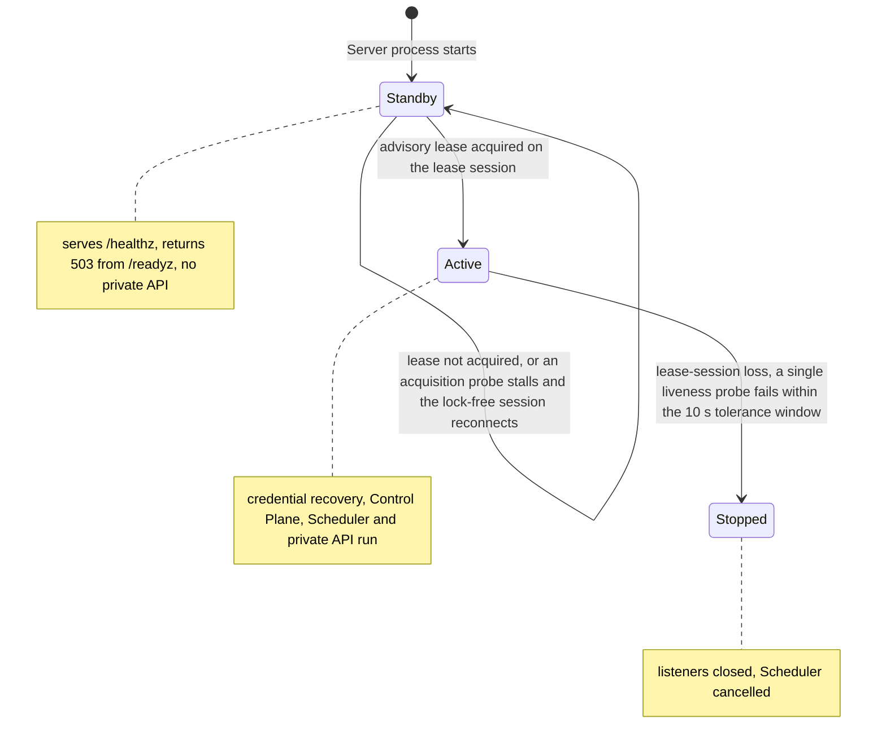
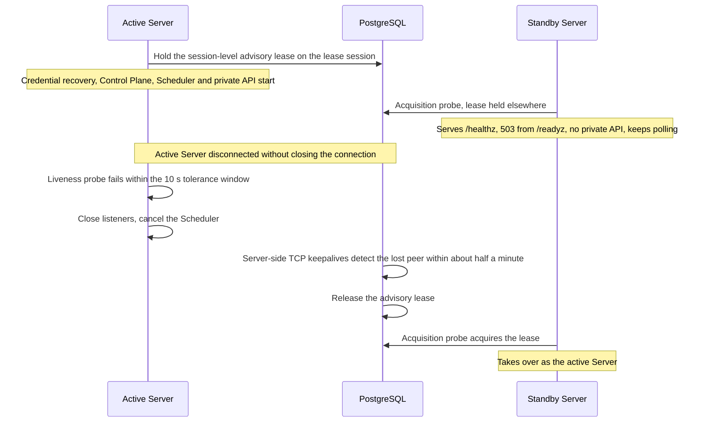
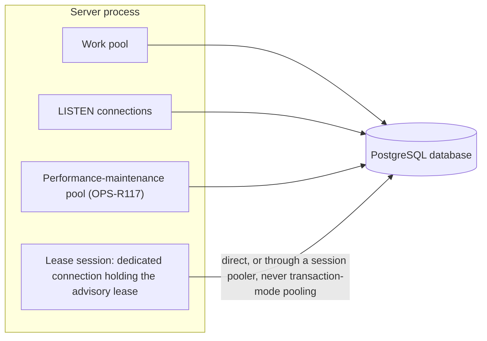

# Persistence

Requirement prefix: `PER` · [Specification index](../README.md)

## Purpose and scope

This document owns the persistence rules that belong to no single domain: one
active Server per PostgreSQL database, the session-level PostgreSQL advisory
lease that enforces it, the standby Server, detection of lease-session loss and
its time bounds, the connection pooling that the lease needs, and what must
not stand in for that lease: an unfenced shared `runtime_agents` table or a
durable Runtime Agent principal. It also indexes the PostgreSQL state and the
transaction and serialization rules that domain documents own, so each can be
found from here while it is stated only in its owner.
<!-- from: 02#58, 20#53 -->

It leaves to other documents:

- the single-host deployment topology and its Runtime Agent processes:
  [Overview](../overview.md);
- the live Runtime Agent Registry, control leases, durable Runtime Agent
  principals, the binding-then-principal lock order and the in-memory Registry
  lock: [Control plane](../execution/control-plane.md);
- Stage admission and the owner queue pause: [Scheduler](../execution/scheduler.md);
- WorkflowRun metadata labels: [Runs](../execution/runs.md);
- Artifact scopes, CAS writes, output freezing and the StageResult acceptance
  transaction: [Artifact store](../artifacts/artifact-store.md);
- `workflow_run_events` and live event delivery:
  [Public API](../api/public-api.md);
- LLM credential records and their recovery journal:
  [Runtime config](../configuration/runtime-config.md);
- the `/healthz` and `/readyz` dependency checks, active-active Server
  replicas, the `scheduler_settings` singleton, the performance-maintenance
  connection pool and `performance_minutes`:
  [Operations](../operations/operations.md);
- shared registries: [limits](limits.md), [errors](errors.md),
  [failure model](failure-model.md) and [lifecycle](lifecycle.md).
<!-- from: 02#54, 02#58, 03#69, 03#99, 06#81, 06#129, 07#90, 16#18, 18#15, 20#11, 20#13, 20#53, 22#24, 22#38 -->

## Concepts

Terms are defined once in the [glossary](../glossary.md); this document owns
the following ones.

| Term | Meaning here |
| --- | --- |
| Advisory lease | The session-level PostgreSQL advisory lease a Server holds on a dedicated connection to be the one active Server, and the one active Control Plane instance, for its database. It is not the Runtime Agent control lease of the [Control plane](../execution/control-plane.md). |
| Lease session | The dedicated PostgreSQL connection that holds the advisory lease. |
| Active Server | The Server process that holds the advisory lease of a database and therefore runs credential recovery, the process-local Control Plane, the Scheduler and the private API. |
| Standby Server | A Server process on the same database that does not hold the advisory lease. |
| Lease-session loss | A single liveness probe of the lease session that fails within the tolerance window. |
| Tolerance window | The bounded time a lease-session liveness probe may run. |

<!-- from: 02#58, 20#53 -->

## Model

### Server roles

A Server process is a standby until it holds the advisory lease, and the active
Server stops when it detects lease-session loss:

<!-- from: 02#58, 20#53 -->

### Takeover after the active Server is disconnected

<!-- from: 02#58, 20#53 -->

### Server connections to PostgreSQL

The lease session is a dedicated connection. The Server's other PostgreSQL
pools, including the performance-maintenance pool, are specified in
[Operations](../operations/operations.md) (OPS-R117).

<!-- from: 20#53, 22#24 -->

### PostgreSQL state and its owners

| State | Owner |
| --- | --- |
| The advisory lease | This document ([PER-R2](#requirements)) |
| `workflow_run_events`, the Run replay authority, and its insert-trigger notification | [Public API](../api/public-api.md) (API-R54, API-R55) |
| `llm_credentials` and the `credential_operations` internal recovery journal | [Runtime config, LLM credential record](../configuration/runtime-config.md#llm-credential-record) (RCF-R33, RCF-R71) |
| WorkflowRun metadata labels | [Runs](../execution/runs.md) (RUN-R72, RUN-R73) |
| The `scheduler_settings` singleton and its seeding migration | [Operations](../operations/operations.md) (OPS-R48, OPS-R49, OPS-R50) |
| `performance_minutes` and its migration | [Operations](../operations/operations.md) (OPS-R150, OPS-R151, OPS-R152) |
| Not PostgreSQL state: the live Runtime Agent Registry | [Control plane](../execution/control-plane.md) (CTL-R62) |

<!-- from: 02#54, 06#81, 06#129, 16#18, 20#11, 20#13, 22#38 -->

## Requirements

### One active Server per database

**PER-R1.** The supported deployment has one active Server/Scheduler process
per PostgreSQL database (LIM-PER-1) and one or more Runtime Agent processes;
that Server is the one active Control Plane instance of the database. The host
topology is [SYS-R10](../overview.md).
<!-- from: 02#58, 20#53 -->

**PER-R2.** Before credential recovery, the process-local Control Plane, the
Scheduler or the private API starts, the Server must hold a session-level
PostgreSQL advisory lease on a dedicated connection, the lease session.
<!-- from: 02#58, 20#53 -->

**PER-R3.** Until it acquires the advisory lease, a standby Server has only
public health and 503 readiness: it serves `/healthz`, returns 503 from
`/readyz` and has no private API. The general `/readyz` dependency check is
[OPS-R115](../operations/operations.md).
<!-- from: 02#58, 20#53 -->

**PER-R4.** When the active Server detects lease-session loss, it closes its
listeners and cancels the Scheduler; the standby then takes over
(FAIL-PER-1).
<!-- from: 02#58, 20#53 -->

**PER-R11.** Multiple active Control Plane replicas, shared fleet coordination
and durable liveness state must not be approximated by sharing an unfenced
`runtime_agents` table.
<!-- from: 02#58 -->

**PER-R12.** Durable certificate principals and their label assignments
([Control plane](../execution/control-plane.md)) are configuration records
only; they never imply that a process is live, leased or eligible.
<!-- from: 02#58 -->

### Lease-session loss

**PER-R5.** Lease-session loss is a single liveness probe (LIM-PER-2) that
fails within a bounded tolerance window of ten seconds (LIM-PER-3). A probe may
run that long, so a transient client-to-database stall completes late instead
of being cancelled and dropping the lock-holding session, but a genuinely lost
session fails within the window.
<!-- from: 02#58, 20#53 -->

Rationale: the window absorbs transient stalls.
<!-- from: 02#58 -->

**PER-R6.** The lease session sets server-side TCP keepalives of 10 s idle
(LIM-PER-4), a 5 s interval (LIM-PER-5), 3 probes (LIM-PER-6) and a 30 s user
timeout (LIM-PER-7), so PostgreSQL releases the lease within about half a
minute (LIM-PER-8) when the active Server's host disappears without closing the
connection (LIFE-PER-1).
<!-- from: 20#53 -->

**PER-R7.** The tolerance window stays below that keepalive bound, so a
disconnected active Server stops before PostgreSQL releases the lock to a
standby (FAIL-PER-1).
<!-- from: 20#53 -->

**PER-R8.** A standby whose acquisition probe hits a transient stall
reconnects its lock-free session and keeps polling rather than exiting the
process (FAIL-PER-2).
<!-- from: 20#53 -->

### Connection pooling for the lease

**PER-R9.** The lease session requires direct PostgreSQL or session pooling,
not transaction-mode pooling.
<!-- from: 20#53 -->

**PER-R10.** Behind a session pooler, the pooler's own client keepalive
settings bound how long a vanished Server keeps the lease (LIFE-PER-1).
<!-- from: 20#53 -->

### Related rules owned elsewhere

- Active-active Server replicas: [OPS-R5](../operations/operations.md).

<!-- from: 02#58 -->

### Transactions and serialization owned elsewhere

| Rule | Owner |
| --- | --- |
| RunStore and ArtifactRegistry in one PostgreSQL transaction when the Scheduler accepts a StageResult, applies Workflow output mappings and possibly makes the WorkflowRun terminal, including across a storage split | [ART-R92](../artifacts/artifact-store.md) |
| Uniqueness wait for concurrent first writes to a scope and for identical-content writes to different bindings | [ART-R61](../artifacts/artifact-store.md) |
| Empty output set of a Run with no Artifact bindings and the absent Artifact scope row | [ART-R96](../artifacts/artifact-store.md) |
| Binding-then-principal lock order of Run creation, binding mutation, Agent-label mutation and allocation pinning | [CTL-R89](../execution/control-plane.md) |
| Serialization of Agent-label and binding mutations against allocation pinning | [CTL-R90](../execution/control-plane.md) |
| No database or network operation while holding the in-memory Runtime Registry lock | [CTL-R87](../execution/control-plane.md) |
| One database serialization boundary for the owner queue pause and normal Stage admission | [SCH-R156](../execution/scheduler.md) |

<!-- from: 03#69, 03#99, 07#90, 18#15 -->

## Limits, failures and errors

Limits ([registry](limits.md)):

- LIM-PER-1 — one active Server/Scheduler process per PostgreSQL database
  (PER-R1). The single active Server/Control Plane of the deployment host is
  LIM-SYS-2 ([Overview](../overview.md)).
- LIM-PER-2 — a single failed liveness probe is lease-session loss (PER-R5).
- LIM-PER-3 — tolerance window of a liveness probe: ten seconds (PER-R5).
- LIM-PER-4 — lease-session TCP keepalive idle time: 10 s (PER-R6).
- LIM-PER-5 — lease-session TCP keepalive interval: 5 s (PER-R6).
- LIM-PER-6 — lease-session TCP keepalive probes: 3 (PER-R6).
- LIM-PER-7 — lease-session TCP user timeout: 30 s (PER-R6).
- LIM-PER-8 — release of the lease after the active Server's host disappears
  without closing the connection: within about half a minute (PER-R6).

Failure outcomes ([failure model](failure-model.md)):

- FAIL-PER-1 — the active Server's lease session (PER-R4, PER-R5, PER-R6,
  PER-R7, PER-R10).
- FAIL-PER-2 — a standby's lease acquisition probe (PER-R3, PER-R8).

Lifecycle ([lifecycle](lifecycle.md)):

- LIFE-PER-1 — the advisory lease (PER-R2, PER-R4, PER-R6, PER-R10).

Errors ([registry](errors.md)): `/readyz` returns `503` on a standby Server
until it acquires the advisory lease (PER-R3). The `/readyz` `503` for an
unusable working DB connection path is owned by
[Operations](../operations/operations.md).

<!-- from: 02#58, 20#53 -->

## Invariants

1. A PostgreSQL database has at most one active Server, and a Server starts
   credential recovery, the Control Plane, the Scheduler or the private API
   only after it holds the advisory lease (PER-R1, PER-R2); tests
   `TestPostgresControlPlaneLeaseStandbyAndTakeover` in
   [`internal/app/single_active_postgres_test.go`](../../../internal/app/single_active_postgres_test.go)
   and `TestPostgresControlPlaneLeaseHolderIgnoresOtherDatabases` in
   [`internal/app/single_active_database_postgres_test.go`](../../../internal/app/single_active_database_postgres_test.go).
2. A transient client-to-database stall that completes within the tolerance
   window does not drop the lock-holding session (PER-R5); test
   `TestPostgresControlPlaneLeaseToleratesTransientStall` in
   [`internal/app/single_active_proxy_postgres_test.go`](../../../internal/app/single_active_proxy_postgres_test.go).
3. A disconnected active Server stops before PostgreSQL releases the lock to a
   standby (PER-R7); test
   `TestPostgresControlPlaneLeaseStopsOnSustainedOutageBeforeTakeover` in
   [`internal/app/single_active_proxy_postgres_test.go`](../../../internal/app/single_active_proxy_postgres_test.go).
4. A standby survives a transient stall of its acquisition probe (PER-R8);
   test `TestPostgresControlPlaneLeaseStandbySurvivesAcquisitionStall` in
   [`internal/app/single_active_proxy_postgres_test.go`](../../../internal/app/single_active_proxy_postgres_test.go).
5. The lease session carries the keepalive values of PER-R6; test
   `TestPostgresControlPlaneLeaseSessionDetectsVanishedHolder` in
   [`internal/app/single_active_postgres_test.go`](../../../internal/app/single_active_postgres_test.go).

<!-- from: 02#58, 20#53 -->

## Non-goals

- Multiple active Control Plane replicas, shared fleet coordination and durable
  liveness state; they are deferred together and must not be approximated by
  sharing an unfenced `runtime_agents` table (PER-R11).

<!-- from: 02#58 -->
