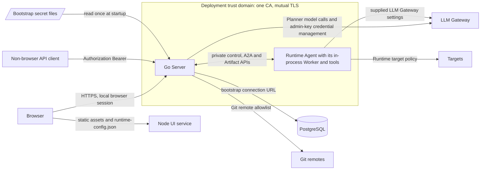
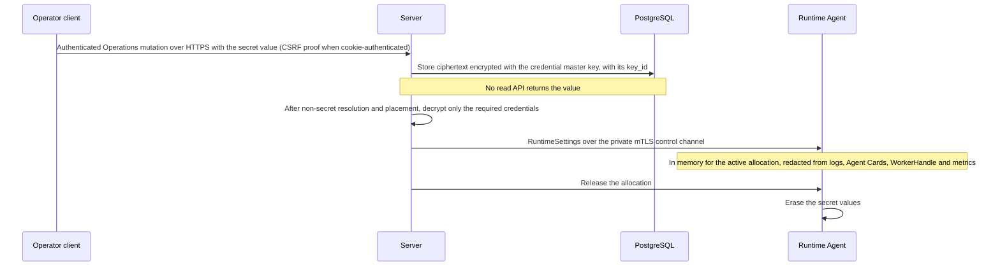
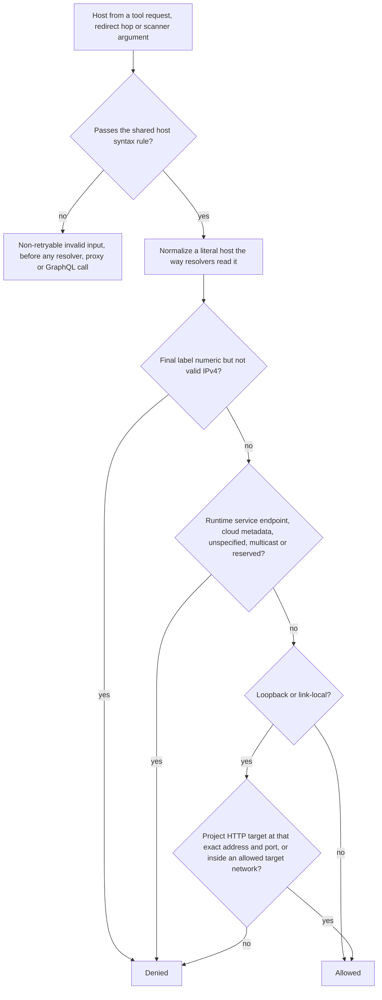

# Security

Requirement prefix: `SEC` · [Specification index](../README.md)

## Purpose and scope

This document owns the security model that every domain relies on:

- the trust boundaries of a deployment;
- the deployment trust domain: its single CA, mutual TLS on the private
  control protocol, and the peer checks between Server and Runtime Agents;
- which bootstrap secrets stay inside the Server and which credentials a
  Runtime Agent never receives;
- the credential-encryption master key and the shared check for bootstrap
  secret files;
- how credential secrets are accepted, encrypted and decrypted, and how
  RuntimeSettings secrets travel, live in memory and are erased;
- allocation-scoped trust roots and the Worker-proxy bypass of private traffic;
- local authentication: the local principal, the local-auth file, password
  hashing, login bounds, the failed-login limiter, trusted proxies, the
  browser-session bootstrap settings and the authentication status codes;
- the Runtime target policy for HTTP, scanner and Caido destinations, with its
  egress and DNS boundary.

It leaves to other documents:

- the certificate-derived Runtime Agent principal, registration and endpoint
  binding, and the Agent Card secret scan: [Control plane](../execution/control-plane.md);
- credential records, LLM Gateway credential management, label resolution and
  the content of RuntimeSettings: [Runtime configuration](../configuration/runtime-config.md);
- the session cookie, session lifetime, CSRF, CORS and live-event
  authentication: [Public API](../api/public-api.md);
- request IDs, diagnostic content and redaction in telemetry:
  [Observability](observability.md);
- secret handling inside individual domains, indexed under
  [Security rules owned by other documents](#security).

<!-- from: 02#7, 02#21, 02#82, 04#68, 06#79, 06#122, 06#143, 06#145, 07#47, 11#24 -->

## Concepts

- **Deployment trust domain**: the Server and every Runtime Agent, rooted in
  one deployment-owned CA and connected by mutual TLS.
- **Control Plane URI SAN prefix**: the reserved prefix
  `urn:contractor:control-plane:` that marks a certificate as a Control Plane
  certificate.
- **Node trust boundary**: the boundary the deployment trust domain draws
  around Contractor processes; it is not user authentication.
- **RuntimeSettings secret**: a secret value delivered to a Runtime Agent in an
  allocation's RuntimeSettings, such as the LLM Gateway token or an
  infrastructure credential.
- **Credential-encryption master key**: the 256-bit bootstrap key that encrypts
  stored credential secrets.
- **Master-key fingerprint (`key_id`)**: the non-secret digest of the master key
  stored beside each ciphertext.
- **Bootstrap secret file**: a file the Server reads once at startup that holds
  a secret: the master key file, the LLM Gateway admin binding and key files,
  and the local-auth file.
- **Local principal**: the single user principal the Server authenticates.
- **Local-auth file**: the bootstrap file that defines the local principal and
  its password hash.
- **Trusted proxy**: a reverse proxy whose forwarded client addresses the
  Server honours.
- **Insecure loopback mode**: the explicit loopback-development mode that uses a
  separately named insecure session cookie.
- **Runtime target policy**: the shared Runtime rule that decides which
  destinations HTTP, scanner and Caido tools may reach.
- **Runtime service endpoint**: an endpoint the Runtime itself depends on, which
  the target policy always denies.
- **Allowed target network**: an operator-configured CIDR network that unlocks
  loopback and link-local destinations for the target policy.

Terms are defined once in the [glossary](../glossary.md).

<!-- from: 02#7, 02#9, 02#12, 02#74, 06#84, 06#85, 06#135, 06#140, 06#144, 11#24, 11#27, 11#28 -->

## Model

### Trust boundaries



<!-- from: 01#114, 02#7, 02#11, 02#12, 06#27, 06#85, 06#86, 06#91, 06#144, 11#24, 24#18 -->

- **Deployment trust domain.** The Server and the Runtime Agents trust each
  other through one CA (SEC-R1). The boundary is between nodes; it does
  not authenticate users (SEC-R10).
- **User boundary.** Browsers and API clients authenticate to the Go Server as
  the local principal (SEC-R38). The boundary of the Node UI service
  is specified in [UI](../ui/ui.md).
- **Bootstrap secrets.** The database connection URL is Server bootstrap
  configuration (SEC-R12), and the Server reads the bootstrap secret files at
  startup (SEC-R22).
- **Inside a Runtime Agent.** The Worker and its tools share the Runtime Agent
  process; what a SandboxProfile such as `local-workdir@1` isolates is specified
  in [Runtime Agent](../execution/runtime-agent.md).
- **Egress.** Runtime tool traffic passes the Runtime target policy
  (SEC-R63); Server Git traffic passes the Git remote allowlist
  ([Git import](../artifacts/git-import.md)).
- **LLM Gateway.** Two components cross this boundary with secrets. The Server
  makes Server-side Planner model calls with credentials it decrypts just in
  time (SEC-R28, [RCF-R46](../configuration/runtime-config.md)) and sends a
  Gateway admin key only to the bound Gateway URL
  ([RCF-R60](../configuration/runtime-config.md)). A Runtime Agent reaches the
  Gateway with the LLM Gateway settings supplied in its RuntimeSettings
  (SEC-R13, SEC-R29).
- **Content channels.** The selected LLM Gateway receives the model
  conversation ([Memory](../tools/memory.md)), and a telemetry sink with content
  capture enabled is trusted with unredacted content
  ([Observability](observability.md)).
- **Configuration trust.** Trust in configuration comes from the configured
  catalog boundary and the mTLS control channel
  ([TPL-R64](../configuration/agent-templates.md)).

<!-- from: 01#76, 01#84, 01#114, 02#7, 02#12, 06#27, 06#85, 06#86, 06#91, 07#51, 07#114, 08#58, 11#24, 24#18 -->

### Secret material

The diagram follows one infrastructure credential secret from acceptance to
erasure.



<!-- from: 02#74, 06#84, 07#49, 07#51 -->

### Target policy decision



On the direct path the client checks every address a name resolves to and
connects only to a permitted one (SEC-R81). How the policy applies on a forward-proxy route is
specified in [HTTP and Caido tools](../tools/http-caido.md).

<!-- from: 11#25, 11#26, 11#27, 11#28, 11#30, 11#31 -->

## Requirements

### Deployment trust domain and mutual TLS

**SEC-R1.** The Server and the Runtime Agents form one deployment-owned trust
domain rooted in a single CA.
<!-- from: 02#7 -->

**SEC-R2.** The private control protocol uses mutual TLS.
<!-- from: 02#7 -->

**SEC-R3.** All Runtime Agents are equally trusted and have the same
control-protocol privileges; the certificate does not encode per-agent roles or
an authorization policy. Runtime Agents may still advertise different execution
capabilities, because their immutable process environments contain different
runtime, tool or sandbox dependencies.
<!-- from: 02#7 -->

**SEC-R4.** Control Plane accepts any otherwise-valid Runtime Agent certificate
that chains to the deployment CA.
<!-- from: 02#8 -->

**SEC-R5.** A Runtime Agent accepts a Control Plane peer only when both of the
following hold:

- its certificate chains to the same CA;
- one URI SAN starts with the exact canonical prefix
  `urn:contractor:control-plane:` and has a non-empty instance identifier after
  the prefix, for example
  `urn:contractor:control-plane:01951d4e-ec24-7df2-a9c1-18d55d123456`.

<!-- from: 02#8, 02#9 -->

**SEC-R6.** The URI SAN, rather than the CN or OU, distinguishes Control Plane
certificates from the otherwise-equivalent Runtime Agent certificates.
<!-- from: 02#10 -->

Rationale: prefix matching permits certificate rotation and multiple future
Control Plane instances without an agent-side allowlist.
<!-- from: 02#10 -->

**SEC-R7.** CA issuance must ensure that Runtime Agent certificates do not
contain the reserved Control Plane URI SAN prefix.
<!-- from: 02#10 -->

**SEC-R8.** For HTTPS/TCP, normal endpoint-name verification against a DNS/IP
SAN still applies. The reserved URI SAN is an additional Control Plane role
check, not a replacement for standard TLS endpoint validation.
<!-- from: 02#11 -->

**SEC-R9.** The same peer check protects Server calls to both the Runtime Agent
control endpoint and its A2A endpoint.
<!-- from: 02#11 -->

**SEC-R10.** The deployment trust domain is a node trust boundary, not user
authentication: user clients do not receive certificates from the deployment CA,
and an in-process Worker has no identity or certificate separate from its
Runtime Agent.
<!-- from: 02#12 -->

**SEC-R11.** Separately from TLS, Control Plane keeps the allocation invariant
that lifecycle messages and final reports are associated with the Runtime Agent
to which the allocation was issued ([CTL-R17](../execution/control-plane.md),
[CTL-R18](../execution/control-plane.md)). That association protects
execution-state consistency; it does not give different Runtime Agents different
privileges.
<!-- from: 02#12, 02#21, 07#54 -->

### Bootstrap configuration and Runtime credentials

**SEC-R12.** The PostgreSQL connection URL is Server bootstrap configuration. It
never appears in AgentTemplate, AllocationSpec or Runtime Agent configuration
supplied by Control Plane.
<!-- from: 01#114 -->

**SEC-R13.** A Runtime Agent receives no database or S3 credential: artifact
access uses the allocation-bound Server API, and model access uses the supplied
LLM Gateway settings.
<!-- from: 01#114 -->

**SEC-R14.** Deployment and allocation-scoped secrets enter a Runtime Agent only
through `RuntimeSettings`; Workflow parameters are not a secret channel
([RUN-R15](../execution/runs.md)).
<!-- from: 00#56 -->

### Credential-encryption master key

**SEC-R15.** The Contractor credential-encryption master key is a 256-bit
bootstrap secret (LIM-SEC-1) kept outside PostgreSQL.
<!-- from: 06#84 -->

**SEC-R16.** The Server receives only an absolute `--credential-master-key-file`
path. Command-line literal and environment-variable key values are forbidden.
<!-- from: 06#84 -->

**SEC-R17.** The key file contains RFC 4648 base64 for exactly 32 bytes
(LIM-SEC-1), with at most one trailing newline (LIM-SEC-2).
<!-- from: 06#84 -->

**SEC-R18.** The Server rejects a missing, malformed, non-regular, symlinked,
group-readable or world-readable key file, and reads the key file once during
startup (FAIL-SEC-1).
<!-- from: 06#84 -->

**SEC-R19.** The database stores with each ciphertext a non-secret `key_id`,
formatted as the lowercase `sha256:<hex>` digest of the decoded key bytes, so
that a future keyring migration does not require a schema change.
<!-- from: 06#84 -->

Rationale: the fingerprint is not secret because the key has 256 bits of random
entropy.
<!-- from: 06#84 -->

**SEC-R20.** The Server accepts one active master key (LIM-SEC-3).
<!-- from: 06#84 -->

**SEC-R21.** Database backups and master-key backups must be protected and
stored separately.
<!-- from: 06#101 -->

Rationale: encrypting the database protects a PostgreSQL dump without the
master-key file; it does not protect against compromise of the running Server
process or host.
<!-- from: 06#101 -->

### Bootstrap secret files

**SEC-R22.** The credential master key file, the LLM Gateway admin binding and
key files ([Runtime configuration](../configuration/runtime-config.md)) and the
local-auth file share one file check.
<!-- from: 06#85, 06#91 -->

**SEC-R23.** Because permission bits only restrict group and other access, each
bootstrap secret file must also be owned by the Server's effective UID or by
root.
<!-- from: 06#85 -->

**SEC-R24.** The Server checks the path, then opens the file without following a
symlink or waiting for a FIFO writer, and re-checks the open handle, so a FIFO,
device or file swapped in between is refused instead of blocking startup
(FAIL-SEC-1).
<!-- from: 06#85 -->

### Credential secrets

**SEC-R25.** Header names in infrastructure credentials are validated, and
hop-by-hop, routing and body-framing headers are forbidden.
<!-- from: 07#49 -->

**SEC-R26.** Infrastructure credential secret values are accepted once, through
an authenticated Operations mutation over HTTPS. A cookie-authenticated browser
call additionally requires the session-bound CSRF proof ([Public
API](../api/public-api.md)).
<!-- from: 07#49 -->

**SEC-R27.** Infrastructure credential secret values are encrypted with the
Contractor credential master key and are never returned by any read API.
<!-- from: 07#49 -->

**SEC-R84.** Managed LiteLLM credentials keep their own create and delete
lifecycle and Gateway binding ([RCF-R116](../configuration/runtime-config.md)).
<!-- from: 07#49 -->

**SEC-R28.** The Server decrypts only the credentials required for a Planner
invocation or a selected allocation, and only after non-secret resolution and
placement succeed.
<!-- from: 07#51 -->

**SEC-R85.** The active-binding, Run and allocation deletion fence applies to
both LLM and adapter credentials ([RCF-R54](../configuration/runtime-config.md)).
<!-- from: 07#51 -->

### RuntimeSettings secrets

**SEC-R29.** RuntimeSettings secret fields are accepted only over the private
mTLS control channel.
<!-- from: 02#74, 07#51 -->

**SEC-R30.** RuntimeSettings secret values remain in memory and are retained for
the active allocation (LIFE-SEC-1).
<!-- from: 02#74, 07#51 -->

**SEC-R31.** RuntimeSettings secret values are redacted from logs, Agent Cards,
WorkerHandle, metrics and durable StageExecution state, and never enter
AgentTemplate, instructions, model context, durable provenance, ADK State or the
private live-State snapshot.
<!-- from: 02#74, 07#51 -->

**SEC-R32.** RuntimeSettings secret values are erased during allocation release
(LIFE-SEC-1).
<!-- from: 02#74, 07#51 -->

**SEC-R33.** Durable execution records and metrics may retain the non-secret
LLMGatewayConfig and credential refs, never their resolved token.
<!-- from: 02#74 -->

**SEC-R34.** A token that expires during a long allocation fails through the
ordinary bounded Gateway error path (FAIL-SEC-2); silently replacing the active
settings snapshot is not allowed
([RCF-R162](../configuration/runtime-config.md)).
<!-- from: 02#74 -->

### Allocation trust roots and the Worker proxy

**SEC-R35.** The private registration, heartbeat and control endpoint, the
Runtime Agent A2A server, the Artifact API client and any Server-internal
traffic always bypass the Worker proxy.
<!-- from: 07#112 -->

**SEC-R36.** The Runtime never mutates its own control-channel trust roots.
<!-- from: 07#112 -->

**SEC-R37.** A temporary CA bundle is allocation-scoped, readable only by the
process or child that needs it, and removed with the allocation workspace
(LIFE-SEC-2).
<!-- from: 07#112 -->

### Local principal

**SEC-R38.** The Server has exactly one local principal (LIM-SEC-4).
<!-- from: 06#135 -->

**SEC-R86.** The Server reads the local principal once at startup from the
local-auth file named by the absolute `--local-auth-file` bootstrap path; that
file has this shape:

```yaml
user:
  userId: local-admin
  username: admin
  passwordHash: $argon2id$v=19$m=65536,t=3,p=1$...
```

<!-- from: 06#135, 06#136 -->

**SEC-R39.** `userId` uses the shared ID grammar and is the immutable UserScope
owner and audit actor.
<!-- from: 06#137 -->

**SEC-R40.** `username` is case-sensitive, 1 through 64 ASCII characters
(LIM-SEC-5), and matches `[A-Za-z0-9][A-Za-z0-9_.-]*`.
<!-- from: 06#137 -->

**SEC-R41.** The local-auth file must be absolute, regular, non-symlinked and
unreadable by group or world.
<!-- from: 06#137 -->

**SEC-R42.** The local-auth file contains one Argon2id PHC string with version
19, 64 MiB memory, three iterations, parallelism one, a 16-byte random salt and
a 32-byte output (LIM-SEC-6). The Server rejects another algorithm or parameter
set rather than silently weakening or unexpectedly amplifying login cost.
<!-- from: 06#137 -->

**SEC-R43.** The local principal owns both ordinary user and Operations
capabilities.
<!-- from: 06#146 -->

**SEC-R44.** API components receive `userId` from the authenticated request
context rather than from a request field or UI state.
<!-- from: 06#146 -->

**SEC-R45.** Authentication failure is `401`, authenticated lack of a future
permission is `403`, and ownership checks retain their non-disclosing `404`
behavior.
<!-- from: 06#146 -->

**SEC-R46.** A future OIDC or session adapter and RBAC reuse the same principal
boundary rather than changing Workflow, Artifact or credential semantics.
<!-- from: 06#146 -->

### Passwords and login

**SEC-R47.** `contractor server auth hash-password` reads the password twice
from an interactive terminal without echo and emits the bootstrap YAML. It
accepts no password command-line argument or environment variable.
<!-- from: 06#138 -->

**SEC-R48.** Passwords are 12 through 1,024 UTF-8 bytes (LIM-SEC-7), are never
trimmed and are never logged.
<!-- from: 06#138 -->

**SEC-R49.** Login accepts a raw JSON body of at most 8 KiB (LIM-SEC-8),
independently of the decoded password's UTF-8 byte limit. Additional whitespace
or equivalent escaping counts toward the raw-body limit. A request beyond the
limit is rejected before password verification, including when Content-Length is
absent (FAIL-SEC-3).
<!-- from: 06#138 -->

Rationale: JSON escaping can represent each supported one-byte control
character with six bytes (`\u0001`), so a 1,024-byte password can occupy 6,144
encoded bytes. With a maximum 64-byte ASCII username and 29 bytes of compact
JSON framing, the request occupies at most 6,237 bytes; 8 KiB admits this
standard serialization with bounded formatting headroom.
<!-- from: 06#138 -->

**SEC-R50.** Login uses `Cache-Control: no-store` and one generic failure
response for an unknown username and for a bad password (FAIL-SEC-3).
<!-- from: 06#139 -->

**SEC-R51.** Before Argon2 verification, an in-memory limiter permits at most
five failed attempts per rolling minute for one client IP (LIM-SEC-9) and 30
process-wide (LIM-SEC-10). An excess attempt returns `429` with a bounded
`Retry-After` and creates no account lockout (FAIL-SEC-3).
<!-- from: 06#139 -->

### Client IP and trusted proxies

**SEC-R52.** The client IP is the socket peer unless that peer is listed in the
optional `trustedProxies` setting: exact IPs or CIDR prefixes, given by the
repeatable `--trusted-proxy` or the comma-separated
`CONTRACTOR_TRUSTED_PROXIES`.
<!-- from: 06#140 -->

**SEC-R53.** Behind a trusted proxy, the Server walks `X-Forwarded-For` from the
proxy-appended end toward the client and attributes the failure to the first hop
that is not itself a trusted proxy, so a client cannot choose its limiter bucket
by forwarding headers of its own.
<!-- from: 06#140 -->

**SEC-R54.** A peer outside the trusted-proxy list is always the client,
whatever it forwards.
<!-- from: 06#140 -->

**SEC-R55.** A forwarded chain the proxy did not populate, or one containing an
unparseable hop, degrades to the proxy address rather than failing login
(FAIL-SEC-3).
<!-- from: 06#140 -->

**SEC-R56.** Catch-all prefixes in `trustedProxies` are rejected at startup.
<!-- from: 06#140 -->

**SEC-R87.** By default no proxy is trusted.
<!-- from: 06#140 -->

**SEC-R57.** A production deployment behind a reverse proxy must list that
proxy.
<!-- from: 06#140 -->

Rationale: with the default, every client behind an unlisted reverse proxy
shares one per-IP window.
<!-- from: 06#140 -->

### Browser-session bootstrap settings

**SEC-R58.** The local browser session uses these bootstrap settings:

| Setting | Environment equivalent | Use |
| --- | --- | --- |
| `--local-auth-file`, required, absolute | `CONTRACTOR_LOCAL_AUTH_FILE` | Local-auth file (SEC-R86) |
| `--browser-origin`, repeatable, exact | `CONTRACTOR_BROWSER_ORIGINS`, comma-separated | Allowed browser origins ([Public API](../api/public-api.md)) |
| `--insecure-loopback-cookie`, optional | `CONTRACTOR_INSECURE_LOOPBACK_COOKIE` | Insecure loopback mode (SEC-R59) |
| `--trusted-proxy`, repeatable | `CONTRACTOR_TRUSTED_PROXIES`, comma-separated | Trusted proxies (SEC-R52) |

<!-- from: 06#144 -->

**SEC-R59.** Insecure loopback mode uses only the `contractor_loopback_session`
cookie and requires an IP-literal loopback Server listener.
<!-- from: 06#144 -->

**SEC-R60.** Insecure loopback mode permits exact HTTP browser origins only on
loopback or RFC 1918 private IPv4 literals, allowing an explicitly trusted
local-network demo proxy. Public HTTP addresses and hostnames remain invalid.
<!-- from: 06#144 -->

**SEC-R61.** The production session cookie name is never downgraded.
<!-- from: 06#144 -->

**SEC-R62.** The non-browser `Authorization: Bearer` path maps to the same
local-auth principal and requires neither Origin nor CSRF.
<!-- from: 06#144 -->

### Runtime target policy

**SEC-R63.** `http-tools@1`, every `scan@1` operation and request-bound
`caido@1` actions share one Runtime target policy
([`runtime/src/contractor_runtime/core/target_policy.py`](../../../runtime/src/contractor_runtime/core/target_policy.py)).
The policy classifies IP addresses, not URL text.
<!-- from: 11#24 -->

#### Host syntax

**SEC-R64.** Every host first passes one shared syntax rule. The rule covers
`http_request` URLs and each redirect hop; Caido raw and captured Replay,
Automate and active-workflow connection hosts; and every scanner URL or host
argument.
<!-- from: 11#25 -->

**SEC-R65.** A host is an IP literal (a Caido connection host may bracket an
IPv6 literal) or a name of ASCII labels made of letters, digits, `_` and `-`,
each label 1..63 bytes (LIM-SEC-11) and not starting with `-`, with at most 253
bytes in total plus an optional final dot (LIM-SEC-12). Docker-compose service
names such as `juice_shop` therefore work everywhere.
<!-- from: 11#25 -->

**SEC-R66.** A Unicode name must IDNA-encode, and httpx sends and Katana
canonicalizes its A-label. An `xn--` label must decode.
<!-- from: 11#25 -->

**SEC-R67.** Percent-escapes (`%6c%6fcalhost`), sub-delimiters (`a!b$c.example`)
and IPv6 zone identifiers are rejected as non-retryable invalid input
(`http_request_invalid`, `caido_request_invalid` or the scanner's input error)
before any resolver, proxy or GraphQL call (FAIL-SEC-4).
<!-- from: 11#25 -->

Rationale: resolvers and forward proxies disagree about these forms.
<!-- from: 11#25 -->

#### Literal hosts

**SEC-R68.** A literal host is first normalized the way resolvers read it:
shortened, single-number, octal and hexadecimal IPv4 forms (`127.1`,
`2130706433`, `0x7f000001`, `0`), IPv4-mapped IPv6 and the NAT64 well-known
prefix `64:ff9b::/96` all classify as the IPv4 address they reach.
<!-- from: 11#26 -->

**SEC-R69.** A host whose final label is numeric but which is not valid IPv4 is
denied rather than guessed.
<!-- from: 11#26 -->

#### Destinations

**SEC-R70.** Runtime service endpoints are always denied, by host name plus port
and by every resolved address plus port. They are the LLM Gateway, the Artifact
API, the telemetry collector, the forward proxy, the Caido control API, Control
Plane, the advertised control and A2A URLs and the private listener. A loopback
or unspecified endpoint address protects every loopback address on that port.
<!-- from: 11#27 -->

**SEC-R71.** Cloud metadata destinations are always denied: `169.254.169.254`,
`169.254.170.2`, `169.254.170.23`, `100.100.100.200`, `fd00:ec2::254`,
`fd00:ec2::23`, and the names `metadata`, `metadata.goog`,
`metadata.google.internal`, `instance-data` and `instance-data.ec2.internal`.
<!-- from: 11#27 -->

**SEC-R72.** Unspecified addresses, `0.0.0.0/8`, multicast and reserved
addresses (including IPv4 `240.0.0.0/4` and broadcast) are always denied.
<!-- from: 11#27 -->

**SEC-R73.** Loopback (`127.0.0.0/8`, `::1`) and link-local (`169.254.0.0/16`,
`fe80::/10`) destinations are denied unless the allocation's project HTTP target
(`httpOriginTarget`) resolves to that exact address and port, or an
operator-allowed target network contains them.
<!-- from: 11#27 -->

**SEC-R74.** Private networks (RFC 1918, the shared address space
`100.64.0.0/10`, IPv6 unique local `fc00::/7`), other non-global ranges and
global addresses are allowed.
<!-- from: 11#27 -->

Rationale: internal application targets usually live on private networks, so
they need no setting; only the destinations that reach the Runtime host itself
or its link are gated.
<!-- from: 11#28 -->

#### Allowed target networks

**SEC-R75.** Additional allowed target networks are an immutable Runtime Agent
startup setting: `--allowed-target-network CIDR` (repeatable) or the
comma-separated `CONTRACTOR_ALLOWED_TARGET_NETWORKS`, at most 64 strict CIDR
networks (LIM-SEC-13). They serve same-host deployments and local evaluations,
for example `127.0.0.0/8` when targets run beside the Runtime.
<!-- from: 11#28 -->

**SEC-R76.** An allowed target network never unlocks a Runtime service endpoint,
a metadata address or another always-denied destination.
<!-- from: 11#28 -->

**SEC-R77.** A project target on loopback needs no operator setting: its own
origin is allowed for the allocation that receives it.
<!-- from: 11#28 -->

#### Denials

**SEC-R78.** Every denial, whether found before sending, at connect time or by
the proxy route, is the non-retryable `http_target_denied`; scanners report
`scan_target_denied`, or `scan_target_unresolved` when the host did not resolve
(FAIL-SEC-4).
<!-- from: 11#29 -->

**SEC-R79.** Caido Replay, Automate and request-bound active workflows report
the non-retryable `caido_target_denied` before any GraphQL mutation
(FAIL-SEC-4).
<!-- from: 11#29 -->

**SEC-R80.** Because Caido resolves captured or supplied target names, the
Runtime checks their names and literal addresses without a separate target DNS
lookup.
<!-- from: 11#29 -->

#### Egress and DNS

**SEC-R81.** The direct client resolves the host once per TCP connection inside
its network backend, checks every candidate address and connects only to a
permitted one. There is no second lookup, so DNS rebinding cannot swap the
checked address for another one.
<!-- from: 11#30 -->

**SEC-R82.** HTTPS still verifies the certificate against the URL host name.
<!-- from: 11#30 -->

**SEC-R83.** Redirect hops and retries open connections through the same check.
<!-- from: 11#30 -->

## Interfaces

- Login, session and logout routes: the `Auth` operations of
  [`contractor-public-v1.yaml`](../../../api/openapi/contractor-public-v1.yaml).
  Session, CSRF and Origin semantics are specified in
  [Public API](../api/public-api.md).
- Server bootstrap settings owned here: `--credential-master-key-file`
  (SEC-R16) and the browser-session settings (SEC-R58).
- Runtime Agent startup setting owned here: `--allowed-target-network`
  (SEC-R75).
- Operator command: `contractor server auth hash-password` (SEC-R47).

<!-- from: 06#84, 06#138, 06#144, 11#28 -->

## Limits, failures and errors

Limits ([registry](limits.md)):

- LIM-SEC-1: credential-encryption master key of 256 bits, exactly 32 decoded
  bytes (SEC-R15, SEC-R17).
- LIM-SEC-2: at most one trailing newline in the master key file
  (SEC-R17).
- LIM-SEC-3: one active master key (SEC-R20).
- LIM-SEC-4: exactly one local principal (SEC-R38).
- LIM-SEC-5: `username` of 1 through 64 ASCII characters (SEC-R40).
- LIM-SEC-6: the Argon2id parameter set (SEC-R42).
- LIM-SEC-7: passwords of 12 through 1,024 UTF-8 bytes (SEC-R48).
- LIM-SEC-8: login raw JSON body of at most 8 KiB (SEC-R49).
- LIM-SEC-9: five failed login attempts per rolling minute per client IP
  (SEC-R51).
- LIM-SEC-10: 30 failed login attempts per rolling minute process-wide
  (SEC-R51).
- LIM-SEC-11: host name labels of 1..63 bytes (SEC-R65).
- LIM-SEC-12: host names of at most 253 bytes plus an optional final dot
  (SEC-R65).
- LIM-SEC-13: at most 64 allowed target networks (SEC-R75).

Failure outcomes ([failure model](failure-model.md)):

- FAIL-SEC-1: reading a bootstrap secret file at startup
  (SEC-R18, SEC-R24).
- FAIL-SEC-2: a model call whose LLM Gateway token expired during the
  allocation (SEC-R34).
- FAIL-SEC-3: a login attempt (SEC-R49, SEC-R50,
  SEC-R51); client-IP attribution degrades rather than failing login
  (SEC-R55).
- FAIL-SEC-4: a Runtime tool request checked by the target policy
  (SEC-R67, SEC-R78, SEC-R79).

Entity lifecycle ([lifecycle](lifecycle.md)):

- LIFE-SEC-1: RuntimeSettings secret values in Runtime Agent memory
  (SEC-R30, SEC-R32).
- LIFE-SEC-2: a temporary allocation CA bundle (SEC-R37).

Error codes ([registry](errors.md)): `http_target_denied` and
`caido_target_denied` (SEC-R78, SEC-R79); the authentication statuses `401` and
`403` (SEC-R45) and the failed-login status `429` (SEC-R51).
`scan_target_denied` and `scan_target_unresolved` are owned by
[Scanners](../tools/scanners.md) (SCN-R56), which registers the scanner
target-policy outcome as FAIL-SCN-6. `http_request_invalid` and
`caido_request_invalid` are owned by
[HTTP and Caido tools](../tools/http-caido.md); the non-disclosing `404` is
owned by [Public API](../api/public-api.md).

<!-- from: 06#84, 06#85, 06#135, 06#137, 06#138, 06#139, 06#140, 06#146, 02#74, 07#51, 07#112, 11#25, 11#28, 11#29 -->

## Security

This whole document is the shared security model. Security rules that belong
to one domain are owned by that domain's document:

| Topic | Owner |
| --- | --- |
| Workflow parameters carry no credentials or provider tokens | [Runs](../execution/runs.md), RUN-R15 |
| Public Run status projection: what is never part of public Run status | [Runs](../execution/runs.md) |
| `local-workdir@1` is lifecycle isolation, not an OS security boundary | [Runtime Agent](../execution/runtime-agent.md) |
| Allocation-scoped A2A endpoint security requirement; `tenant` is never a credential | [Runtime Agent](../execution/runtime-agent.md) |
| Fail-closed Worker proxying, proxy credential authority and the allocation CA bundle's scope | [Runtime Agent](../execution/runtime-agent.md) |
| Configuration digests are fingerprints, not authorization signatures | [AgentTemplates](../configuration/agent-templates.md), TPL-R64 |
| Durable provenance never records access material or secret-bearing RuntimeSettings values | [Scheduler](../execution/scheduler.md), SCH-R7 |
| Registration binding of `(runtime_agent_id, instance_id)` to the certificate-derived principal, the derivation of `runtime_agent_id`, SPKI verification of registered endpoints | [Control plane](../execution/control-plane.md), CTL-R17 to CTL-R22 |
| `WorkerHandle` content and the Agent Card secret scan | [Control plane](../execution/control-plane.md), CTL-R109, CTL-R110 |
| Private Artifact API mTLS authentication and allocation binding; User Artifact API binding to the authenticated UserScope | [ArtifactStore](../artifacts/artifact-store.md), ART-R40 to ART-R44, ART-R69 |
| RuntimeSettings secrets outside ADK Session, State, events and model context | [Worker](../execution/worker.md), WRK-R78, WRK-R79 |
| Worker result secret scan (`unsafe_worker_result`) | [Worker](../execution/worker.md), WRK-R60, WRK-R61 |
| Summarizer input redaction | [Worker](../execution/worker.md), WRK-R146 |
| `X-Request-ID` trust, server-side 5xx diagnostic content, tool-argument redaction, the shared secret-substitution policy and telemetry `captureContent` | [Observability](observability.md) |
| Node UI deployment boundary (`/runtime-config.json`, `apiBaseUrl`) and the UI invariants on key material, passwords, session cookies and CSRF tokens | [UI](../ui/ui.md) |
| Stored secrets are never returned; credential ID grammar, Gateway token bounds and AES-256-GCM encryption; master key required at startup when credential rows exist; decryption failure; Gateway admin bindings | [Runtime configuration](../configuration/runtime-config.md), RCF-R179, RCF-R37, RCF-R39 to RCF-R47, RCF-R58 to RCF-R60 |
| Runtime labels are not authorization roles | [Runtime configuration](../configuration/runtime-config.md), RCF-R5, RCF-R6 |
| RuntimeConfig stores only credential references; infrastructure credential kinds | [Runtime configuration](../configuration/runtime-config.md), RCF-R110, RCF-R111 |
| `ResolvedRuntimeConfigProvenance` contains no secrets | [Runtime configuration](../configuration/runtime-config.md), RCF-R166 |
| Write-only runtime-credential create and its HMAC idempotency record | [Runtime configuration](../configuration/runtime-config.md), RCF-R177 |
| Browser-origin allowlist and CORS; the session cookie; session lifetime and CSRF; live-event WebSocket authentication | [Public API](../api/public-api.md) |
| The LLM Gateway as a content channel for memory notes | [Memory](../tools/memory.md) |
| Agent Skill packages widen no authority | [Skills](../tools/skills.md) |
| No operator project directory mount; no infrastructure input is model-visible | [Workspace](../tools/workspace.md) |
| Target policy on a `tool-http` forward-proxy route; Caido credential redaction; HTTP and Caido invariants | [HTTP and Caido tools](../tools/http-caido.md) |
| Project HTTP target credential authorization and secret handling | [Projects](../artifacts/projects.md), PRJ-R74 to PRJ-R84 |
| Podman container, mount and environment boundary | [Code execution](../tools/code-execution.md) |
| Go profiling listener | [Operations](../operations/operations.md), OPS-R196 to OPS-R202 |
| Git SSH key protection and the outbound Git allowlist | [Git import](../artifacts/git-import.md), GIT-R41 to GIT-R46, GIT-R52 to GIT-R57 |

<!-- from: 00#56, 04#71, 01#76, 02#108, 07#113, 01#84, 01#113, 02#21, 02#22, 07#52, 07#54, 02#82, 03#28, 03#100, 04#58, 14#63, 14#39, 15#27, 02#76, 02#77, 04#68, 07#114, 06#27, 06#149, 06#79, 06#82, 06#86, 06#91, 07#11, 07#47, 07#93, 07#129, 06#122, 06#143, 06#145, 06#124, 08#58, 09#38, 10#4, 11#31, 11#48, 11#64, 17#40, 17#41, 21#19, 21#21, 22#59, 22#60, 24#15, 24#18 -->

## Observability

- Passwords are never logged (SEC-R48); RuntimeSettings secrets are
  redacted from logs and metrics (SEC-R31); durable records and metrics
  keep only non-secret refs (SEC-R33).
- Request-ID propagation, server-side diagnostics, redaction of tool
  arguments and errors, and telemetry content capture are owned by
  [Observability](observability.md).

<!-- from: 02#74, 02#76, 02#77, 04#68, 06#138, 07#114 -->

## Invariants

These properties follow from the cited requirements, which are authoritative.

1. A Runtime Agent never accepts a CA-valid peer as Control Plane without the
   reserved URI SAN prefix (SEC-R5); test
   `TestRuntimeAgentRejectsCAValidPeerWithoutControlPlaneURI` in
   [`internal/mtls/mtls_test.go`](../../../internal/mtls/mtls_test.go).
2. Control Plane never accepts a Runtime Agent certificate that does not chain
   to the deployment CA (SEC-R4); test
   `TestControlPlaneRejectsForeignRuntimeAgent` in
   [`internal/mtls/mtls_test.go`](../../../internal/mtls/mtls_test.go).
3. A bootstrap secret file that is relative, missing, malformed, symlinked,
   non-regular or readable by group or world is never loaded
   (SEC-R16, SEC-R17, SEC-R18, SEC-R41);
   tests `TestLoadTokenCipherRejectsUnsafeOrMalformedFiles` in
   [`internal/credentials/master_key_test.go`](../../../internal/credentials/master_key_test.go)
   and `TestLoadBootstrapRequiresOwnerOnlyStrictSingleDocument` in
   [`internal/auth/auth_test.go`](../../../internal/auth/auth_test.go).
4. Failed login attempts never exceed the per-client-IP and process-wide
   windows (SEC-R51); test `TestFailureLimiterBoundsInflightAndRollingAttempts`
   in [`internal/auth/auth_test.go`](../../../internal/auth/auth_test.go).
5. A client cannot choose its limiter bucket through forwarded headers
   (SEC-R53, SEC-R54); tests
   `TestClientIPWalksForwardedChainFromTrustedProxies` and
   `TestClientIPIgnoresForwardedHeadersWithoutTrustedProxies` in
   [`internal/auth/peer_test.go`](../../../internal/auth/peer_test.go).
6. Runtime service endpoints and cloud metadata are never reachable through
   Runtime tools, and loopback or link-local destinations are reachable only as
   the project target or inside an allowed target network
   (SEC-R70, SEC-R71, SEC-R73,
   SEC-R76); tests in
   [`runtime/tests/test_target_policy.py`](../../../runtime/tests/test_target_policy.py).
7. A RuntimeSettings secret never reaches durable state, model context or ADK
   State, and does not outlive its allocation in Runtime Agent memory
   (SEC-R31, SEC-R32).

<!-- from: 02#8, 02#9, 06#84, 06#85, 06#137, 06#139, 06#140, 11#27, 11#28, 07#51, 02#74 -->

## Non-goals

- Master-key rotation (SEC-R20).
- A Vault or KMS credential adapter. A future one may implement the same
  credential interface without changing LLMGatewayConfig or `executionConfig`.
- A closed network boundary beyond the target policy: what remains outside it
  on proxied and scanner paths is described in
  [HTTP and Caido tools](../tools/http-caido.md).

<!-- from: 06#84, 06#101, 11#31, 11#64 -->
