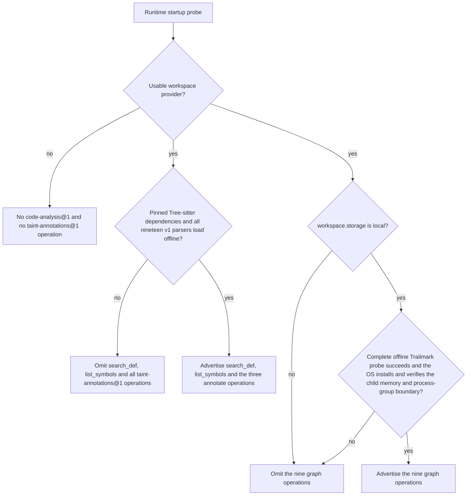
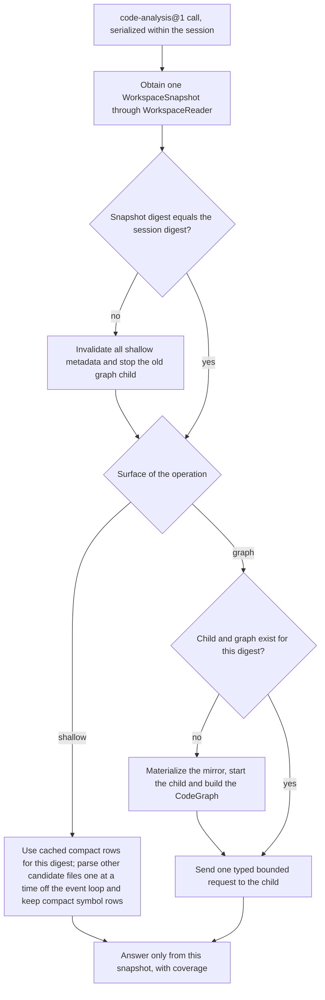
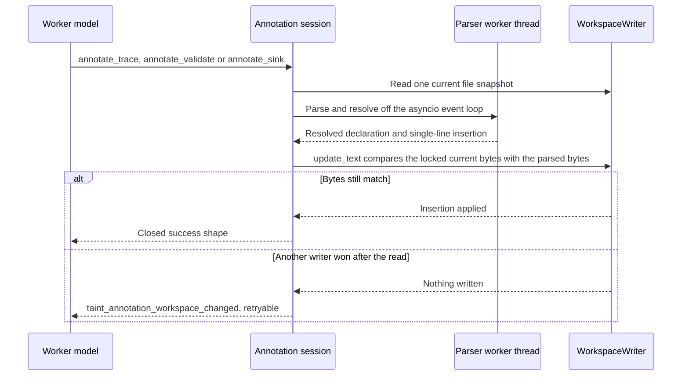

# Code analysis

Requirement prefix: `CAN` · [Specification index](../README.md)

## Purpose and scope

This document owns two Worker Toolsets that operate on a hydrated allocation
workspace:

- `code-analysis@1`, the read-only structural code-analysis Toolset built on
  Tree-sitter and Trailmark: its exported operations and their two positive
  capability levels, workspace binding, snapshot semantics, coverage and
  bounds, the shallow Tree-sitter surface, the Trailmark graph surface, graph
  symbol identity, the allocation-local Trailmark child and its lifecycle,
  errors and telemetry;
- `taint-annotations@1`, the structured source-mutation Toolset for taint
  annotation comments: its operations, structural resolution and placement,
  input limits and canonical form, atomicity and replay, errors and telemetry.

It also owns the tool selection of the bundled code-analysis discovery
AgentTemplate, the bundled trace AgentTemplate and the bundled taint-trace
Workflow.

It leaves to other documents:

- Run workspaces, `WorkspaceSnapshot`, `WorkspaceReader` and `WorkspaceWriter`,
  hydration, `direct` and `overlay` modes, the local-direct disk-authoritative
  rule, the filesystem, edit and workspace-change Toolsets, pre-terminal
  auto-export and the allocation-wide cleanup task: [Workspace](workspace.md).
- The common Toolset contract and the operation-level capability model:
  [Toolsets](toolsets.md).
- Runtime Agent capability registration and placement:
  [Control plane](../execution/control-plane.md); capacity deferral and claim
  fairness: [Scheduler](../execution/scheduler.md).
- Configuration validation: [Catalog](../configuration/catalog.md);
  AgentTemplate toolset selection:
  [AgentTemplates](../configuration/agent-templates.md); the bundled Workflow
  catalog: [Workflows](../configuration/workflows.md).
- The trace Skill package: [Skills](skills.md).
- The Podman executor: [Code execution](code-execution.md).
- Finding proposals, collections and evidence references:
  [Findings](../findings/findings.md).
- The registries of [limits](../platform/limits.md),
  [errors](../platform/errors.md), [failure outcomes](../platform/failure-model.md)
  and [entity lifecycle](../platform/lifecycle.md).

## Concepts

- **`code-analysis@1`**: the read-only structural code-analysis Toolset; it
  always analyzes the current effective workspace snapshot.
- **Shallow surface**: the `search_def` and `list_symbols` operations,
  implemented with Tree-sitter directly on the snapshot and portable across
  both workspace providers.
- **Graph surface**: the nine `code-analysis@1` operations backed by Trailmark
  and advertised only by local workspace Runtimes.
- **Code-analysis session**: the per-allocation state of `code-analysis@1`: the
  current snapshot digest and bounded derived state.
- **Trailmark child**: the allocation-local child process that builds and
  queries one Trailmark graph for the current digest.
- **Mirror**: the uniquely named copy of a snapshot's admitted managed UTF-8
  files below the allocation's private scratch directory, from which the child
  builds its graph.
- **`symbolId`**: the opaque, integrity-protected identity of one graph symbol,
  bound to one workspace digest and one complete upstream Trailmark node ID.
- **Coverage**: the bounded metadata in every successful analysis response that
  describes what was analyzed and whether the answer may be incomplete.
- **`taint-annotations@1`**: the structured source-mutation Toolset for taint
  annotation comments.
- **Taint annotation**: one machine-readable `@trace`, `@validate` or `@sink`
  comment line above a function-like declaration.
- **Annotation block**: the contiguous canonical taint annotations immediately
  adjacent to a declaration.
- **Annotation session**: the per-allocation state of `taint-annotations@1`
  through which annotation calls serialize.

Terms are defined once in the [glossary](../glossary.md).

## Model

### Toolsets, surfaces and capability levels

`code-analysis@1` exports eleven operations at two positive capability levels:
two shallow Tree-sitter operations and nine Trailmark graph operations.
`taint-annotations@1` exports three operations that are advertised together.
The Runtime's bounded offline startup probe decides which operations a Runtime
Agent advertises:



### Code-analysis call

Every `code-analysis@1` call answers from one immutable snapshot. The session
keeps only derived state for the current digest and replaces it when a call
observes a new digest:



### Annotation mutation

An annotation call computes its insertion outside the workspace lock and
commits it only if the file is unchanged:



## Requirements

### Ownership boundary

Both Toolsets keep the Runtime ownership boundary:

**CAN-R1.** The Workflow supplies the exact source and state
artifacts through `context.workspace`; for `taint-annotations@1` these are an
exact ZIP and optional overlay-state artifacts.

**CAN-R2.** The Scheduler pins those artifacts in `AllocationSpec`
and performs ordinary exact capability placement, placing only against the
Runtime Agent's frozen positive capability snapshot.

**CAN-R3.** Runtime alone chooses `local` or `memory` workspace
storage at process start and alone hydrates that disposable storage.

**CAN-R4.** The AgentTemplate grants an exact set of
model-visible operations. Installed analyzers and labels never add tools.

**CAN-R5.** The Worker receives selected tool instances and a
narrow `WorkspaceReader` (`code-analysis@1`) or `WorkspaceWriter`
(`taint-annotations@1`). It never receives an AgentTemplate, Artifact catalog,
fsspec object, the provider's physical root or a host path; neither the
Tree-sitter operations nor the allocation child used for Trailmark graph
analysis receives the provider's physical root.

**CAN-R6.** `code-analysis@1` consumes the same `WorkspaceReader`
snapshot boundary as the other model-visible workspace Toolsets
([Workspace](workspace.md)).

**CAN-R7.** `code-analysis@1` is domain-neutral. OpenAPI,
LikeC4, security review and general repository understanding may all select
it; the Scheduler contains no code-analysis-specific workflow behaviour.

**CAN-R8.** The internal Trailmark child is an implementation
detail of a trusted local Toolset. It is not the `runtime-subprocess-launcher`
infrastructure channel used for external validators, is not configured by
Runtime labels and is not a new model-visible process-execution authority. The
Server descriptor records no infrastructure channel for the `code-analysis@1`
tools.

**CAN-R9.** `taint-annotations@1` mutates only the effective
allocation workspace. It does not mutate Trailmark or any persistent graph. It
introduces no Server-side annotation service, database table, Artifact endpoint
or infrastructure channel.

### Code-analysis operations and capability levels

**CAN-R10.** The exact ref is `code-analysis@1`. Its complete exported
operation set is:

```text
search_def
list_symbols
graph_summary
find_symbol
find_callers
find_callees
paths_between
entrypoint_paths_to
attack_surface
complexity_hotspots
functions_that_raise
```

**CAN-R11.** The first two operations, `search_def` and
`list_symbols`, are the **shallow** Tree-sitter surface. They operate directly
on the current immutable `WorkspaceSnapshot` and are portable across both
workspace providers: local and memory Runtime Agents may advertise them.

**CAN-R12.** The remaining nine operations are the **graph**
surface, backed by `trailmark==0.5.0`. Only a Runtime configured with
`workspace.storage: local` whose complete offline Trailmark probe, including a
bounded offline child-process probe, succeeds advertises them. Graph operations
are a positive local-only capability in version 1: only `local` workspace
Runtime Agents advertise them, even though a memory workspace could technically
be copied to allocation scratch.

Rationale: this is a deliberate resource policy. Graph RSS belongs in a
killable child on a Runtime provisioned for disk-backed project work, while
memory Runtime Agents retain the low-overhead shallow surface.

**CAN-R13.** Trailmark runs in an allocation-local child process, so
releasing one allocation reclaims its graph RSS even though the Runtime Agent
process is long-lived.

**CAN-R14.** A local Runtime whose Trailmark probe fails may still
advertise only the two shallow operations. A Runtime without a usable
workspace provider advertises none of `code-analysis@1`.

**CAN-R15.** The two levels are a use of the existing operation-level
Toolset capability model ([Toolsets](toolsets.md)), a partial positive
capability, not a new `shallow`/`deep` capability type. The Server's
code-backed descriptor knows all eleven legal operation names.

**CAN-R16.** An AgentTemplate names the exact operations it
needs, and placement requires that exact selected set to be contained in one
candidate Runtime's registered set
([Control plane](../execution/control-plane.md)).

**CAN-R146.** The Scheduler never silently substitutes shallow analysis
for a selected graph operation: there is no graph-to-shallow fallback.

**CAN-R147.** A Stage requiring `find_callers` waits for compatible
local capacity ([Scheduler](../execution/scheduler.md)); a template selecting
only `search_def` and `list_symbols` can run on either provider.

### Code-analysis workspace binding

**CAN-R17.** Selecting any `code-analysis@1` operation
requires the corresponding Workflow Stage to declare `context.workspace`.
Configuration validation rejects a code-analysis Worker binding without that
logical workspace ([Catalog](../configuration/catalog.md)).

**CAN-R18.** The `code-analysis@1` operations work in `direct` and
`overlay` mode and require read access only. They see the effective tree,
including imported overlay state and edits already committed by earlier tools
in the allocation.

**CAN-R19.** `code-analysis@1` is intentionally separate
from `source-analysis@1`. `source-analysis@1` explicitly opens and searches one
ZIP artifact and can be used without a hydrated project workspace;
`code-analysis@1` never accepts an ArtifactRef and always analyzes the current
effective workspace snapshot.

**CAN-R20.** Adding structural tools does not change the
behaviour or version of existing archive-oriented templates.

### Snapshot semantics

**CAN-R21.** Every call begins by obtaining one `WorkspaceSnapshot`
through the narrow `WorkspaceReader`. The snapshot contains the complete
effective managed-text projection, binary path metadata and its canonical
digest, whose coverage is defined in [Workspace](workspace.md). The call
answers only from that immutable value, even if an Edit tool commits a later
workspace version concurrently; the next call acquires a fresh snapshot.

**CAN-R22.** For `local + direct`, the disk-authoritative rule of
[Workspace](workspace.md) requires acquisition from current files, including
completed external changes; hydration state or remembered size/mtime cannot
prove a cached analysis is current. Acquisition remains a workspace-provider
responsibility: analysis receives the same narrow reader and adds neither host
paths nor a refresh tool.

**CAN-R23.** The [Podman executor](code-execution.md) shares the
acquisition guard; completed command edits enter the next snapshot and
invalidate stale analysis.

**CAN-R24.** Derived analysis caches may be reused only after
acquiring the current snapshot digest.

**CAN-R25.** One allocation owns one code-analysis session
(LIM-CAN-1). The session remembers only its current snapshot digest
and bounded derived state, as follows.

**CAN-R26.** Tree-sitter parses one file at a time and discards
every AST after extracting compact symbol metadata.

**CAN-R27.** The shallow cache is bounded, contains compact per-file
symbol rows and never source bytes or AST objects, and is keyed by snapshot
digest plus relative path.

**CAN-R28.** Trailmark owns at most one child and one graph, for the
current digest (LIM-CAN-2).

**CAN-R29.** A call observing a different digest first invalidates
all shallow metadata, stops the old graph child and builds or queries only the
new snapshot. Workspace mutation therefore invalidates derived state
automatically by digest; a `code-analysis@1` call after a
`taint-annotations@1` mutation observes the new workspace digest and rebuilds
its derived state.

**CAN-R30.** No model-visible `refresh` operation exists.

**CAN-R31.** Code-analysis calls serialize within their session. They
do not retain the workspace lock while parsing: the immutable snapshot is their
consistency boundary.

**CAN-R32.** A cursor is bound to its operation, normalized
arguments and snapshot digest. Reusing it after an edit fails with
`code_analysis_workspace_changed` rather than combining two trees or pages from
two projections; the caller restarts the query without a cursor
(FAIL-CAN-1).

### Bounds and coverage

**CAN-R33.** Version 1 uses these fixed implementation ceilings, and
every scan, result, traversal, child and cache has a finite explicit bound:

| Boundary | Ceiling | Limit |
|---|---:|---|
| candidate managed-text source files per snapshot | 20,000 | LIM-CAN-3 |
| aggregate source bytes parsed/materialized | 128 MiB | LIM-CAN-4 |
| one analyzed source file | 4 MiB | LIM-CAN-5 |
| compact cache entries retained for one digest | 20,000 files | LIM-CAN-6 |
| compact symbols retained for one digest | 100,000 | LIM-CAN-7 |
| ordinary result page | 200 items | LIM-CAN-8 |
| one model-visible result after JSON encoding | 256 KiB | LIM-CAN-9 |
| symbol/query string | 256 Unicode scalar values | LIM-CAN-10 |
| one shallow scan CPU budget | 10 seconds, checked between bounded files | LIM-CAN-11 |
| one Trailmark graph query | 10 seconds hard wall time | LIM-CAN-12 |
| first Trailmark graph build for one digest | 120 seconds | LIM-CAN-13 |
| Trailmark child address space | 1 GiB | LIM-CAN-14 |
| path results returned by one traversal | 50 | LIM-CAN-15 |
| call-path depth | 20 nodes | LIM-CAN-16 |
| successor examinations by one path query, across all sources | 1,000,000 | LIM-CAN-17 |
| parent/child protocol request | 16 KiB | LIM-CAN-18 |
| parent/child protocol response | 2 MiB | LIM-CAN-19 |

Rationale: fixed ceilings give a Toolset capability the same semantic strength
on every Runtime that advertises it.

**CAN-R34.** Workspace path and total hydration limits
([Workspace](workspace.md)) still apply first. Source candidates recognized by
the selected engine, outside directories that engine never walks, are ordered
by normalized relative path and then admitted until the file or byte ceiling
(LIM-CAN-3, LIM-CAN-4) is reached. A file above the
per-file ceiling (LIM-CAN-5) is skipped. Partial coverage is
therefore deterministic instead of depending on filesystem walk order.

**CAN-R35.** Every successful analysis response includes bounded
coverage metadata of this shape:

```json
{
  "coverage": {
    "analyzedFiles": 143,
    "analyzedBytes": 921337,
    "binaryFiles": 4,
    "unsupportedSourceFiles": 2,
    "oversizedFiles": 0,
    "parseErrors": 1,
    "incomplete": true,
    "reasons": ["parse_errors"]
  }
}
```

**CAN-R36.** `unsupportedSourceFiles` counts files recognized by the
other v1 engine's source-extension registry but unsupported by the selected
one. Unknown non-source files are ignored rather than counted.

**CAN-R37.** `incomplete` is true when a file, byte, symbol or
deadline ceiling or a parser error can make the answer omit otherwise
supported source. Its sorted unique `reasons` are drawn from `file_limit`,
`byte_limit`, `symbol_limit`, `symbol_name_limit`, `deadline` and
`parse_errors`.

**CAN-R38.** Binary and unsupported-language counts describe
intentional coverage boundaries and do not alone make the supported-language
result incomplete.

**CAN-R39.** Graph coverage additionally reports `excludedFiles`:
recognized source files below a directory that the pinned Trailmark walk never
enters (`.git`, `.hg`, `.svn`, `node_modules`, `__pycache__`, `.venv`, `venv`,
`.tox`, `.mypy_cache`, `.pytest_cache`, `.ruff_cache`, `build`, `dist`,
`.eggs`, `vendor` and every other directory whose name starts with `.`). These
exclusions are applied before the file and byte ceilings, are never copied into
the mirror and, like binary and unsupported files, do not alone make the
result incomplete. The reviewed directory list is pinned with the engine
version.

**CAN-R40.** Graph `parseErrors` is always `0`: Trailmark
0.5.0's public graph exposes no per-file syntax-error signal, and Tree-sitter
recovers so that the affected definitions are simply absent.

**CAN-R41.** Collection responses use `items`, `nextCursor`,
`truncated` and `observedTotal`. `observedTotal` counts the complete bounded
result set, not an unexamined suffix when `coverage.incomplete` is true.

**CAN-R42.** Cursors are opaque, allocation-local,
integrity-protected and at most 2 KiB (LIM-CAN-20). Invalid, cross-tool
or cross-allocation cursors fail closed (FAIL-CAN-1).

**CAN-R43.** A page stops before the item ceiling (LIM-CAN-8) or
the encoded JSON response ceiling (LIM-CAN-9) and returns a cursor
for the first unreturned ordinary item. No operation silently cuts off results.

**CAN-R44.** Path traversals stop traversal after finding
`limit + 1` paths and return at most `limit`. They set `truncated` when another
path was observed, when another path would exceed the encoded response ceiling
(LIM-CAN-9), or when the fixed traversal-step budget
(LIM-CAN-17) ended the search before it completed. They do not claim
a total and have no cursor; callers narrow the symbols or depth instead.

Rationale: continuing an exponential traversal would retain unbounded frontier
state.

### Shallow Tree-sitter surface

**CAN-R45.** The shallow implementation pins exact `tree-sitter` and
`tree-sitter-language-pack` versions in the Runtime lock. It supports this
fixed set of nineteen v1 language names:

```text
python javascript typescript tsx go rust java kotlin c cpp c_sharp ruby php
scala swift lua elixir haskell bash
```

**CAN-R46.** The extension mapping is code-backed and versioned with the
Toolset.

**CAN-R47.** The startup probe loads every v1 parser from the installed
wheel without network access. If the fixed set cannot be honored, both shallow
operations are omitted rather than advertising an unexpressed language subset.
Runtime startup never downloads grammars.

**CAN-R48.** Extensions match case-insensitively, so `Tool.PY` is
Python source.

**CAN-R49.** A `.h` header is valid C and C++ alike, so one
snapshot-wide rule picks its grammar for shallow analysis, graph admission and
`taint-annotations@1`: C++ when the snapshot holds at least as many unambiguous
C++ files (`.cpp`, `.cc`, `.cxx`, `.hpp`, `.hh`, `.hxx`) as C sources (`.c`),
otherwise C. A C project with a vendored C++ file therefore keeps C headers.

Rationale: a tie favours C++, whose grammar parses nearly every C header, while
the C grammar rejects every class, namespace, template and reference.

#### `search_def`

```text
search_def(symbol, path="", language="", cursor="", limit=50)
```

**CAN-R50.** `symbol` is mandatory and is matched against extracted
definition names using exact and case-folded bare-name comparison.

**CAN-R51.** A C or C++ definition is named by its declarator below any
pointer, reference, array or parenthesized wrapper. A qualified C++ name keeps
its scopes without template arguments (`Box<T>::get` is `Box::get`), and an
operator keeps its written form (`operator()`).

**CAN-R52.** `path` is the normalized relative workspace root or
subtree; `language` is empty or one exact v1 language name; `limit` is 1..200
(LIM-CAN-8).

**CAN-R53.** For efficiency, the implementation first performs a
bounded case-folded text prefilter for the bare symbol, then parses only
candidate files and validates actual definition nodes. A file whose compact
symbols are already cached skips the text scan: a definition's bare name is
part of its source, so the cached rows decide the match. Only a cached file
with a parse-error or long-name flag is still scanned, because those flags
count in coverage only when the file contains the symbol.

**CAN-R54.** Search retains and counts only matching definitions toward
the compact-symbol ceiling (LIM-CAN-7), so results are identical with
or without the cache.

**CAN-R55.** Results are sorted by path, start line, column, name and
node type. Each row contains `name`, `path`, `line`, `endLine`, `column`,
`nodeType`, `language` and an optional definition preview capped at 12 lines
and 4 KiB (LIM-CAN-21). A caller can use `filesystem@1/read_file` for
more context.

**CAN-R56.** Absence of a structural definition returns an empty
result. It never silently turns into a grep result; a template that wants
textual occurrences explicitly grants `filesystem@1/grep`.

#### `list_symbols`

```text
list_symbols(path="", language="", node_type="", cursor="", limit=100)
```

**CAN-R57.** `list_symbols` returns structural definition rows with the
same location fields as `search_def` but no source preview. `language` and
`path` have the same meaning as in `search_def`.

**CAN-R58.** `node_type` is empty or an exact parser node type. It is
deliberately language-specific rather than pretending v1 has a lossless common
symbol-kind taxonomy. A returned row's `nodeType` is a valid exact filter value
for a subsequent call. Rows are sorted by path, start line, column, name and
node type.

#### Parsing off the event loop

**CAN-R59.** Both shallow tools perform CPU parsing outside the asyncio
event-loop thread.

**CAN-R60.** The 10-second scan budget (LIM-CAN-11) is
cooperative between files, because a Tree-sitter C parse cannot be safely
preempted inside a Python thread; the 4 MiB per-file ceiling
(LIM-CAN-5) bounds one uninterrupted parser call. Budget exhaustion
after that call returns explicit `deadline` coverage and retains no partial
AST.

**CAN-R61.** The shallow cache may accelerate later calls but
cannot change results or cursor ordering.

Rationale: offloading a parse does not keep the event loop responsive during
it. The pinned binding holds the GIL for the whole `Parser.parse` call, so the
loop stalls for the full parse, which grows with file size and syntactic
density (tens of milliseconds for a few MiB of long lines, around a second for
4 MiB of dense code on a loaded host). The per-file ceiling is the only bound
on one stall. Result-page fitting also runs in a worker thread; it encodes each
row once and only the small envelope per tried page size, so it keeps the loop
running apart from interpreter pauses such as garbage collection.

### Trailmark graph surface

#### Build boundary

**CAN-R62.** Graph support pins exactly `trailmark==0.5.0`. A version
change requires a new review, a lock update and either proven compatibility or
a new Toolset version.

**CAN-R63.** All Python packages and grammar data are installed in the
Runtime image or environment before startup. Capability probing is finite and
offline.

**CAN-R64.** On the first graph call for a digest, the Runtime:

1. takes the exact current `WorkspaceSnapshot`;
2. creates a uniquely named mirror below the allocation's private scratch
   directory;
3. writes only admitted managed UTF-8 files at normalized relative paths,
   omitting directories the pinned Trailmark walk skips;
4. starts one child with direct argv, no shell, a sanitized environment and no
   Allocation RuntimeSettings, LLM/API credentials or Artifact grant;
5. has the child build a public Trailmark `CodeGraph` from that mirror in
   `auto` language mode, detect entrypoints and construct query indexes;
6. serves typed bounded requests over a framed, size-bounded local protocol
   (LIM-CAN-18, LIM-CAN-19).

**CAN-R65.** The graph never reads `ProjectWorkspaceStorage.root`, the
local provider's live physical underlay or a model-supplied path.

Rationale: this matters in both modes. The direct storage tree is an
implementation detail, and an overlay's lower tree is intentionally stale after
edits. Snapshot materialization makes the graph match the same effective tree
as the shallow and filesystem tools and prevents host paths from escaping in
results.

**CAN-R66.** The child uses Trailmark's public parse-only API and
retained `CodeGraph` data. The adapter does not reach through
`QueryEngine._store._graph`, install a process-global parser monkeypatch or
expose raw Trailmark objects. The mirror already excludes binary and non-UTF-8
data, so no global UTF-8 workaround is needed.

**CAN-R67.** Graph language coverage is the exact supported set
returned by the pinned Trailmark 0.5.0 public API: Python, JavaScript,
TypeScript/TSX, PHP, Ruby, C, C++, C#, Java, Go, Rust, Solidity, Cairo, Circom,
Haskell, Erlang, MASM, Swift, Objective-C, Kotlin, Dart, Move, Tact, FunC,
Sway, Rego, Protobuf, Thrift, GraphQL and SQL.

**CAN-R68.** Graph coverage counts as unsupported:

- a shallow-supported language outside that set;
- a recognized source whose suffix differs in case from the pinned walk, which
  matches suffixes case-sensitively and never parses `Tool.PY`;
- a `.h` header that resolves to C++, because Trailmark parses headers only
  with its C and Objective-C grammars, after a `.c`, `.m` or `.mm` source
  activates one of them.

#### Stable symbol identity

**CAN-R69.** Raw Trailmark IDs and Trailmark's ambiguous first-name
resolver are not model-facing.

**CAN-R70.** For each graph, Contractor maps every Trailmark node to an
opaque `symbolId` that is deterministic within the allocation,
integrity-protected by an allocation-local random key and bound to the
workspace digest plus the complete upstream node ID. The token contains a
bounded digest tag, so the session can distinguish stale from unknown IDs
without retaining an old graph.

**CAN-R71.** `symbolId` collisions fail the build, cross-allocation IDs
fail validation, and the key is erased on close.

**CAN-R72.** All graph results expose only this ID, the symbol
name, kind and normalized relative source location. They never expose the
mirror, workspace-provider or Runtime host path.

**CAN-R73.** Trailmark names a root `__init__.py` module after its
parse-root directory, which is the randomly named mirror. The child therefore
rewrites that module, the definitions below it and the proxy nodes of its
unresolved calls to the `__init__` package (`__init__:print` for a builtin
call), so their upstream IDs, names and `symbolId` values stay identical when
the same digest is rebuilt after an invalidation or query timeout.

**CAN-R74.** `find_symbol` is the only name-to-ID operation. Every
relationship and path tool requires an exact `symbolId`; no graph operation
resolves an ambiguous name by choosing the first equal bare name. An ID from
an older digest fails with `code_analysis_stale_symbol`; an exact `symbolId`
that is absent fails with `code_analysis_symbol_not_found`.

#### Graph operations

**CAN-R75.** The graph operations have these contracts:

| Tool | Contract |
|---|---|
| `graph_summary()` | Bounded node/call-edge/entrypoint/language counts and coverage; no full dependency map. |
| `find_symbol(query, cursor="", limit=50)` | Exact/case-folded name and qualified-name candidates with opaque `symbolId` and relative locations. |
| `find_callers(symbol_id, cursor="", limit=100)` | Direct call-edge predecessors with confidence and slim source locations. |
| `find_callees(symbol_id, cursor="", limit=100)` | Direct call-edge successors, including bounded unresolved proxy nodes. |
| `paths_between(source_id, target_id, max_depth=20, limit=20)` | Deterministic simple call paths, capped before unbounded Trailmark enumeration. |
| `entrypoint_paths_to(symbol_id, max_depth=20, limit=20)` | Deterministic simple paths from detected entrypoints to one exact node. |
| `attack_surface(cursor="", limit=100)` | Slim detected entrypoints with bounded known route/trust metadata. |
| `complexity_hotspots(threshold=10, cursor="", limit=100)` | Nodes with detected cyclomatic complexity at or above `threshold` (1..10,000, LIM-CAN-22), highest first. |
| `functions_that_raise(exception, cursor="", limit=100)` | Nodes whose parsed exception type exactly matches the bounded name. |

**CAN-R76.** `limit` for ordinary collections is 1..200
(LIM-CAN-8). Path `limit` is 1..50 (LIM-CAN-15) and `max_depth` is
1..20 (LIM-CAN-16). Rows and adjacency lists use deterministic sorting
before pagination or traversal. A path is a list of slim symbol projections,
not a list of raw Trailmark IDs.

**CAN-R77.** `find_callers` and `find_callees` return one row per
distinct related symbol; their `observedTotal` counts those symbols, not call
sites. When multiple call sites join the same pair, the row uses the strongest
confidence (`certain` over `inferred` over `uncertain`).
`graph_summary.callEdgeCount` still counts the underlying Trailmark call-site
edges.

**CAN-R78.** Contractor must not invoke Trailmark's public
`paths_between` and `entrypoint_paths_to` implementations, which materialize
all simple paths before the caller can slice them. The child performs its own
deterministic depth-limited traversal over the retained `CodeGraph` call edges
and stops after `limit + 1` results.

**CAN-R79.** Before descending, the child runs one reverse
breadth-first search from the target, bounded by `max_depth`, and never enters
a successor whose shortest call distance to the target exceeds the remaining
depth. An unreachable or too-distant target, including one queried from every
entrypoint, therefore costs no path enumeration.

**CAN-R80.** Every path query shares one successor-examination
budget (LIM-CAN-17) across all of its sources, because
shortest-distance pruning cannot drop a valid simple path but cannot rule out a
shortest route blocked by nodes already on the current path. Exhausting the
budget returns the paths found so far with `truncated: true` well before the
query deadline, so the child and its mirror are retained for the next call.

### Graph child lifecycle and failure

**CAN-R81.** The child is lazy: selecting a graph tool does not build a
repository graph at allocation prepare. Build, query and mirror replacement
serialize per allocation and run outside the Runtime asyncio event-loop thread.

**CAN-R82.** The parent enforces the build and query deadlines
(LIM-CAN-13, LIM-CAN-12), the protocol bounds
(LIM-CAN-18, LIM-CAN-19) and the fixed child memory ceiling
(LIM-CAN-14). A Runtime whose OS cannot install and verify that
memory and process-group boundary omits graph operations during probe.

**CAN-R83.** A timeout, malformed frame, unexpected exit or
memory-limit termination kills and reaps the complete child (FAIL-CAN-2).

**CAN-R148.** A definitely-unprocessed read-only operation may be
replayed once (LIM-CAN-23) after one clean child start or rebuild. There is
no mutation or external side effect to reconcile.

**CAN-R149.** An operation that already exceeded its deadline is not
automatically repeated.

**CAN-R150.** After the child is killed, the next model call may cause a
fresh build.

**CAN-R84.** On graceful Worker terminalization, Runtime closes the
analysis session and reaps the child while retaining the ordinary project
workspace for existing release semantics. The later release idempotently
confirms that teardown and removes any residual bounded state; ordinary
success leaves no mirror or cache (LIFE-CAN-1).

**CAN-R85.** Abort, lost lease, failed prepare and process shutdown cancel
analysis, kill and reap the child, and remove the mirror before a slot can
become reusable.

**CAN-R86.** Mirror materialization runs in an uninterruptible
worker thread. Cancellation, however often repeated, waits for it, registers
any written mirror with the session and only then propagates as cancellation
rather than a Toolset error.

**CAN-R87.** Tool close is idempotent and composes with the
allocation-wide bounded cleanup task of [Workspace](workspace.md).

**CAN-R88.** Failure to confirm child termination or mirror cleanup
leaves the Runtime fenced; it cannot return an apparently clean slot
(FAIL-CAN-3). Release cannot make a slot reusable while an analysis
child, mirror or source-bearing cache remains live.

**CAN-R89.** No graph, index or mirror is persisted as an Artifact or
reused by another allocation. Router Workers receive independent workspace
sessions, mirrors, children, allocation keys and symbol IDs even when their
initial source artifacts are equal.

### Bundled code-analysis Workflows and discovery template

**CAN-R90.** The default catalog publishes only the current
graph-backed workspace choices. The bundled `openapi-from-workspace@5`,
`likec4-from-workspace@5` and `likec4-from-workspace-streamline@2` Workflows
([Workflows](../configuration/workflows.md)) use the discovery AgentTemplate
`workspace_source_graph_analyst@1`, which selects all eleven operations, so
each waits for complete local graph capacity.

**CAN-R91.** Whether the built-in project Workflows may use the
shallow operations is defined in Workflows
([WFL-R79](../configuration/workflows.md)); this document's placement rule
is CAN-R16, with no graph-to-shallow fallback (CAN-R146).

**CAN-R92.** `workspace_source_graph_analyst@1` retains only
bounded filesystem reads and explicit text-artifact read and write operations
in addition to its exact `code-analysis@1` allowlist. It has no Edit or
workspace-change tool authority.

**CAN-R93.** Its Worker instructions explain
model-visible operation semantics, opaque graph identity, coverage and
truncation without describing configuration objects, placement, process
identity, scratch paths or implementation protocols.

### Taint annotations

#### Toolset and capability

**CAN-R94.** `taint-annotations@1` is the specialized
source-mutation Toolset for the machine-readable comments used while tracing
data and control flow. The comments have these forms:

```text
@trace target=<target> [args=<name:state,...>] [calls=<symbol,...>]
@validate arg=<name> kind=<kind>
@sink kind=<kind> arg=<name-or-unknown>
```

**CAN-R95.** The exact ref is `taint-annotations@1`; it exports
exactly:

```text
annotate_trace
annotate_validate
annotate_sink
```

**CAN-R96.** All three operations are available together after
the Runtime's exact pinned Tree-sitter dependencies and all nineteen v1
language parsers pass their bounded offline startup probe. They are portable
across `local` and `memory` workspace storage and work in both `direct` and
`overlay` mode.

**CAN-R97.** A Runtime with no workspace provider or a failed
parser probe advertises no `taint-annotations@1` capability. There is no
partial language capability and no grep fallback.

**CAN-R98.** The factory declares `requires_workspace=true`,
`workspace_access=write` and no infrastructure channels. Selecting any
operation therefore requires `context.workspace`, but does not by itself
require overlay mode.

**CAN-R99.** In direct mode the mutation lives only in the
disposable allocation copy. A Workflow that needs durable annotation output
selects overlay mode and ordinary workspace `state`/`diff` result slots; the
pre-terminal auto-export contract of [Workspace](workspace.md) remains the only
persistence path (LIFE-CAN-2).

**CAN-R100.** `taint-annotations@1` is independent of
`code-analysis@1`; a template may select either or both. The annotation
resolver uses Tree-sitter internally but does not accept or emit the graph
Toolset's allocation-private `symbolId`.

#### Annotation operations

**CAN-R101.** All paths are normalized workspace-relative POSIX
paths. `symbol` is the exact case-sensitive structural name as written in a
function-like declaration: Python and Java methods use the bare name (`get` in
`Handler.get`), an out-of-line C++ definition uses `Handler::get` (`Box::get`
for `Box<T>::get`), and a Lua dotted function uses `Handler.get`.

**CAN-R102.** Callers may omit `definition_line` by passing its
default `0` when `(path, symbol)` identifies exactly one declaration. If more
than one real declaration matches, the operation fails with
`taint_annotation_target_ambiguous`; the caller then supplies a positive
1-based `definition_line` observed in the current source or structural-search
result.

**CAN-R103.** Wrapper rows belonging to the same decorated or
exported declaration are deduplicated and accepted as selectors for that one
declaration.

An exact canonical annotation in the adjacent block also identifies its
replay selectors: each current selector may be shifted back by zero through
the difference between the current insertion line and that annotation's line.
These selectors reconcile an identical call whose response was lost after
insertion or a no-op, including after allocation replacement or subsequent
annotations on the same declaration. They never authorize a new annotation
at a stale line. Current and replay matches participate in the same ambiguity check;
Runtime never picks the first matching declaration.

```text
annotate_trace(
  path,
  symbol,
  target="unknown",
  args="",
  calls="",
  definition_line=0
)
```

**CAN-R104.** `args` is a comma-separated ordered list of `name:state`
entries, where the state is exactly one of `tainted`, `validated`, `clean` or
`derived`. `calls` is a comma-separated ordered list of direct target-relevant
callees. Empty `args` and `calls` fields are omitted from the inserted line.
`target` defaults to the literal `unknown`; Runtime never infers it.

**CAN-R105.** One declaration may have multiple trace lines for
different targets. Their order is insertion order.

```text
annotate_validate(path, symbol, arg, kind, definition_line=0)
```

**CAN-R106.** `annotate_validate` inserts one
`@validate arg=<arg> kind=<kind>` line. Runtime validates only the bounded
machine syntax: the trace Skill supplies the semantic vocabulary and evidence
discipline, and Runtime does not guess whether visible code really validates
the argument.

```text
annotate_sink(path, symbol, kind, arg="unknown", definition_line=0)
```

**CAN-R107.** `annotate_sink` inserts one `@sink kind=<kind> arg=<arg>`
line; `arg` defaults to `unknown`. As with validation, the selected Skill and
Worker own semantic classification, and Runtime owns only safe structural
mutation.

**CAN-R108.** Every successful response has this closed shape and
contains neither source excerpts nor annotation text:

```json
{
  "path": "src/handlers.py",
  "symbol": "get_order",
  "kind": "trace",
  "annotationLine": 7,
  "definitionLine": 9,
  "changed": true
}
```

**CAN-R109.** On exact replay, `changed` is false and the line
numbers describe the already-current file.

#### Structural resolution and placement

**CAN-R110.** Version 1 recognizes only executable function-like
declarations in the same nineteen languages as the shallow code-analysis
surface. Classes, interfaces, types, imports, call sites and non-callable
variables never qualify. Named arrow or closure assignments supported by the
pinned grammar qualify under their assigned variable name.
In Lua, an assignment qualifies only when its value is directly a function,
optionally parenthesized. A table or call containing a function is not itself
a callable target.

**CAN-R111.** The resolver parses only the named current UTF-8
managed-text file. It finds all exact structural matches, folds parser wrapper
nodes belonging to one real declaration, and applies `definition_line` only
after that deduplication. It never selects the first ambiguous result.

**CAN-R112.** A `.h` header uses the snapshot-wide C or C++ grammar
rule of the shallow surface (CAN-R49), so a function definition that
`search_def` returns from a header resolves here too.

**CAN-R113.** Line numbers, both the `definition_line` selector and
the returned `annotationLine` and `definitionLine`, use
`filesystem@1/read_file` boundaries: CRLF, a lone CR and LF each end exactly
one line, and other Unicode separators do not. They are derived from byte
offsets rather than parser rows, which advance only at LF.

**CAN-R114.** The inserted comment uses the target declaration's
indentation and the file's existing newline style: the file's first LF-based
break (`\r\n` or `\n`), with `\n` for a file without one. A lone CR is never
used.

Rationale: several parser grammars, such as Python and Go, continue a line
comment past a lone CR, so the comment would swallow the declaration.

**CAN-R115.** Marker selection is fixed:

| Languages | Marker |
|---|---|
| Python, Ruby, Bash, Elixir | `#` |
| Haskell, Lua | `--` |
| JavaScript, TypeScript, TSX, Go, Rust, Java, Kotlin, C, C++, C#, PHP, Scala, Swift | `//` |

**CAN-R116.** Insertion precedes the declaration's complete syntax-owned
prefix, so it lands above Python and TypeScript decorators, Rust and PHP
attributes, Java and C# annotations, JavaScript exports and C++ templates
rather than splitting those constructs.
The prefix must start after indentation only on its physical source line.
A declaration embedded after other expression content on that line, including
`${function ...}` in a JavaScript/TypeScript/TSX template string, returns
non-retryable `taint_annotation_input_invalid` without mutation.

**CAN-R117.** Existing immediately adjacent canonical taint annotations
remain one contiguous block, and new lines append to that block so
multi-target order is stable. Unrelated whitespace, comments and source bytes
do not change.

#### Input limits and canonical form

**CAN-R118.** Existing workspace path and tree limits
([Workspace](workspace.md)) apply first. Additionally:

| Boundary | Limit | Registry |
|---|---:|---|
| one parsed/updated file | 4 MiB UTF-8 | LIM-CAN-24 |
| `symbol` | 256 Unicode scalar values | LIM-CAN-25 |
| one emitted token (`target`, argument, call or kind) | 128 ASCII characters | LIM-CAN-26 |
| `args` entries | 32 | LIM-CAN-27 |
| `calls` entries | 32 | LIM-CAN-28 |
| canonical annotation line | 4 KiB UTF-8 | LIM-CAN-29 |
| `definition_line` | `0` or `1..2147483647` | LIM-CAN-30 |

**CAN-R119.** Emitted tokens use only ASCII letters, digits and the
reviewed punctuation `_ . $ : / { } [ ] * ? + - < >`. Argument names
additionally exclude `:` because it separates state.

**CAN-R120.** Empty entries, duplicates, whitespace, control
characters, `=`, comma, comment introducers and newline injection are
rejected.
The complete emitted line must also be inert in its language: PHP `?>` is
rejected in every emitted field because it terminates even a line comment;
an inserted Python comment in physical line one or two must not match an
encoding cookie (`coding[:=]` followed by an encoding name). These conditions
return non-retryable `taint_annotation_input_invalid` without mutation.

**CAN-R121.** Runtime canonicalizes comma-separated lists without
spaces and preserves their declared order.

#### Atomicity, replay and lifecycle

**CAN-R122.** One allocation owns one annotation session
(LIM-CAN-31), and calls through it serialize.

**CAN-R123.** A mutation follows this sequence:

1. read one current file snapshot through `WorkspaceWriter`;
2. parse, resolve and prepare the complete candidate insertion and response
   off the asyncio event loop;
3. enter `WorkspaceWriter.update_text`, compare the locked current bytes with
   the parsed bytes, and commit the already-computed single-line insertion only
   if they still match.

**CAN-R124.** Any Edit tool or other writer that wins between steps 1
and 3 causes the retryable `taint_annotation_workspace_changed` error
(FAIL-CAN-4). The annotation call never overwrites that change.
There is no non-atomic read-then-write fallback.

**CAN-R125.** Toolsets keep their own session locks; local-direct
workspace mutations, commands and snapshots also share the workspace operation
guard.

**CAN-R126.** An exact canonical annotation already in the target's
adjacent annotation block is a successful idempotent replay (`changed=false`).
This covers a lost tool response after a committed write.
Exact replay uses CAN-R103's current and replay selectors and returns
current coordinates. Resulting-file growth is checked only for an actual
insertion, so replay of a file at LIM-CAN-24 remains a successful no-op.

**CAN-R127.** For `@trace`, a second line for the same target with a
different canonical body, that is different arguments or callees, returns
`taint_annotation_conflict` rather than silently rewriting the existing line;
lines for different targets remain valid. Exact duplicate `@validate` or
`@sink` lines are no-ops; distinct validation and sink lines may coexist.

**CAN-R128.** Cancellation while Tree-sitter is running waits for
the bounded worker thread before releasing session ownership, then reports
cancellation. Workspace commit itself is short and non-awaiting under the
workspace lock: cancellation may happen before it or after a complete commit,
never in the middle. A replay after an uncertain response reconciles through
the exact no-op rule (CAN-R126).

**CAN-R129.** `close()` is idempotent, prevents new calls and waits
for any active parse or mutation. Normal finalize, abort, lease loss and
release use the existing Toolset-before-workspace teardown order. No parser
tree, source snapshot, physical path or annotation body survives allocation
cleanup (LIFE-CAN-3).

#### Annotations and findings

Whether annotated source and its state or diff are Workflow outputs, whether
Audit results and findings use annotations, and how an annotation artifact
becomes evidence through an explicit reference to an existing exact artifact
revision are defined in [Findings](../findings/findings.md).

**CAN-R130.** Annotation identity and participation in an
investigation are different facts: an existing annotation comment, or a
repeated call returning `changed=false`, does not prove that the current
Worker checked that path.

#### Bundled trace template and Workflow

**CAN-R131.** The trace Skill adds guidance, not tools. The checked-in
trace template intentionally does not select generic `edit-files@1`, so
annotation comments go through the structured surface. This is an
AgentTemplate policy, not a hidden Runtime ban: another explicitly versioned
template may select both Toolsets.

**CAN-R132.** The checked-in `workspace_taint_analyst@1` template
selects the complete local graph surface, all three annotation operations,
bounded filesystem reads, workspace change inspection and text-artifact reads
and writes.

**CAN-R133.** The one-Stage `taint-trace-from-workspace@2`
Workflow supplies `target`, optional `objective` and `context` strings,
hydrates one required source ZIP in overlay mode, and maps the evidence report
plus the cumulative overlay state and text diff to Workflow outputs.

**CAN-R134.** The Worker uses `changed_paths` and `diff` to verify
intended edits and never calls a materialize operation. When its Workflow
selects overlay export, the resulting cumulative state can be applied by a
later Stage and the text diff can be analyzed as an ordinary artifact, as
defined in [Workspace](workspace.md).

## Interfaces

Both Toolsets are model-visible Worker tool surfaces. The Server descriptor
records no infrastructure channel for `code-analysis@1`
(CAN-R8), and `taint-annotations@1` introduces no
Server-side annotation service, database table, Artifact endpoint or
infrastructure channel (CAN-R9). Operation signatures and response
shapes are stated with their requirements:

| Toolset | Operations | Signatures and shapes |
|---|---|---|
| `code-analysis@1` shallow | `search_def`, `list_symbols` | [Shallow Tree-sitter surface](#shallow-tree-sitter-surface) |
| `code-analysis@1` graph | the nine graph operations | [Graph operations](#graph-operations) |
| `code-analysis@1` common | `coverage`, collection fields, cursors | [Bounds and coverage](#bounds-and-coverage) |
| `taint-annotations@1` | `annotate_trace`, `annotate_validate`, `annotate_sink` | [Annotation operations](#annotation-operations) |

## Limits, failures and errors

Limits LIM-CAN-1 to LIM-CAN-31 are registered in
[limits](../platform/limits.md). The failure outcomes of cursor continuation
(FAIL-CAN-1), graph child build and query (FAIL-CAN-2), child and
mirror teardown (FAIL-CAN-3) and annotation mutation
(FAIL-CAN-4) are registered in the
[failure model](../platform/failure-model.md). The lifecycle of code-analysis
session state (LIFE-CAN-1), annotations written into the workspace
(LIFE-CAN-2) and annotation session state
(LIFE-CAN-3) is registered in [lifecycle](../platform/lifecycle.md).
Error codes, with their meaning and retryability, are registered in
[errors](../platform/errors.md).

**CAN-R135.** The model-visible error vocabulary of `code-analysis@1`
is [ERR-R11](../platform/errors.md); this document owns the conditions that
raise each code (CAN-R32, CAN-R42, CAN-R74, CAN-R83, CAN-R136 to CAN-R138).

**CAN-R136.** Invalid input, stale or not-found symbol and deterministic
capacity failures are non-retryable for the same request. Workspace change is
retryable by restarting the tool query. Unexpected child failure is retryable
only after the one internal read-only recovery attempt has failed
(FAIL-CAN-2).

**CAN-R137.** The child reports a request-time memory exhaustion as
non-retryable capacity; if it cannot write that response, exit status 71
carries the same classification. An unrecognized child death remains a
retryable engine failure.

**CAN-R138.** Code-analysis errors contain a stable code,
retryability and bounded structural counts. They never contain source text,
query strings, relative or host paths, raw child stderr or arbitrary
exceptions.

**CAN-R139.** The closed model-visible error vocabulary of
`taint-annotations@1`, including which codes are retryable, is
[ERR-R12](../platform/errors.md); this document owns the conditions that
raise each code (CAN-R102, CAN-R110, CAN-R111, CAN-R116, CAN-R118, CAN-R120,
CAN-R124, CAN-R127, CAN-R128, CAN-R129, CAN-R140).

**CAN-R140.** Annotation errors never include source,
annotation text, input values, logical or physical paths, parser diagnostics or
arbitrary exceptions. Raw ADK arguments are validated before framework
binding, so unknown fields and wrong types also map to
`taint_annotation_input_invalid`.

## Security

The Trailmark child is part of a trusted local Toolset (CAN-R8);
trust boundaries are defined in [Security](../platform/security.md). The
security rules of both Toolsets are: the narrow
Worker inputs with no host path, physical root or catalog
(CAN-R5, CAN-R65, CAN-R72); grants only
through the AgentTemplate (CAN-R4); the Trailmark child as
internal Toolset machinery that is not a new model-visible process-execution
authority and receives no credentials or Artifact grant (CAN-R8, CAN-R64); integrity-protected,
allocation-local cursors and symbol IDs (CAN-R42,
CAN-R70, CAN-R71); no cross-allocation reuse
(CAN-R89); bounded emitted-token syntax (CAN-R119,
CAN-R120); error content (CAN-R138,
CAN-R140); telemetry content (CAN-R142,
CAN-R144); and the tool authority of the bundled templates
(CAN-R92, CAN-R131).

## Observability

**CAN-R141.** `code-analysis@1` Worker metrics may contain the
Toolset and operation, the shallow or graph engine, outcome, duration, analyzed
file, byte and symbol counts, skip and error counts, cache hit and
invalidation, build and rebuild count and classified child termination.

**CAN-R142.** Metrics, logs, final reports and OTLP must not
contain symbol or query text, source paths, source or preview content, raw IDs,
cursors, scratch paths or credentials.

**CAN-R143.** Child stdout is protocol-only; stderr is bounded and
reduced to a safe failure class instead of being copied to logs.

**CAN-R144.** `taint-annotations@1` Worker metrics may contain
operation, kind, outcome, duration and `changed`. They must not retain path,
symbol, target, argument, call or kind values, source, annotation text, parser
diagnostics, workspace digest, physical path or credentials.

**CAN-R145.** Tool results sent intentionally to the model may
contain the closed success projection (CAN-R108); automatic logs,
final reports and OTLP do not.

## Invariants

These properties follow from the cited requirements, which are authoritative.

1. AgentTemplate grants tools; installed analyzers and labels never add them
   (CAN-R4).
2. Code analysis reads one exact effective workspace snapshot per call
   (CAN-R21).
3. Shallow capability is portable; graph capability is local-only in version 1
   (CAN-R11, CAN-R12).
4. Capability placement is exact and has no semantic fallback
   (CAN-R16, CAN-R146).
5. Trailmark is pinned, offline, allocation-local and killable
   (CAN-R13, CAN-R62, CAN-R63, CAN-R83).
6. No model or Server contract contains a Runtime host path or raw filesystem
   handle (CAN-R5, CAN-R72).
7. No graph operation resolves an ambiguous name by choosing the first match
   (CAN-R74).
8. Every scan, result, traversal, child and cache has a finite explicit bound
   (CAN-R33).
9. Workspace mutation invalidates derived state automatically by digest
   (CAN-R29).
10. Release cannot make a slot reusable while an analysis child, mirror or
    source-bearing cache remains live (CAN-R88).

## Examples

### Frozen capability registrations

Typical frozen registrations contain, for a memory workspace Runtime:

```json
{
  "workspaceCapabilities": {"storage": "memory", "modes": ["direct", "overlay"]},
  "supportedToolsets": [
    {"ref": "code-analysis@1", "tools": ["list_symbols", "search_def"]}
  ]
}
```

and for a local workspace Runtime whose Trailmark probe succeeded:

```json
{
  "workspaceCapabilities": {"storage": "local", "modes": ["direct", "overlay"]},
  "supportedToolsets": [
    {
      "ref": "code-analysis@1",
      "tools": [
        "attack_surface",
        "complexity_hotspots",
        "entrypoint_paths_to",
        "find_callees",
        "find_callers",
        "find_symbol",
        "functions_that_raise",
        "graph_summary",
        "list_symbols",
        "paths_between",
        "search_def"
      ]
    }
  ]
}
```

The examples omit unrelated capability fields and workspace limits.

### AgentTemplate selections

A shallow template can select:

```yaml
spec:
  toolsets:
    - ref: code-analysis@1
      tools:
        - search_def
        - list_symbols
```

A graph-oriented template lists every graph operation it intends to expose:

```yaml
spec:
  toolsets:
    - ref: code-analysis@1
      tools:
        - graph_summary
        - find_symbol
        - find_callers
        - find_callees
        - paths_between
        - entrypoint_paths_to
        - attack_surface
        - complexity_hotspots
        - functions_that_raise
```

A trace-oriented template explicitly selects its authority:

```yaml
spec:
  toolsets:
    - ref: filesystem@1
      tools: [ls, glob, read_file, grep]
    - ref: code-analysis@1
      tools: [search_def, list_symbols]
    - ref: taint-annotations@1
      tools: [annotate_trace, annotate_validate, annotate_sink]
    - ref: workspace-changes@1
      tools: [changed_paths, diff, rollback_changes]
  skills:
    - namespace: skills
      name: trace
```

## Non-goals

- The following behaviour is excluded from the read-only `code-analysis@1`
  Toolset:
  - `annotate_trace`, `annotate_validate` and `annotate_sink`; the separate
    `taint-annotations@1` Toolset owns those structured workspace mutations
    without making the Trailmark graph mutable;
  - preanalysis/findings, SARIF, weAudit and binary graph augmentation;
  - raw AST, `CodeGraph` or graph serialization exposed to the model;
  - model-visible code/script execution;
  - automatic host-root discovery or direct reads through a concrete fsspec
    backend;
  - process-global Trailmark patches, private `_store._graph` access and
    first-match ambiguous symbol resolution;
  - persisted/shared graph artifacts, cross-allocation caches and hidden
    cross-Run reuse;
  - a model-visible refresh/materialize operation or silent shallow fallback.
- An annotation participation registry. `target` is model-authored text, not a
  trusted Audit item identity. A structured index, snapshot reconciliation and
  cross-Worker attribution remain a separate
  [research proposal](../../research/annotation-index-proposal.md), not a
  requirement for existing annotation or finding tools.
