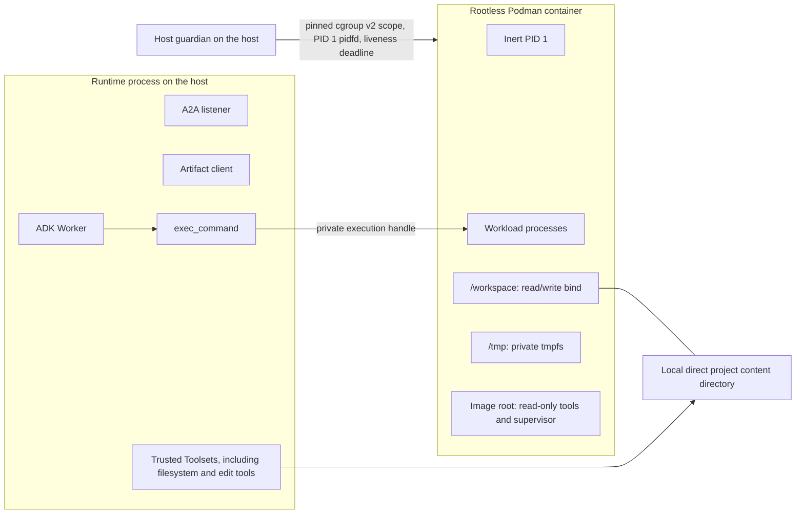
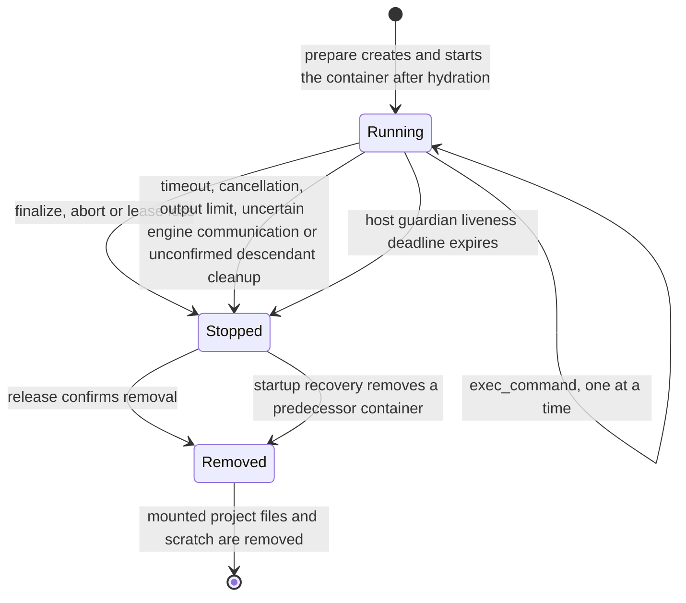
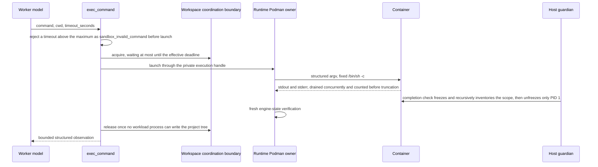

# Code execution

Requirement prefix: `EXE` · [Specification index](../README.md)

## Purpose and scope

This document owns the `podman@1` SandboxProfile and the `code-execution@1`
Toolset: one allocation-scoped rootless Podman container that shares the
allocation's local direct project directory, the compatibility rules that tie
the profile to its Toolset and workspace, the operator-owned process
configuration and its limits, the container and mount boundary, container
preparation and ownership, the `exec_command` tool and its observation,
command completion and workspace coordination, finalization, release and crash
recovery of the container, the host guardian, the Podman startup probes, and
the execution failure classes and metrics.

It leaves to other documents:

- the Runtime startup probe phase, its timeouts (including the Podman
  discovery budget) and the general allocation preparation, finalization,
  abort and release steps: [Runtime Agent](../execution/runtime-agent.md);
- the placement algorithm and the per-binding placement requirement: [Control
  Plane](../execution/control-plane.md);
- the project workspace, hydration, `direct` and `overlay` semantics, the
  coordination boundary and the filesystem and edit tools:
  [Workspace](workspace.md);
- the `exec_command` tool's place in the common Toolset contract:
  [Toolsets](toolsets.md);
- AgentTemplate `sandboxProfile` and `toolsets` selection:
  [AgentTemplates](../configuration/agent-templates.md);
- Runtime labels: [Runtime configuration](../configuration/runtime-config.md);
- Agent Skill packages, pinning and the exclusion of skill scripts:
  [Skills](skills.md);
- the HTTP and Caido Toolsets: [HTTP and Caido](http-caido.md);
- the write fence: [Artifact store](../artifacts/artifact-store.md);
- the Worker failure and termination path: [Worker](../execution/worker.md);
- telemetry content capture and the shared sensitive-output tool attribute:
  [Observability](../platform/observability.md);
- the exact CLI and environment spelling of the Podman settings, the
  implementation ceilings and the concrete host guardian protocol: [Runtime
  Podman policy](../../../runtime/PODMAN.md).

## Concepts

Terms are collected in the [glossary](../glossary.md); this document owns the
following ones.

- **`podman@1`.** The SandboxProfile that gives an allocation one rootless
  Podman container sharing its local direct project directory.
- **`code-execution@1`.** The explicitly selected Toolset that exports
  `exec_command`.
- **Execution handle.** The private, allocation-owned sandbox channel through
  which selected execution tools reach the container; it is distinct from the
  host `runtime-subprocess-launcher` channel.
- **`PreparedExecution`.** The execution resource that `AllocationService`
  prepares through `PodmanLifecycle` after hydration, separate from the
  allocation scratch.
- **Stable service owner.** The stable, unique local Runtime service identity
  that owns containers, held under an exclusive local ownership lock.
- **Host guardian.** The trusted host component, independent of the Runtime
  process, that holds the container's cgroup scope, enforces the liveness
  deadline and performs completion checks.
- **Managed execution supervisor.** The approved supervisor that runs commands
  through the managed execution protocol, accounts for command descendants and
  confirms their termination.
- **Inert PID 1.** The separate subordinate-UID init process of the image that
  reaps orphans.
- **Effective deadline.** The minimum of a command's requested timeout, the
  operator policy and the supplied execution deadline.
- **Cleanup reserve.** The part of a command budget reserved for stopping: the
  stop grace plus one second, at most half the budget.
- **Probe container.** A container that startup discovery creates under a
  separate ownership identity.
- **Command observation.** The bounded structured result of one completed
  command.

## Model

### Process and container boundary

The Worker and the trusted Toolsets stay in the Runtime process. Only executed
code runs in the container; the trusted owner and the host guardian run on the
host.



### Allocation phases

The container lives for the allocation. Finalization stops it; release removes
it before the mounted project files:

```text
prepare:  hydrate project → start container → construct tools/Worker → ready
run:      acquire workspace → execute → confirm no writers → release workspace
finalize: reject new work → stop Worker/commands → stop container → report
release:  confirm container removal → remove mounted project/scratch → acknowledge
```



### One command



## Requirements

### Scope of isolation

**EXE-R1.** One local Runtime Agent creates one rootless Podman container
(LIM-EXE-1) when preparing an allocation that selects `podman@1`. The
container shares that allocation's local direct project directory. Explicit
execution tools run commands inside it; finalization stops it, and release
removes it before deleting mounted files.

**EXE-R2.** The ADK Worker, the A2A listener, the Artifact client and the
existing trusted Toolsets continue to run in the Runtime process. `podman@1`
isolates executed code; it does not move or sandbox the whole Runtime Agent.

**EXE-R3.** `podman@1` does not replace the Scheduler, introduce another queue
or create an independent Worker lifecycle.

### Selection and capability advertisement

**EXE-R4.** An AgentTemplate selects `podman@1` and `code-execution@1` through
the existing exact selectors of
[AgentTemplates](../configuration/agent-templates.md): `spec.sandboxProfile`
and an entry of `spec.toolsets` (see [Examples](#examples)).

**EXE-R5.** `podman@1` and `code-execution@1` are registered authoring refs. A
Runtime advertises this pair only after an opt-in, real startup probe and
confirmed probe cleanup (EXE-R110); registering the authoring refs alone does
not make a Runtime eligible.

**EXE-R6.** Filesystem and edit tools retain their own capability probes
([Workspace](workspace.md)). Selecting `podman@1` does not implicitly add
execution or filesystem tools.

**EXE-R7.** `podman@1` may be selected without `exec_command`; it still owns
its container lifecycle.

**EXE-R8.** Selecting `exec_command` requires `podman@1`. `exec_command`
cannot execute on the host or silently fall back to `local-workdir@1`.

### Workspace mode and storage

**EXE-R9.** Every `podman@1` Worker requires a declared Stage
`context.workspace` with `mode: direct` and a Runtime configured with
`workspace.storage: local`; the Podman executor requires `local + direct`.

**EXE-R10.** The Podman executor cannot be combined with Contractor `overlay`
mode, including a temporary materialization followed by an implicit
merge-back. The restriction concerns the workspace mode, not the container
engine's internal image-layer storage, which the engine may still use.

The filesystem prerequisite of the sandbox is the local-direct
disk-authoritative rule of [WSP-R58 and WSP-R59](workspace.md); that an
execution sandbox sharing the writable project workspace requires local direct
mode is [WSP-R110](workspace.md).

**EXE-R11.** Sources and optional initial state reach the workspace through
the existing artifact hydration contract ([Workspace](workspace.md)). No
operator checkout, empty-workspace schema extension or additional mount paths
can be supplied by the model.

### Compatibility checks

Compatibility is checked at three boundaries: authoring, placement and the
Runtime.

**EXE-R12.** Authoring rejects `podman@1` with a missing workspace or with
`mode: overlay`, and rejects execution tools with an incompatible
SandboxProfile.

**EXE-R13.** For a binding selecting `podman@1`, placement requires the exact
runtime, profile, selected tools and local direct workspace capability, and the
registered profile/tool compatibility; local workspace storage is an explicit
binding placement requirement.

**EXE-R120.** These are binding-specific requirements: a different Worker in
the same Stage may continue to use its own compatible profile.

**EXE-R14.** Bindings that do not select `podman@1` keep the ordinary
placement behavior of [Control Plane](../execution/control-plane.md), and
ordinary workspace placement remains as specified in
[Workspace](workspace.md).

**EXE-R15.** The Runtime repeats all checks before creating resources. Unknown
or incompatible combinations fail prepare without starting code.

**EXE-R16.** Profile/tool compatibility belongs in registered descriptors and
their Runtime counterparts. It is not inferred from instructions or from a
tool-name prefix.

### Operator configuration

**EXE-R17.** Podman support is opt-in, immutable Runtime startup
configuration. Settings are parsed at process startup, not from a public
Workflow document.

**EXE-R18.** The logical settings contract is the following; the exact CLI and
environment spelling and the implementation ceilings are documented in the
[Runtime Podman policy](../../../runtime/PODMAN.md).

| Setting | Policy |
| --- | --- |
| enabled | False unless explicitly enabled |
| image | Required preinstalled OCI image pinned by digest |
| engine | Local rootless Podman; no remote URL or socket selection |
| owner identity | Stable unique local Runtime service identity, held under an exclusive ownership lock (EXE-R48) |
| cpu | 2 vCPU by default (LIM-EXE-2); positive operator-configured limit |
| memory | 2 GiB by default (LIM-EXE-3); positive operator-configured hard limit |
| pids | 256 by default (LIM-EXE-4); includes command children and the inert container PID 1, not the host guardian |
| tmpfs | 256 MiB by default (LIM-EXE-5) for private temporary files |
| network | `none` in `podman@1` |
| command timeout | 60 seconds default (LIM-EXE-6), 300 seconds operator maximum by default (LIM-EXE-7) |
| stdout/stderr previews | 32 KiB each (LIM-EXE-8) |
| combined output limit | 1 MiB per command (LIM-EXE-9); exceeding it terminates execution |
| preparation timeout | 30 seconds maximum by default (LIM-EXE-10), bounded by allocation prepare/lease deadlines |
| stop grace | 5 seconds maximum by default (LIM-EXE-11), bounded by remaining teardown deadline |

**EXE-R19.** Limits are finite, validated at startup and bounded by
implementation ceilings.

**EXE-R20.** There is no model-selected image, user, mount, Podman flag, host
executable, credential, network mode or resource override.

**EXE-R21.** Image and resource policy are kept in immutable Runtime startup
settings. `podman@1` adds no label-selected image, mount or credential, and no
Run-selected image or resource policy via Runtime labels ([Runtime
configuration](../configuration/runtime-config.md)).

**EXE-R22.** The Runtime does not pull or build images during allocation
prepare. Packages and the inert init are provisioned in the approved image;
the trusted owner and the guardian run on the host. Project-local environments
can be created from already available dependencies.

**EXE-R23.** Executed code has no network access: package downloads and live
target HTTP requests from executed code are unavailable.

Rationale: network access is deliberately excluded; a networked profile is a
non-goal ([Non-goals](#non-goals)).

**EXE-R24.** `http-tools@1` and `caido@1` remain separate, explicitly selected
capabilities ([HTTP and Caido](http-caido.md)); their credentials and proxy
configuration are not injected into the sandbox. Proxy settings must not
implicitly configure container commands.

**EXE-R25.** The resolved image digest and the effective limits are captured
in allocation-owned diagnostic state. Reports may include the image digest and
safe limits, but not host paths or secrets.

### Container and mount boundary

**EXE-R26.** The Runtime creates an unprivileged rootless container with
private namespaces, dropped capabilities, no-new-privileges and the host's
supported confinement profile. It does not disable SELinux, AppArmor or
seccomp globally to make mounts work.

**EXE-R27.** The required UID/GID mapping and mount labels are established and
probed before the profile is advertised.

**EXE-R28.** Host and container tools must be able to read and edit each
other's project files without recursively changing ownership of an operator
directory.

**EXE-R29.** The container paths are:

| Container path | Access and lifetime |
| --- | --- |
| `/workspace` | Read/write bind of the allocation's project content directory |
| `/tmp` | Bounded private tmpfs, disposed with the container |
| image root | Read-only approved tools and supervisor |

**EXE-R30.** No parent provider root, ownership marker, general Runtime
scratch, home directory, engine socket, Artifact token, mTLS key or LLM
credential is mounted. What the executor receives and its confinement are
[WSP-R9 and WSP-R97](workspace.md).

**EXE-R31.** Additional device access, privileged execution and host
namespaces are not available.

**EXE-R32.** Environment variables are constructed from an explicit safe
allowlist, including a writable temporary HOME. The Runtime environment is
never copied wholesale, and bare Podman environment-inheritance flags are not
used.

**EXE-R33.** No command may choose its execution user.

**EXE-R34.** `podman@1` uses regular Linux container isolation, which shares
the host kernel; it is not a VM profile. CPU, memory, process and tmpfs limits
are enforced by the runtime and the OS, not by model instructions.

**EXE-R35.** There is no per-allocation hard disk quota for the `/workspace`
bind mount. Workspace acquisition limits do not stop an executing process from
filling that filesystem; operators own dedicated workspace capacity and any
filesystem quotas ([WSP-R95](workspace.md)).

**EXE-R36.** Deployment documentation must state this limitation explicitly,
and capability diagnostics must not claim a disk limit that is not enforced.

### Allocation preparation

Preparation of a `podman@1` allocation follows this order; how it fits the
general allocation preparation of the Runtime Agent is [RTA-R33 to
RTA-R41](../execution/runtime-agent.md).

- **EXE-R37.** Step 1: validate exact profile/tool/workspace compatibility and
  the remaining deadlines.
- **EXE-R38.** Step 2: acquire the Runtime's allocation slot and prepare its
  ordinary private scratch and local project provider resources.
- **EXE-R39.** Step 3: hydrate exact source artifacts and optional state onto
  disk ([Workspace](workspace.md)).
- **EXE-R40.** Step 4: create and start the owned container with `/workspace`
  bound to that content directory; verify the supervisor, the effective limits
  and mount access.
- **EXE-R41.** Step 5: construct the selected Toolsets with narrow filesystem
  and execution handles, then construct the Worker.
- **EXE-R42.** Step 6: return prepared/ready only after all resources are
  usable.

**EXE-R43.** `SandboxFactory.prepare()` returns local scratch before project
hydration. `AllocationService` then allocates and prepares a separate
`PreparedExecution` through `PodmanLifecycle`, after hydration and before
constructing tools.

**EXE-R44.** The container ID never masquerades as an
`AllocationWorkspace.path`.

**EXE-R45.** The container is owned by the allocation lifecycle, not by an
individual tool instance whose `close()` might run multiple times
(LIFE-EXE-1).

### Container ownership

**EXE-R46.** Each container has a unique, internally generated name and labels
identifying Contractor ownership, the stable local Runtime service instance,
the process incarnation and the allocation ID.

**EXE-R47.** The Runtime retains the full engine container ID; subsequent
operations resolve and verify that exact owned resource. There are no
`--latest`, broad `--all` or name-prefix-only destructive operations.

**EXE-R48.** The stable service owner is held under an exclusive local
ownership lock, so one Runtime's startup recovery cannot collect another live
Runtime's resources.

**EXE-R49.** Creation records the ownership labels atomically with engine
creation. If the CLI times out before returning the ID, the Runtime reconciles
by the unique creation identity before retrying or cleaning up; it must not
create a second container blindly (FAIL-EXE-1).

**EXE-R50.** No Run or user text is interpolated into host shell commands.

**EXE-R51.** Retries of an identical prepare return the already owned
allocation resources; a mismatching request remains a conflict (FAIL-EXE-1).

**EXE-R52.** A partial prepare removes its container before deleting project
files; cleanup uncertainty fences the slot (FAIL-EXE-1, LIFE-EXE-1).

### The `exec_command` tool

**EXE-R53.** `code-execution@1` exports only `exec_command`:

```text
exec_command(command: string, cwd: string = "", timeout_seconds: integer = 60)
```

**EXE-R54.** `command` is a bounded UTF-8 shell program of at most 64 KiB
(LIM-EXE-12), passed as one argument to a fixed `/bin/sh -c` inside the
container. Podman itself is invoked with structured argv and no host shell.

**EXE-R55.** `cwd` uses the existing normalized workspace-relative path
grammar ([Workspace](workspace.md)); `""` selects `/workspace`. It cannot
select a host path, or a directory outside the mounted project through a link.

**EXE-R56.** `timeout_seconds` ranges from 1 second (LIM-EXE-13) to the
operator command maximum: 300 seconds by default (LIM-EXE-7), at most 3600
seconds (LIM-EXE-14). A larger value is rejected as `sandbox_invalid_command`
before launch; it is neither clamped silently nor fatal to the allocation
(FAIL-EXE-2).

**EXE-R57.** The tool description advertises the operator command maximum and
the cleanup reserve (LIM-EXE-15): the stop grace plus one second, at most half
the budget, taken from the same budget.

**EXE-R58.** The Runtime supplies a private allocation-owned execution handle
only to selected execution tools. It is a sandbox channel distinct from the
existing host `runtime-subprocess-launcher` channel: existing validators must
not automatically move into the container or lend host execution privileges to
this tool, and infrastructure descriptors and factory validation must
distinguish these channels.

**EXE-R59.** The model never receives the handle, the container ID or a raw
engine client.

**EXE-R60.** Commands run without a PTY or interactive stdin. They may invoke
Python or any other installed executable through the shell.

**EXE-R61.** Separate calls preserve project files and temporary files for the
allocation's lifetime (LIFE-EXE-2), but do not promise a persistent shell cwd
or environment, Python globals or background services.

**EXE-R62.** There is at most one active command per allocation (LIM-EXE-16).

**EXE-R63.** A command's effective deadline is the minimum of the requested
timeout, the operator policy and the supplied execution deadline (the
applicable invocation bound).

**EXE-R121.** Waiting for the workspace operation lock is bounded by the
effective deadline.

**EXE-R122.** The command budget includes workspace-lock wait and a reserved
cleanup window; the process can therefore be stopped before `timeout_seconds`
elapses.

**EXE-R64.** The confirmed control lease is not part of the effective-deadline
minimum; it is enforced continuously instead of as a deadline snapshot, and
heartbeats keep renewing it while a command runs.

Rationale: capping a command by the lease remaining at launch would stop long
commands after one lease window.

**EXE-R65.** A command cannot extend a lease or a shutdown grace period. Lease
loss revokes the allocation during the command: the owner aborts the launch at
once and the guardian kills the container scope (FAIL-EXE-2).

**EXE-R66.** Invocation cancellation revokes execution immediately
(FAIL-EXE-2). `StageContentRequest` carries no wall-clock deadline for a
command beyond the supplied execution deadline of EXE-R63;
`StageContentRequest.deadline` itself is [WRK-R6](../execution/worker.md).

### Command observation

**EXE-R67.** Each completed command returns a bounded structured observation:

```text
status: completed | timed_out | output_limit_exceeded | failed
exitCode: integer | null
stdout: string
stderr: string
stdoutTruncated: boolean
stderrTruncated: boolean
durationMs: nonnegative integer
errorCode: stable code | null
```

**EXE-R68.** Output is untrusted content, decoded with explicit replacement
for invalid UTF-8.

**EXE-R69.** Stdout and stderr are drained concurrently and counted before
preview truncation. A preview truncation flag remains true when bytes were
omitted.

**EXE-R70.** Truncation alone does not stop a command; exceeding the combined
hard output limit (LIM-EXE-9) does.

**EXE-R71.** No unbounded full log is retained in memory or written to host or
container log storage (LIFE-EXE-3).

### Outcome classification

**EXE-R72.** A normal program exit with a nonzero code is `completed` with
that exit code (subject to EXE-R76); it is evidence available to the Worker,
not an infrastructure retry.

**EXE-R73.** Engine, supervisor, timeout and output-limit failures are
distinguishable.

**EXE-R74.** The Runtime must not infer engine success or failure from command
stdout or from a single ambiguous CLI exit code: command status comes through
the managed execution protocol and is checked against engine state. Raw Podman
errors are mapped to content-free stable codes.

**EXE-R75.** Commands are never automatically replayed after an uncertain
outcome, because filesystem or other effects may already have happened; launch
or outcome uncertainty is never an automatic command retry (FAIL-EXE-2).

**EXE-R76.** The Podman transport conservatively treats CLI exit codes
`125–127` as `sandbox_outcome_unknown`: these codes overlap Podman's own exec
errors and cannot prove the program's status. It discards their diagnostic
streams and terminates the allocation without retry (FAIL-EXE-2).

**EXE-R77.** Other exit codes become `completed` only after the independent
guardian check and a fresh engine-state verification.

**EXE-R78.** A failed descendant proof reports `sandbox_cleanup_failed`; a
closed guardian channel is not evidence of a more specific cause. Neither
`sandbox_outcome_unknown` nor `sandbox_cleanup_failed` is derived from
workload output.

### Command completion and workspace coordination

**EXE-R79.** `exec_command` owns the same coordination boundary as local
direct reads, edits and snapshot acquisition ([Workspace](workspace.md)) for
its entire command lifetime. It may release that ownership only after no
remaining workload process can write the project tree. A Python asyncio lock
or the exit of the attached Podman client alone is not evidence of that
condition.

This is the trusted descendant completion through which the executor uses the
workspace coordination boundary; that cancellation does not hand off the
workspace before confirmed stop or removal is [WSP-R79](workspace.md).

**EXE-R80.** `code-execution@1` has no background-command API.

**EXE-R81.** The managed execution supervisor must account for command
descendants, including reparented and detached children, and confirm their
termination before reporting completion. A process-group kill alone is
insufficient if children can detach into another group or session.

**EXE-R82.** A workload that leaves live descendants is terminated and
reported as `sandbox_cleanup_failed` (FAIL-EXE-3).

**EXE-R83.** If descendant cleanup cannot be confirmed, the Runtime stops the
entire container and makes the allocation unusable rather than releasing
workspace ownership and continuing (FAIL-EXE-3).

**EXE-R84.** The supervisor protocol and the descendant guarantee must be
tested with adversarial fork/detach cases on the supported Podman environment.

**EXE-R85.** On timeout, cancellation, a hard output-limit violation or
uncertain engine communication after launch, the Runtime conservatively stops
the whole container. It does not restart it or run another command in that
allocation (FAIL-EXE-2).

**EXE-R86.** After a normal nonzero program exit, the allocation can continue
if cleanup is confirmed.

**EXE-R87.** The Runtime reports fatal execution infrastructure failures
through the existing Worker failure and termination path
([Worker](../execution/worker.md)). An interrupted command's partial
filesystem effects are not rolled back or labelled as a completed result.

**EXE-R88.** After any command outcome, the current project files remain
authoritative ([Workspace](workspace.md)), and any retained snapshot is
invalid for a subsequent call until reacquired. The filesystem contract also
covers completed external changes that did not originate from `exec_command`.

### Persisting outputs

**EXE-R89.** Files intended to outlive allocation release are explicitly
written as ordinary Run artifacts through the existing Artifact tools and
grants while writes remain permitted. A sandbox path is not an ArtifactRef,
and there is no automatic output upload or workspace export (LIFE-EXE-2).

**EXE-R90.** Normal result artifacts are published before Contractor's
existing write fence ([Artifact store](../artifacts/artifact-store.md)), not
after entering `finalizing` or `aborting`. Stopping the container retains the
project bind contents until allocation release; shutdown does not introduce a
late export window.

### Finalization, abort and release

**EXE-R91.** The container lives for the allocation, including sequential A2A
invocations and `INPUT_REQUIRED`. An individual tool return or the completion
of an A2A invocation does not remove it (LIFE-EXE-1).

**EXE-R92.** Allocation finalization and release remain distinct: finalization
stops the container and release removes it ([Allocation
phases](#allocation-phases)).

**EXE-R93.** Finalize, abort and lease loss first reject new commands.
Stopping includes a finite grace and forced termination within the remaining
lifecycle deadline, followed by engine-state verification. Host client
cancellation alone never completes this step (FAIL-EXE-4).

**EXE-R94.** A lost lease cannot be extended just to finish a user command.

**EXE-R95.** Abort and lease-loss cleanup may remove resources earlier,
according to [Runtime Agent](../execution/runtime-agent.md) and
[Scheduler](../execution/scheduler.md), but must preserve
container-before-files ordering (LIFE-EXE-1).

**EXE-R96.** Release is idempotent and owns one cleanup task (LIM-EXE-17): it
closes tool entry points, confirms the container stopped and removed, disposes
mounted project files, and then releases scratch and adapters (LIFE-EXE-1).

**EXE-R97.** `AllocationService` removes the separate execution handle before
disposing the project session or scratch (LIFE-EXE-4).

**EXE-R98.** A release timeout retains the owned cleanup task and fences the
slot; retries join it. Only authoritative release confirmation makes the slot
idle (FAIL-EXE-5).

### Crash recovery and the host guardian

**EXE-R99.** Startup recovery runs before idle capacity is advertised. It
acquires the stable service ownership lock, lists only Contractor containers
for that owner, validates ownership and removes predecessor allocation
containers before the workspace provider removes their files (LIFE-EXE-1).

**EXE-R100.** Containers belonging to other Runtime services or unrelated
Podman users remain untouched. Engine operations use full resolved IDs and
bounded verification. Global prune is never recovery.

**EXE-R101.** The deployment must also stop owned containers when the Runtime
service dies; a stopped Python process does not imply stopped containers.

**EXE-R102.** The trusted host guardian enforces a finite, Runtime-renewed
liveness deadline bounded by the confirmed control lease, so code cannot keep
running indefinitely while the Runtime is down. When that deadline expires,
the guardian must stop accepting commands and terminate the container
(FAIL-EXE-6).

**EXE-R103.** Startup cleanup remains responsible for removing stopped orphan
resources (LIFE-EXE-1).

**EXE-R104.** No workload can renew or disable the supervisor's liveness
deadline or forge command-completion acknowledgements. The control channel and
supervisor authority must be separated from workload processes, not merely
hidden in a file readable by the same execution user.

**EXE-R105.** The host guardian owns this boundary independently of the
Runtime process; startup probes verify it before the profile is advertised.

Rationale: this is a Contractor lifecycle guarantee, not one supplied
automatically by `podman exec`.

**EXE-R106.** The host guardian uses an inherited private socket, an exact
pinned systemd cgroup v2 scope and a PID 1 pidfd. A separate subordinate-UID
inert image PID 1 reaps orphans; workloads use the nonzero keep-id UID.

**EXE-R107.** Completion checks freeze and recursively inventory the scope
before unfreezing only PID 1.

**EXE-R108.** Liveness is capped at 10 seconds (LIM-EXE-18) and the confirmed
lease. Expiry, EOF or uncertainty kills the entire scope through `cgroup.kill`
(FAIL-EXE-6).

**EXE-R109.** No engine socket or control token is exposed to workloads.

The concrete protocol, the real-host gate and the integrated allocation
lifecycle are documented in the [Runtime Podman
policy](../../../runtime/PODMAN.md).

### Startup probes

The Podman discovery budget, the shared profile and execution probe bound and
its cleanup reserve, and the rule that unconfirmed Podman cleanup during
discovery prevents registration are [RTA-R13 and
RTA-R14](../execution/runtime-agent.md) (LIM-RTA-3 to LIM-RTA-5).

**EXE-R110.** Enabling a setting alone is not a capability. Bounded startup
discovery checks local engine access, rootless configuration, cgroup and
resource support, pinned image availability, a compatible supervisor, bind
access and UID mapping, execution, descendant cleanup, liveness expiry and
confirmed container removal.

**EXE-R111.** Probe containers have separate ownership identities and must be
cleaned before the Runtime advertises `podman@1` and the dependent tool
operation (LIFE-EXE-5).

**EXE-R112.** A failed probe omits those capabilities. It must not degrade to
privileged Podman, host execution, memory storage or overlay (FAIL-EXE-7).

**EXE-R113.** If probe cleanup cannot be confirmed, the Runtime remains fenced
and unready. Existing usable profiles can remain available when the failed
probe left no resources behind (FAIL-EXE-7, LIFE-EXE-5).

### Failure classes

**EXE-R114.** Stable tool failure classes include invalid command or cwd,
sandbox unavailable, timeout, output limit, cleanup failure and uncertain
outcome. Sandbox selection can fail as incompatible.

**EXE-R115.** A confirmed local engine preparation failure is an internal
signal; allocation preparation reports `allocation_preparation_failed` through
its existing retry classification (FAIL-EXE-1).

**EXE-R116.** Shutdown and cleanup use the existing lifecycle reporting.

### Telemetry

**EXE-R117.** Metrics record command count, elapsed time, exit/failure
category, captured-byte counts, truncation, and sandbox prepare, stop and
cleanup outcomes.

**EXE-R118.** Aggregate logs exclude command text, output, host paths and
secrets. Bounded command and output content belongs only to the existing
authorized tool observation surfaces.

**EXE-R119.** Execution-enabled Workers use metadata-only instrumentation even
when an operator has opted into content capture, because later model requests,
result finalizers and summaries may contain earlier command or output content
too. `exec_command` declares this through the shared sensitive-output tool
attribute (`contractor_sensitive_output`, [OBS-R56 and
OBS-R57](../platform/observability.md)).

## Interfaces

- The `exec_command` signature (EXE-R53) and its command observation
  (EXE-R67).
- The Podman settings contract (EXE-R18); their exact CLI and environment
  spelling is in the [Runtime Podman policy](../../../runtime/PODMAN.md).
- The per-binding placement requirement that carries `podman@1`:
  [CTL-R71](../execution/control-plane.md).

The lifecycle and policy choices of this document are Contractor requirements,
not claims that Podman implements them all. The engine primitives they build
on are:

- [Podman run](https://docs.podman.io/en/stable/markdown/podman-run.1.html):
  container creation, mounts, namespaces and resource controls.
- [Podman exec](https://docs.podman.io/en/stable/markdown/podman-exec.1.html):
  execution inside a running container, attached streams and exit statuses.
- [Podman stop](https://docs.podman.io/en/stable/markdown/podman-stop.1.html):
  bounded graceful stop followed by forced termination.
- [Podman API
  service](https://docs.podman.io/en/stable/markdown/podman-system-service.1.html):
  engine access grants the service user's authority; it is not a workload API.

## Limits, failures and errors

Limits ([registry](../platform/limits.md)):

- LIM-EXE-1 — one container per `podman@1` allocation (EXE-R1).
- LIM-EXE-2 — 2 vCPU default CPU limit (EXE-R18).
- LIM-EXE-3 — 2 GiB default memory hard limit (EXE-R18).
- LIM-EXE-4 — 256 default process limit (EXE-R18).
- LIM-EXE-5 — 256 MiB default `/tmp` tmpfs (EXE-R18).
- LIM-EXE-6 — 60 seconds default command timeout (EXE-R18).
- LIM-EXE-7 — 300 seconds default operator command maximum (EXE-R18, EXE-R56).
- LIM-EXE-8 — 32 KiB per stdout or stderr preview (EXE-R18).
- LIM-EXE-9 — 1 MiB combined output per command (EXE-R18, EXE-R70).
- LIM-EXE-10 — 30 seconds default maximum preparation timeout (EXE-R18).
- LIM-EXE-11 — 5 seconds default maximum stop grace (EXE-R18).
- LIM-EXE-12 — 64 KiB `command` (EXE-R54).
- LIM-EXE-13 — 1 second minimum `timeout_seconds` (EXE-R56).
- LIM-EXE-14 — 3600 seconds ceiling of the operator command maximum (EXE-R56).
- LIM-EXE-15 — cleanup reserve of the stop grace plus one second, at most half
  the command budget (EXE-R57).
- LIM-EXE-16 — one active command per allocation (EXE-R62).
- LIM-EXE-17 — one cleanup task per release (EXE-R96).
- LIM-EXE-18 — 10 seconds host guardian liveness cap (EXE-R108).
- Owned elsewhere: the 60-second total Podman discovery budget (LIM-RTA-3),
  the 30-second shared profile and execution probe (LIM-RTA-4) and its
  8-second cleanup reserve (LIM-RTA-5) in [Runtime
  Agent](../execution/runtime-agent.md).

Failure outcomes ([failure model](../platform/failure-model.md)):

- FAIL-EXE-1 — container creation and allocation preparation (EXE-R49,
  EXE-R51, EXE-R52, EXE-R115).
- FAIL-EXE-2 — `exec_command` execution (EXE-R56, EXE-R65, EXE-R66, EXE-R75,
  EXE-R76, EXE-R85).
- FAIL-EXE-3 — descendant cleanup at command completion (EXE-R82, EXE-R83).
- FAIL-EXE-4 — container stop on finalize, abort or lease loss (EXE-R93).
- FAIL-EXE-5 — release cleanup (EXE-R98).
- FAIL-EXE-6 — Runtime death and host guardian liveness expiry (EXE-R102,
  EXE-R108).
- FAIL-EXE-7 — Podman startup probe (EXE-R112, EXE-R113).

Lifecycle ([registry](../platform/lifecycle.md)):

- LIFE-EXE-1 — allocation Podman container (EXE-R45, EXE-R52, EXE-R91,
  EXE-R95, EXE-R96, EXE-R99, EXE-R103).
- LIFE-EXE-2 — files written by executed commands (EXE-R61, EXE-R89).
- LIFE-EXE-3 — command output (EXE-R71).
- LIFE-EXE-4 — execution handle, `PreparedExecution` (EXE-R97).
- LIFE-EXE-5 — probe container (EXE-R111, EXE-R113).

Error codes ([registry](../platform/errors.md)): `sandbox_invalid_command`
(EXE-R56), `sandbox_outcome_unknown` (EXE-R76), `sandbox_cleanup_failed`
(EXE-R78, EXE-R82) and `allocation_preparation_failed` (EXE-R115).

## Security

The security rules of the sandbox are the isolation scope (EXE-R2), the
operator-only configuration and the absence of model overrides (EXE-R17 to
EXE-R25), the container and mount boundary (EXE-R26 to EXE-R36), container
ownership (EXE-R46 to EXE-R50), the execution handle (EXE-R58, EXE-R59), the
host guardian (EXE-R101 to EXE-R109) and the probe fallbacks (EXE-R112). The
Runtime host trust boundary for same-UID processes is described with
[WSP-R96](workspace.md); trust boundaries across the system are in
[Security](../platform/security.md).

## Observability

Metrics, log content and the metadata-only instrumentation of
execution-enabled Workers are EXE-R117 to EXE-R119; allocation-owned
diagnostic state is EXE-R25. Content capture and the sensitive-output
attribute are owned by [Observability](../platform/observability.md).

## Invariants

- Container before files: every path that deletes mounted project files first
  confirms container removal — partial prepare (EXE-R52), release (EXE-R96),
  abort and lease-loss cleanup (EXE-R95) and startup recovery (EXE-R99).
- Workspace ownership is never released while a workload process can still
  write the project tree (EXE-R79, EXE-R83); the owning test is the
  adversarial fork/detach suite of EXE-R84.
- No command is replayed automatically after an uncertain outcome (EXE-R75).
- The model never holds the execution handle, the container ID or an engine
  client (EXE-R59).

## Examples

### AgentTemplate selecting the sandbox

A Worker with read, edit and execution tools in the Podman sandbox:

```yaml
spec:
  sandboxProfile: podman@1
  toolsets:
    - ref: filesystem@1
      tools: [ls, read_file, grep]
    - ref: edit-files@1
      tools: [write_file, edit]
    - ref: code-execution@1
      tools: [exec_command]
```

## Non-goals

- A multi-container Podman pod: `podman@1` uses a single container.
- Remote engines, Daytona, sidecars, interactive terminals and background
  services.
- Execution of skill scripts. Packages contain no scripts
  ([SKL-R21](skills.md)); selecting `podman@1`, installing ADK or loading
  `SKILL.md` never enables script execution ([SKL-R45](skills.md)); a skill
  cannot add tools, images, mounts, privileges or network authority
  ([SKL-R44](skills.md)); enabling scripts needs a separate amendment to
  [Skills](skills.md).
- A networked profile. It would need explicit egress and proxy semantics and
  Audit active-check classification.
- Skill mounts. No `/skills/<name>` mount is provided. A read-only
  `/skills/<name>` mount containing selected Run-pinned skill packages, with
  writable outputs directed to `/workspace` or `/tmp`, is reserved; selection
  and pinning continue to belong to [Skills](skills.md). No global skill
  directory or mutable catalog is mounted.
