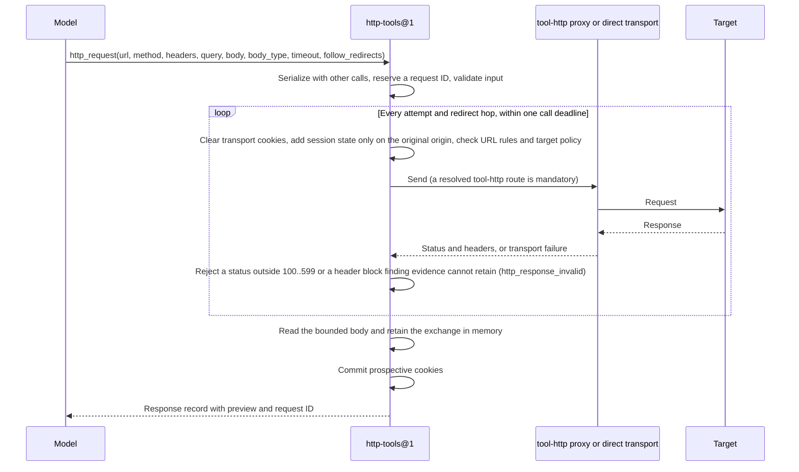
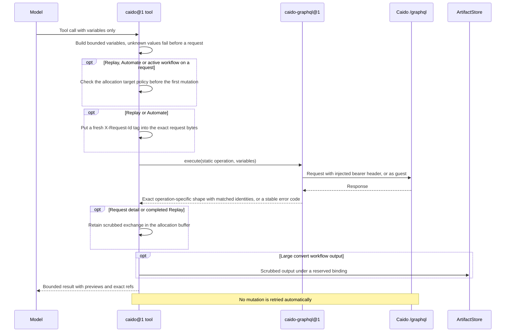
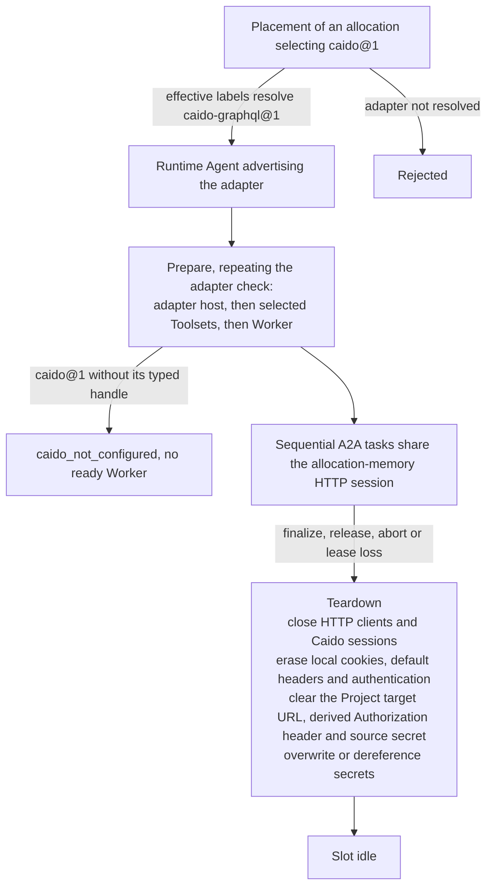

# HTTP and Caido tools

Requirement prefix: `HTP` · [Specification index](../README.md)

## Purpose and scope

This document owns the Runtime tool contracts used for HTTP exploration and
Caido-assisted security workflows:

- the generic HTTP Toolset `http-tools@1`: its operations, request contract,
  retries, response records, finding-selected exchange artifacts, allocation session state,
  request IDs and outgoing exchange store;
- how `http-tools@1` uses the `tool-http` route of the optional `http-proxy@1`
  adapter, and how the Runtime target policy applies on that forward-proxy
  route;
- how the HTTP tools apply a resolved Project HTTP target and its authorization
  at Runtime;
- the Caido Toolset `caido@1`: its static GraphQL operations, bounds,
  compatibility boundary, credential scrubbing and request tags;
- the `caido-graphql@1` Runtime adapter, its private handle and the endpoint
  and request-timeout rules of `worker.caido`;
- the checked-in templates `caido_analyst@1` and `http_explorer@1`;
- allocation lifecycle, authority, metrics and stable error codes of both
  Toolsets.

The implementation is domain-specific, but the architectural boundary is the
same as for every Worker Toolset.

It leaves to other documents:

- the common Toolset boundary between AgentTemplate tool selection, Runtime
  label infrastructure configuration, private AllocationSpec settings and
  allocation-scoped Runtime adapters, and the rule that no label or Skill adds
  a tool the AgentTemplate omitted: [Toolsets](toolsets.md);
- the exact allowlist rule of AgentTemplate Toolset selection:
  [AgentTemplates](../configuration/agent-templates.md);
- the `worker.caido` RuntimeConfig field (its atomic shape, allowed members,
  publication and display, its `caido-bearer@1` credential and a complete
  example), the `http-proxy@1` adapter and its route targets:
  [Runtime configuration](../configuration/runtime-config.md);
- the Runtime target policy shared with scanners (host syntax, destination
  classes, allowed target networks, the denial codes and the DNS boundary of
  the direct client): [Security](../platform/security.md);
- the finding evidence snapshot of a selected HTTP request and its limits:
  [Findings](../findings/findings.md);
- how scanner Workers and scan planning apply the target policy, including
  `scan_target_denied`, `scan_target_unresolved` and `scan_proxy_unsupported`
  refusals: [Scanners](scanners.md);
- Skill metadata semantics, including that guidance never installs Toolsets:
  [Skills](skills.md);
- the Project HTTP target and its credential:
  [Projects](../artifacts/projects.md);
- the table of reserved artifact name prefixes and the generic payload limit:
  [Artifact store](../artifacts/artifact-store.md);
- the registry of error codes: [Errors](../platform/errors.md).

## Concepts

Terms are collected in the [glossary](../glossary.md); this document owns the
following ones.

- **HTTP Toolset (`http-tools@1`).** The Toolset that sends model-described
  HTTP requests to application targets and keeps an allocation-scoped HTTP
  session.
- **Caido Toolset (`caido@1`).** The Toolset whose model-visible tools call the
  trusted Caido control GraphQL API through static operations.
- **Caido GraphQL adapter (`caido-graphql@1`).** The typed private Runtime
  adapter that creates the allocation's Caido GraphQL client; it is not an HTTP
  forward proxy.
- **Caido client handle (`caido-graphql-client`).** The one private
  infrastructure handle that `caido-graphql@1` advertises and every `caido@1`
  tool requires.
- **Direct transport.** The Runtime-owned HTTP transport that `http-tools@1`
  uses when no `tool-http` route is resolved.
- **HTTP session.** The target cookie jar, allocation-memory default headers,
  authentication and history of `http-tools@1`.
- **Redacted session view.** The model-visible projection of the HTTP session
  that `http_session_get` returns.
- **Response record.** The bounded metadata and preview that `http_request`
  returns for one completed request.
- **Selected HTTP exchange artifact.** The immutable Run evidence artifact of
  media type `application/vnd.contractor.http-exchange+json`, published only
  with a finding, containing its captured request and optional response.
- **Outgoing exchange store.** The allocation memory store of the latest
  outgoing exchanges from which a finding snapshots selected HTTP evidence.
- **Request ID.** The allocation-monotonic identifier of one `http_request`
  call.
- **Request tag.** The opaque allocation-derived `X-Request-Id` value that lets
  proxy history correlate HTTP tool and Caido Replay traffic.
- **Static operation.** A GraphQL document that is a source-code constant
  selected by a Caido tool method.
- **Caido capture.** Scrubbed raw request and optional response bytes in the
  allocation buffer; a finding can select this capture as HTTP evidence.
- **Runtime credential marker.** `[runtime-target-credential]` or
  `[runtime-credential]`, the text that replaces a header line carrying a
  credential the Runtime injected.
- **Active workflow.** A Caido workflow that `caido_workflow_run` starts
  asynchronously for a stored `request_id`.
- **Convert workflow.** A Caido workflow that `caido_workflow_run` runs on
  non-empty UTF-8 `input`.

## Model

### Two distinct facilities

`http-tools@1` sends model-described requests to application targets, either
through the `tool-http` forward-proxy route or directly. `caido@1` drives the
Caido control GraphQL API through the `caido-graphql@1` adapter. Both buffer inspected exchanges in allocation memory. A finding selects
which exchanges become durable evidence; large convert workflow output remains
an artifact under its separate contract.

```mermaid
flowchart LR
    M[Model] -->|http_request| HT[http-tools@1]
    HT -->|"tool-http route resolved (mandatory)"| P["http-proxy@1 forward proxy<br/>(for example Caido)"]
    HT -->|"no tool-http route"| D[Runtime-owned direct transport]
    P --> T[Application target]
    D --> T
    M -->|"caido_* tool: variables only"| CT[caido@1]
    CT -->|"execute(static operation, variables)"| A["caido-graphql@1<br/>handle caido-graphql-client"]
    A -->|"endpoint + /graphql"| C[Caido control GraphQL API]
    HT --> B[Recent exchange buffer]
    CT --> B
    B -->|finding selection| F[Finding intake]
    F -->|atomic proposal and selected evidence| AS[(ArtifactStore)]
    CT -->|large convert output| AS
```

### HTTP session state

Each allocation of `http-tools@1` holds this state in memory:

| State | Holds | Model-visible as |
| --- | --- | --- |
| Cookies | The authoritative jar restored from the same Run/Namespace artifact | Cookie names and count |
| Default headers | Session default request headers | Non-sensitive values; redaction markers for sensitive headers |
| Authentication | `none`, `bearer` or `basic` | `auth_kind` |
| History | Recent request summaries and explicit failed outcomes | `http_history`; the history count |
| Outgoing exchange store | Shared bounded HTTP/Caido capture buffer, including attempts, available response bytes and invocation ownership | HTTP bodies through `http_read_body`; selection through `finding(request_id=...)` or `finding(caido_request_id=...)` |
| Project target | Target URL, derived `Authorization` header and source secret | Never |

### One `http_request` call



### One Caido tool call



### Allocation lifecycle



## Requirements

### Scope and authority

**HTP-R1.** The separate target adapter with enforced scope, identities and
trusted capture specified in
[Autonomous pentest Audits](../../proposals/0033-autonomous-pentest-audits.md)
does not upgrade the guarantees of `http-tools@1` or `caido@1` described here.

**HTP-R2.** `http-tools@1` and `caido@1` use the same exact allowlist rule as
every other Toolset ([AgentTemplates](../configuration/agent-templates.md)).

**HTP-R3.** A Caido mutation is permitted only when its exact tool name is
selected.

**HTP-R4.** A Runtime label may configure HTTP routing or a Caido endpoint and
credential, but labels do not add either Toolset.

**HTP-R123.** A label can retarget the Caido client but cannot make `caido@1`
model-visible when the AgentTemplate omitted it.

That neither a Run label such as `debug` nor a Skill adds a tool the
AgentTemplate omitted, and that AgentTemplate selection is the model authority
boundary, is owned by [Toolsets](toolsets.md).

**HTP-R5.** Infrastructure endpoint and credential values never enter prompts
or tool arguments: the model never chooses an infrastructure endpoint, proxy
credential or Caido bearer token.

### Facilities and routing

**HTP-R6.** `http-tools@1` sends model-described HTTP requests to application
targets. It uses the `tool-http` route of the optional `http-proxy@1` adapter
(for example a Caido forward proxy) when that route is resolved, and a
Runtime-owned direct transport when no such route is resolved.

**HTP-R7.** A resolved `tool-http` proxy route is mandatory routing, not a
hint: its failure never falls back to the direct network (FAIL-HTP-1).

**HTP-R8.** `caido@1` calls the trusted Caido control GraphQL API. That
endpoint is not an HTTP forward proxy and must not be represented by
`httpProxy.proxyUrl`.

**HTP-R124.** `caido-graphql@1` is a typed Runtime adapter separate from the
`http-proxy@1` adapter, so the forward proxy and the Caido control API are
different typed configurations.

**HTP-R9.** The Caido GraphQL endpoint and credential are infrastructure and
therefore belong to one atomic `spec.worker.caido` RuntimeConfig field, whose
shape is owned by [Runtime configuration](../configuration/runtime-config.md).
`caido@1` requires the private `caido-graphql@1` adapter resolved for the
allocation.

### Caido endpoint

**HTP-R10.** The `worker.caido` `endpoint` is an absolute `http` or `https`
origin without userinfo, query or fragment; a deployment may include a fixed
path prefix in it. The Runtime appends exactly `/graphql`.

**HTP-R11.** HTTPS to the Caido endpoint uses system trust plus an optional
bounded PEM CA bundle (`caBundlePem`).

**HTP-R12.** `requestTimeoutSeconds` is 1..120 seconds (LIM-HTP-1) and defaults
to the allocation request timeout.

The optional `credential` member is specified by
[RCF-R109](../configuration/runtime-config.md), and a complete `worker.caido`
example is in [Runtime configuration](../configuration/runtime-config.md).

### Caido adapter

**HTP-R13.** `caido-graphql@1` advertises one private infrastructure handle,
`caido-graphql-client`. Every `caido@1` tool requires that channel.

**HTP-R14.** Placement must reject a selected Caido Toolset when the effective
labels do not resolve the `caido-graphql@1` adapter, and must choose a Runtime
Agent advertising the adapter. The Runtime repeats the check during prepare.

**HTP-R15.** The adapter uses `trust_env=false` and is not implicitly routed
through `http-proxy@1`.

Rationale: this avoids proxy loops.

**HTP-R16.** The adapter owns connection pooling, bounded request and response
reads, bearer header injection, the TLS context, safe metrics, and close and
credential erasure.

**HTP-R17.** The adapter exposes a narrow `execute(operation, variables)`
client in which `operation` is one implementation-defined static operation,
never arbitrary model GraphQL.

**HTP-R18.** Adapter capability discovery proves only that the local
implementation can construct the typed client; it deliberately does not contact
or introspect an infrastructure instance during Runtime Agent registration.

### HTTP Toolset operations

**HTP-R19.** `http-tools@1` exports these tools:

| Tool | Purpose |
| --- | --- |
| `http_request` | Send one bounded HTTP or HTTPS request and return metadata plus a small preview. |
| `http_read_body` | Read a bounded slice of a response body retained in allocation memory. |
| `http_history` | Return bounded allocation-session request summaries, oldest first. |
| `http_session_set` | Set persisted target cookies and allocation-memory headers and authentication. |
| `http_session_get` | Return the redacted session view. |
| `http_session_clear` | Erase cookies, headers, authentication, HTTP history and buffered HTTP exchanges; selected finding evidence remains immutable. |

**HTP-R20.** The callable shape remains compatible with the migrated Skills:
`http_request(url, method, headers, query, body, body_type, timeout, follow_redirects)`.

### Request contract

**HTP-R21.** `url` is an absolute `http` or `https` URL without userinfo. A
`#fragment` is client-side state and is removed before the request is sent.

**HTP-R22.** `method` is one of `GET|POST|PUT|PATCH|DELETE|HEAD|OPTIONS`.

**HTP-R23.** A request carries at most 64 bounded headers and query keys
(LIM-HTP-2).

**HTP-R24.** Session default headers plus request headers total at most 48 KiB
(LIM-HTP-3). The rest of the 64 KiB header block that finding evidence retains
(LIM-FND-8) is reserved for headers the Runtime adds: the request tag, `Host`,
the session `Authorization` and client defaults.

**HTP-R25.** A request whose complete header block, including session cookies
and authorization, would still exceed 64 KiB (LIM-FND-8) fails
`http_request_invalid` before it is sent, so every sent request can be selected
as evidence. The evidence limits themselves are owned by
[Findings](../findings/findings.md).

**HTP-R26.** Hop-by-hop headers, `Host`, `Content-Length`, proxy authentication
and CR/LF header injection are rejected.

**HTP-R27.** `body_type` is one of `none|json|form|text`, with at most 1 MiB of
encoded request body (LIM-HTP-5).

**HTP-R28.** `timeout` is 1..120 seconds, capped by the allocation settings
(LIM-HTP-6); when it is omitted it is
`min(allocation request timeout, 120 seconds)`.

**HTP-R29.** The timeout is one deadline for the whole call: connecting,
sending and reading every redirect hop and retry, retry waits, and reading the
complete response body. The same value also bounds each individual network
operation. A later finding submission has the existing independent intake deadline.

**HTP-R30.** Expiry of the deadline fails with the retryable
`http_request_failed` (FAIL-HTP-1).

**HTP-R31.** `follow_redirects` follows at most 10 redirects (LIM-HTP-7). Every
hop is parsed, stripped of its fragment and checked against the target policy
again.

**HTP-R32.** Before each send, including redirects and retries, the Runtime
checks the final httpx-built URL against the finding-evidence URL rules. A URL
that grows past 8192 UTF-8 bytes after encoding (LIM-HTP-8), contains a
backslash or has an invalid percent escape fails `http_request_invalid` before
that hop is sent.

**HTP-R33.** Raw control characters and hosts outside the shared host syntax
rule of the [target policy](../platform/security.md) are also invalid input
(`http_request_invalid`); neither the direct nor the proxy route resolves,
forwards or retries them as transport failures.

### HTTP session

**HTP-R34.**
`http_session_set(cookies, headers, auth, replace_cookies, replace_headers)`
applies sparse updates; `auth` is exactly one of `{"kind":"none"}`,
`{"kind":"bearer","token":"..."}` or
`{"kind":"basic","username":"...","password":"..."}`.

**HTP-R35.** Sparse header, cookie and auth updates are validated as one
prospective state before mutation.

**HTP-R36.** The redacted session view that `http_session_get` returns contains
only `auth_kind`, non-sensitive default-header values, redaction markers for
sensitive headers, cookie names and count, and the history count. Cookie values
are not included in session projections. Explicit authorized artifact reads
remain available. An HTTP response may additionally report `cookie_checkpoint`
with `state="unconfirmed"`, a safe error code and recovery instruction (HTP-R130).

**HTP-R37.** Target cookies persist as the ordinary `http-cookie-session`
Artifact binding in the allocation's Run and resolved Agent Namespace. A fresh
HTTP toolset restores this binding before readiness, including retry and
escalation in the same Namespace. No new table or credential store is involved;
ordinary authorized Artifact tools can read it. Headers, basic/bearer session
auth, injected Project authorization, infrastructure/proxy/Caido credentials,
HTTP history and captures remain allocation memory and are never included.
Release, abort and lease loss erase local copies; Run purge owns all persisted
revisions (LIFE-HTP-1).

**HTP-R38.** `http_session_clear` commits the empty cookie jar before claiming
success, then erases local cookies, headers, authentication,
history and buffered HTTP captures (LIFE-HTP-2). Caido captures have their own
session lifetime. Selected finding evidence remains immutable (LIFE-HTP-3).

### Cookie continuation

**HTP-R127.** The cookie payload is compact UTF-8 JSON with exactly
`schema_version` (integer `1`), `target_origin` (the resolved Project target's
canonical `[scheme, host, port]`, or null without a Project target), and
`cookies`. Each cookie has exactly the Python CookieJar attributes `version`,
`name`, `value`, `port`, `port_specified`, `domain`, `domain_specified`,
`domain_initial_dot`, `path`, `path_specified`, `secure`, `expires`, `discard`,
`comment`, `comment_url`, `rest` and `rfc2109`. Nullable values remain null;
`rest` retains HttpOnly/SameSite extensions. Cookie identity is domain/path/name,
ordered by that identity. Duplicate keys/identities, unknown members, coercions,
incompatible schema/origin, and invalid matching attributes fail permanently
with `http_cookie_state_invalid`. Runtime owns the format; Go Artifact readers
and writers transport opaque bytes without a second cookie parser. Media type
is `application/vnd.contractor.http-cookie-session+json`.

**HTP-R128.** A jar is bounded to 128 cookies and 65536 encoded UTF-8 bytes
including metadata (LIM-HTP-37). Restore reads the direct binding with this byte
cap and never scans other artifacts. Absence starts empty; corrupt or oversized
state prevents readiness. Expired cookies are dropped against an injectable
clock. Session cookies survive only within this Run's retention. CookieJar
attributes preserve domain/path/Secure matching on both transports; host-only
cookies never reach subdomains. Without a Project target, ordinary RFC cookie
scope applies; explicit unscoped `http_session_set` cookies keep their existing
scope. With a Project target, explicit cookies are scoped to that host.

**HTP-R129.** The existing HTTP session lock serializes changes and Artifact
CAS uses the restored revision. Canonical unchanged bytes create no revision.
Cookie deletion and explicit clear publish an updated/empty jar. A cancelled or
incomplete response cannot publish prospective cookies. Checkpoint work starts
only after the full response and its exchange are accepted. Cancellation at this
later boundary joins the bounded checkpoint before releasing ownership; a
completed checkpoint may already be durable. Allocation teardown never writes
cookies. The existing allocation write fence and Stage terminal barrier finish
old mutations before replacement restore; no new receipt or lease is added.

**HTP-R130.** A completed target request retains its actual status and body
when cookie checkpointing fails. Its response includes `cookie_checkpoint` with
`state="unconfirmed"`, a classified code, and an instruction to call
`http_session_get` without repeating the HTTP request. Further requests and
updates are blocked until that recovery succeeds. If the template did not select
`http_session_get`, the Worker reports the unconfirmed checkpoint and stops HTTP
requests; a fresh allocation restores only committed state. Recovery reconciles exact
bytes; it retries only the pending Artifact PUT under the same CAS when the
original revision is still current. A different newer revision raises permanent
`http_cookie_state_conflict` and discards the pending write; another explicit
`http_session_get` can adopt that authoritative state. No target request is
replayed. Invalid local response cookies recover the last durable state.

**HTP-R131.** A checkpoint uses the existing exact-document helper: at most
two PUTs with identical bytes/precondition and one exact-value reconciliation
read. A definite denial is permanent `http_cookie_write_denied`; a divergent
CAS is `http_cookie_state_conflict`; unresolved transient storage/timeout is
retryable `http_cookie_storage_unavailable`. Restore makes at most two reads.
Restore is inside preparation's remaining deadline; checkpoint's own deadline
is capped by the current HTTP deadline or, for session controls, the configured
request timeout. Cancelled operations join their bounded Artifact task before
cleanup (FAIL-HTP-8). Sparse session updates and clear claim durable success only
after confirmed writes. No secret payload is added to errors, prompts,
summaries or telemetry.

### Project target authorization

**HTP-R39.** At Runtime, the configured Project target authorization replaces a
model-supplied `Authorization` header only on that exact origin. It is not
injected on another port or subdomain and is removed before following a
cross-origin redirect.

**HTP-R40.** The Project target origin also unlocks the Runtime target policy
for exactly the addresses it resolves to at allocation start and its port, so a
loopback or link-local application target is reachable without widening access
to its host.

**HTP-R41.** Model-visible HTTP session inspection reports neither the target
nor its credential.

**HTP-R42.** Allocation cleanup clears the target URL, the derived
`Authorization` header and the source secret before slot reuse (LIFE-HTP-4).

### Redirects and cookies

**HTP-R43.** The httpx transport cookie jar is scratch state: allocation-owned
cookies are the authoritative copy, and transport cookies are cleared before
every hop, including redirects and retries on direct and proxied requests.

**HTP-R44.** Prospective response cookies become session state only after
the full request succeeds and its exchange is buffered. An error or cancellation before that acceptance boundary does not commit the
prospective cookie jar (FAIL-HTP-2); a later cancelled checkpoint follows the
joined mutation rule in HTP-R129.

**HTP-R45.** Each redirect hop is compared with the originally requested
origin. A hop on another origin receives no session cookies, no session
authorization and no sensitive request header (`Authorization`, `Cookie`, and
any name containing `api-key`, `auth-token` or `access-token`); a later hop
back on the original origin receives them again.

**HTP-R46.** Every response is closed, including when its redirect target is
malformed or forbidden.

### Target policy on the forward-proxy route

`http-tools@1` and request-bound `caido@1` actions apply the shared Runtime
target policy owned by [Security](../platform/security.md): its host syntax
rule, destination classes, allowed target networks, the denial codes
`http_target_denied` and `caido_target_denied`, and the DNS boundary of the
direct client. The rules below govern only the `tool-http` route.

**HTP-R47.** With a `tool-http` route, the forward proxy resolves target names;
the Runtime does not resolve them locally, because proxy-only names are valid
there. The Runtime still applies every literal-address, name and Runtime
endpoint check of the target policy before sending.

**HTP-R48.** The route handle has no host list of its own: every tool request
names the allocation's target policy, and the handle refuses a denied
destination before any network I/O.

**HTP-R49.** A same-host target on `localhost`, `127.0.0.1` or `::1` behind a
local proxy such as Caido is therefore reachable exactly when the policy allows
it, as the Project target's origin or inside an allowed target network, while
Runtime endpoints, including the proxy and Caido endpoints on their loopback
ports, and metadata stay refused. Loopback then means the proxy's host: allow
it only when the proxy runs beside the Runtime.

**HTP-R50.** DNS-based address policy for proxied names belongs to that proxy.
Deployments needing a closed network boundary beyond this policy enforce it at
the proxy, by restricting the Runtime's network namespace, or both.

**HTP-R51.** Both the direct and the proxied path use normal TLS certificate
and endpoint-name verification; neither supports an agent-selected
`verify=false`.

**HTP-R52.** The proxy endpoint itself is Control Plane configuration and
cannot be changed by a tool argument.

### Retries and response status

**HTP-R53.** Retries are bounded to idempotent methods by default and cover
transport failure plus `408`, `425`, `429`, `500`, `502`, `503` and `504`. A
non-idempotent request is not retried unless a future explicit idempotency
contract is added.

**HTP-R54.** At most two retries follow the first attempt (LIM-HTP-9). The
first retry waits 0.25 seconds and the second 0.5 seconds (LIM-HTP-10); a
target's `Retry-After` (delta seconds or HTTP date) of at most 5 seconds
(LIM-HTP-11) replaces a shorter wait.

**HTP-R55.** A longer `Retry-After`, or a wait that would leave the retry less
of the call deadline than the wait itself, ends retrying: the last response is
returned as data, or the transport failure as `http_request_failed`
(FAIL-HTP-1).

**HTP-R56.** The target's 4xx or 5xx response is a valid response record, not
an adapter failure: generic HTTP response status is data, while a transport or
routing failure is an error. This requires the proxy handle to expose the
response status rather than collapsing it into a transport failure.

**HTP-R57.** Only a `407` answering a forwarded plain-HTTP request is treated
as the proxy refusing the route, because it may come from either hop. For HTTPS
the proxy's refusal fails the `CONNECT` tunnel before any request is sent, so a
`407` response is the target's own record.

### Response record

**HTP-R58.** A response with a status outside 100..599 (LIM-HTP-12) or with
headers that the finding-evidence contract cannot retain, including a header
block over 64 KiB (LIM-FND-8), fails `http_response_invalid` before
`http_request` completes.

**HTP-R59.** A completed final response and every sent request remain
available without request-body truncation while retained in the bounded buffer.
Intermediate redirect or retry response bodies are not retained: their status
and headers are recorded with `complete: false`. A failed or interrupted final
response is explicit; it is never presented as complete.

**HTP-R60.** The response record contains the request ID and tag, method, final
URL, status, content type and length, safe response headers, body kind, at most
8192 characters of text preview (LIM-HTP-14), truncation and elapsed milliseconds.
It contains no body ArtifactRef: ordinary execution does not publish evidence.

**HTP-R61.** `Authorization`, cookies, `set-cookie` and proxy headers are
removed from returned headers and from retained metrics.

### Response bodies

**HTP-R62.** The complete final response body is streamed into allocation
memory with a 16 MiB hard limit (LIM-HTP-15). The limit applies separately to
bytes received and to the decoded body. A too-large or interrupted response
retains a truthful failed capture without a fabricated complete body.

**HTP-R63.** `gzip` and `deflate` content codings are decoded incrementally, so
compressed data never inflates past the limit in memory; any other content
coding is stored as received.

**HTP-R64.** Captured body bytes use canonical base64. `http_read_body`
decodes text for inspection and returns binary slices as base64.

**HTP-R65.** The selected exchange JSON, including base64 expansion and
Server-issued finding association, must fit the Artifact plane's 64 MiB
payload limit (LIM-ART-4). The raw final response body remains independently
capped at 16 MiB; the proposal keeps its separate document limit.

**HTP-R66.** `http_request` does not create a response-body artifact.
Only finding selection publishes the exchange, through the atomic finding
intake described in [Findings](../findings/findings.md). No separate save tool
or all-traffic archive is part of this contract.

**HTP-R67.** `http_read_body` accepts only a request ID created by that
allocation, never an arbitrary ArtifactRef.

**HTP-R68.** `http_read_body(request_id, offset, length)` returns at most 8192
text characters or binary bytes (LIM-HTP-16). Offsets are characters for UTF-8
text and bytes for binary bodies.

**HTP-R69.** A missing, expired, invalid or incomplete buffered final body
fails with non-retryable `http_body_not_found` (FAIL-HTP-3). Reads use allocation
memory and do not call the Artifact API.

### History, request IDs and the outgoing exchange store

**HTP-R70.** History contains at most 128 summaries (LIM-HTP-17).
`http_history(limit)` returns retained records in request-ID order, oldest
first, without previews or body content. Failed sent attempts are included with
an explicit error; validation or target denial before any send creates no
exchange. Evicted captures disappear from history.

**HTP-R71.** HTTP and Caido share one allocation buffer of at most 128 recent
exchanges (LIM-HTP-18) and 64 MiB of serialized capture JSON (LIM-HTP-33).
Each record retains the actual request, available response, attempts and
invocation ownership. Either limit evicts the oldest capture deterministically.
Replacing the same source and request ID releases its previous bytes.

**HTP-R72.** The buffer is allocation-owned; finding selection additionally
requires the same invocation that captured or inspected the source. HTTP and
Caido identities are disjoint. Buffer bytes never enter serialized Worker state.

**HTP-R73.** `finding(request_id=...)` or `finding(caido_request_id=...)`
selects one buffered exchange without replay. An expired or foreign-invocation
ID fails explicitly. A request with an absent or incomplete response can be
selected with its explicit outcome; selection does not claim successful execution.

**HTP-R74.** The selected exchange is an ordinary immutable evidence artifact
with a mandatory captured request and optional response, published and pinned
with its finding. Actual target headers and bodies are retained, including
model-supplied `Authorization` and `Cookie`; Runtime-injected Project credentials
use the existing marker. Caido capture keeps its existing scrubbing rules.
The format and publication boundary are owned by
[Findings](../findings/findings.md).

**HTP-R75.** Request IDs are monotonic for the allocation. Tool calls serialize
session mutation and request ID assignment; network waits do not permit a
second call to reuse state or an ID.

**HTP-R76.** Once reserved, a request ID is never reused after validation
failure, transport ambiguity, cancellation, evidence publication ambiguity,
session clear or close (FAIL-HTP-1, FAIL-FND-1).

**HTP-R77.** Allocation release joins in-flight capture work before erasing
the buffer. Captures that were not selected by a committed finding leave no
ordinary HTTP artifact. Cancellation racing with finding commit is reconciled
through the existing finding receipt (FAIL-FND-1).

### Caido Toolset operations

**HTP-R78.** `caido@1` retains these model-visible names:

| Tool | Static Caido operations |
| --- | --- |
| `caido_scope` | List scopes or create one bounded allow/deny scope |
| `caido_history` | Query paginated proxy history using bounded HTTPQL text |
| `caido_request_detail` | Read request/response metadata and bounded raw previews and finding-selectable capture |
| `caido_replay` | Replay a stored request or one bounded supplied raw request |
| `caido_automate_run` | Create, configure and start bounded Automate fuzzing |
| `caido_automate_results` | Page one Automate result set |
| `caido_sitemap` | Browse the root or descendants with bounded depth and result count |
| `caido_workflow_list` | List Caido workflows, optionally by known kind |
| `caido_workflow_run` | Run one convert or active workflow with bounded input |
| `caido_workflow_findings` | Page findings created by workflows |

**HTP-R79.** Every GraphQL document is a source-code constant selected by the
tool method; the model supplies variables only. Variable objects are strictly
built and bounded, and unknown sort, strategy, kind or depth values fail before
a request.

### Caido compatibility

**HTP-R80.** Caido compatibility is defined by GraphQL operation shape, not by
a claimed Caido semantic-version range. The Runtime performs no introspection,
arbitrary query fallback or startup schema negotiation.

**HTP-R81.** A configured Caido endpoint is compatible when it accepts the
checked-in operation documents, field selections, input and enumeration values
and exact response identities used by the selected tools.

**HTP-R82.** Missing or renamed fields, changed nullability, an unknown
response member or another schema drift becomes a bounded
`caido_response_invalid` or `caido_request_failed`, and arbitrary GraphQL or
server text is discarded. Drift does not trigger a less constrained query
(FAIL-HTP-4).

**HTP-R83.** A Caido upgrade is an explicit compatibility event: deterministic
fixtures for all static operations and the repository compatibility gate must
pass before the supported deployment is updated. A future version that needs a
different document receives a reviewed adapter or tool revision rather than
runtime-generated GraphQL.

**HTP-R84.** For Caido 0.56.2, filtered history supplies an `HTTPQLInput`
object with a `code` field.

**HTP-R85.** Caido 0.56.2's numeric `Timestamp` scalars contain integer
milliseconds since the Unix epoch; tools normalize them to UTC ISO 8601 strings
with millisecond precision. Bounded textual timestamps remain accepted for
compatible deployments. Boolean, fractional, negative and overflowing numeric
timestamps are malformed responses.

**HTP-R86.** A deployment compatibility check should exercise a real proxied
request through the production history and request detail tools.

Rationale: schema validation alone does not validate scalar values.

### Caido limits

**HTP-R87.** Caido tools apply these common limits:

| Resource | Limit | Registry |
| --- | ---: | --- |
| One GraphQL response, received and decoded | 16 MiB | LIM-HTP-19 |
| Raw request supplied to replay or a workflow | 1 MiB | LIM-HTP-20 |
| Inline raw preview | 8192 characters | LIM-HTP-21 |
| History, sitemap, results or findings page | 100 entries | LIM-HTP-22 |
| Scope allowlist plus denylist | 256 terms | LIM-HTP-23 |
| HTTPQL or filter text | 8192 UTF-8 bytes | LIM-HTP-24 |
| Automate targets | 32 | LIM-HTP-25 |
| Automate payloads | 1000 and 1 MiB total | LIM-HTP-26 |
| One payload or target | 8192 UTF-8 bytes | LIM-HTP-27 |
| Automate workers | 1..50 | LIM-HTP-28 |
| Poll or wait | At most the allocation deadline and 60 seconds | LIM-HTP-29 |
| One GraphQL response structure | 100,000 JSON values, depth 32 | LIM-HTP-34 |
| One model-visible Caido tool result | 1 MiB of compact UTF-8 JSON | LIM-HTP-35 |
| Retained sitemap snapshot | One per allocation; 16 MiB of encoded entries plus at most 100,001 eight-byte offsets | LIM-HTP-36 |

**HTP-R126.** `caido_sitemap(parent_id="", scope_id="", depth="DIRECT",
cursor="", limit=100)` starts a root or descendant selection. `depth` is
`DIRECT` or `ALL`, and `limit` is an integer from 1 through 100. The result has
`entries`, `total_entries`, zero-based `offset` and `truncated`; a truncated
page also has `next_cursor`. A page may contain fewer than `limit` entries to
fit LIM-HTP-35. A valid collection exceeding one page is not malformed.

The provider's root and descendant queries return flat collections without
provider pagination. The first call fetches and strictly validates the entire
selected collection under LIM-HTP-19 and LIM-HTP-34, then retains one indexed
snapshot under LIM-HTP-36. Following calls pass `cursor=next_cursor` and may
choose a new `limit`, but must omit `parent_id`, `scope_id` and `depth`.
Pages preserve the snapshot's provider order even if Caido changes. Replaying
a cursor returns the same entries for the same limit without another provider
request. Starting or refreshing a selection invalidates the previous snapshot
and its cursors, including when the new request fails. Cursors from another
allocation or an invalidated snapshot fail `caido_request_invalid`.

Provider JSON decoding and snapshot construction run outside the event loop;
each is bounded by the complete response limits. Continuations use indexed
offsets and decode at most one page, with no whole-collection rescan. Cancelled
or expired calls join their processing before releasing the session lock;
they do not publish a new snapshot. Finalize or release erases the snapshot.
Malformed nodes anywhere in the selected collection fail
`caido_response_invalid`; a response exceeding the byte bound fails
`caido_response_too_large`. The caller may narrow `parent_id` or `scope_id`
when a complete provider selection exceeds the source bounds. Failures retain
the redaction rules of HTP-R112.

### Raw exchanges and workflow output

**HTP-R88.** Request detail and completed Replay retain scrubbed raw exchanges
in the shared allocation buffer and return bounded previews and source IDs.
They do not publish ordinary exchange artifacts. Large workflow output remains
under the existing allocation Artifact client contract (HTP-R93).

**HTP-R89.** Request detail validates and decodes both available Caido Blobs
before buffering one exchange (FAIL-HTP-5). The request is mandatory; a response
may be absent. `finding(caido_request_id=...)` selects the inspected exchange
from the same invocation without another GraphQL read or replay.

**HTP-R90.** Caido capture preserves scrubbed raw request and response bytes
using canonical base64. Each returned preview is at most 8192 characters
(LIM-HTP-21), or 6144 binary bytes encoded as base64 (LIM-HTP-30).

**HTP-R91.** A missing request or session is an explicit bounded `not_found`
domain result. A malformed partial GraphQL result is `caido_response_invalid`
and replaces no buffered capture (FAIL-HTP-5). A valid request with no response
is retained with `response_unavailable`; missing capture alone does not prove
a target transport failure.

**HTP-R92.** `caido_workflow_run` dispatches by mutually exclusive input:
`request_id` starts an active workflow asynchronously, while non-empty UTF-8
`input` runs a convert workflow.

**HTP-R93.** A convert result is returned inline only when it is bounded UTF-8;
a large text or any binary result is written to one exact reserved
`caido.output.*` artifact with a bounded preview in the tool result.

### Credentials in Caido-captured traffic

**HTP-R94.** Caido stores proxied traffic as sent: when the `tool-http`,
`tool-subprocess` or `llm-gateway` route uses Caido as its forward proxy, those
requests carry the `Authorization` and `Proxy-Authorization` values the Runtime
injected. Request detail and Replay previews, exchange artifacts and convert
output therefore replace a header line whose value equals the Project target
credential with `[runtime-target-credential]`, and one whose value equals the
proxy or Gateway credential with `[runtime-credential]`, at any length; the
authentication scheme compares case-insensitively.

**HTP-R95.** Other Runtime secrets, and these header values elsewhere in a
message such as an echoing response body, are replaced by `[REDACTED]` in raw
bytes and in every result string when they are at least 16 bytes long
(LIM-OBS-3), under the shared substring policy
([OBS-R31](../platform/observability.md)).

**HTP-R96.** Previews, sizes and artifacts describe the scrubbed bytes, while a
captured request used for Replay or Automate is still submitted to Caido
unchanged.

**HTP-R97.** Caido itself retains the credentials and evaluates HTTPQL filters
against them (LIFE-HTP-6), so a deployment that must keep the Project
credential from the model does not route credentialed traffic through Caido.

### Request tags

**HTP-R98.** Replay requests receive an opaque allocation-derived
`X-Request-Id` tag. HTTP tool and Caido Replay counters use distinct infixes,
so proxy history can correlate traffic without exposing Run or Stage IDs. Tags
are safe observability identifiers, not authentication.

**HTP-R99.** Reserved HTTP and Caido request tags, like request IDs, are
monotonic and are never reused after an ambiguous or cancelled operation.

### Scope, Replay and Automate

**HTP-R100.** `caido_scope(action="create")` requires a bounded non-empty name
and accepts at most 256 non-empty allow and deny terms in total (LIM-HTP-23).

**HTP-R101.** `caido_replay` accepts exactly one source: an existing request
ID, or a UTF-8 raw request plus host, port and TLS.

**HTP-R102.** Before the first mutation, `caido_replay` replaces any existing
`X-Request-Id` header in the exact request bytes and consumes a fresh tag. The
tag is not reused after cancellation or an ambiguous response loss
(FAIL-HTP-6).

**HTP-R103.** Replay polling may return only `completed`, `failed`, `timeout`,
`started`, `rejected` or `not_found`, as supported by the chosen path.
`timeout` describes only the bounded local observation window: it neither
claims that Caido stopped nor starts a cleanup mutation (FAIL-HTP-6).

**HTP-R104.** `caido_automate_run` reads one existing request, injects its own
fresh tag, then computes every placeholder against the exact tagged UTF-8 bytes
submitted to Caido. It rejects missing, duplicate or overlapping targets.

**HTP-R105.** One simple payload list may contain at most 1000 values and 1 MiB
in total (LIM-HTP-26); empty and control-character payload strings remain valid
fuzz inputs.

**HTP-R106.** The Automate strategy is exactly
`SEQUENTIAL|PARALLEL|MATRIX|ALL`, workers are 1..50 (LIM-HTP-28), delay is
0..60000 ms (LIM-HTP-31), redirects are disabled and Caido request retries are
configured to zero (LIM-HTP-32).

**HTP-R107.** Raw Replay connections, captured Replay and Automate connections,
and captured requests passed to active workflows must pass the allocation
target policy before their first mutation. A denied destination cannot be
revived by a Caido scope rule or by an allowed-target-network exception for a
Runtime service.

### Caido failures

**HTP-R108.** No Caido mutation is automatically retried. A transport error
after send has an unknown remote outcome and is returned as a non-retryable
bounded failure for that model-visible action (FAIL-HTP-6); the Worker may
inspect Caido state before deciding whether another explicit tool call is
appropriate.

**HTP-R109.** Read-only polling queries also use no transport retry
(FAIL-HTP-4).

**HTP-R110.** Every returned object has an exact operation-specific shape, and
identities returned for an ID-addressed query or mutation must match the
requested or session identity before they are exposed.

**HTP-R111.** Known Caido domain failures become bounded tool results. Every
user-error selection includes `__typename`, so a user-error type without its
own fragment (for example one added by a newer Caido) is still a `rejected`
result whose `error_code` is that type name rather than an invalid response.

**HTP-R112.** Transport, JSON, GraphQL and schema errors return a stable code
and retryability without echoing the endpoint, bearer token, raw query,
variables or arbitrary server text.

### Allocation lifecycle

**HTP-R113.** Prepare order is adapter host first, selected Toolsets second,
Worker last.

**HTP-R114.** Creating `caido@1` without its typed handle fails
`caido_not_configured` and does not create a ready Worker (FAIL-HTP-7).

**HTP-R115.** HTTP direct and proxied clients and Caido sessions are closed on
finalize or release through their owning Toolset or adapter, and secrets are
overwritten or dereferenced before the slot becomes idle (LIFE-HTP-4).

**HTP-R125.** Allocation teardown erases all local session credentials and client
handles (LIFE-HTP-4).

### Checked-in templates and the Caido Skill

**HTP-R116.** The checked-in `caido_analyst@1` template is a closed assignment.
It selects all ten `caido@1` operations, the bounded `http_request`,
`http_read_body` and `http_history` operations, text artifact read and write,
and the versionless `skills/caido` ref. `security-analysis@2` uses that
template in one passthrough Stage.

**HTP-R117.** `http_explorer@1` is the reusable HTTP-only template; it selects
all six `http-tools@1` operations without a Caido Skill or adapter requirement.

**HTP-R118.** The Workflow, these templates, their instructions and the Skill
contain no endpoint, proxy route or credential setting; a deployment binds
those separately through RuntimeConfig labels.

**HTP-R119.** The association between the Caido Skill and its template is
configuration, not Skill metadata semantics ([Skills](skills.md)). A repository
compatibility gate scans the model-visible operation names in the bundled Caido
package and requires them in the exact checked-in template; changing either
side requires a reviewed configuration or Skill revision and a new canonical
package digest.

### Metrics

**HTP-R120.** Metrics may retain the tool or operation name, outcome, duration,
status class, request and response byte counts, retry count and safe error
code. They must not retain URLs, query or filter text, headers, cookies,
credentials, raw bodies, payloads, findings or GraphQL data.

**HTP-R121.** The HTTP and Caido tools add no durable metrics plane: the
Toolset call counters and Runtime adapter metrics remain the only ones.

### Error codes

**HTP-R122.** The stable error codes of the two Toolsets include:

- `http_request_invalid`, `http_request_failed`, `http_response_invalid`,
  `http_response_too_large`, `http_body_not_found`, `http_cookie_state_invalid`,
  `http_cookie_state_conflict`, `http_cookie_write_denied` (all non-retryable),
  and `http_cookie_storage_unavailable` (retryable), together with
  `http_target_denied`, which the [target policy](../platform/security.md)
  owns;
- `caido_not_configured`, `caido_request_invalid`, `caido_request_failed`,
  `caido_response_invalid` and `caido_response_too_large`.

## Interfaces

- Tool calls:
  `http_request(url, method, headers, query, body, body_type, timeout, follow_redirects)`
  (HTP-R20), `http_read_body(request_id, offset, length)` (HTP-R68),
  `http_history(limit)` (HTP-R70),
  `http_session_set(cookies, headers, auth, replace_cookies, replace_headers)`
  (HTP-R34), `http_session_get` and `http_session_clear` (HTP-R19); the ten
  Caido tools (HTP-R78).
- Finding evidence selection: `finding(request_id=...)` or
  `finding(caido_request_id=...)` (HTP-R73), specified in
  [Findings](../findings/findings.md).
- Adapter: `caido-graphql@1` with the private handle `caido-graphql-client` and
  the client `execute(operation, variables)` (HTP-R13, HTP-R17).
- Artifacts: selected exchanges as `application/vnd.contractor.http-exchange+json`
  under frozen `finding-proposals/http.exchange.<proposal_id>` bindings
  (HTP-R74); convert output
  under `caido.output.*` (HTP-R93).
- Headers: the request tag `X-Request-Id` (HTP-R98).
- Configuration: `worker.caido` and the `tool-http` route of `http-proxy@1`,
  specified in [Runtime configuration](../configuration/runtime-config.md);
  endpoint and timeout rules in HTP-R10 to HTP-R12.

## Limits, failures and errors

Limits ([registry](../platform/limits.md)):

- LIM-HTP-1 — `worker.caido` `requestTimeoutSeconds` of 1..120 seconds
  (HTP-R12).
- LIM-HTP-2 — at most 64 headers and query keys (HTP-R23).
- LIM-HTP-3 — session default plus request headers of at most 48 KiB (HTP-R24).
- LIM-HTP-5 — encoded request body of at most 1 MiB (HTP-R27).
- LIM-HTP-6 — `http_request` timeout of 1..120 seconds (HTP-R28).
- LIM-HTP-7 — at most 10 redirects (HTP-R31).
- LIM-HTP-8 — URL of at most 8192 UTF-8 bytes after encoding (HTP-R32).
- LIM-HTP-9 — at most two retries after the first attempt (HTP-R54).
- LIM-HTP-10 — retry waits of 0.25 seconds and 0.5 seconds (HTP-R54).
- LIM-HTP-11 — `Retry-After` honoured up to 5 seconds (HTP-R54).
- LIM-HTP-12 — response status 100..599 (HTP-R58).
- LIM-HTP-14 — text preview of at most 8192 characters (HTP-R60).
- LIM-HTP-15 — response body of at most 16 MiB (HTP-R62).
- LIM-HTP-16 — `http_read_body` slice of at most 8192 characters or bytes
  (HTP-R68).
- LIM-HTP-17 — at most 128 history summaries (HTP-R70).
- LIM-HTP-18 — latest 128 exchanges shared by HTTP and Caido (HTP-R71).
- LIM-HTP-19 to LIM-HTP-29 — Caido common limits (HTP-R87).
- LIM-HTP-30 — request detail binary preview of 6144 bytes (HTP-R90).
- LIM-HTP-31 — Automate delay of 0..60000 ms (HTP-R106).
- LIM-HTP-32 — zero Caido request retries for Automate (HTP-R106).
- LIM-HTP-33 — 64 MiB serialized capture buffer, with oldest-first eviction (HTP-R71).
- LIM-HTP-34 — at most 100,000 JSON values and depth 32 in a Caido response (HTP-R87).
- LIM-HTP-35 — at most 1 MiB of compact UTF-8 JSON per Caido tool result (HTP-R87).
- LIM-HTP-37 — 128 cookies and 65536 encoded cookie-session bytes (HTP-R128).
- LIM-HTP-36 — one bounded indexed sitemap snapshot per allocation (HTP-R87, HTP-R126).
- The generic Artifact payload limit (LIM-ART-4) belongs to
  [Artifact store](../artifacts/artifact-store.md); the host-name bounds and
  the allowed-target-network count belong to
  [Security](../platform/security.md); the finding evidence limits, including
  the 64 KiB request and response header block (LIM-FND-8, HTP-R24, HTP-R25,
  HTP-R58), belong to [Findings](../findings/findings.md); the 16-byte secret
  length of the shared substring policy (LIM-OBS-3, HTP-R95) belongs to
  [Observability](../platform/observability.md).

Failure outcomes ([failure model](../platform/failure-model.md)):

- FAIL-HTP-1 — sending an `http_request` attempt or redirect hop (HTP-R7,
  HTP-R30, HTP-R55, HTP-R76).
- FAIL-HTP-2 — buffering after target execution (HTP-R44, HTP-R77).
- FAIL-HTP-3 — reading a buffered body through `http_read_body` (HTP-R69).
- FAIL-HTP-4 — Caido read-only queries and polling (HTP-R82, HTP-R109).
- FAIL-HTP-5 — storing a Caido request-detail exchange (HTP-R89, HTP-R91).
- FAIL-HTP-6 — Caido GraphQL mutations (HTP-R102, HTP-R103, HTP-R108).
- FAIL-HTP-8 — cookie restore and checkpoint (HTP-R131).
- FAIL-HTP-7 — creating `caido@1` during prepare (HTP-R114).

Entity lifecycle ([lifecycle](../platform/lifecycle.md)):

- LIFE-HTP-1 — HTTP session state (HTP-R37, HTP-R38).
- LIFE-HTP-2 — outgoing exchange store records (HTP-R38, HTP-R71).
- LIFE-HTP-3 — selected HTTP evidence artifacts (HTP-R38, HTP-R72).
- LIFE-HTP-4 — HTTP clients, Caido sessions and allocation secrets (HTP-R42,
  HTP-R115, HTP-R125).
- LIFE-HTP-5 — unselected captures, without durable retention (HTP-R77).
- LIFE-HTP-6 — traffic captured by Caido (HTP-R97).

Errors ([registry](../platform/errors.md)): `http_request_invalid`,
`http_request_failed`, `http_response_invalid`, `http_response_too_large`,
`http_body_not_found`, `caido_not_configured`, `caido_request_invalid`,
`caido_request_failed`, `caido_response_invalid` and `caido_response_too_large`
(HTP-R122). `http_target_denied` and `caido_target_denied` are owned by
[Security](../platform/security.md). The Caido `not_found` and `rejected`
outcomes are domain results, not error codes (HTP-R91, HTP-R111).

## Security

- Authority: only AgentTemplate selection makes these tools model-visible, and
  labels configure infrastructure only (HTP-R2, HTP-R3, HTP-R4, HTP-R123).
- `http_read_body` reads only allocation-created IDs; selected evidence bindings
  and their finding association are Server-owned (HTP-R66, HTP-R67, FND-R160).
- Infrastructure endpoints and credentials never reach the model (HTP-R5,
  HTP-R36, HTP-R41, HTP-R112, HTP-R61).
- Destinations: invalid hosts never reach a resolver, proxy or Caido (HTP-R33);
  the target policy applies on the forward-proxy route (HTP-R47 to HTP-R52) and
  to Caido Replay, Automate and active workflows (HTP-R107).
- Cross-origin redirects never carry session or Project credentials (HTP-R39,
  HTP-R45).
- Caido-captured traffic is scrubbed of injected credentials (HTP-R94 to
  HTP-R97).
- Caido GraphQL is static-operation-only (HTP-R17, HTP-R79).
- Allocation teardown erases credentials and handles (HTP-R37, HTP-R42,
  HTP-R115, HTP-R125).
- The shared target policy, its host syntax and its denial codes are owned by
  [Security](../platform/security.md).

## Observability

- Metrics content (HTP-R120) and metric planes (HTP-R121).
- Request tags for proxy-history correlation (HTP-R98).
- Header removal from retained metrics (HTP-R61).
- The adapter owns its safe metrics (HTP-R16).

## Invariants

These properties follow from the cited requirements, which are authoritative.

1. The forward proxy and the Caido control API are different typed
   configurations (HTP-R8, HTP-R124).
2. Labels configure infrastructure but never grant model-visible tools
   (HTP-R4, HTP-R123).
3. Infrastructure endpoint and credential values never enter prompts or tool
   arguments (HTP-R5).
4. Generic HTTP response status is data; transport or routing failure is an
   error (HTP-R56).
5. Caido GraphQL is static-operation-only and bounded at every input and output
   (HTP-R17, HTP-R79, HTP-R87); tests
   `test_caido_static_operation_variable_and_response_shape_bounds` in
   [`runtime/tests/test_http_caido_security.py`](../../../runtime/tests/test_http_caido_security.py)
   and `test_static_authenticated_and_guest_operations_are_exact_and_detach` in
   [`runtime/tests/test_caido_adapter.py`](../../../runtime/tests/test_caido_adapter.py).
6. Allocation teardown erases all session credentials and client handles
   (HTP-R37, HTP-R115, HTP-R125); test
   `test_close_erases_session_and_fresh_allocation_starts_empty` in
   [`runtime/tests/test_http_toolset_lifecycle.py`](../../../runtime/tests/test_http_toolset_lifecycle.py).
7. The target policy classifies resolved addresses: direct HTTP connects only
   to a checked address, Runtime endpoints and metadata are never reachable,
   and loopback and link-local destinations need the Project target or an
   operator network ([Security](../platform/security.md)). Proxied name
   resolution and scanner re-resolution remain outside that pin; a deployment
   requiring a closed boundary uses proxy or network policy (HTP-R50). Tests in
   [`runtime/tests/test_http_target_policy.py`](../../../runtime/tests/test_http_target_policy.py)
   and
   [`runtime/tests/test_caido_target_policy.py`](../../../runtime/tests/test_caido_target_policy.py).
8. Reserved HTTP and Caido IDs and tags are monotonic and never reused after an
   ambiguous or cancelled operation (HTP-R75, HTP-R76, HTP-R102, HTP-R99);
   tests
   `test_http_cancellation_during_capture_preserves_id_and_does_not_commit_cookies`
   and
   `test_cancelled_caido_mutation_consumes_opaque_tag_and_slot_remains_usable`
   in
   [`runtime/tests/test_http_caido_concurrency.py`](../../../runtime/tests/test_http_caido_concurrency.py).

## Examples

The two request paths:

```text
model -> http_request(target URL) -> optional tool-http forward proxy -> target

model -> caido_history/static operation -> caido-graphql@1 handle
                                      -> configured Caido /graphql endpoint
```

A complete `worker.caido` RuntimeConfig example is in
[Runtime configuration](../configuration/runtime-config.md).

## Non-goals

- Arbitrary GraphQL queries or user-defined Caido schema extensions.
- Automatic PAT-to-access-token exchange and refresh.
- A Server-side HTTP allow/deny policy editor or network sandbox.
- Per-Run allowed target networks in RuntimeConfig labels: the operator setting
  is per Runtime Agent process.
- Streaming multi-gigabyte downloads and binary artifact chunking.
- Automatic Skill-to-Toolset dependency installation.
- UI-specific Caido panels or an HTTP history browser.
- Reconciling Caido findings into a separate Contractor domain model.
