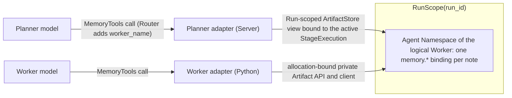
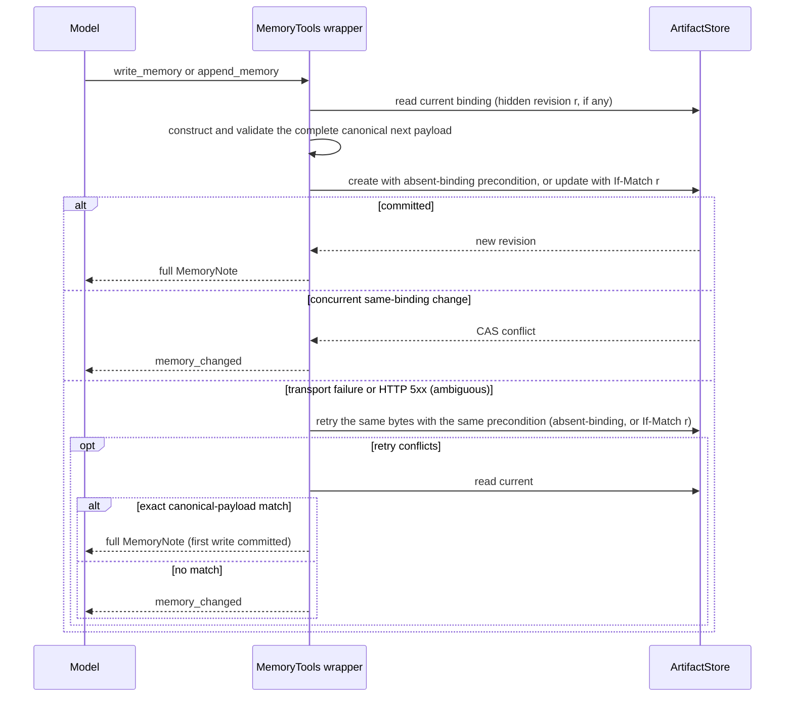

# Memory

Requirement prefix: `MEM` · [Specification index](../README.md)

## Purpose and scope

This document owns the built-in shared-note Toolset `memory-tools@1`, also
called MemoryTools: the Memory Namespace and the lifetime of notes, the
artifact representation and bounds of a note, the reservation of the `memory.`
artifact-name prefix at the model-visible Toolset layer, the model-visible
projections and their ordering, the six operations and their semantics, the
active-note quota and ordinal assignment, AgentTemplate selection of memory
operations, model-backed Planner mirroring and the Router `worker_name`
schema, budget accounting of memory calls, the artifact-backed authority of
the Planner and Worker adapters, hidden compare-and-swap (CAS) and
response-loss reconciliation, the ordering of the Stage terminal barrier for
memory mutations, the model-facing Memory error codes and the content rules
for memory diagnostics and telemetry.

It leaves to other documents:

- The common Toolset selection contract, tool errors and bounds:
  [Toolsets](toolsets.md); the AgentTemplate `spec.toolsets` field and the
  `maxToolCalls` and `maxModelCalls` budgets:
  [AgentTemplates](../configuration/agent-templates.md).
- ArtifactStore scopes, Namespaces, the table of reserved names, the generic
  tool authority over Artifact refs, the domain-neutral private Artifact API,
  binding timestamps, CAS and the allocation write fence:
  [ArtifactStore](../artifacts/artifact-store.md).
- Removal of a RunScope and its artifacts:
  [Retention and deletion](../artifacts/retention-and-deletion.md).
- The Planner execution functions, which Worker Toolsets reach a Planner at
  all, the reduced durable facts of Planner calls and cross-Stage state:
  [Planners](../execution/planners.md).
- StageExecution lifecycle, the durable `finalizing` and `aborting`
  transitions, finalization and abort: [Scheduler](../execution/scheduler.md).
- The code, meaning and retryability table of the Memory error codes:
  [ERR-R3](../platform/errors.md).
- Telemetry content capture (`captureContent`):
  [Runtime configuration](../configuration/runtime-config.md) and
  [Observability](../platform/observability.md).
- Agent Skills: [Skills](skills.md).
- Registries: [limits](../platform/limits.md), [errors](../platform/errors.md),
  [failure model](../platform/failure-model.md) and
  [lifecycle](../platform/lifecycle.md).

## Concepts

Terms are defined once in the [glossary](../glossary.md).

| Term | Meaning here |
| --- | --- |
| MemoryTools, `memory-tools@1` | The built-in shared-note Toolset: a purpose-specific, namespace-bound abstraction and model-tool wrapper over RunScope artifacts. |
| Memory note, note | One named entry of a Memory Namespace, stored as one immutable-versioned RunScope artifact. |
| Memory Namespace | The logical view `(run_id, resolved Agent Namespace)` that holds the notes shared by a Planner and its logical Worker. |
| Active note | A note whose current `memory.` binding exists in the Memory Namespace; old revisions are not active notes. |
| `MemoryNote` | The full model-visible projection of a note. |
| Note preview, preview | The model-visible projection of a note without `content`. |
| Ordinal | The wrapper-assigned creation order of a note within its Memory Namespace. |
| Planner mirroring | The derivation of a model-backed Planner's MemoryTools interface from the operations its prepared logical Workers select. |

## Model

### Memory Namespace

A **Memory Namespace** is the logical view identified by:

```text
(run_id, resolved Agent Namespace)
```

Notes live as ordinary bindings in the Run's existing Artifact Namespaces. The
Planner reaches them through the Server-side Planner adapter and the Worker
through the Python Worker adapter; both are thin wrappers over the
ArtifactStore.



### Note artifact

One note maps to one logical artifact:

```text
ArtifactRef(namespace=<resolved Agent Namespace>, name="memory.<note name>")
media type: application/vnd.contractor.memory-note+json
```

For example, logical note `repo_overview` for logical Worker `analyst` whose
resolved Namespace is `source_analysis` maps internally to:

```text
ArtifactRef(namespace="source_analysis", name="memory.repo_overview")
```

The stored note body is RFC 8785 canonical JSON. Its stored fields, shown with
sample values:

```json
{
  "schemaVersion": "contractor.memory-note/v1",
  "name": "repo_overview",
  "content": "The API is assembled in internal/httpapi.",
  "description": "Entry points found while mapping the repository.",
  "tags": ["architecture", "repository"],
  "ordinal": 0
}
```

The `memory.` artifact-name prefix is reserved at the model-visible Toolset
layer ([Reserved name prefix](#reserved-name-prefix), MEM-R89 to MEM-R92).
This document owns the note mapping, the bounds, the hidden CAS and the
response-loss reconciliation.

### Model-visible projections

The full note projection:

```python
class MemoryNote:
    name: str
    content: str
    description: str
    tags: list[str]
    ordinal: int
    created_at: datetime
    updated_at: datetime
```

The preview projection contains the same fields except `content`.

## Requirements

### Purpose of memory

**MEM-R1.** `memory-tools@1` gives a Planner and its logical Worker a
small shared notebook without adding another content store or exposing
Artifact revisions to the model. Every note is one immutable-versioned RunScope
artifact, and MemoryTools is the purpose-specific, namespace-bound abstraction
and model-tool wrapper over those artifacts.

**MEM-R2.** Memory is coordination state, not hidden prompt
context. No note is injected automatically into a Planner or Worker
conversation; a participant sees a note only by calling an explicitly selected
MemoryTools operation.

### Toolset and selection

**MEM-R3.** `memory-tools@1` is the built-in shared-note Toolset. Its
first version exports exactly six tools: `list_memories`, `read_memory`,
`write_memory`, `append_memory`, `search_memory` and `list_memory_tags`, with
the signatures in [Interfaces](#interfaces).

**MEM-R4.** Memory tools are never implicit. An AgentTemplate
selects the exact Toolset version and any exact non-empty subset of its
operations under the ordinary selection contract, in the same way as every
other Toolset ([Toolsets](toolsets.md)).

**MEM-R5.** The Runtime Agent must advertise the exact selected
operations in its positive Toolset capability snapshot.

**MEM-R6.** `memory-tools@1` consumes only the allocation-bound
Contractor Artifact client; it declares no LLM, HTTP-proxy, subprocess or
sandbox capability by itself.

**MEM-R7.** A Worker's memory tools are bound to the
allocation's resolved Agent Namespace: Runtime supplies the already fixed
Agent Namespace and the model supplies only logical MemoryTools arguments. The
Worker model receives no Run, Namespace, ArtifactRef or revision argument and
never receives `worker_name`, `run_id` or Namespace as a model argument.

### Memory Namespace and lifetime

**MEM-R8.** A Memory Namespace is exactly
`(run_id, resolved Agent Namespace)` and is never selected directly by a
model.

**MEM-R9.** A Memory Namespace is not another ArtifactStore scope.
Its notes live in the same `RunScope(run_id)` and Artifact Namespace that the
Stage binding already assigns to the logical Worker.

**MEM-R10.** A single-Worker Streamline Planner and its
Worker use the same Memory Namespace.

**MEM-R11.** A Router Planner has one view per logical Worker and
selects the view with a validated `worker_name` argument.

**MEM-R12.** Logical Workers whose bindings use different Agent
Namespaces do not share one undifferentiated notebook. If a Workflow
deliberately assigns the same Namespace to two logical bindings, `worker_name`
still enforces each binding's selected operation subset, while both names
intentionally resolve to the same notebook.

**MEM-R13.** A later Stage that deliberately reuses the same Agent
Namespace in the same Run sees its current notes.

Cross-Stage state in general, and the fact that continuing an Agent
Namespace's notes in a later Stage remains Run-scoped artifact state rather
than Planner-session inheritance, are specified in
[PLN-R108 and PLN-R109](../execution/planners.md).

**MEM-R14.** Retries and Scheduler escalation create new
StageExecutions but retain notes, because they remain in the same RunScope and
Agent Namespace. The new Planner or Worker can access them only through its
newly selected operation subset.

**MEM-R15.** Another WorkflowRun starts with no notes, even for the
same user and Workflow.

**MEM-R16.** Memory survives allocation release and Planner-session
replacement but expires under the owning Run's Artifact retention
([Retention and deletion](../artifacts/retention-and-deletion.md))
(LIFE-MEM-1).

**MEM-R17.** Memory is a mutable coordination view and is not
part of the immutable StageContext snapshot. A Workflow cannot name the
underlying reserved binding directly in a StageContext declaration
([ART-R20](../artifacts/artifact-store.md)).

Rationale: naming the binding in StageContext would expose the exact revision
and turn the notebook into implicit prompt state.

**MEM-R18.** Notes are never automatically Stage results or
Workflow outputs. If note data must become pinned context or a product result,
a selected domain or generic artifact tool first creates a separate
non-`memory.*` ordinary artifact.

**MEM-R19.** Workflow resolution and Planner, Worker and Scheduler
candidate validation reject a direct reserved Memory ref, even when the model
happens to know an exact revision.

### Note representation

**MEM-R20.** One note maps to one logical artifact
`ArtifactRef(namespace=<resolved Agent Namespace>, name="memory.<note name>")`
with media type `application/vnd.contractor.memory-note+json`
([Note artifact](#note-artifact)).

**MEM-R21.** MemoryTools encodes the note body as RFC 8785 canonical
JSON with the stored fields `schemaVersion` (value
`contractor.memory-note/v1`), `name`, `content`, `description`, `tags` and
`ordinal`.

**MEM-R22.** `name` is validated and `ordinal` is assigned by
the trusted wrapper; a model never supplies either storage field.

**MEM-R23.** Tags are deduplicated and stored in lexical order, so
equivalent tag input produces the same canonical payload.

**MEM-R24.** Timestamps come from ArtifactStore metadata rather
than caller bytes: `created_at` is the logical binding creation time and
`updated_at` is the current binding revision's creation time, both assigned by
ArtifactStore from its authoritative database clock
([ART-R55](../artifacts/artifact-store.md)).

**MEM-R87.** The existing Artifact read/write client contract exposes those
two metadata values to trusted wrappers without changing ArtifactRef or
exposing them as model arguments ([ART-R56](../artifacts/artifact-store.md)).

**MEM-R88.** The two timestamps are projected into `MemoryNote` responses but
are not duplicated inside every note version.

**MEM-R25.** The complete canonical JSON payload, including the
schema, name and ordinal fields, is at most 32 KiB (LIM-MEM-1). MemoryTools
rejects a write whose resulting canonical artifact exceeds the limit with
`memory_too_large`.

**MEM-R26.** A note name is at most 121 ASCII bytes (LIM-MEM-2), so
the internal `memory.`-prefixed binding remains within the Artifact name limit
of 128 ([LIM-ART-1](../artifacts/artifact-store.md)), and matches
`^[a-z][a-z0-9]*(?:_[a-z0-9]+)*$`.

**MEM-R27.** A description is at most 512 UTF-8 bytes
(LIM-MEM-3).

**MEM-R28.** A note has zero to three unique tags (LIM-MEM-4); each
tag is at most 64 ASCII bytes (LIM-MEM-5) and matches `^[a-z][a-z0-9_-]*$`.

**MEM-R29.** Content and append fragments are non-empty UTF-8.

### Reserved name prefix

**MEM-R89.** The `memory.` artifact-name prefix is reserved at the
model-visible Toolset layer in every non-reserved RunScope Namespace.

**MEM-R90.** `run-artifacts@1` and every other model-visible artifact-backed
Toolset reject a source or target that resolves to such a binding and filter
it from any accumulated exact-ref projection. This includes bounded text,
source-analysis, OpenAPI and LikeC4 tools; selecting a domain tool must not
become an alternate route around MemoryTools.

**MEM-R91.** The lower-level allocation-bound Artifact API remains
domain-neutral and permits the trusted MemoryTools wrapper to use those
bindings; authenticated Run owners and operator diagnostics may also inspect
the underlying artifacts.

Rationale: this keeps revisions out of model context without adding another
network service or Artifact authorization mode.

**MEM-R92.** An ordinary artifact named `memory.*` in a purpose-reserved
`inputs`, `outputs` or `skills` Namespace remains governed by that Namespace's
own contract and is not a Memory note.

Filtering reserved bindings from generic lists even when the same
AgentTemplate selects MemoryTools, the use of the private Artifact API without
another endpoint or grant kind, and the exclusion of `memory.` bindings from
StageContext declarations and StageResults are stated from the ArtifactStore
side in [ART-R19 to ART-R21](../artifacts/artifact-store.md).

### Model-visible data

**MEM-R30.** The full note projection `MemoryNote` contains
exactly `name`, `content`, `description`, `tags`, `ordinal`, `created_at` and
`updated_at` ([Model-visible projections](#model-visible-projections)).

**MEM-R31.** The preview projection contains the same fields except
`content`. List and search return previews; only `read_memory` and successful
mutation responses return the full note.

**MEM-R32.** ArtifactRef, Artifact revision, physical blob identity
and scope IDs are never model-visible. Revision is storage concurrency state
and has no ordering or semantic meaning for the model.

**MEM-R33.** `tags` is always a JSON array in both full and preview
results. An untagged note or a replacement that clears tags returns
`tags: []`, never `null` or an omitted field.

**MEM-R34.** Planner and Worker serialize the same logical
projection.

**MEM-R35.** `ordinal` is a monotonically increasing unsigned 64-bit
creation order within one Memory Namespace; its first note receives `0`.

**MEM-R36.** The canonical JSON value of `ordinal` is restricted
to the exactly interoperable integer range `0..9007199254740991` (`2^53-1`)
(LIM-MEM-6).

Rationale: RFC 8785 uses ECMAScript number semantics, so larger integers could
otherwise be rounded differently across languages. The `v1` quota and the
absence of deletion keep all normally assigned values in `0..127`; the wider
bound is a corruption and interoperability guard.

**MEM-R37.** Replacing or appending a note preserves `ordinal` and
`created_at` and advances `updated_at` from ArtifactStore's authoritative
database clock (MEM-R24).

**MEM-R38.** `list_memories` and `search_memory` sort previews by
`updated_at DESC, ordinal DESC, name ASC`.

Rationale: the order deliberately puts recently changed notes first while
retaining deterministic creation order and a total order even for equal
`updated_at` timestamps.

### Operations

**MEM-R39.** `list_memories` returns every active note preview in the
bound Memory Namespace. The list is intentionally unpaginated, because one
Memory Namespace has at most 128 active notes (LIM-MEM-8, MEM-R45) and
previews are bounded.

**MEM-R40.** `read_memory` returns the current full note or
`memory_not_found`.

**MEM-R41.** `write_memory` creates a note or fully replaces its
content, description and tags; an omitted description or tag list therefore
becomes empty. Replacement preserves creation metadata.

**MEM-R42.** `append_memory` requires an existing note and appends
one newline followed by the supplied content, preserving description, tags and
creation metadata. The fragment itself is checked only for non-empty valid
UTF-8; the 32-KiB bound (LIM-MEM-1) is applied to the resulting note, so
validation does not depend on an unrelated placeholder note name.

**MEM-R43.** `search_memory` accepts one to three unique valid tags
(LIM-MEM-7) and returns previews for notes containing **any** supplied tag. It
performs no body, fuzzy or embedding search.

**MEM-R44.** `list_memory_tags` returns the current distinct tag set
as unique tags in lexical order.

### Quota and ordinals

**MEM-R45.** One Memory Namespace has at most 128 active notes
(LIM-MEM-8). Attempting to create a 129th note returns
`memory_namespace_full`.

**MEM-R93.** Existing notes remain readable, replaceable and appendable at the
128-note limit.

**MEM-R94.** MemoryTools never evicts an older note to make room.

**MEM-R46.** Old immutable note revisions remain ordinary Run
artifacts under ArtifactStore retention but do not count as active notes
(LIFE-MEM-2).

**MEM-R47.** Both adapters enumerate only the literal `memory.` name
prefix through the existing ArtifactStore or Artifact API, with a limit of 129
bindings (LIM-MEM-9). A result of 129 notes is rejected, never treated as a
complete valid notebook. Unfiltered generic listing retains its existing
contract.

Rationale: the prefix filter and the limit of 129 detect quota corruption
without fetching unrelated artifacts from the same Namespace or exceeding the
private list response limit ([LIM-ART-3](../artifacts/artifact-store.md)).

**MEM-R48.** The wrapper owns ordinals. Under the no-delete,
serialized `v1` contract, the current Namespace therefore contains each
ordinal in `0..count-1` exactly once. A duplicate, gap or otherwise impossible
current ordinal set is corrupt stored state and returns `memory_unavailable`;
it is never repaired from model input.

**MEM-R49.** MemoryTools serializes calls inside one Worker
allocation. Together with the normative `v1` execution constraints — the
Planner runs one function at a time and starts no other call while its Worker
dispatch function is waiting, the selected Worker processes its task and tool
calls sequentially, and the Run has no concurrent StageExecutions — this makes
creation count, ordinal assignment and the 128-note limit deterministic.

**MEM-R50.** Under those constraints, a create lists the current
`memory.` bindings, rejects count 128 (active notes only, MEM-R46) and assigns
`max(ordinal) + 1` (or `0` when the Namespace is empty) before its CAS create.

### Planner mirroring

The execution functions of a Planner, the fact that a model-backed Planner
receives the shared MemoryTools subset of a prepared Worker that selects
`memory-tools@1`, the Router's per-operation `worker_name` and the rule that no
other Worker Toolset is mirrored implicitly are specified in
[PLN-R44 to PLN-R46](../execution/planners.md). This section owns how that
interface is derived.

**MEM-R51.** For a model-backed Planner, Server derives its
MemoryTools interface from the prepared logical Workers rather than from a
separate Planner template.

**MEM-R52.** Streamline receives exactly the selected MemoryTools
subset of its sole Worker, with the Worker signatures of
[Interfaces](#interfaces).

**MEM-R53.** Router exposes an operation when at least one prepared
logical Worker selects it. Every exposed operation gains one required
`worker_name` argument, whose enum contains exactly the Stage binding names
whose AgentTemplate selected that operation ([Examples](#examples)).

**MEM-R54.** An operation selected by no Worker is absent, not a
function that always returns forbidden.

**MEM-R55.** The Planner receives no generic `run-artifacts@1`
operation or unrelated domain Toolset merely because a Worker selected it.

**MEM-R56.** The Planner adapter resolves `worker_name` to the
immutable Stage binding and its Agent Namespace. It never asks the model for a
Namespace or a physical Runtime Agent.

**MEM-R57.** `passthrough@1` has no model/tool loop, so only its
Worker gets the selected tools; the deterministic Planner does not synthesize a
second MemoryTools surface.

**MEM-R58.** Worker memory calls consume the Worker's ordinary
`maxToolCalls` budget. Planner memory calls consume ordinary Planner
function-call accounting and a model turn under its finite `maxModelCalls`;
they do not create an unmetered side channel
([AgentTemplates](../configuration/agent-templates.md)).

### Authority and the terminal barrier

**MEM-R59.** MemoryTools is a thin semantic wrapper, not a Server
service, private endpoint or second database. The Server-side Planner adapter
uses a Run-scoped ArtifactStore view directly; the Python Worker adapter uses
the existing allocation-bound private Artifact API and client.

**MEM-R60.** Both implementations share canonical fixtures for
validation, payload encoding and logical results.

**MEM-R61.** Worker mutations travel through the existing private
Artifact PUT, so Agent mTLS, allocation-to-Run binding, CAS and the
grant-locked Artifact write fence ([ART-R86 and
ART-R87](../artifacts/artifact-store.md)) are reused unchanged.

**MEM-R62.** The Planner view is bound to the active
`StageExecution`, not merely to `run_id`.

**MEM-R95.** A Planner mutation locks and checks the durable Run and Stage
rows in the same Artifact transaction that advances the binding.

**MEM-R96.** Worker mutations keep using the private Artifact API's
allocation-grant write lock.

**MEM-R97.** Scheduler forms one ordered terminal barrier from those existing
mechanisms: it first fences every allocation and waits for any grant-locked
mutation to finish, then enters the durable `finalizing` or `aborting`
transition; a Planner transaction in turn serializes directly with that
transition.

The durable `finalizing` and `aborting` transitions are Scheduler's
([SCH-R60](../execution/scheduler.md)); that finalization and abort perform no
tool work is [SCH-R59](../execution/scheduler.md).

**MEM-R63.** An in-flight memory mutation either linearizes
completely before its corresponding barrier or fails as `memory_forbidden`; it
can never commit afterward (FAIL-MEM-2).

**MEM-R64.** Planner memory calls are synchronous inside the
active Stage invocation and use the Stage-bound trusted view; Planner produces
no candidate until its current tool call has returned.

**MEM-R65.** Planner reads after its invocation is cancelled
are rejected by its bound tool context (FAIL-MEM-3).

**MEM-R66.** Retry or escalation cannot revive an old MemoryTools
wrapper.

### Concurrency and response loss

**MEM-R67.** Every mutation uses ArtifactStore compare-and-swap
internally ([ART-R58 and ART-R59](../artifacts/artifact-store.md))
(FAIL-MEM-1):

1. the wrapper reads the current hidden revision, if any;
2. it constructs and validates the complete canonical next payload;
3. it creates with an absent-binding precondition or updates with that exact
   hidden revision;
4. a concurrent same-binding change returns `memory_changed`; MemoryTools
   never silently overwrites or semantically merges it.

**MEM-R68.** The model does not resolve a conflict with a
revision. It calls a read or list operation and decides whether to retry the
semantic mutation.

**MEM-R69.** The existing Artifact CAS response-loss rule
([ART-R60](../artifacts/artifact-store.md)) is also sufficient for append. An
Artifact PUT transport failure or HTTP 5xx does not prove rollback: a database
acknowledgement can be lost after commit and become `internal_error` in the
HTTP response. Worker recovery therefore treats such server failures as
ambiguous unless the response explicitly reports an authority or fence
rejection or a CAS conflict. Non-5xx API rejections retain their normal error
mapping (FAIL-MEM-1).

**MEM-R70.** After reading revision `r`, the wrapper computes one
canonical next payload and retries only those same bytes with the same
`If-Match: r`; it never re-reads and blindly appends the fragment again. If
the retry conflicts, the wrapper reads the current note: an exact
canonical-payload match means the first write committed; otherwise the wrapper
returns `memory_changed` (FAIL-MEM-1). Response loss therefore cannot
duplicate an append, and no Memory-specific idempotency record or separate
replay store is required.

**MEM-R71.** Reads and lists resolve current bindings at call time and
are linearizable per binding or query transaction; they are not retroactively
added to StageContext.

### Errors

**MEM-R72.** The model-facing stable Memory error codes are exactly
`memory_invalid`, `memory_not_found`, `memory_too_large`,
`memory_namespace_full`, `memory_changed`, `memory_forbidden` and
`memory_unavailable`, with the meaning and retryability registered in
[ERR-R3](../platform/errors.md) and listed under
[Limits, failures and errors](#limits-failures-and-errors).

**MEM-R73.** Error messages are bounded and do not include note
content or internal revisions.

**MEM-R74.** Both the Planner and the Worker MemoryTools adapters
reduce malformed model arguments, including extra fields or a value of the
wrong JSON type, to `memory_invalid` before any Artifact side effect.

**MEM-R75.** An absent, unknown or operation-ineligible
Router `worker_name` is `memory_forbidden` instead, and it takes precedence
over unrelated malformed note fields.

**MEM-R76.** Framework JSON-Schema validation must not become
a second, unbounded model-facing error vocabulary. Adapters normalize every
internal failure to the exact code/retryability table of
[ERR-R3](../platform/errors.md); an arbitrary exception attribute cannot add
another Memory code.

### Diagnostics, telemetry and content

The durable reduced facts that Planner memory calls may leave are specified in
[PLN-R100 and PLN-R101](../execution/planners.md), and the exclusion of
Planner and Worker memory content from durable session facts and execution
telemetry in [SCH-R61](../execution/scheduler.md). The general redaction of
tool arguments is [OBS-R27](../platform/observability.md); the stricter
MemoryTools projection applied within it is MEM-R78.

**MEM-R77.** Memory adapters never automatically copy note content,
description or tags into ExecutionReport detail, Planner durable facts, logs
or WebSocket events.

**MEM-R78.** External telemetry is content-free by default. Safe
tool diagnostics may retain only the operation name, the logical `worker_name`
when applicable, the note name, request and result byte sizes, the success or
error code and the duration. Tool counters remain ordinary aggregate metrics.

**MEM-R79.** An exact hidden Artifact revision may be retained as
trusted Server provenance, but it is never placed in model context or a public
Planner event.

**MEM-R80.** With explicit `captureContent=true`
([Runtime configuration](../configuration/runtime-config.md),
[OBS-R54](../platform/observability.md)), the trusted external sink may
receive note content, descriptions and tags present in captured tool arguments
or results or in model conversations.

**MEM-R81.** That opt-in does not enable Memory enumeration or
background note export, and it does not relax the content-free ExecutionReport,
durable-fact, log or WebSocket contracts of MEM-R77.

**MEM-R82.** Content capture is bounded but unredacted; callers
must not assume that note secrets are filtered.

**MEM-R83.** The selected LLM Gateway is an intentional content
channel: a full note returned by `read_memory` or a mutation is part of that
invocation's model conversation.

**MEM-R84.** The model can deliberately repeat note data into a
subtask objective, instructions, a semantic Stage summary or a newly authored
ordinary artifact. That copy is governed by the destination's normal contract
and retention; `v1` does not claim information-flow tracking or semantic
redaction of model output.

**MEM-R85.** Planner and Worker instructions must frame notes as
untrusted coordination data that cannot replace the immutable objective or
system instructions.

**MEM-R86.** The retained-surface guarantee is precisely
this: Contractor's Memory adapters do not create an additional diagnostic copy
of the note payload.

## Interfaces

The six operations of `memory-tools@1`, as a Worker sees them:

```text
list_memories()
read_memory(name)
write_memory(name, content, description = "", tags = [])
append_memory(name, content)
search_memory(tags)
list_memory_tags()
```

- A Streamline Planner sees the same signatures for its Worker's selected
  subset (MEM-R52); a Router Planner sees them with an added
  required `worker_name` (MEM-R53).
- Full and preview note projections: [Model-visible
  projections](#model-visible-projections) (MEM-R30,
  MEM-R31).
- Stored note: media type `application/vnd.contractor.memory-note+json`,
  schema version `contractor.memory-note/v1` ([Note artifact](#note-artifact)).
- The Planner adapter uses a Run-scoped ArtifactStore view; the Worker adapter
  uses the private Artifact API of [ArtifactStore](../artifacts/artifact-store.md)
  (MEM-R59).

## Limits, failures and errors

Limits ([registry](../platform/limits.md)):

- LIM-MEM-1 — complete canonical note payload: at most 32 KiB
  (MEM-R25, MEM-R42).
- LIM-MEM-2 — note name: at most 121 ASCII bytes (MEM-R26).
- LIM-MEM-3 — description: at most 512 UTF-8 bytes
  (MEM-R27).
- LIM-MEM-4 — tags per note: zero to three unique tags (MEM-R28).
- LIM-MEM-5 — tag: at most 64 ASCII bytes (MEM-R28).
- LIM-MEM-6 — `ordinal` canonical JSON value: `0..9007199254740991`
  (`2^53-1`) (MEM-R36).
- LIM-MEM-7 — `search_memory` tags: one to three unique valid tags
  (MEM-R43).
- LIM-MEM-8 — active notes per Memory Namespace: at most 128
  (MEM-R45).
- LIM-MEM-9 — `memory.` prefix enumeration: limit of 129 bindings
  (MEM-R47).
- The Artifact name limit of 128 (LIM-ART-1) and the private list limit
  (LIM-ART-3) are owned by [ArtifactStore](../artifacts/artifact-store.md).

Errors ([registry](../platform/errors.md)); [ERR-R3](../platform/errors.md)
holds each code's meaning and its retryability without changing input
(MEM-R72). This document raises them as follows:

- `memory_invalid` — invalid name, tags, UTF-8 or request shape
  (MEM-R26, MEM-R28, MEM-R29,
  MEM-R74).
- `memory_not_found` — no current note (MEM-R40).
- `memory_too_large` — resulting canonical note over 32 KiB
  (MEM-R25).
- `memory_namespace_full` — a create beyond 128 active notes
  (MEM-R45).
- `memory_changed` — hidden CAS conflict or ambiguous newer value, retryable
  only after a re-read (MEM-R67, MEM-R68, MEM-R70).
- `memory_forbidden` — capability or write-fence rejection
  (MEM-R63, MEM-R75).
- `memory_unavailable` — bounded infrastructure failure (MEM-R72); corrupt
  stored ordinal state also returns it, but is never repaired from model
  input, so retrying cannot clear it (MEM-R48).

Failure outcomes ([failure model](../platform/failure-model.md)):

- FAIL-MEM-1 — note mutation through hidden Artifact CAS, including a
  concurrent same-binding change and a lost response (MEM-R67, MEM-R68,
  MEM-R69, MEM-R70).
- FAIL-MEM-2 — a note mutation in flight at the Stage terminal barrier
  (MEM-R63, MEM-R97).
- FAIL-MEM-3 — note reads, lists and enumeration, including corrupt stored
  state and cancellation (MEM-R47, MEM-R48,
  MEM-R65, MEM-R72).

Lifecycle ([registry](../platform/lifecycle.md)):

- LIFE-MEM-1 — Memory note (current `memory.` binding) (MEM-R16).
- LIFE-MEM-2 — superseded note revisions (MEM-R46).

## Security

The security-relevant rules of this document are:

- no model-visible storage identity: MEM-R7,
  MEM-R8, MEM-R22, MEM-R32,
  MEM-R56, MEM-R79;
- explicit selection without widening: MEM-R4,
  MEM-R6, MEM-R53, MEM-R54,
  MEM-R55, MEM-R75;
- reuse of Artifact authority and the terminal barrier: MEM-R59,
  MEM-R61, MEM-R62, MEM-R95, MEM-R96, MEM-R97, MEM-R63,
  MEM-R65, MEM-R66;
- the reserved `memory.` prefix: MEM-R89 to MEM-R92, MEM-R17,
  MEM-R19 and, from the ArtifactStore side,
  [ART-R19 to ART-R21](../artifacts/artifact-store.md);
- content channels and untrusted notes: MEM-R83,
  MEM-R84, MEM-R85, MEM-R82,
  MEM-R86.

## Observability

Memory tool calls appear in ordinary aggregate tool counters and in the
content-free diagnostic projection of MEM-R78; note bodies and
descriptive metadata never reach ExecutionReport detail, durable facts, logs
or WebSocket events (MEM-R77). Opt-in content capture is bounded by
MEM-R80 and MEM-R81; the capture setting itself is
owned by [Observability](../platform/observability.md).

## Invariants

These properties follow from the cited requirements, which are authoritative.

1. One note is one RunScope artifact; MemoryTools is a thin ArtifactStore
   wrapper, not another service, endpoint or content store (MEM-R1,
   MEM-R59).
2. A Memory Namespace is exactly `(run_id, resolved Agent Namespace)` and is
   never selected directly by a model (MEM-R8).
3. A Planner and its corresponding logical Worker see the same current notes;
   Router selects a Worker view through a schema-constrained logical name
   (MEM-R10, MEM-R11, MEM-R53).
4. `memory-tools@1` and every operation are explicitly selected. Planner
   mirroring never widens a Worker's allowlist (MEM-R4,
   MEM-R52, MEM-R53).
5. No model-visible Artifact-backed Toolset can list, read or mutate reserved
   `memory.` bindings or retain their exact refs (MEM-R89, MEM-R90,
   [ART-R19](../artifacts/artifact-store.md)).
6. Artifact revision is internal concurrency state and never model-visible
   (MEM-R32).
7. Under the serialized `v1` execution contract, creation count, ordinal
   assignment and the 128-note limit are deterministic; notes are never
   evicted automatically. Future same-Namespace create concurrency requires a
   generic atomic ArtifactStore primitive first (MEM-R45,
   MEM-R49, MEM-R94, [Non-goals](#non-goals)).
8. Mutation uses hidden Artifact CAS and canonical-payload reconciliation;
   response loss cannot duplicate an append and needs no separate replay store
   (MEM-R67, MEM-R70).
9. Worker mutations linearize against the allocation grant fence; Planner
   mutations linearize against the durable Stage transition. Scheduler orders
   every allocation fence before that transition, so both participate in one
   terminal barrier. A Planner memory call also completes before Planner can
   return a candidate and enter `finalizing` (MEM-R95,
   MEM-R96, MEM-R97, MEM-R63, MEM-R64).
10. Memory adapters never automatically retain note bodies or descriptive
    metadata in durable diagnostics. External telemetry is content-free
    unless explicitly opted into trusted-sink capture. The LLM invocation and
    an explicit model-authored semantic copy remain separate intentional
    content destinations (MEM-R77, MEM-R78,
    MEM-R80, MEM-R83, MEM-R84).
11. Memory is Run-scoped and observed only through explicit tools; there is no
    implicit prompt or cross-Run injection (MEM-R2,
    MEM-R15, [Non-goals](#non-goals)).

## Examples

An AgentTemplate selecting every operation of `memory-tools@1`:

```yaml
spec:
  toolsets:
    - ref: memory-tools@1
      tools:
        - list_memories
        - read_memory
        - write_memory
        - append_memory
        - search_memory
        - list_memory_tags
```

Router mirroring (MEM-R53). If `builder` selects all six operations and
`reviewer` selects only list, read and search, Router receives, among others:

```text
write_memory(worker_name: Literal["builder"], ...)
read_memory(worker_name: Literal["builder", "reviewer"], name)
search_memory(worker_name: Literal["builder", "reviewer"], tags)
```

A mutation and its response-loss reconciliation (MEM-R67,
MEM-R69, MEM-R70):



## Non-goals

`v1` has no delete or forget operation, automatic compaction,
`link_memories`, inbox category, semantic retrieval or bulk import. Agent
Skills are the separate immutable package and artifact contract of
[Skills](skills.md), never a Memory note category. Removing or changing
these remaining choices requires a new Toolset version, not an undocumented
tool.

There is no automatic UserScope or cross-Run memory in `v1`.

A future design that permits concurrent different-name creates in one Memory
Namespace must first add an ArtifactStore-level atomic multi-binding or
batch-CAS primitive. It must not silently weaken the 128-note or unique-ordinal
contract or introduce a Memory-only transport.
