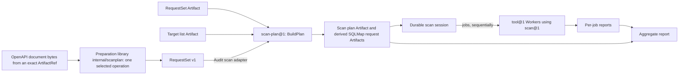
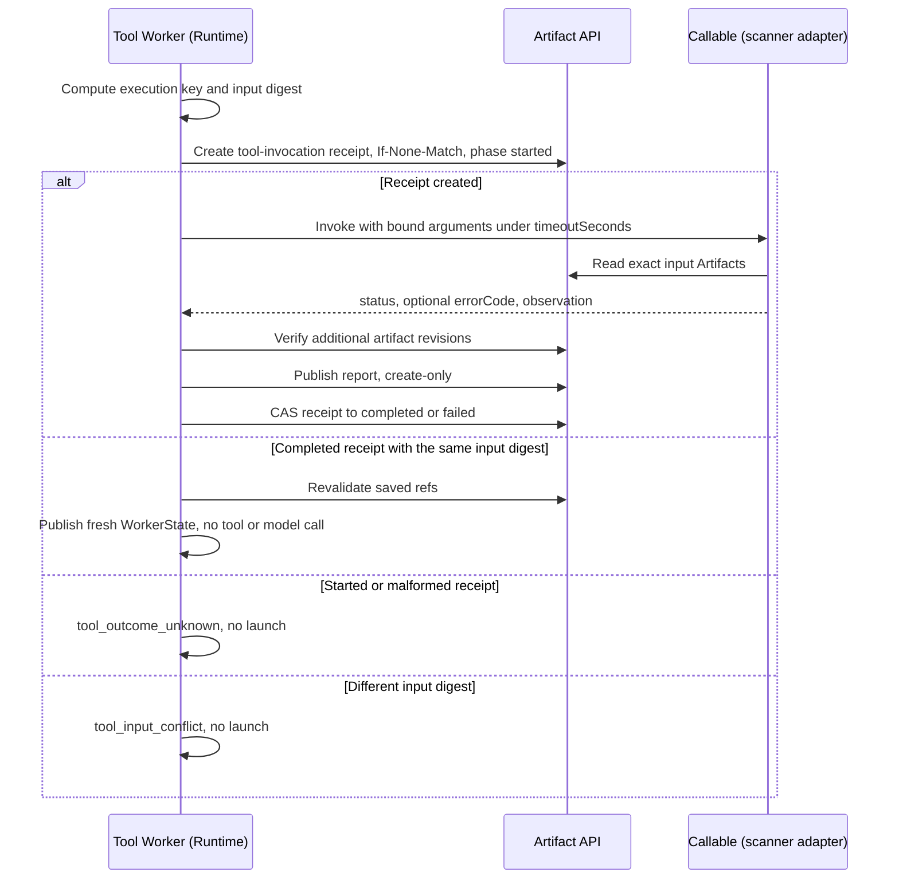
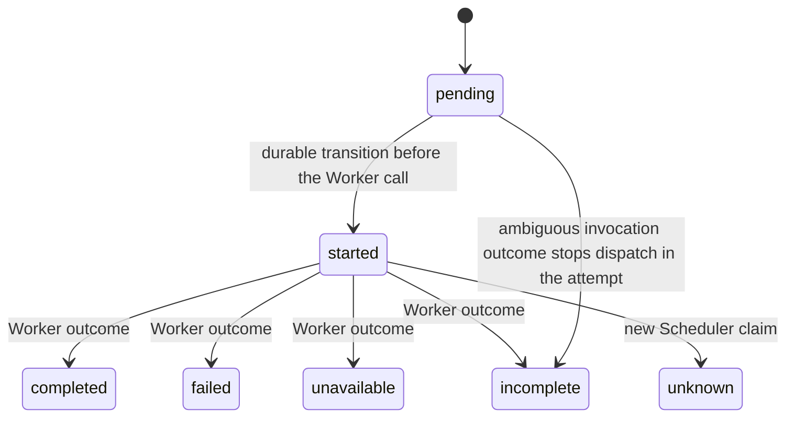

# Scanners

Requirement prefix: `SCN` · [Specification index](../README.md)

## Purpose and scope

This document owns the deterministic scanning path of Contractor:

- model-free tool Workers (`tool@1`): their `execution` bindings, model
  absence, invocation receipts, reports, replay and failure handling;
- the scanner Toolset `scan@1` and its adapters `scan_nuclei`, `scan_sqlmap`,
  `scan_naabu` and `scan_ffuf`;
- the SQLMap HTTP request artifact and the scanner wordlist artifact;
- deterministic scan request preparation: RequestSet v1 and single-operation
  preparation from an OpenAPI document;
- deterministic scan planning: the `scan-plan@1` Planner, its plan, its
  journal and its aggregate report.

<!-- from: 01#7, 01#52, 29#2, 31#1, 32#1 -->

It leaves to other documents:

- AgentTemplate fields, the `adk@1` model fields (absent in the `tool@1`
  variant) and the ResolvedAgentTemplate projection and canonical digest that
  embed `execution`: [AgentTemplates](../configuration/agent-templates.md).
- RuntimeSettings, runtime labels, label merge, credentials, LLM Gateways and
  the `tool-http` and `tool-subprocess` proxy routes:
  [RuntimeConfig](../configuration/runtime-config.md).
- Workflow input slots and slot media-type matching:
  [Workflows](../configuration/workflows.md).
- The common Toolset selection contract and tool allowlists:
  [Toolsets](toolsets.md).
- The reserved `memory.` and `tool-invocation.` artifact-name prefixes, exact
  ArtifactRefs, scopes and input forks:
  [ArtifactStore](../artifacts/artifact-store.md) (ART-R19 to ART-R23).
- The `passthrough@1` Planner and the general Planner contract:
  [Planners](../execution/planners.md).
- Scheduler claims, Worker allocation, readiness, leases and placement:
  [Scheduler](../execution/scheduler.md).
- Runtime startup and the Runtime-side allocation lifecycle:
  [Runtime Agent](../execution/runtime-agent.md).
- WorkerCompletion, WorkerFailure and Worker State:
  [Worker](../execution/worker.md).
- The shared target policy: [Security](../platform/security.md).
- The OpenAPI Audit scan adapter, including the fixed Nuclei URL target
  (`scanplan.PrepareOperationTarget` and its `url-target` preparation identity) and the
  Audit use of SQLMap requests: [Audit scans](../audits/scans.md).
- Active-check classification and approval in Audits:
  [Audits](../audits/audits.md).
- Shared registries: [limits](../platform/limits.md),
  [errors](../platform/errors.md),
  [failure model](../platform/failure-model.md) and
  [lifecycle](../platform/lifecycle.md).

<!-- from: 01#7, 03#25, 29#11, 29#14, 32#19, oas#20, oas#21 -->

## Concepts

Terms are defined once in the [glossary](../glossary.md).

| Term | Meaning here |
| --- | --- |
| Tool Worker | A Worker whose AgentTemplate selects the model-free runtime `tool@1` and invokes one registered callable without a model. |
| `execution` | The AgentTemplate block of a tool Worker that names the tool, its argument bindings, its report binding and its deadline. |
| Argument binding | One entry of `execution.arguments` that takes its value from exactly one source: `parameter`, `artifact` or `literal`. |
| Execution key | The SHA-256 of canonical JSON of `runId`, `stageExecutionId`, `logicalAgentName` and `subtaskId` that identifies one tool invocation. |
| Invocation receipt | The Runtime-owned `tool-invocation.<hex-key>` artifact that records the phase of one tool invocation. |
| Input digest | The digest of the template ref, resolved arguments and output bindings of one tool invocation. |
| Tool Worker report | The bounded `application/json` artifact that carries a tool invocation's unchanged observation. |
| ScanToolset | The `scan@1` Toolset exporting `scan_nuclei`, `scan_sqlmap`, `scan_naabu` and `scan_ffuf`. |
| SQLMap request artifact | The six-field JSON description of one HTTP request that `scan_sqlmap` request mode accepts. |
| Scanner wordlist | A `text/vnd.contractor.wordlist` (or `text/plain`) artifact holding one scanner payload per line. |
| RequestSet | The bounded, versioned `application/vnd.contractor.http-requests+json` set of neutral prepared HTTP requests with exact source provenance and preparation gaps. |
| Preparation gap | A `pointer` and fixed `code` recording source data that preparation omitted, ignored or could not use. |
| Preparation digest | The digest that binds preparation policy, source, options, selected operation and mode. |
| Concrete value | A value taken from an explicit binding or a document hint; preparation never invents one. |
| Target list | A `text/vnd.contractor.target-list` artifact of nonempty target lines. |
| Scan plan | The immutable `application/vnd.contractor.scan-plan+json` artifact that `scan-plan@1` builds from one input. |
| Candidate | One possible (Worker, input) pairing in a scan plan, with its selection decision. |
| Job | A selected candidate, executed as one tool Worker invocation. |
| Scan session | The durable journal of a scan plan's job records, fenced by the Scheduler claim. |
| Aggregate report | The Stage-level `application/json` report that references the plan and every per-job report. |

<!-- from: 01#52, 01#60, 03#47, 03#59, 29#2, 29#4, 29#5, 29#15, 29#17, 31#2, 31#5, 31#6, 31#15, 32#1, 32#5, 32#12, 32#14, 32#15, 32#18, 32#22 -->

## Model

### Scanning path

An OpenAPI operation can be prepared into a RequestSet in process; a RequestSet
or target list Artifact supplied to a Run is planned and executed by
`scan-plan@1` through fixed tool Workers.



<!-- from: 31#1, 03#59, oas#20, 32#1, 32#5, 32#18, 32#19, 32#22 -->

### Tool Worker invocation



<!-- from: 29#15, 29#16, 29#17, 29#18, 29#19 -->

### Scan job states

A job record in the scan session moves through these states. A Worker outcome
other than completion is classified by the Worker error code table.
`completed`, `failed`, `unavailable`, `incomplete` and `unknown` are never
silently restarted.



<!-- from: 32#19, 32#20, 32#24 -->

## Requirements

### Tool Workers: template and arguments

**SCN-R1.** `tool@1` invokes one registered callable without a model. It uses
the ordinary Allocation, A2A, WorkerState, Artifact API and WorkerCompletion
contracts.
<!-- from: 29#2 -->

**SCN-R2.** A `tool@1` AgentTemplate accepts exactly one selected tool
(LIM-SCN-1) and no Agent Skills, summarizer, instructions, ModelPolicy, custom
completion contract or project workspace.
<!-- from: 29#2 -->

**SCN-R3.** The `local-workdir@1` sandbox profile owns disposable scanner
files.
<!-- from: 29#2 -->

**SCN-R4.** `execution` is forbidden for runtimes other than `tool@1`. ADK
requirements remain unchanged.
<!-- from: 29#2, 01#7 -->

**SCN-R5.** `execution` has exactly four required fields: `tool`, `arguments`,
`resultArtifact` and `timeoutSeconds`.
<!-- from: 29#3, 29#4 -->

**SCN-R6.** `arguments` is an object with at most 32 keys (LIM-SCN-2). Argument
names match `[A-Za-z_][A-Za-z0-9_]{0,63}` (LIM-SCN-3). Each binding selects
exactly one source:

| `source` | Required payload | Resolved value |
| --- | --- | --- |
| `parameter` | `name`, 1–128 non-whitespace characters (LIM-SCN-4) | The unchanged `StageContentRequest.parameters` string |
| `artifact` | `name`, with the same bounds | The exact ArtifactRef object from `StageContentRequest.artifacts` |
| `literal` | `value` | A non-null JSON string, boolean or finite number |

<!-- from: 29#4, 29#5 -->

**SCN-R7.** `name` is forbidden for `literal`, and `value` is forbidden for the
other sources.
<!-- from: 29#6 -->

**SCN-R8.** Literal strings are at most 8192 UTF-8 bytes (LIM-SCN-5). Numbers
must be finite and, when integral, within the exactly representable integer
range ±9007199254740991 (LIM-SCN-6).
<!-- from: 29#6 -->

**SCN-R9.** There is no string interpolation and no implicit JSON or type
coercion.
<!-- from: 29#6, 29#10 -->

**SCN-R10.** Numeric limits can be pinned as literals; omitted arguments use
the callable's defaults.
<!-- from: 29#6 -->

**SCN-R11.** Artifacts remain refs for adapters to resolve, never local paths
or model context.
<!-- from: 29#6 -->

**SCN-R12.** `tool` must equal the one selected exported tool name.
<!-- from: 29#7 -->

**SCN-R13.** `resultArtifact` names a versionless binding in
`StageContentRequest.resultArtifacts` and is required for every call. Its
target must be in the Worker's own namespace and cannot use the reserved
`tool-invocation.` prefix ([ART-R23](../artifacts/artifact-store.md)).
<!-- from: 29#7, 03#25 -->

**SCN-R14.** Up to 16 additional result bindings (LIM-SCN-7) may be supplied
for artifacts produced by the callable. They belong to the Worker's namespace,
have names distinct from each other and from the report, and cannot use the
`tool-invocation.` or `memory.` prefixes. Invalid additional bindings fail
before invocation.
<!-- from: 29#7, 03#25 -->

**SCN-R15.** `timeoutSeconds` is an integer in 1–3600 (LIM-SCN-8). The Worker
enforces it around the tool call, independently of the tool's own deadline.
<!-- from: 29#7 -->

**SCN-R16.** The bound arguments, artifact refs and output binding together are
limited to 64 KiB of canonical JSON (LIM-SCN-9).
<!-- from: 29#7 -->

**SCN-R17.** Unknown arguments, missing sources, wrong types or missing
required arguments fail before invocation.
<!-- from: 29#8 -->

**SCN-R18.** Runtime builds a strict input schema from the selected callable's
annotations and defaults at allocation preparation.
<!-- from: 29#8 -->

**SCN-R19.** The callable returns a JSON object with `status: completed|failed`
and an optional fixed `errorCode`. Invalid, non-finite or oversized responses
fail explicitly.
<!-- from: 29#8 -->

**SCN-R20.** Runtime never interprets the objective or instructions as
arguments and never chooses a different tool.
<!-- from: 29#8 -->

### Tool Workers: model absence and placement

How ResolvedAgentTemplate embeds `execution`, how its canonical digest covers
it, and how model absence is carried through resolved execution config and
AllocationSpec are specified in
[AgentTemplates](../configuration/agent-templates.md).
<!-- from: 29#11 -->

**SCN-R21.** RuntimeSettings permits an absent `llmGatewayUrl` and token, but
AllocationSpec requires them for ADK and forbids them for `tool@1`.
<!-- from: 29#12 -->

**SCN-R22.** Tool allocation provenance has no LLM Gateway or credential refs.
<!-- from: 29#12 -->

**SCN-R23.** Template model absence and effective model absence are validated
independently; omission does not relax model validation for ADK.
<!-- from: 29#12 -->

**SCN-R24.** Workflow, Run and escalation execution patches that target a tool
Worker cannot set a model policy, Gateway or model credential, including an
explicit clear.
<!-- from: 29#13 -->

**SCN-R25.** Shared Runtime labels may contain model routes for other Workers.
Those leaves are irrelevant to `tool@1` and must be projected out before merge,
catalog or credential lookup and adapter materialization.
<!-- from: 29#13 -->

**SCN-R26.** Telemetry and applicable HTTP and proxy adapters retain their
normal precedence and provenance for a tool Worker.
<!-- from: 29#13 -->

**SCN-R27.** Selecting `tool@1` never requires a model catalog or key.
<!-- from: 29#13 -->

**SCN-R28.** Tool and runtime capability matching and active-check
classification apply to tool Workers as to other Workers; there is no fallback
to ADK.
<!-- from: 29#13 -->

**SCN-R29.** Stage-local parameter, artifact and output bindings are checked
against the resolved execution contract when a Workflow is loaded.
<!-- from: 29#14 -->

**SCN-R30.** The ordinary `passthrough@1` Planner
([Planners](../execution/planners.md)) supplies single-call tool Worker
scenarios and needs no model.
<!-- from: 29#14 -->

### Tool Workers: receipt, report and replay

**SCN-R31.** The execution key is the SHA-256 of canonical JSON containing
`runId`, `stageExecutionId`, `logicalAgentName` and `subtaskId`.
<!-- from: 29#15 -->

**SCN-R32.** The Worker's owned namespace stores a `tool-invocation.<hex-key>`
`application/json` receipt, created with `If-None-Match` before tool launch
(FAIL-SCN-1).
<!-- from: 29#15, 03#25 -->

**SCN-R33.** The input digest covers the template ref, the resolved arguments
and the output binding, plus any additional result bindings. A changed input
under the same execution key fails as `tool_input_conflict`. The objective and
instructions do not affect execution identity.
<!-- from: 29#15 -->

**SCN-R34.** The receipt provides delivery deduplication within one
StageExecution; an explicitly new Run or StageExecution is new work.
<!-- from: 29#15 -->

**SCN-R35.** A receipt starts with `schemaVersion` 1, `inputDigest` and phase
`started`. Only its creator may launch the tool.
<!-- from: 29#16 -->

**SCN-R36.** A terminal CAS update records phase `completed` or `failed`, an
optional exact report ref, optional additional artifact refs and a fixed error
code (FAIL-SCN-2, LIFE-SCN-1).
<!-- from: 29#16 -->

**SCN-R37.** An existing `started` receipt means `tool_outcome_unknown`, and
Runtime does not rescan. A receipt write with an ambiguous result also prevents
launch.
<!-- from: 29#16 -->

**SCN-R38.** An in-memory completed delivery returns the same WorkerCompletion.
Receipt replay on another allocation publishes fresh local WorkerState with
zero new tool or model calls and reuses the exact report and additional
artifacts. Repeated delivery therefore reuses the durable report and never
automatically repeats an unknown scan.
<!-- from: 29#16, 01#68, 03#53 -->

**SCN-R39.** Receipts contain no target, credentials or raw arguments.
<!-- from: 29#16 -->

**SCN-R40.** An invocation that declares no additional result bindings
computes its input digest and writes its receipt without any additional-binding
fields.
<!-- from: 29#16 -->

**SCN-R41.** The report is `application/json`, at most 512 KiB (LIM-SCN-10),
and contains `schemaVersion` 1, `tool`, `inputDigest`, the exact
`inputArtifacts` and the unchanged bounded tool response under `observation`.
<!-- from: 29#17, 01#68, 03#53 -->

**SCN-R42.** Report publication is create-only to the supplied output binding.
Runtime must not overwrite an existing report or infer its ownership by name
(LIFE-SCN-2).
<!-- from: 29#17 -->

**SCN-R43.** The callable may return an `observation.artifacts` object that
maps additional declared slots to exact ArtifactRefs. A successful observation
must include every additional declared slot; a failed observation may include a
subset, so that an early tool failure can still publish its diagnostic report.
<!-- from: 29#18 -->

**SCN-R44.** The `observation.artifacts` map is at most 8192 UTF-8 JSON bytes
(LIM-SCN-11). Each ref must identify its declared namespace and name, include
an immutable revision and exclude the primary report slot. Invalid output
mappings fail as `tool_output_invalid`.
<!-- from: 29#18 -->

**SCN-R45.** Before publishing success, Runtime verifies each exact revision
through the Artifact API with a 512 KiB read bound (LIM-SCN-12). Inaccessible
or mismatched published revisions fail as `tool_report_failed` (FAIL-SCN-3).
<!-- from: 29#18 -->

**SCN-R46.** The receipt persists the validated refs, and WorkerCompletion
returns them alongside the report for ordinary Workflow output propagation.
<!-- from: 29#18 -->

**SCN-R47.** Completed receipt replay revalidates the declared refs and their
availability. An invalid or unavailable saved ref produces
`tool_outcome_unknown`, never a new tool call or a substitution of the latest
mutable binding (FAIL-SCN-4).
<!-- from: 29#18 -->

**SCN-R48.** Tool Worker completion and recovery follow this table
(FAIL-SCN-5):

| Event | Completion / recovery |
| --- | --- |
| Tool completes, report and receipt persist | Result with the report ref, `summarized=false` |
| Tool reports `failed` | Publish the diagnostic report; nonretryable WorkerFailure |
| Invalid input | `tool_input_invalid`, no process launch |
| Tool exception / invalid output | `tool_execution_failed` / `tool_output_invalid` |
| Tool deadline | `tool_timeout`; await tool cancellation and cleanup |
| User cancel, lease loss, abort | Cancel the task and join child cleanup; a `started` receipt prevents a rescan if final persistence is fenced |
| Report publication fails | `tool_report_failed`; no rescan; the receipt retains the failure if writable |
| Terminal receipt persistence is ambiguous | `tool_outcome_unknown`; no success declaration or rescan |
| Same key, same completed input | Replay the existing result and ref; no new tool call |
| Same key, different input | `tool_input_conflict`; no launch |
| Existing `started` or malformed receipt | `tool_outcome_unknown`; no launch |

<!-- from: 29#19 -->

**SCN-R49.** Tool Worker failures use bounded fixed messages and
`retryable=false`.
<!-- from: 29#20 -->

**SCN-R50.** Reports may contain scanner evidence, including sensitive target
data, under the normal artifact access rules. Metrics and receipts do not
contain argument values or output.
<!-- from: 29#20 -->

**SCN-R51.** Worker State revisions and tool counts are updated through
WorkerStateStore. Model counters remain zero, and no ADK finalizer or
summarizer is constructed.
<!-- from: 29#20 -->

### Scan toolset

**SCN-R52.** `scan@1` exports `scan_nuclei`, `scan_sqlmap`, `scan_naabu` and
`scan_ffuf` through the explicit tool allowlist of [Toolsets](toolsets.md).
`scan_ffuf` is independently selectable.
<!-- from: 01#52 -->

**SCN-R53.** Every scanner operation declares the `runtime-subprocess-launcher`
infrastructure channel.
<!-- from: 01#52 -->

**SCN-R54.** Runtime startup probes each optional scanner executable
separately, and only tools whose version commands succeed are advertised.
Missing scanners do not prevent Runtime registration, and an empty ScanToolset
is omitted.
<!-- from: 01#52 -->

**SCN-R55.** All four scanner operations are active checks for Audit
compatibility.
<!-- from: 01#52 -->

The scanner CLI contract and provisioning requirements are documented in the
[Runtime README](../../../runtime/README.md#cli-scanners). `scan_sqlmap`
request inputs follow [SQLMap HTTP request
artifacts](#sqlmap-http-request-artifacts) and `scan_ffuf` wordlists follow
[Scanner wordlist artifacts](#scanner-wordlist-artifacts).
<!-- from: 01#52 -->

**SCN-R56.** Each scanner Worker applies the shared target policy
([Security](../platform/security.md)) to its target host before launching its
scanner. A refusal is reported without an exit code as `scan_target_denied`,
or as `scan_target_unresolved` when the host did not resolve; the policy
decisions behind both are owned by [SEC-R78](../platform/security.md)
(FAIL-SCN-6).
<!-- from: 03#56, 32#11 -->

**SCN-R57.** No scanner result establishes the absence of a vulnerability:
empty matches, an empty result list, an empty SQL-injection technique list,
truncation, a completed process and a completed invocation never establish that
a target is secure or free of vulnerabilities, or a negative SQL-injection
result.
<!-- from: 29#20, 01#67, 03#58, 32#24 -->

### SQLMap HTTP request artifacts

**SCN-R58.** `scan_sqlmap(request_ref=...)` accepts one prepared HTTP request
as an exact ArtifactRef containing `namespace`, `name` and `revision`. The
allocation's Artifact client resolves the ref under its normal access and
visibility rules; the caller cannot supply a local request-file path.
<!-- from: 01#59 -->

**SCN-R59.** The request artifact's media type must be `application/json` or
`application/vnd.contractor.http-request+json`.
<!-- from: 01#59 -->

**SCN-R60.** An inaccessible artifact, a wrong media type or an invalid request
fails before scanner launch with a fixed diagnostic that omits the supplied
request data (FAIL-SCN-7).
<!-- from: 01#59 -->

**SCN-R61.** The request artifact is a UTF-8 JSON object with exactly the six
required fields below. Duplicate JSON keys, extra fields, nulls and implicit
type conversions are rejected.

| Field | Version 1 contract |
| --- | --- |
| `schemaVersion` | Integer `1`. |
| `method` | One of `GET`, `HEAD`, `POST`, `PUT`, `PATCH`, `DELETE`, `OPTIONS`, in uppercase. |
| `url` | Absolute ASCII `http://` or `https://` URL, including any query string and explicit port. No embedded credentials, fragment, whitespace, backslash or malformed percent escape. |
| `headers` | Array of objects with exactly `name` and `value` string fields; an empty array is allowed. Header names are unique case-insensitively. |
| `body` | UTF-8 text string; use `""` for an empty body. It is not decoded from base64 or coerced from a JSON object. |
| `testParameters` | Nonempty array of distinct explicit parameter names passed to sqlmap's `-p`. Each matches `[A-Za-z0-9_][A-Za-z0-9_.\[\]-]*`. Runtime does not choose parameters or infer a request from an OpenAPI document. |

<!-- from: 01#60, 01#61 -->

**SCN-R62.** A request artifact must satisfy these bounds:

| Bound | Value | Limit |
| --- | --- | --- |
| Request artifact | 256 KiB | LIM-SCN-13 |
| UTF-8 body | 64 KiB | LIM-SCN-14 |
| URL | 8192 bytes | LIM-SCN-15 |
| Input headers | 64 | LIM-SCN-16 |
| Header name | 128 bytes | LIM-SCN-17 |
| Header value | 8192 bytes | LIM-SCN-18 |
| Serialized headers, including synthesized headers | 32 KiB | LIM-SCN-19 |
| Test parameters | 64 | LIM-SCN-20 |
| One test parameter | 128 bytes | LIM-SCN-21 |

<!-- from: 01#62 -->

**SCN-R63.** Header names use HTTP token characters, and header values are
printable ASCII without leading or trailing whitespace.
<!-- from: 01#63 -->

**SCN-R64.** A supplied `Host` must match the URL authority and explicit port
case-insensitively. A supplied `Content-Length` must be the decimal UTF-8 body
length. Runtime adds either header when it is absent.
<!-- from: 01#63 -->

**SCN-R65.** A `Content-Type` charset, if present, must be `utf-8` or `utf8`
and appear once.
<!-- from: 01#63 -->

**SCN-R66.** `Authorization`, `Cookie` and custom headers can be supplied.
Encoding, connection and conditional headers that sqlmap cannot preserve are
rejected: `Connection`, `Content-Encoding`, `Expect`, `If-Modified-Since`,
`If-None-Match`, `Keep-Alive`, `Proxy-Connection`, `TE`, `Trailer`,
`Transfer-Encoding` and `Upgrade`.
<!-- from: 01#63 -->

**SCN-R67.** The body text subset excludes carriage returns and other
characters below U+0020 except tab and line feed. A body may contain internal
line feeds but cannot end with a line feed or a final whitespace-only line,
because sqlmap's reader would change those representations. Binary bodies and
non-UTF-8 charsets are unsupported.
<!-- from: 01#64 -->

**SCN-R68.** Literal `*` injection markers in the URL, body or headers are
rejected; `Accept: */*` is permitted. The scanner request-file delimiters
`==========` and `### Conversation`, and the case-insensitive `<request
base64=`, `%INJECTHERE%`, `%INJECT_HERE%` and `%INJECT HERE%`, are also
rejected.
<!-- from: 01#64 -->

Rationale: these restrictions keep one artifact from becoming multiple requests
or an implicit injection-marker selection.
<!-- from: 01#64 -->

**SCN-R69.** Runtime serializes an absolute-form HTTP/1.1 request line, the
validated headers and the UTF-8 body into `request.http`. The absolute URL
retains HTTPS and any explicit port.
<!-- from: 01#65 -->

**SCN-R70.** `request.http` is created exclusively with mode `0600` under a
private per-call directory and passed through `-r`, together with an explicit
`--method`, `--encoding=utf-8` and the selected `-p` names.
<!-- from: 01#65 -->

**SCN-R71.** `--skip-waf` disables automatic WAF probes that would add
unselected query parameters. Redirects and response-driven cookie replacement
are disabled.
<!-- from: 01#65 -->

**SCN-R72.** Artifact retrieval and file materialization share the scanner
deadline. Completion, timeout, cancellation and allocation close remove the
temporary request and output files; child cleanup is joined before deletion
(FAIL-SCN-7, LIFE-SCN-3).
<!-- from: 01#65 -->

**SCN-R73.** Request mode cannot be combined with nonempty `url`, `parameter`,
`data` or `cookie` arguments. Without `request_ref`, URL mode remains
available.
<!-- from: 01#66 -->

**SCN-R74.** Both modes accept `level` (1–5, default 1) (LIM-SCN-22), `risk`
(1–3, default 1) (LIM-SCN-23) and `timeout_seconds` (1–3600, default 300)
(LIM-SCN-24).
<!-- from: 01#66 -->

**SCN-R75.** Request mode does not accept additional CLI options and does not
enable dumping databases or executing commands.
<!-- from: 01#66 -->

**SCN-R76.** Request-mode observations retain the process `status`, `exitCode`,
`errorCode`, duration and truncation fields and add the exact `requestArtifact`
ref.
<!-- from: 01#67 -->

**SCN-R77.** In request mode `stdout` and `stderr` are empty and
`diagnosticsRedacted` is `true`, because arbitrary scanner diagnostics can
reveal headers, credentials or body data.
<!-- from: 01#67 -->

**SCN-R78.** `injectionTechniques` contains only recognized fixed labels:
`boolean-based blind`, `error-based`, `inline query`, `stacked queries`,
`time-based blind` and `union query`. `injectionOutcome` is `reported` when at
least one such label is found and `unknown` otherwise.
<!-- from: 01#67 -->

**SCN-R79.** A `tool@1` Worker binds `request_ref` using `{source: artifact,
name: request}`.
<!-- from: 01#68 -->

The [SQLMap Workflow fixture](../../../configs/scan/README.md#sqlmap-request)
supplies the required input slot and a complete upload and run example.
<!-- from: 01#68 -->

### Scanner wordlist artifacts

**SCN-R80.** `text/vnd.contractor.wordlist` identifies a UTF-8 list of scanner
payloads, one payload per line. A wordlist input slot also accepts
`text/plain`, so an ordinary uploaded `.txt` file can be reused without
rewriting its contents.
<!-- from: 03#47 -->

**SCN-R81.** The semantic media type describes the input; it does not replace
byte-level validation or create a separate storage service.
<!-- from: 03#47 -->

**SCN-R82.** The usual UserScope and ProjectScope upload and the exact RunScope
input fork ([ArtifactStore](../artifacts/artifact-store.md)) apply to
wordlists.
<!-- from: 03#49 -->

**SCN-R83.** `scan_ffuf` accepts an exact `wordlist_ref` with `namespace`,
`name` and `revision` and reads it using the allocation-bound Artifact client.
It rejects versionless, inaccessible, hidden or wrong-media-type refs before
process launch (FAIL-SCN-8).
<!-- from: 03#49 -->

**SCN-R84.** A caller cannot supply a host path, an input command or multiple
lists.
<!-- from: 03#49 -->

**SCN-R85.** The wordlist's bytes remain in the Artifact plane and private
scanner scratch; binding the ref does not place the full list into a model
prompt.
<!-- from: 03#49 -->

**SCN-R86.** The source artifact is at most 1 MiB (LIM-SCN-25), the list at
most 10,000 payloads (LIM-SCN-26) and each payload at most 4096 UTF-8 bytes,
excluding its line delimiter (LIM-SCN-27).
<!-- from: 03#50 -->

**SCN-R87.** UTF-8 decoding is strict. A leading UTF-8 byte-order mark,
malformed UTF-8, a bare carriage return, C0 controls other than line delimiters
(tab included) and DEL are rejected.
<!-- from: 03#50 -->

**SCN-R88.** LF and CRLF delimit lines, and CRLF is normalized to LF in the
private scanner file. Unicode NEL and the line and paragraph separator
characters are payload characters, not delimiters.
<!-- from: 03#50 -->

**SCN-R89.** The reserved literal `FFUFHASH` is rejected in payloads and target
URLs, because ffuf can replace it with an internal value outside the supplied
wordlist.
<!-- from: 03#50 -->

**SCN-R90.** Payload order, duplicate lines, blank lines, leading and trailing
spaces and `#` characters are preserved. Runtime performs no trimming, comment
interpretation, deduplication or placeholder expansion.
<!-- from: 03#51 -->

**SCN-R91.** A final LF or CRLF terminates the final payload and does not
create another empty payload. An additional blank line does represent an empty
payload:

| Source bytes | Payloads |
| --- | --- |
| Empty file | Invalid: no payloads. |
| `a` or `a\n` or `a\r\n` | One payload, `a`. |
| `\n` | One empty payload. |
| `a\n\n` | `a`, then one empty payload. |
| ` a \n#entry\na\na\n` | ` a `, `#entry`, `a`, `a`, unchanged and in order. |

<!-- from: 03#51, 03#52 -->

**SCN-R92.** Validation finishes before launch. Runtime creates the normalized
wordlist exclusively with mode `0600` in its private per-invocation directory.
<!-- from: 03#53 -->

**SCN-R93.** Artifact retrieval, validation and execution share the scan
deadline. Completion, timeout, cancellation and allocation close remove the
list and scanner scratch after joining child cleanup (FAIL-SCN-8, LIFE-SCN-4).
<!-- from: 03#53 -->

### ffuf invocation and results

**SCN-R94.** `scan_ffuf(url, wordlist_ref, ...)` requires an absolute ASCII
HTTP(S) URL without credentials, a fragment, whitespace or malformed percent
escapes.
<!-- from: 03#54 -->

**SCN-R95.** At least one `FUZZ` must appear in the URL's path or query; a
marker in the authority is rejected. One wordlist replaces all `FUZZ`
occurrences.
<!-- from: 03#54 -->

**SCN-R96.** Payloads are passed to ffuf unchanged after newline normalization.
ffuf's normal URL handling applies when it constructs HTTP requests, so
wordlist bytes are not promised to be the literal encoded bytes on the wire.
<!-- from: 03#54 -->

**SCN-R97.** `scan_ffuf` accepts these arguments:

| Argument | Contract |
| --- | --- |
| `rate` | Configured payloads per second, integer 1–1000; default 10 (LIM-SCN-28). |
| `timeout_seconds` | Total artifact-read, preparation and scan deadline, integer 1–3600 seconds; default 300 (LIM-SCN-29). |
| `match_status` | HTTP status codes or ordered ranges to include; default `all`. |
| `filter_status` | HTTP status codes or ordered ranges to exclude; default empty. |
| `filter_size` | Response byte counts or ordered ranges to exclude; default empty. |
| `filter_words` | Response word counts or ordered ranges to exclude; default empty. |
| `filter_lines` | Response line counts or ordered ranges to exclude; default empty. |

<!-- from: 03#55 -->

**SCN-R98.** Filters (`match_status`, `filter_status`, `filter_size`,
`filter_words` and `filter_lines`) are comma-separated numbers or ranges, each
with at most 64 entries (LIM-SCN-30) and 1024 ASCII bytes (LIM-SCN-31), and at
most ten digits per number (LIM-SCN-32). Status values are 100–599
(LIM-SCN-33); byte, word and line counts are 0–1000000000 (LIM-SCN-34).
<!-- from: 03#56, 03#55 -->

**SCN-R99.** `all` is accepted only for `match_status`, which cannot be empty.
Exclusion filters combine using ffuf's OR semantics. No regex or arbitrary
flags are accepted.
<!-- from: 03#56 -->

**SCN-R100.** Runtime invokes a fixed GET operation with one thread
(LIM-SCN-35), a ten-second HTTP timeout (LIM-SCN-36) and no shell. Redirect
following, recursion, auto-calibration, comment removal, external input
commands and additional wordlists are not enabled.
<!-- from: 03#56 -->

**SCN-R101.** A configured `tool-http` or `tool-subprocess` proxy route
([RuntimeConfig](../configuration/runtime-config.md)) fails with
`scan_proxy_unsupported` (FAIL-SCN-8).
<!-- from: 03#56 -->

**SCN-R102.** ffuf may retry a failed HTTP request once (LIM-SCN-68) without
another rate-limiter tick. `rate` therefore controls payload scheduling, not a strict
cap on physical HTTP requests; the retry remains within the overall Runtime
deadline.
<!-- from: 03#56 -->

**SCN-R103.** The JSONL output is projected to at most 100 matches (LIM-SCN-37)
and 128 KiB of encoded match data (LIM-SCN-38). Each match contains the decoded
`input.FUZZ`, its one-based `position`, HTTP `status`, response `length`,
`words`, `lines`, `url`, `durationNs`, `contentType` and `redirectLocation`.
<!-- from: 03#57 -->

**SCN-R104.** Payloads in matched results are visible in the report; the
complete input file and arbitrary scanner output are not. Raw `stdout` and
`stderr` are empty, with `diagnosticsRedacted: true`.
<!-- from: 03#57 -->

**SCN-R105.** The observation includes the exact `wordlistArtifact`,
`wordlistEntries`, `payloadsAttempted`, `requestErrors`, `scanComplete`,
`resultsTruncated` and `invalidResultLines`, alongside the process status and
exit code and the output limit and truncation fields. Request and error counts
are null when no progress was observed.
<!-- from: 03#58, 03#53 -->

**SCN-R106.** `payloadsAttempted` counts scheduled wordlist entries, excluding
ffuf's internal retries; `requestErrors` counts final failures after retry.
<!-- from: 03#58 -->

**SCN-R107.** A scan is complete only after a successful process, valid output
and final progress confirming that all wordlist entries were attempted with
zero request errors.
<!-- from: 03#58 -->

**SCN-R108.** Because ffuf can exit zero despite HTTP transport failures,
`scan_request_failed` reports request errors, `scan_incomplete` reports missing
or incomplete progress and `invalid_scanner_output` reports malformed results.
Timeout, process failure and output overflow retain their own error codes
(FAIL-SCN-8).
<!-- from: 03#58 -->

**SCN-R109.** Result truncation is independent of whether the scan completed.
<!-- from: 03#58 -->

### Scan request preparation

**SCN-R110.** The preparation library `internal/scanplan` prepares one assigned
OpenAPI operation from an exact Artifact input. It performs no network
requests, scanner execution, credential lookup or model calls, and it neither
fetches references nor dispatches scans.
<!-- from: 31#1, 03#59 -->

**SCN-R111.** The caller supplies bytes read from an authorized exact
ArtifactRef; the library validates the ref and records a SHA-256 digest of the
supplied bytes. The caller remains responsible for matching those bytes to the
selected revision.
<!-- from: 31#1, 03#59 -->

The production caller is the OpenAPI Audit scan adapter ([Audit
scans](../audits/scans.md)), which uses `AuditScanSettings.PrepareOperation`
for SQLMap requests or a fixed Nuclei target.
<!-- from: 31#1 -->

**SCN-R220.** The `request-set-scan@1` Workflow consumes a separately supplied
valid RequestSet Artifact; scanner selection and dispatch belong to [scan
planning](#scan-planning).
<!-- from: 31#1 -->

#### RequestSet v1

**SCN-R112.** `application/vnd.contractor.http-requests+json` carries a
bounded, versioned RequestSet with exact source provenance, deterministic
request IDs and explicit preparation gaps. Its normative JSON schema and
fixture live in [api/scan/v1](../../../api/scan/v1/README.md).
<!-- from: 03#59, 31#2 -->

**SCN-R113.** A RequestSet contains `schemaVersion: 1`, `source` (the exact
`artifact` and `contentDigest`), `preparationDigest`, `requests`, `gaps` and
`coverage`. Arrays are always present, including when empty.
<!-- from: 31#2 -->

**SCN-R114.** Each entry contains `id`, `contentDigest`, a `request` and sorted
unique `origins`. A request contains `method`, `url`, `headers` and a UTF-8
text `body`. Headers use lowercase names, sorted by name; duplicates are
forbidden. An origin contains the operation's JSON Pointer, such as
`#/paths/~1pets~1{id}/get`.
<!-- from: 31#3 -->

**SCN-R115.** The request digest is the SHA-256 of the RFC 8785 canonical JSON
of the request alone, formatted `sha256:<64 lowercase hex digits>`. The entry
ID is `request-<same hex>`. Provenance and gaps do not change the identity of
the HTTP request.
<!-- from: 31#3 -->

**SCN-R116.** The entry that operation preparation returns, if any, has the
selected operation as its origin.
<!-- from: 31#3 -->

**SCN-R117.** RequestSet entries are neutral prepared HTTP inputs: they do not
choose SQLMap test parameters or declare scanner eligibility. A later planner
must select parameters explicitly and construct the six-field single-request
artifact (SCN-R61), including its additional scanner-specific validation.
Passing a RequestSet entry directly to SQLMap is not supported.
<!-- from: 31#4, 03#59 -->

**SCN-R118.** The preparation digest binds policy version 2, the exact source
ref and bytes, the input media type, the normalized preparation options, the
selected operation and the `request` mode.
<!-- from: 31#5, oas#19 -->

**SCN-R119.** RequestSet artifacts can contain credentials and private example
data. Neither their canonical bytes nor option values belong in logs.
Diagnostic codes contain no supplied values; JSON Pointers identify source
locations, not resolved values.
<!-- from: 31#5 -->

**SCN-R120.** `coverage.operations` counts the selected path operation;
`prepared` is one when its request is retained, and `skipped` is their
difference. `complete` requires zero skipped operations and zero gaps.
`complete` describes extraction under the documented one-sample policy; it does
not certify schema validity, exhaustive API coverage or the security of a
target.
<!-- from: 31#6 -->

**SCN-R121.** Gaps contain `pointer` and a fixed `code`, sorted by pointer then
code and deduplicated.
<!-- from: 31#6 -->

**SCN-R122.** Invalid source documents or options return a fixed preparation
error; they never return a successful empty RequestSet.
<!-- from: 31#6 -->

#### Input and selection policy

**SCN-R123.** Preparation policy 2 accepts OpenAPI 3.0.x and 3.1.x, as JSON or
YAML (`application/json`, `application/yaml`, `application/x-yaml`,
`text/yaml`). Other OpenAPI versions are rejected explicitly.
<!-- from: 31#7 -->

**SCN-R124.** The JSON or YAML source must contain one UTF-8 mapping with
string keys and no duplicate keys, YAML anchors or aliases, nonstandard tags,
nonfinite numbers or numbers outside the exact integer range of IEEE 754
doubles (LIM-SCN-67).
<!-- from: 31#7 -->

Rationale: rejecting numbers outside that range prevents silent changes to
large numeric examples.
<!-- from: 31#7 -->

**SCN-R125.** Preparation extracts concrete HTTP data on a best-effort basis.
Schema type, format, dialect and validation constraints do not reject supplied
values or examples, and ignoring those validation keywords does not create a
coverage gap. Strict checks apply to source syntax, resource bounds and the
resulting HTTP representation.
<!-- from: 31#8 -->

**SCN-R126.** RequestSet keeps `schemaVersion: 1`; the extraction policy is
recorded by `preparationDigest`.
<!-- from: 31#8 -->

**SCN-R127.** Only in-document `#/...` JSON Pointer references are resolved.
The resolver does not fetch files, URLs or external example values.
<!-- from: 31#9 -->

**SCN-R128.** Schema references are followed when concrete hints are needed; an
unused or broken schema reference does not invalidate an explicit value.
Unavailable hints can fall through to other concrete values.
<!-- from: 31#9 -->

**SCN-R129.** If required data remains unavailable, only the affected operation
is skipped; unavailable optional inputs are omitted with a gap. Unresolvable
parameter definitions still skip the operation, because their name, location
and requiredness cannot be established.
<!-- from: 31#9 -->

**SCN-R130.** Unused response schemas are not traversed. Resolved reference
siblings override referenced fields.
<!-- from: 31#9 -->

**SCN-R131.** Callbacks and unknown operation metadata other than `x-`
extensions are reported as gaps; recognized fields can still produce a request.
<!-- from: 31#9 -->

**SCN-R132.** The caller selects one canonical operation pointer. Other
operations do not consume its request or reference budget or contribute gaps.
<!-- from: 31#10 -->

**SCN-R133.** Supported methods are DELETE, GET, HEAD, OPTIONS, PATCH, POST and
PUT. TRACE is an explicit unsupported operation.
<!-- from: 31#10 -->

**SCN-R134.** `Options` supplies a global `Server`, `ServerVariables`,
`Authentication`, per-operation `Operations` and `MaxRequests`. The only
allowed operation binding is the selected pointer; unknown operation bindings
fail validation.
<!-- from: 31#11 -->

**SCN-R135.** An `OperationInput` supplies `Parameters` keyed by
`location:name` and an optional `Body` containing `MediaType` and a
JSON-compatible `Value`.
<!-- from: 31#11 -->

**SCN-R136.** Bound values take precedence over document examples. No values
are read from environment variables.
<!-- from: 31#11 -->

**SCN-R137.** Server precedence is explicit override, operation servers, path
servers, root servers; the first declared server is selected. Relative URLs
need an explicit absolute override.
<!-- from: 31#12 -->

**SCN-R138.** Server variables use supplied values or declared defaults,
without checking schema enum restrictions. Variable values cannot introduce new
`{...}` placeholders.
<!-- from: 31#12 -->

**SCN-R139.** The final server must be an absolute ASCII HTTP(S) URL without
credentials, a fragment or a query. Base paths are retained; the OpenAPI path
is appended without URL resolution or path cleaning.
<!-- from: 31#12 -->

**SCN-R140.** Path-level parameters are overridden by operation parameters with
the same `in` and `name`. Header names and `header:name` bindings are compared
case-insensitively; duplicate bindings are rejected.
<!-- from: 31#13 -->

**SCN-R141.** Reserved `Accept`, `Content-Type` and `Authorization` parameter
definitions are ignored with an explicit gap.
<!-- from: 31#13 -->

**SCN-R142.** Scalar strings, numbers and booleans use simple style for path
and header parameters and form style for query and cookie parameters,
regardless of their declared schema type. Path parameters are required even
when their `required` flag is absent or false.
<!-- from: 31#13 -->

**SCN-R143.** Arrays, objects, parameter content, `allowReserved: true` and
other styles are unsupported. Optional unsupported parameters without explicit
bindings are omitted with a gap. A required input or explicitly bound value
that cannot be serialized skips the affected operation with a diagnostic.
<!-- from: 31#13 -->

**SCN-R144.** Path and query values are percent-encoded; cookie and header
values must satisfy their respective HTTP syntax. Invalid HTTP syntax skips the
operation, including when the offending input was optional.
<!-- from: 31#13 -->

**SCN-R145.** Concrete value precedence is:

1. Explicit operation binding.
2. Parameter or media-type `example`.
3. First named `examples` entry with a concrete `value`, in lexicographic
   order.
4. Schema `example`.
5. Schema `examples[0]`.
6. Schema `default`.
7. Schema `const`.
8. Schema `enum[0]`.

<!-- from: 31#14, 31#15 -->

**SCN-R146.** Broken named example references and `externalValue` entries can
fall through to later entries or schema hints.
<!-- from: 31#16 -->

**SCN-R147.** Explicit `null` is a concrete value. Its usability depends on
HTTP serialization: it is accepted in a JSON body but not as a scalar parameter
or text body.
<!-- from: 31#16 -->

**SCN-R148.** Selecting a concrete hint does not retry lower-priority hints
when that value cannot be serialized.
<!-- from: 31#16 -->

**SCN-R149.** Without a direct hint, schema properties can supply an object.
Synthesis omits `readOnly` properties and fails when a required property has no
concrete value.
<!-- from: 31#17 -->

**SCN-R150.** Available object samples in `allOf` are merged in array order,
later fields win, and local property hints override the merged fields. Missing
required data in an `allOf` branch prevents that synthesis.
<!-- from: 31#17 -->

**SCN-R151.** If no object can be synthesized, `oneOf` then `anyOf` branches
are tried in array order for the first concrete sample; branch uniqueness and
schema intersection are not validated.
<!-- from: 31#17 -->

**SCN-R152.** A supplied object retains its fields. No placeholder strings,
random values or arbitrary values inferred from types are generated.
<!-- from: 31#17 -->

**SCN-R153.** Bodies use the same concrete-value precedence. Supported output
media types are `application/json` and `text/plain`.
<!-- from: 31#18 -->

**SCN-R154.** An explicit body binding can supply either supported type even
when its definition is absent, broken or does not declare that media type; the
deviation receives a gap.
<!-- from: 31#18 -->

**SCN-R155.** Without a binding, supported declared media types are tried in
lexicographic order until usable body data is found.
<!-- from: 31#18 -->

**SCN-R156.** JSON is canonicalized deterministically; plain text must be a
string. The matching content-type header is added.
<!-- from: 31#18 -->

**SCN-R157.** Missing or unsupported optional bodies are omitted with a gap,
while unavailable required bodies skip the affected operation. An unusable
explicit body binding also skips that operation.
<!-- from: 31#18 -->

**SCN-R158.** Multipart and binary output formats are not synthesized. A
schema's `format` annotation does not prevent use of a concrete JSON or text
value. Bodies can be prepared for all supported methods, including GET, HEAD
and DELETE.
<!-- from: 31#18 -->

**SCN-R159.** Operation `security` overrides root security, including an empty
array that disables authentication. Requirement objects are OR alternatives in
document order; scheme names within each alternative are AND requirements. The
first fully satisfiable alternative is selected. An empty object allows
anonymous access.
<!-- from: 31#19 -->

**SCN-R160.** Preparation supports apiKey in header, query or cookie and HTTP
bearer. Values must come from the explicit authentication binding for that
scheme; declared examples are never credentials. HTTP bearer bindings contain
the raw token, without the `Bearer ` prefix.
<!-- from: 31#19 -->

**SCN-R161.** Unsupported schemes, missing values or collisions with ordinary
parameters cannot silently create an unauthenticated request.
<!-- from: 31#19 -->

#### Operation preparation

**SCN-R162.** `scanplan.PrepareOperation` accepts one canonical
`#/paths/<escaped-path>/<method>` selector and returns a bounded RequestSet
holding at most that operation's request. It retains the original full source
ref and byte digest.
<!-- from: oas#18 -->

**SCN-R163.** `PrepareOperation` does not filter a whole-document RequestSet
after unrelated operations have consumed its budget.
<!-- from: oas#18 -->

**SCN-R164.** Bindings for any other operation fail with
`unassigned_operation_binding`. Unknown selectors fail explicitly.
<!-- from: oas#18 -->

**SCN-R165.** An unresolved selected path or an unusable request remains one
skipped operation with diagnostics, never an empty success.
<!-- from: oas#18 -->

**SCN-R166.** Source parsing and the size, depth and node bounds apply to the
entire document; reference expansion and request preparation concern only the
assigned operation.
<!-- from: oas#19 -->

#### Preparation bounds

**SCN-R167.** Preparation enforces these bounds:

| Bound | Value | Limit |
| --- | --- | --- |
| Source bytes | 2 MiB | LIM-SCN-39 |
| Options | 256 KiB | LIM-SCN-40 |
| Parsed document depth | 64 | LIM-SCN-41 |
| Parsed document nodes | 100,000 | LIM-SCN-42 |
| Local reference resolutions for the selected operation | 4,096 | LIM-SCN-43 |
| Reference depth | 32 | LIM-SCN-44 |
| Concrete-hint extraction work budget, shared | 100,000 nodes | LIM-SCN-45 |
| Concrete-hint extraction depth | 64 | LIM-SCN-46 |
| `MaxRequests`, after defaulting | 1–1,000 | LIM-SCN-47 |
| Requests in an operation-scoped RequestSet; samples for the selection | at most 1 | LIM-SCN-48 |
| Serialized RequestSet | 4 MiB | LIM-SCN-49 |
| Gaps | 4,096 | LIM-SCN-50 |
| Entry URL | 8,192 ASCII bytes | LIM-SCN-51 |
| Entry body (wire limit for serialized bodies) | 64 KiB | LIM-SCN-52 |
| Entry headers | 64 | LIM-SCN-53 |
| Header name | 128 bytes | LIM-SCN-54 |
| Header value | 8,192 bytes | LIM-SCN-55 |
| Total header bytes of an entry | 32 KiB | LIM-SCN-56 |

<!-- from: 31#20, 31#3, 31#10, oas#18 -->

**SCN-R168.** The concrete-hint work budget and depth limit prevent repeated
references from expanding into an unbounded tree. Expanded concrete values are
measured before JSON encoding to bound amplification from repeated references;
serialized bodies must still fit the 64 KiB wire limit (LIM-SCN-52).
<!-- from: 31#20 -->

**SCN-R169.** Source-document, reference-work and serialized-output bounds fail
explicitly rather than returning unaccounted partial data.
<!-- from: 31#20 -->

### Scan planning

**SCN-R170.** `scan-plan@1` is the model-free scan Planner. It consumes one
exact Run Artifact containing prepared HTTP requests or a target list, creates
a bounded immutable plan and invokes existing fixed logical `tool@1` Workers.
<!-- from: 32#1 -->

**SCN-R171.** `scan-plan@1` does not discover targets, invent scanner
arguments, resolve remote schemas or ask a model to rank candidates. Request
preparation remains the separate [preparation
library](#scan-request-preparation).
<!-- from: 32#1 -->

#### Inputs and fixed Workers

**SCN-R172.** A Stage selects `planner: scan-plan@1` and supplies `scanPlan`
with:

- `inputArtifact`: a required Stage context Artifact slot;
- `maxInputs`: 1–1,000 prepared requests or nonempty target lines
  (LIM-SCN-57);
- `maxJobs`: 1–100 selected jobs across all Workers
  (LIM-SCN-58);
- `maxTotalSeconds`: 1–86,400 summed configured Worker timeout seconds
  (LIM-SCN-59);
- `tools`: 1–4 entries (LIM-SCN-60), each naming a fixed
  `worker`, its `maxJobs` and `maxTotalSeconds`, and any scanner-specific
  selection inputs.

<!-- from: 32#2, 32#3 -->

**SCN-R173.** Every Stage Worker must appear exactly once in `tools`, and each
scanner may have only one Worker. Workers use `tool@1`, `scan@1` and the
`report` result slot. No Planner model configuration is accepted.
<!-- from: 32#4 -->

**SCN-R174.** All extra tool arguments are pinned scalar literals in the
resolved AgentTemplate, so policy cannot override template-owned scanner flags.
<!-- from: 32#4 -->

**SCN-R175.** Worker allocation, readiness, leases and placement remain
Scheduler responsibilities ([Scheduler](../execution/scheduler.md)). All
configured Workers must be prepared before the Planner runs, so a missing
scanner binary can fail Stage preparation before a scan plan exists.
<!-- from: 32#4 -->

**SCN-R176.** The source media type is either
`application/vnd.contractor.http-requests+json` (RequestSet v1) or
`text/vnd.contractor.target-list`.
<!-- from: 32#5 -->

**SCN-R177.** A target list is bounded UTF-8 text of at most 2 MiB (LIM-SCN-61)
and 1,000 nonempty lines (LIM-SCN-62). LF and CRLF are accepted; a bare CR and
a UTF-8 BOM are rejected. Empty lines are ignored; other lines retain their
exact bytes. Provenance uses original line numbers, including preceding blank
lines.
<!-- from: 32#5 -->

**SCN-R178.** RequestSet entries retain their neutral HTTP method, URL, headers
and body. Request IDs refer back to all original OpenAPI operation pointers
through the exact source Artifact.
<!-- from: 32#6, oas#20 -->

**SCN-R179.** Preparation gaps and coverage are copied into the plan. The
planner neither discards those gaps nor treats preparation coverage as scan
coverage.
<!-- from: 32#6 -->

**SCN-R180.** Tool eligibility is explicit:

| Scanner | Dynamic Worker input | Selection rule |
| --- | --- | --- |
| nuclei | `url` from parameter `target` | Absolute HTTP(S) target; a RequestSet entry must be GET without a body or headers. |
| naabu | `host` from parameter `target` | Valid DNS name or IP address; URL input contributes its hostname. Host names are normalized to lowercase. |
| sqlmap | `request_ref` from Artifact `request` | RequestSet only; nonempty `testParameters` in policy must name available query, body, cookie or header inputs. |
| ffuf | `url` from parameter `target`, `wordlist_ref` from Artifact `wordlist` | Target-only HTTP(S) input with a `FUZZ` marker in path or query; policy names a required exact `wordlistArtifact` context slot. |

<!-- from: 32#7, 32#8 -->

**SCN-R181.** SQLMap jobs use the single-request artifact format (SCN-R61) with
explicitly selected parameter names. The planner checks the request-file
representation before job selection; missing parameters and unsupported
serialization are recorded as skips.
<!-- from: 32#9, oas#20 -->

**SCN-R182.** JSON selection covers top-level object keys, and form bodies use
ordinary form fields. The planner does not infer nested schema paths or broaden
the set of tested parameters.
<!-- from: 32#9, oas#20 -->

**SCN-R183.** The generated single-request Artifact revision belongs to
execution state and is absent from immutable job identity.
<!-- from: 32#9 -->

**SCN-R184.** For nuclei and ffuf, authenticated requests and requests with
other headers are skipped, because their target-only Worker interfaces cannot
preserve those inputs.
<!-- from: 32#10 -->

**SCN-R185.** The planner never invents an ffuf marker or wordlist. An exact
wordlist ArtifactRef becomes part of the semantic job input.
<!-- from: 32#10 -->

**SCN-R186.** Planning performs no DNS or reachability checks, so a plan may
contain targets the Runtime refuses. A refused job is not skipped at planning.
Like other pre-launch refusals, such as `scan_proxy_unsupported`, the Planner
records it as `incomplete`, never as completed coverage (FAIL-SCN-6).
<!-- from: 32#11 -->

#### Plan v1 and selection

**SCN-R187.** The plan media type is
`application/vnd.contractor.scan-plan+json`; its structural schema is
[scan-plan.schema.json](../../../api/scan/v1/scan-plan.schema.json).
<!-- from: 32#12 -->

**SCN-R188.** `BuildPlan(input, policy, bindings, wordlists)` is a pure Go
function in `internal/scanplan`. The caller supplies the exact input refs, the
actual source bytes and the resolved templates from the Run snapshot.
<!-- from: 32#12 -->

**SCN-R189.** `MarshalPlan` emits canonical JSON. `DecodePlan` rejects unknown,
duplicate, missing or null required fields, invalid identities, inconsistent
accounting and oversized input. The Go codec enforces cross-field identities,
ordering, budgets and scanner input semantics in addition to the structural
JSON schema.
<!-- from: 32#12 -->

**SCN-R190.** The plan contains `schemaVersion: 1`, `id`, `source`, normalized
`policy`, `preparationGaps`, `candidates` and `jobs`; RequestSet sources also
contain `preparationCoverage`. Arrays are present even when empty. Source
metadata binds the exact ArtifactRef, media type and SHA-256 digest of the
supplied bytes.
<!-- from: 32#13 -->

**SCN-R191.** Each candidate records its stable ID, logical Worker, scanner,
sorted unique `sourceIds`, `selection` and diagnostic `code`. A selected
candidate has an empty code and exactly one job. Unselected candidates retain a
fixed reason, such as unsupported input, an unavailable selected parameter or
an exceeded budget.
<!-- from: 32#14 -->

**SCN-R192.** The codec also reserves `unavailable` for candidates with an
explicit diagnostic; the pure builder classifies unsupported candidates as
`skipped`.
<!-- from: 32#14 -->

**SCN-R193.** Each selected job contains semantic parameters or SQLMap request
data, exact external input refs, the resolved execution configuration, the
template selector and digest, the logical Worker namespace and the timeout.
Physical allocation IDs, Run IDs, Stage execution IDs and generated request and
report Artifact revisions are not job inputs.
<!-- from: 32#15 -->

**SCN-R194.** Candidate IDs derive from semantic job content; duplicate jobs
combine source provenance. Policy tools and SQLMap parameter names are
normalized before hashing. Candidates and jobs sort by candidate ID.
<!-- from: 32#15 -->

**SCN-R195.** The input bound applies before deduplication. Candidates outside
`maxInputs` remain visible with `input_budget_exceeded`.
<!-- from: 32#16 -->

**SCN-R196.** Within the input bound, deduplicated candidates are considered in
stable candidate-ID order. Selection checks the global job count, the per-tool
job count, the global summed timeout, then the per-tool summed timeout.
Rejected candidates remain in the plan with the corresponding reason. A later
candidate may fit a remaining time budget even when an earlier one did not.
<!-- from: 32#16 -->

**SCN-R197.** The plan ID is the SHA-256 of the canonical plan content with its
own ID and the job IDs blanked. A job ID binds the plan ID and the candidate
ID. Source revision, template, wordlist, policy or concrete input changes
therefore change the plan and job identity.
<!-- from: 32#17 -->

**SCN-R198.** A plan has at most 4,000 candidates (LIM-SCN-63), 100 selected
jobs (LIM-SCN-64) and 4 MiB of serialized plan (LIM-SCN-65). These bounds are
not guarantees about the number of network requests generated inside a scanner.
<!-- from: 32#17 -->

**SCN-R199.** Time budgets count configured Worker deadlines; each invocation
is additionally bounded by the remaining Stage deadline.
<!-- from: 32#17 -->

#### Persistence, execution and recovery

**SCN-R200.** The Planner reads through the authorized Run Artifact service.
<!-- from: 32#18 -->

**SCN-R201.** Before dispatch, the Planner persists the canonical plan bytes
and any derived SQLMap request artifacts, then initializes a durable scan
session containing the exact plan ref, digest and job records.
<!-- from: 32#18 -->

**SCN-R202.** Create-only Artifact writes use deterministic bindings. A lost
write acknowledgement can be recovered only when the existing immutable bytes
match; conflicting content is not overwritten (FAIL-SCN-9).
<!-- from: 32#18 -->

**SCN-R203.** The Planner invokes selected jobs sequentially through the
ordinary Worker invoker. Each job has a stable subtask ID and its own result
Artifact binding.
<!-- from: 32#19 -->

**SCN-R204.** The scan session journal is fenced by the current durable
Scheduler claim ([Scheduler](../execution/scheduler.md)). Only the owner of
that claim may mutate the session or complete it.
<!-- from: 32#19 -->

**SCN-R205.** A job must transition from `pending` to `started` durably before
its Worker call (FAIL-SCN-10).
<!-- from: 32#19 -->

**SCN-R206.** A new Scheduler claim preserves completed records and converts
any previously `started` job to `unknown`. Only `pending` jobs remain eligible
for execution; completed, failed, unavailable, incomplete and unknown jobs are
not silently restarted (FAIL-SCN-10, LIFE-SCN-5).
<!-- from: 32#20 -->

**SCN-R207.** An ambiguous invocation outcome stops further dispatch in that
attempt, and the remaining jobs receive an incomplete outcome (FAIL-SCN-10).
This deliberately records a possible scan without claiming that it finished or
automatically repeating it.
<!-- from: 32#20 -->

**SCN-R208.** Recovery rechecks the exact source snapshot, the canonical
persisted plan and the derived input Artifact refs; changed bytes, revisions or
ownership fail explicitly. A durably completed session returns its previously
validated aggregate result (FAIL-SCN-11).
<!-- from: 32#21 -->

#### Results and coverage

**SCN-R209.** The Stage publishes one required `application/json` aggregate
`report`, in a namespace separate from the Workers. It references the exact
plan and the per-job reports and accounts for selected, skipped and terminal
job outcomes.
<!-- from: 32#22 -->

**SCN-R210.** Aggregate and per-job report bindings include the Stage execution
identity, to avoid collisions between Stages or retries with different semantic
work.
<!-- from: 32#22 -->

**SCN-R211.** The configured `report.from.name` is a prefix of at most 100
bytes (LIM-SCN-66). The actual binding name is `<prefix>.<first 16 hex
characters of SHA-256(stageExecutionId)>`; the returned result and the Workflow
output retain that exact reference.
<!-- from: 32#23 -->

**SCN-R212.** Aggregate JSON contains `schemaVersion: 1`, `plan`, `planId`,
`jobs` and `coverage`. Coverage counts candidates, selected jobs, skipped
candidates, unavailable candidates and jobs, and completed, failed, incomplete
and unknown jobs.
<!-- from: 32#23 -->

**SCN-R213.** `coverage.complete` requires every selected job to complete with
no selection or preparation gaps.
<!-- from: 32#23 -->

**SCN-R214.** The Stage succeeds when at least one job was selected and all
selected jobs completed; it can therefore succeed with partial overall
coverage. Otherwise it fails with `scan_incomplete` while retaining the
aggregate report (LIFE-SCN-6).
<!-- from: 32#23 -->

**SCN-R215.** Job outcomes distinguish `completed`, `failed`, `unavailable`,
`incomplete` and `unknown`. Scanner absence is `unavailable`; timeouts,
truncation, incomplete ffuf scans and malformed outputs are `incomplete`; an
ordinary nonzero scanner exit remains `failed`.
<!-- from: 32#24 -->

**SCN-R216.** The shared [Worker error code
table](../../../api/scan/v1/testdata/worker-error-codes.json) fixes the outcome
of every reported `errorCode`; an unlisted code is an invalid report.
<!-- from: 32#24 -->

**SCN-R217.** When `tool_execution_failed` omits the report reference, the
Planner resolves only that job's own deterministic report binding for
classification; a failure whose report binding cannot be resolved remains
failed.
<!-- from: 32#24 -->

**SCN-R218.** Scanner error reports and interrupted results remain separate
from completed coverage; missing or invalid reports do not become successful
scans. The aggregate preserves preparation gaps and candidate selection reasons
through its exact plan reference.
<!-- from: 32#24 -->

**SCN-R221.** Both selection accounting and execution outcomes must be
inspected before a security report is interpreted.
<!-- from: 32#24 -->

**SCN-R219.** Prepared requests, plan artifacts and scanner reports may contain
credentials, private examples or target data. They remain ordinary scoped
Artifacts; diagnostic codes and journal records do not copy supplied HTTP
bodies or scanner arguments.
<!-- from: 32#25 -->

## Interfaces

| Media type | Content | Contract |
| --- | --- | --- |
| `application/vnd.contractor.http-request+json` or `application/json` | One SQLMap HTTP request, version 1 | SCN-R61 |
| `text/vnd.contractor.wordlist` or `text/plain` | Scanner wordlist | SCN-R80 |
| `application/vnd.contractor.http-requests+json` | RequestSet v1 | [http-request-set.schema.json](../../../api/scan/v1/http-request-set.schema.json), SCN-R112 |
| `text/vnd.contractor.target-list` | Target list | SCN-R177 |
| `application/vnd.contractor.scan-plan+json` | Scan plan v1 | [scan-plan.schema.json](../../../api/scan/v1/scan-plan.schema.json), SCN-R187 |
| `application/json` | Invocation receipt, tool Worker report, aggregate report | SCN-R32, SCN-R41, SCN-R209 |

<!-- from: 01#59, 03#47, 31#2, 32#5, 32#12, 29#15, 29#17, 32#22 -->

## Limits, failures and errors

Limits LIM-SCN-1 to LIM-SCN-68 are registered in
[limits](../platform/limits.md).
<!-- from: 01#62, 01#66, 03#50, 03#55, 03#56, 03#57, 29#4, 29#5, 29#6, 29#7, 29#17, 29#18, 31#7, 31#20, 32#3, 32#5, 32#17, 32#23 -->

The failure outcomes of tool-invocation receipt creation (FAIL-SCN-1), terminal
receipt updates (FAIL-SCN-2), tool invocation (FAIL-SCN-5), report publication
(FAIL-SCN-3), receipt replay (FAIL-SCN-4), the scanner target-policy check
(FAIL-SCN-6), the SQLMap request input (FAIL-SCN-7), the ffuf wordlist input
and scan (FAIL-SCN-8), scan-plan Artifact writes (FAIL-SCN-9), scan job
dispatch (FAIL-SCN-10) and scan-plan recovery (FAIL-SCN-11) are registered in
the [failure model](../platform/failure-model.md).
<!-- from: 01#59, 01#65, 03#53, 03#56, 03#58, 29#15, 29#16, 29#18, 29#19, 32#11, 32#18, 32#19, 32#20, 32#21 -->

The retention of SQLMap temporary files (LIFE-SCN-3), ffuf wordlist scratch
(LIFE-SCN-4), invocation receipts (LIFE-SCN-1), tool Worker reports
(LIFE-SCN-2), scan session job records (LIFE-SCN-5) and aggregate reports
(LIFE-SCN-6) is registered in [lifecycle](../platform/lifecycle.md).
<!-- from: 01#65, 03#53, 29#16, 29#17, 29#19, 32#20, 32#23 -->

Error codes owned here are registered in [errors](../platform/errors.md):
`tool_input_invalid`, `tool_input_conflict`, `tool_execution_failed`,
`tool_output_invalid`, `tool_timeout`, `tool_report_failed`,
`tool_outcome_unknown`, `scan_target_denied`, `scan_target_unresolved`,
`scan_proxy_unsupported`, `scan_request_failed`, `scan_incomplete`,
`invalid_scanner_output`, `input_budget_exceeded` and
`unassigned_operation_binding`. `scan_incomplete` is both an ffuf observation
code (SCN-R108) and the failure code of a `scan-plan@1` Stage (SCN-R214).
A scanner reports `scan_target_denied`, `scan_target_unresolved`,
`scan_proxy_unsupported`, `scan_request_failed`, `scan_incomplete` and
`invalid_scanner_output` as the `errorCode` of a `failed` result (SCN-R19), so
a `tool@1` Worker that reports one publishes its diagnostic report and ends
with a nonretryable WorkerFailure (`retryable=false`, SCN-R48, SCN-R49).
The target-policy decisions that raise `scan_target_denied` and
`scan_target_unresolved` are owned by [Security](../platform/security.md)
(SEC-R78).
<!-- from: 03#56, 03#58, 29#8, 29#15, 29#16, 29#18, 29#19, 29#20, 32#11, 32#16, 32#23, oas#18 -->

## Security

Scanners execute active checks against targets (SCN-R55). The security rules of
this document are: the shared target policy before every scanner launch
(SCN-R56); exact, authorized artifact refs instead of host paths for request
and wordlist inputs (SCN-R58, SCN-R83, SCN-R84, SCN-R11); `request.http` and
the normalized wordlist created exclusively with mode `0600` in a private
per-call or per-invocation directory (SCN-R70, SCN-R92); temporary request,
output, wordlist and scratch files removed on completion, timeout, cancellation
and allocation close (SCN-R72, SCN-R93); template-owned scanner flags pinned as
literals (SCN-R174); ffuf invoked as a fixed GET with no shell (SCN-R100);
SQLMap request mode without extra CLI options, database dumping or command
execution (SCN-R75); redacted diagnostics for SQLMap request mode and ffuf
(SCN-R60, SCN-R77, SCN-R104); no model credentials for tool Workers
(SCN-R21 to SCN-R27); credentials only from explicit authentication bindings
(SCN-R160, SCN-R161); and sensitive content kept in ordinary scoped Artifacts
and out of receipts, logs, diagnostic codes and journal records (SCN-R39,
SCN-R50, SCN-R119, SCN-R219).
<!-- from: 01#52, 01#59, 01#65, 01#66, 01#67, 03#49, 03#53, 03#56, 03#57, 29#12, 29#13, 29#16, 29#20, 31#5, 31#19, 32#4, 32#11, 32#25 -->

## Observability

Metrics and receipts carry no argument values or output (SCN-R50, SCN-R39).
Tool Workers update Worker State revisions and tool counts through
WorkerStateStore and keep model counters at zero (SCN-R51). RequestSet bytes
and preparation option values never reach logs (SCN-R119).
<!-- from: 29#16, 29#20, 31#5 -->

## Examples

A tool Worker AgentTemplate that runs nuclei against one supplied target:

```yaml
apiVersion: contractor/v1alpha1
kind: AgentTemplate
metadata:
  name: nuclei-scan
  version: "1"
spec:
  description: Scan one supplied target with installed nuclei templates.
  runtime: tool@1
  sandboxProfile: local-workdir@1
  toolsets:
    - ref: scan@1
      tools: [scan_nuclei]
  execution:
    tool: scan_nuclei
    arguments:
      url: {source: parameter, name: target}
      rate_limit: {source: literal, value: 10}
    resultArtifact: report
    timeoutSeconds: 300
```

<!-- from: 29#3 -->

Invalid examples include:

```yaml
# Missing parameter name; a literal cannot also name a parameter.
badBindings:
  url: {source: parameter}
  rate_limit: {source: literal, name: rate, value: 10}
# String-to-integer coercion is not permitted by the callable schema.
badTypedInput:
  rate_limit: {source: literal, value: "10"}
# Contradictory runtime selection.
badTemplate:
  runtime: tool@1
  modelPolicy: worker@1
```

<!-- from: 29#9, 29#10 -->

A compatible Workflow wordlist input slot is:

```yaml
inputs:
  wordlist:
    required: true
    mediaTypes: [text/vnd.contractor.wordlist, text/plain]
```

<!-- from: 03#47, 03#48 -->

## Non-goals

- A SQLMap request artifact describing more than one request: request v1
  represents a single request, not a RequestSet or a scanner proxy-log format.
  <!-- from: 01#62 -->
- A general OpenAPI-to-RequestSet Artifact exporter.
  <!-- from: 31#1 -->
- Generic finding publication by tool Workers and raw unbounded log artifacts.
  <!-- from: 29#17 -->
- Exactly-once remote scanner execution across an acknowledgement failure:
  scan-plan recovery provides conservative recovery accounting only.
  <!-- from: 32#21 -->
