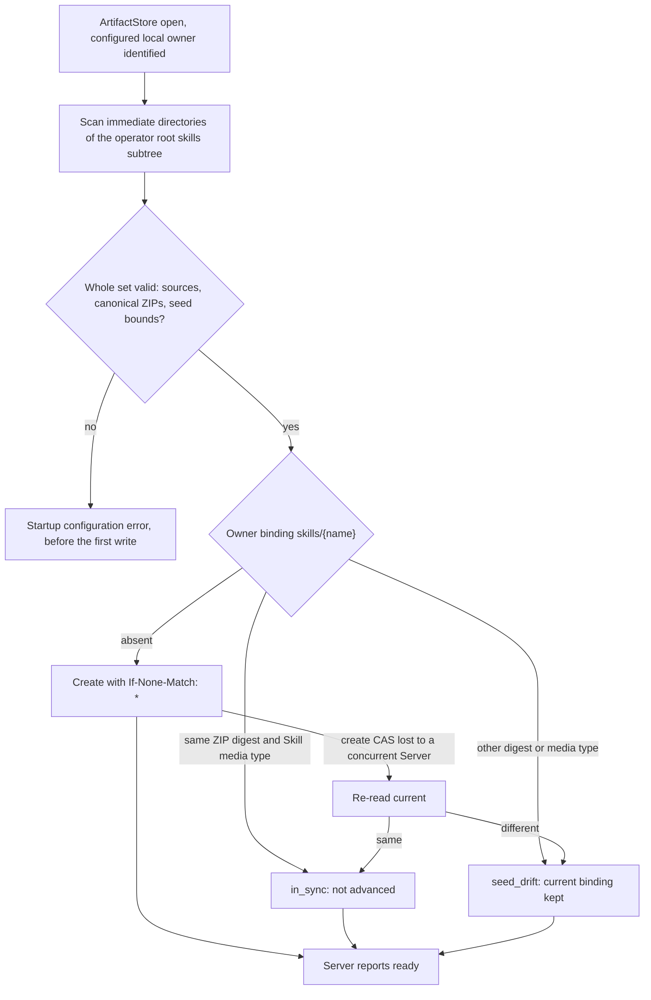
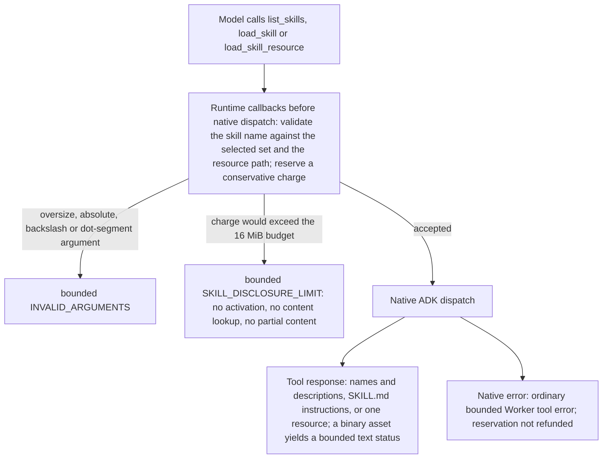

# Agent Skills

Requirement prefix: `SKL` · [Specification index](../README.md)

## Purpose and scope

This document owns Agent Skills: the skill package profile and its validation,
the Server's internal `SkillCatalog` and its create-only bundled
initialization, Skill upload and update through the ordinary Artifact API, the
rules that tie skills to an AgentTemplate, Run-time resolution and forking of
packages into RunScope, the `resolvedSkills` allocation contract, Runtime
loading through Google ADK's native `SkillToolset`, the Skill disclosure
budget, Skill failure codes and the retained Skill telemetry projection.

It leaves to other documents:

- The `spec.skills` field of an AgentTemplate (its `ArtifactRef` shape,
  normalization, name grammar and digest contribution):
  [AgentTemplates](../configuration/agent-templates.md), TPL-R11 to TPL-R13.
- Loading of the operator configuration root and its YAML subtrees:
  [Configuration catalog](../configuration/catalog.md). The non-YAML
  `configs/audit-standards` subtree and its curated catalog:
  [Audits](../audits/audits.md).
- ArtifactStore scopes, the reserved RunScope Namespaces `inputs`, `outputs`
  and `skills`, CAS writes, Workflow input forks, the private allocation
  Artifact API and the model/tool separation of generic Artifact tools:
  [ArtifactStore](../artifacts/artifact-store.md).
- The Project resource: [Projects](../artifacts/projects.md); retention of
  Skills when a Project or Run is deleted:
  [Retention and deletion](../artifacts/retention-and-deletion.md).
- WorkflowRun creation, idempotency and lifecycle: [Runs](../execution/runs.md);
  initialization recovery and Stage preparation retry:
  [Scheduler](../execution/scheduler.md).
- AllocationSpec delivery and placement:
  [Control Plane](../execution/control-plane.md); Runtime startup probes,
  allocation preparation and release:
  [Runtime Agent](../execution/runtime-agent.md); Worker sessions and the
  isolated-session State carry: [Worker](../execution/worker.md).
- The common Toolset contract: [Toolsets](toolsets.md); the
  Caido Toolset and its checked-in template: [HTTP and Caido](http-caido.md);
  the Podman sandbox and its planned skill mount:
  [Code execution](code-execution.md).
- Telemetry content capture (`captureContent`):
  [Runtime configuration](../configuration/runtime-config.md) and
  [Observability](../platform/observability.md).
- The Skills page of the web UI: [UI](../ui/ui.md).
- Registries: [limits](../platform/limits.md), [errors](../platform/errors.md),
  [failure model](../platform/failure-model.md) and
  [lifecycle](../platform/lifecycle.md).

## Concepts

Terms are defined once in the [glossary](../glossary.md).

| Term | Meaning here |
| --- | --- |
| Agent Skill, skill package | The directory with `SKILL.md` in the open Agent Skills package format, stored as one ZIP artifact. It is progressively disclosed model context for a Worker. The concept is unrelated to an A2A Agent Card `AgentSkill`. |
| Progressive disclosure | The model first sees skill names and descriptions and loads instructions or resources only by calling the native Skill functions. |
| Logical skill ref | A versionless `ArtifactRef` with Namespace `skills` declared by an AgentTemplate; the owner UserScope is supplied by the Run. |
| SkillCatalog | The Server's internal typed view and validator over ArtifactStore for skill packages. |
| Bundled skill source | A reviewable package source directory `configs/skills/<name>/`, used only to create missing owner artifacts at startup. |
| Run skill fork | The exact RunScope `skills/<name>` binding that Scheduler forks from the pinned owner source revision. |
| `ResolvedSkill`, `resolvedSkills` | The AllocationSpec entry, and the sorted list of entries, that name the exact Run skill forks of one allocation and their package digests. |
| Package digest | Lowercase `sha256:<64 hex>` over the exact ZIP payload bytes. |
| Disclosure budget | The allocation-lifetime byte budget shared by `list_skills`, `load_skill` and `load_skill_resource`. |
| `in_sync`, `seed_drift` | The two reported outcomes of bundled initialization for an existing owner binding. |
| `contractor-skill` | The repository authoring helper that packages and validates a skill before upload. |

## Model

### From source to Worker

A skill package reaches a Worker only as an exact artifact pinned and forked
into a Run.

```mermaid
flowchart LR
    SRC["configs/skills/{name}/ (bundled source)"] -->|"SkillCatalog at startup, create-only"| U
    API["PUT /v1/artifacts/skills/{name} (owner, CAS)"] --> U
    U["UserScope(owner) skills/{name}: current binding"] -->|"Run creation: select exact current revision"| P["Run configuration snapshot: pinned source ref or missing-source result"]
    P -->|"pinned source ref; Scheduler: read, validate, record package digest, fork exact version"| R["RunScope(run) skills/{name}: exact revision"]
    P -->|"missing-source result"| F["Run initialization fails: skill_artifact_not_found"]
    R -->|"AllocationSpec.resolvedSkills"| RT["Runtime Agent: read, verify digest, validate, extract, load"]
    RT --> T["native ADK SkillToolset through the non-executing adapter"]
    T --> W["Worker: list_skills, load_skill, load_skill_resource"]
```



### Package members

| Member | Content | Rules |
| --- | --- | --- |
| `SKILL.md` | YAML frontmatter mapping and a non-empty Markdown body | SKL-R20, SKL-R26 to SKL-R33 |
| `references/...` | Regular UTF-8 files | SKL-R20, SKL-R24, SKL-R33 |
| `assets/...` | Regular UTF-8 or binary files | SKL-R20, SKL-R24, SKL-R33 |

`SKILL.md` frontmatter keys:

| Key | Presence | Rules |
| --- | --- | --- |
| `name` | Mandatory | SKL-R27 |
| `description` | Mandatory, non-empty | SKL-R27, SKL-R28 |
| `license` | Optional | SKL-R28, SKL-R32 |
| `compatibility` | Optional | SKL-R28, SKL-R32 |
| `metadata` | Optional bounded string map | SKL-R29, SKL-R31, SKL-R32 |

### Bundled initialization



### Allocation manifest

`AllocationSpec` carries the exact Run skill forks of one allocation:

```python
class ResolvedSkill(BaseModel):
    name: SkillName
    artifact: ArtifactRef       # exact RunScope skills/<name> revision
    package_digest: str         # "sha256:" + 64 lowercase hex of exact ZIP bytes


class AllocationSpec(BaseModel):
    # existing identity, template, policy and RuntimeSettings fields
    resolved_skills: list[ResolvedSkill]
```

### Native Skill call



## Requirements

### Purpose and boundaries

**SKL-R1.** Contractor uses the open Agent Skills package format and
Google ADK's native `SkillToolset` for reusable Worker guidance. A skill is
progressively disclosed model context, not a Worker implementation, Toolset
implementation, executable plugin or placement capability.

**SKL-R2.** Runtime Agent advertises only Contractor's stage-content
operation in its A2A Agent Card. Selected Agent Skills are private allocation
configuration and never create additional A2A operations.

**SKL-R3.** Skill packages are stored as immutable ZIP versions in
the existing ArtifactStore, and the model reaches them through ADK's native
`list_skills`, `load_skill` and `load_skill_resource` implementations,
without ADK's script function or script guidance (SKL-R91).

**SKL-R4.** No Contractor Memory note, MemoryTools tag, parallel
model-facing Skill API or separate Skill persistence is created for a skill.
Skills have no MemoryTools adapter.

**SKL-R5.** Skills are global to the authenticated owner rather
than owned by a Project. The Projects UI may display the exact Skills required
by a candidate Workflow, but ProjectScope never contains Skill copies.

### AgentTemplate ownership

**SKL-R6.** Skills belong to an `AgentTemplate` because they describe
reusable Worker specialization. Workflow, Stage, Run input and Planner output
cannot add, remove or replace them.

An AgentTemplate declares its skills in `spec.skills` as logical refs:
versionless `ArtifactRef` values in Namespace `skills` whose owner UserScope is
supplied by the Run rather than encoded in the ref. The field syntax, its
normalization into sorted unique `(namespace, name)` pairs, the skill name
grammar (LIM-TPL-1) and the digest contribution are defined in
[AgentTemplates](../configuration/agent-templates.md) (TPL-R11 to TPL-R13).

```yaml
spec:
  skills:
    - namespace: skills
      name: likec4
```

**SKL-R7.** Agent Skill refs are the exception to configuration-time
exact-version selection. AgentTemplate configuration loading validates ref
syntax, uniqueness and limits but does not read ArtifactStore and does not
require current packages; the current exact revisions are resolved and pinned
only while the WorkflowRun initializes (SKL-R66). Server
configuration loading therefore never depends on ArtifactStore content; a
missing or invalid current package fails the referencing Run's initialization
before scheduling instead (SKL-R106).

**SKL-R8.** One AgentTemplate may declare at most 32 skills
(LIM-SKL-1). The union retained by one WorkflowRun snapshot may contain at
most 128 distinct refs (LIM-SKL-2). Both limits are validated before resolving
or forking any package.

**SKL-R9.** The source scope is structural rather than part of
`ArtifactRef`: the Run-create transaction resolves every logical ref in that
Run owner's UserScope. A write through the ordinary User Artifact API advances
the binding and returns a new exact `ArtifactRef`. Future Runs resolve that new
exact ref; an existing Run continues to use its selected exact revision and
resulting RunScope fork.

**SKL-R10.** The native ADK Agent Skill functions are the one
bounded first-class exception to the generic Toolset selection rule
([Toolsets](toolsets.md)). A non-empty `skills` field constructs ADK's standard
SkillToolset (SKL-R87); it does not select a Contractor Toolset ref
and cannot add any domain tool. The exception is explicit in the AgentTemplate
body rather than inferred from Runtime installation or a label.

**SKL-R11.** With a non-empty skills set, the three model-visible
function names `list_skills`, `load_skill` and `load_skill_resource` are
reserved. AgentTemplate configuration is invalid if a selected Contractor
Toolset operation has any of those names, so the model-visible function
namespace remains unambiguous. Because Contractor filters `run_skill_script`
and its script-bearing prompt (SKL-R91), that function is not part
of the reserved visible set.

**SKL-R12.** A non-empty skills set requires a Worker ModelPolicy
that is validated as tool-using and has `maxToolCalls`
([TPL-R28](../configuration/agent-templates.md)), even when the ordinary
`toolsets` list is empty (`toolsets: []`). Native Skill calls consume the same
`maxToolCalls` counter as Contractor Toolset calls.

**SKL-R13.** The distinction between instructions and skills is
strict:

- `AgentTemplate.instructions` is always-on mandatory Worker behavior;
- `AgentTemplate.skills` is progressively disclosed supplementary guidance;
- a requirement the Worker must observe without first choosing `load_skill`
  belongs in `instructions`, not in a skill;
- there is no `requiredSkills`, activation mode, Workflow/Stage/Run override or
  Planner-selected skill.

**SKL-R14.** `AgentTemplate` is a Server-side selection and
provenance abstraction. Its name, ref and catalog mechanics are not part of
Worker-facing Skill guidance: Contractor-provided `SKILL.md` files and
resources never tell the model that a Skill or operation was selected by an
AgentTemplate. Server configuration, migration documents and selection tests
may use the AgentTemplate term because they describe the control-plane side of
this boundary.

**SKL-R15.** When Contractor-provided guidance depends on another
capability, it refers only to an operation visible in the current Worker
invocation and defines the behavior when that operation is absent.

**SKL-R16.** For a checked-in package that depends on named
operations, the repository may lock one reviewed AgentTemplate to that package
and assert that its explicit Toolset allowlist contains every operation named
by the guidance. This is a release-time compatibility test only.

**SKL-R17.** Runtime does not interpret Skill metadata or prose as
dependencies, does not parse guidance to install Toolsets, does not install
tools automatically and does not expand an allocation's authority. The
association between a checked-in AgentTemplate's Toolset selection and the
bundled package whose guidance names those operations is configuration, not
Skill metadata semantics, and a label does not make a Skill or tool visible.

**SKL-R18.** For the bundled Caido package, a repository
compatibility gate scans the model-visible operation names in the package and
requires them in the exact checked-in template
([HTTP and Caido](http-caido.md)). Changing either side requires a reviewed
config/Skill revision and a new canonical package digest.

### Package profile

**SKL-R19.** One package is one ZIP artifact whose stored media type is
canonicalized to `application/vnd.contractor.agent-skill+zip`; media-type
parameters are not accepted. The archive root represents the skill directory
and contains `SKILL.md` directly, for example:

```text
SKILL.md
references/
  syntax.md
  examples.md
assets/
  template.c4
```

**SKL-R20.** The package profile accepts exactly:

- one root `SKILL.md` encoded as UTF-8;
- zero or more regular UTF-8 files below `references/`;
- zero or more regular UTF-8 script source files below `scripts/`;
- zero or more regular UTF-8 or binary files below `assets/`;
- directory entries needed for those paths.

**SKL-R21.** Script members are inert source resources. Package validation,
extraction and disclosure never execute them. Accepted packages contain no ADK
metadata capable of extending the tool surface (SKL-R31). Execution is governed
by SKL-R116, independently of package acceptance.

**SKL-R22.** The profile rejects every other root entry,
symlinks, hard links, device or special files, duplicate normalized paths,
backslash paths, absolute paths, empty, dot or dot-dot path components,
encrypted ZIP members and malformed ZIP metadata.

**SKL-R23.** The profile rejects lowercase `skill.md`: the portable
contract uses the standard exact spelling even when one ADK release accepts
more.

**SKL-R24.** Resource paths contain at most eight components
(LIM-SKL-3) and at most 512 ASCII bytes including `/` (LIM-SKL-4); every
component matches `[a-z0-9][a-z0-9._-]{0,127}`, so it has 1 through 128
characters (LIM-SKL-5).

**SKL-R25.** ZIP member names are forward-slash paths whose raw and
decoded characters are ASCII; non-ASCII names are rejected regardless of the
ZIP encoding flag. The accepted compression methods are Store and Deflate.

Rationale: these path rules are deliberately portable. They eliminate
Unicode, case and platform normalization ambiguity rather than trying to
repair it after publication.

**SKL-R26.** `SKILL.md` starts with a YAML frontmatter mapping and
closing `---`, followed by a non-empty Markdown body:

```yaml
---
name: likec4
description: Build and validate LikeC4 models; use for .c4 and .likec4 output.
license: Apache-2.0                  # optional
compatibility: Contractor adk@1     # optional
metadata:                           # optional bounded string map
  author: contractor
---
```

**SKL-R27.** `name` and a non-empty `description` are mandatory. The
frontmatter mapping contains exactly `name`, `description` and the optional
`license`, `compatibility` and `metadata` keys. Unknown keys, non-string keys,
YAML aliases or anchors and custom tags are rejected. `name` follows the Agent
Skills name grammar ([TPL-R13](../configuration/agent-templates.md)).

**SKL-R28.** `description` is at most 1,024 UTF-8 bytes
(LIM-SKL-6); the optional `license` is at most 512 (LIM-SKL-7) and
`compatibility` at most 500 (LIM-SKL-8).

**SKL-R29.** `metadata` has at most 32 entries (LIM-SKL-9). Keys are 1
through 64 ASCII characters (LIM-SKL-10) matching `[A-Za-z0-9_.-]+`; values are
UTF-8 strings of at most 1,024 bytes (LIM-SKL-11). Nested values, lists,
non-string scalars and duplicate YAML keys are rejected.

**SKL-R30.** The bytes between the two frontmatter delimiters are at
most 32 KiB (LIM-SKL-12). Bounded YAML tokenization accepts at most 128 nodes
(LIM-SKL-13) and nesting depth 3 (LIM-SKL-14) before constructing the typed
mapping. Byte or node overflow is `skill_limit_exceeded`; a shape, type, tag or
key violation is `skill_manifest_invalid`.

Rationale: bounding tokenization means a deeply nested or node-heavy document
cannot consume the whole `SKILL.md` allowance in parser state.

**SKL-R31.** Frontmatter `allowed-tools` or `allowed_tools` is
rejected because it is not an authorization grant. Metadata keys with prefix
`adk_` are rejected, including `adk_additional_tools` and `adk_inject_state`.

**SKL-R32.** Metadata has no executable or authorization semantics.
`license`, `compatibility` and `metadata` are descriptive model-visible package
data; Runtime does not interpret them as a capability, placement predicate or
dependency resolver. They contain no secret.

**SKL-R33.** The complete `SKILL.md` is at most 256 KiB
(LIM-SKL-15); one regular reference, asset or script is at most 1 MiB (LIM-SKL-16).
Text members, including scripts, are valid UTF-8 and contain no NUL.

**SKL-R34.** In addition:

- the stored Skill ZIP payload is at most 16 MiB (LIM-SKL-17), a
  package-specific limit below the generic ArtifactStore limit of 64 MiB
  ([LIM-ART-4](../artifacts/artifact-store.md));
- the ZIP contains at most 2,000 entries including directories (LIM-SKL-18);
- total declared and actually streamed decompressed bytes are at most 32 MiB
  (LIM-SKL-19).

**SKL-R35.** The decompressed budget is enforced while streaming, not
only from the attacker-controlled central directory. The Server counts the
actual central-directory records against the entry limit before it parses any
member, so neither an understated nor an oversized directory is materialized
first.

**SKL-R36.** Every bounded package fits a single-disk classic ZIP; the
Server rejects ZIP64 directories and data after the end record as
`skill_archive_invalid`.

**SKL-R37.** Server and Runtime never silently drop a forbidden
member.

**SKL-R38.** Every package digest is lowercase `sha256:<64 hex>` over
the exact ZIP payload bytes, not over a normalized directory tree.

**SKL-R39.** The repository authoring helper emits a single canonical
representation: lexicographically ordered regular files using ZIP Store, fixed
DOS-epoch timestamps, portable mode `0644`, ASCII names and no directory
entries, extra fields or archive or member comments.

**SKL-R40.** Validation accepts ordinary safe Store or Deflate
archives, but bundled initialization uses the canonical writer, so unchanged
source has stable bytes and digest.

**SKL-R41.** Package validators use one bounded classification
vocabulary across Go, Python and the authoring command, defined in
[ERR-R4](../platform/errors.md).

**SKL-R42.** Validator diagnostics may add a bounded field or member
name only after it passed portable path validation. They never include
content, raw parser text or an absolute filesystem path.

**SKL-R43.** Skill packages are user- or operator-managed
behavioral configuration and contain no secret.

**SKL-R44.** Validation cannot make instruction text benign: a
skill may tell the model to call any tool already selected by the
AgentTemplate. Hard authority remains the explicit Toolset operation
allowlist, the allocation Artifact grant, the write fence, the SandboxProfile
and the resolved RuntimeSettings, and a skill widens none of them. Skill
content cannot add tools, images, mounts, privileges or network authority,
broaden grants, change labels or escape the selected sandbox and tool
authority.

**SKL-R45.** Selecting `podman@1`, installing or upgrading ADK,
loading `SKILL.md` or accepting a ZIP member never enables script execution.

### SkillCatalog and bundled initialization

**SKL-R46.** The Server has one internal `SkillCatalog`
application boundary. It is a typed view and validator over the ordinary
ArtifactStore, not a new store: it owns bundled source discovery, package
validation, owner-UserScope resolution and exact UserScope-to-RunScope skill
forks.

**SKL-R47.** ArtifactStore remains authoritative for bindings,
revisions, bytes, CAS, lineage and retention. SkillCatalog has no public or
private HTTP endpoint and no independent database schema.

**SKL-R48.** Reviewable built-in sources live at
`configs/skills/<name>/`, in the non-YAML `configs/skills` subtree of the
operator configuration root, beside the YAML subtrees loaded by the
[Configuration catalog](../configuration/catalog.md). Runtime never scans that
tree; SkillCatalog uses it only for the bounded owner-artifact initialization
of this section. Only an exact artifact resolved and forked into a Run can
affect a Worker.

**SKL-R49.** After opening ArtifactStore and identifying the configured
local owner, but before the Server reports ready, SkillCatalog scans the
immediate directories below the `skills` subtree of the operator configuration
root (the repository path is `configs/skills`). It never scans the managed
configuration root. A missing or empty `skills` subtree is valid. Each
directory name is the expected skill name.

**SKL-R50.** SkillCatalog rejects source symlinks and special
files, validates every source tree, deterministically packages it, then
validates the ZIP again. The whole discovered set is checked before the first
write; an invalid bundled source is a startup configuration error
(FAIL-SKL-1).

**SKL-R51.** At most 128 seed directories (LIM-SKL-20) and 256 MiB
total canonical ZIP bytes (LIM-SKL-21) are accepted.

**SKL-R52.** The validated discovery plan freezes the exact canonical
bytes; Artifact writes never re-read a source tree after the all-or-nothing
check.

**SKL-R53.** Each package is initialized through the same
ArtifactStore write semantics as the public User Artifact API, at:

```text
UserScope(<configured-local-owner>)
  namespace = skills
  name      = <directory and SKILL.md name>
```

**SKL-R54.** Bundled catalog initialization is create-only
(FAIL-SKL-1):

- an absent binding is written with `If-None-Match: *` semantics and media type
  `application/vnd.contractor.agent-skill+zip`;
- an existing binding with an identical exact ZIP digest and the canonical
  Skill media type is `in_sync` and is not advanced;
- an existing binding with another digest or media type is reported as bounded
  `seed_drift` and remains current; the Server still becomes ready.

**SKL-R55.** `configs/skills` is the create-only source for the
initial SkillCatalog population of the local owner's ordinary `skills/*`
UserScope artifacts, not live desired state: bundled sources only create
missing owner artifacts at startup, and a restart never overwrites a binding
advanced through the Artifact API. On drift, the database current binding
wins.

Rationale: create-only initialization makes startup crash-safe and prevents a
restart from rolling back an update made through the ordinary Artifact API.

**SKL-R56.** A changed bundled source is applied explicitly by
packaging it and performing an ordinary CAS Artifact PUT. There is no
synthetic user, special seed table, desired-state reconciler, Skill API or
SystemScope.

**SKL-R57.** If two Server processes accidentally initialize the
catalog concurrently, ordinary Artifact create CAS selects one winner. The
loser re-reads current and reports `in_sync` or `seed_drift`; it never
overwrites or invents another initialization mechanism (FAIL-SKL-1).

**SKL-R58.** Provisioning shared or operator skills for multiple
owners must not be approximated by giving Runtime global Artifact authority.

### Upload and update

**SKL-R59.** Agent Skills use the ordinary owner Artifact API through
their separate Skills UI; there is no Skill-specific API or Operations page. A
package is created or updated at `skills/<name>` with the same strong ETag
preconditions, version history and exact `ArtifactRef` response as any other
UserScope artifact.

**SKL-R60.** Skill upload and update use the existing authenticated
Artifact routes (see [Interfaces](#interfaces)). Create uses
`If-None-Match: *`; update uses the strong current revision ETag; the response
contains the new exact `ArtifactRef`.

**SKL-R61.** The generic Artifact API enforces bytes, CAS, owner
isolation and immutable history but deliberately does not infer that an
artifact is a Skill ([ART-R67](../artifacts/artifact-store.md)).

**SKL-R62.** The `contractor-skill` helper validates before upload;
Run initialization is the authoritative Server validation and Runtime
validates again before extraction.

**SKL-R63.** The browser may upload a ZIP with
`application/vnd.contractor.agent-skill+zip`, inspect its ordinary metadata
and history, and download bytes under existing owner authorization. It does
not preview instructions, validate or edit package structure, enable scripts,
or claim that a successful upload is runnable.

**SKL-R64.** An invalid current package may be stored as an
ordinary artifact, but no Run using it becomes schedulable (SKL-R106). Updating it
through CAS fixes future Runs without mutating already initialized Runs, and
requires no Runtime Agent file synchronization or restart.

### Run resolution and fork

**SKL-R66.** Run initialization resolves skills for every
AgentTemplate retained by the WorkflowRun snapshot, including templates used
only by later Stages or pinned escalation variants. Duplicate logical refs are
resolved once: the union is resolved to current exact revisions, validated and
forked once into RunScope.

**SKL-R67.** Before reading package bodies, SkillCatalog selects the
complete owner-current source set under one short PostgreSQL snapshot. That
selection outcome commits in the same transaction as the WorkflowRun and its
idempotency binding (FAIL-SKL-2).

**SKL-R68.** Every logical ref records either its exact current
source or a durable missing-source result; no committed Run exists with an
unresolved or partial source list.

**SKL-R69.** A transient failure of the source-selection
transaction aborts Run creation: it commits no Run or idempotency row and is a
retryable `POST /v1/runs` failure rather than a partially initialized Run. A
committed missing-source result deterministically fails that Run's
initialization with `skill_artifact_not_found` (FAIL-SKL-2).

**SKL-R70.** Every later recovery step uses only the committed
outcome even if owner current changes; it never resolves a different current
revision after an exact source has been recorded.

**SKL-R71.** Run initialization resolves the AgentTemplate-selected
current UserScope binding of each Skill and forks its exact revision into the
reserved RunScope Namespace, including for a Project Run
([PRJ-R30](../artifacts/projects.md)).

**SKL-R72.** For each selected ref, Scheduler:

1. reads the already recorded exact artifact from the Run owner's UserScope;
2. requires the Skill media type, validates the complete package and checks its
   frontmatter name against the `ArtifactRef` name;
3. records the validated exact package digest beside the already pinned source
   ref in the immutable Run configuration snapshot;
4. forks that exact version, reusing the immutable blob, to the reserved
   RunScope binding `skills/<name>`;
5. records the resulting exact RunScope `ArtifactRef` used by allocations.

Conceptually:

```text
UserScope(owner): skills/likec4@revision-3
  -> RunScope(run-42): skills/likec4@revision-17
```

**SKL-R73.** Scheduler pins and forks every selected Agent Skill
into the reserved `skills` Namespace in the same initialization boundary in
which it forks Workflow inputs into `inputs`
([ART-R76](../artifacts/artifact-store.md)).

**SKL-R74.** All validation and forks complete before the Run becomes
`running`; a partially initialized Run is never schedulable.

**SKL-R75.** Run-creation idempotency replay returns the already
selected revisions or the same missing-source failure even if UserScope
current advances (FAIL-SKL-2).

**SKL-R76.** Every retry, later Stage and escalation in the Run uses
the same exact Run bindings.

**SKL-R77.** In addition to the count limits, each AgentTemplate's
resolved set is bounded to 64 MiB stored package bytes (LIM-SKL-22) and 128 MiB
decompressed bytes (LIM-SKL-23). The complete Run union is bounded to 256 MiB
stored (LIM-SKL-24) and 512 MiB decompressed (LIM-SKL-25). The Server checks
both before scheduling; Runtime independently enforces the per-allocation
bounds.

**SKL-R78.** `skills` is a reserved RunScope Namespace beside `inputs`
and `outputs` ([ART-R14](../artifacts/artifact-store.md)). Scheduler alone
creates its bindings.

**SKL-R79.** The private allocation Artifact API permits the exact
reads required by trusted Runtime loading, through the Runtime loader's
allocation-bound private client, and rejects every allocation write to
`skills`. `run-artifacts@1` filters the Namespace from model-visible list,
read and write operations in Runtime. Agent Skills access content only through
the ADK functions. The artifact-plane side of these rules is
[ART-R39, ART-R108 and ART-R109](../artifacts/artifact-store.md).

**SKL-R80.** The authenticated Run owner may inspect ordinary exact
metadata, lineage and bytes of Run skill forks through existing public
Artifact routes, just as it may inspect the owner source package
([ART-R110](../artifacts/artifact-store.md)). That user-facing authority is not
exposed to Worker model tools.

**SKL-R81.** Exact owner source and Run fork revisions stay readable
while a retained Run snapshot refers to them: UserScope revisions are immutable
and never purged (LIFE-SKL-1), and the fork lives as long as its Run
(LIFE-SKL-2). Ordinary current updates therefore never invalidate a Run.

### Allocation contract

**SKL-R82.** `AllocationSpec` carries a sorted `resolvedSkills` list
(see [Allocation manifest](#allocation-manifest)) outside the digest-bearing
AgentTemplate body, because exact revisions are selected at Run
initialization.

**SKL-R83.** The list contains exactly the refs declared by the
selected AgentTemplate, each once and with a non-null Run revision. Empty
skills encode `resolvedSkills: []`.

**SKL-R84.** Runtime rejects missing, extra, duplicate, versionless,
wrong-Namespace, name-mismatched or digest-malformed entries before creating
the Worker.

**SKL-R85.** Server provenance retains the owner source and Run refs;
Runtime receives only exact current-Run refs, never UserScope or global
authority.

**SKL-R86.** Skill bytes never appear in AllocationSpec, A2A content,
registration, heartbeat or Agent Card. Runtime fetches them through the
existing allocation-bound private Artifact API
([ART-R112](../artifacts/artifact-store.md)).

### Runtime and ADK mapping

**SKL-R87.** After the slot, the artifact grant and the allocation
workspace exist but before the Worker is ready, Runtime Agent:

1. reads every exact `resolvedSkills[].artifact` through its private client;
2. requires the media type and recomputes the exact package SHA-256;
3. applies the complete archive and profile validation again;
4. extracts below an allocation-owned temporary directory named by the
   validated skill name, without following links or overwriting paths;
5. loads through the pinned Google ADK Agent Skills loader;
6. attaches one native ADK SkillToolset to the Worker through Contractor's
   non-executing filter and instruction adapter.

**SKL-R88.** Runtime passes `registry=None`, no `environment`,
`code_executor`, `skills_folder`, `additional_tools` or `tool_name_prefix`, and
an exact native tool filter containing only `list_skills`, `load_skill` and
`load_skill_resource`.

**SKL-R89.** The AgentTemplate's ordinary Toolsets are constructed
independently; Skill activation can never make one of them appear
dynamically.

**SKL-R90.** `registry=None` is mandatory. Runtime does not expose
ADK `search_skills`, contact Google Cloud Skill Registry, scan host or global
directories or resolve a model-selected name. The only discoverable skills are
the exact Run-selected ones.

**SKL-R91.** The stock ADK toolset also implements
`run_skill_script` and injects generic script guidance even without an
executor; Contractor exposes neither: it deliberately filters
`run_skill_script` and replaces ADK's stock script-bearing system instruction
with a non-executing progressive-disclosure instruction. Its adapter
reuses the native list, load and resource tools and the native Skill models,
but injects a bounded instruction that describes only `SKILL.md`,
`references/`, `assets/` and inert `scripts/` source plus the three available
functions. Runtime creates no skill executor.

**SKL-R92.** Runtime's `adk@1` startup probe proves that the pinned
ADK build contains the package models, loader and native SkillToolset before
Runtime advertises `adk@1`. The probe also requires the pinned native
SkillToolset plus Contractor's filter and instruction adapter to expose exactly
`list_skills`, `load_skill` and `load_skill_resource`, with neither
`run_skill_script` nor `search_skills`; it fails if filtering no longer hides
`run_skill_script` or the generated instruction contains `run_skill_script`
or `search_skills`. The instruction explicitly says that script disclosure
returns source without executing code.

**SKL-R93.** Runtime does not advertise installed skill names,
because packages are allocation data, not immutable environment
capabilities.

**SKL-R94.** Runtime callbacks validate a tool-supplied skill name
against the exact selected set before native dispatch. Resource paths must be
portable validated `references/...`, `assets/...` or `scripts/...` paths.
Oversize, absolute, backslash or dot-segment arguments return bounded `INVALID_ARGUMENTS` and are
never retained as a safe metric path.

**SKL-R95.** ADK injects generic skill-use instructions and
function declarations while forming an LLM request. `list_skills` discloses
names and descriptions; `load_skill` returns the selected `SKILL.md`
instructions as a tool response; `load_skill_resource` returns one selected
reference, asset or script source.

**SKL-R96.** Contractor does not copy every body into system
instructions, synthesize activation calls or automatically activate a skill.

**SKL-R97.** Binary assets remain valid package members, but the
text-only Gateway cannot receive their bytes. Loading one returns a bounded
text status that the content is unavailable to this model; Runtime never
appends an `inline_data` part.

**SKL-R98.** `list_skills`, `load_skill` and `load_skill_resource`
share a 16 MiB allocation-lifetime disclosure budget (LIM-SKL-26). Before
native dispatch, a Runtime-owned ADK callback computes and atomically reserves
a deterministic conservative charge no smaller than the complete model-visible
result; UTF-8 structured envelopes include descriptions and frontmatter. A
binary asset reserves only its bounded text status and envelope, since its
bytes are never model-visible.

**SKL-R99.** Repeated calls reserve again; reservations are not
refunded when native dispatch later returns an error (FAIL-SKL-5).

**SKL-R100.** A call that would exceed the budget returns a bounded
`SKILL_DISCLOSURE_LIMIT` before activation or content lookup, reveals no
partial content and still counts against the same `maxToolCalls` and
ModelPolicy limits as a Contractor Toolset call (FAIL-SKL-5).

Rationale: the per-member bounds keep both the charge estimate and one native
result bounded.

**SKL-R101.** Runtime may keep an immutable package cache keyed only by
verified package digest. The cache is bounded, never resolves a logical or
current binding, and contains no User or Run authority, secret, ADK State or
conversation data. A cache hit still verifies the manifest name and the exact
digest (LIFE-SKL-4).

**SKL-R102.** When Agent Skills are selected, ADK's allocation-local
activated-skill State is separate from the reserved `contractor` subtree and
remains process-local. Its eligible ordinary, app and user values may follow
the bounded isolated-session carry rule
([WRK-R73](../execution/worker.md)), but it is never copied into MemoryTools
or persisted durably and is destroyed with the Worker (LIFE-SKL-3).

**SKL-R103.** Release removes the extracted allocation directories,
loaded Skill objects, SkillToolset activation State, the disclosure budget
counter and model context with the Worker (LIFE-SKL-3). A cleanup failure
keeps Runtime fenced under the existing release contract
([Runtime Agent](../execution/runtime-agent.md), FAIL-SKL-6). A bounded
immutable package cache may remain (LIFE-SKL-4).

### Planner and routing boundary

**SKL-R104.** AgentTemplate skills apply only to a Worker created
from that template. Passthrough, Streamline and Router Planners do not inherit
Worker skills and do not receive their descriptions or bodies. The Router
roster still uses the logical Agent name and `AgentTemplate.description`; it
cannot inspect skills to route ([Planners](../execution/planners.md)).

**SKL-R105.** Planner rules remain in Stage `instructions`; mandatory
Worker rules remain in AgentTemplate `instructions`.

### Failures

**SKL-R106.** Run initialization cannot become schedulable when a
referenced owner artifact is missing, has the wrong media type, is invalid or
cannot be forked. It records a stable code and the logical ref, but no body,
host path or parser exception. Invalid content is a configuration error
(FAIL-SKL-3).

**SKL-R107.** The terminal WorkflowRun initialization codes are those
of [ERR-R5](../platform/errors.md) (FAIL-SKL-3).

**SKL-R108.** Transient exact reads and forks leave the Run
`initializing`; their codes and recovery are those of
[ERR-R6 and ERR-R7](../platform/errors.md) (SKL-R70, FAIL-SKL-3).

**SKL-R109.** Allocation preparation distinguishes at least the codes
of [ERR-R9](../platform/errors.md) (FAIL-SKL-4).

**SKL-R110.** A preparation failure creates no ready Worker, Planner
or A2A Task and follows the existing Stage preparation termination and retry
([Scheduler](../execution/scheduler.md)).

**SKL-R111.** A model-issued load or resource error is an ordinary
bounded Worker tool error and cannot bypass policy (FAIL-SKL-5).

### Telemetry

**SKL-R112.** Package bodies never enter lifecycle events or ordinary
execution reports.

**SKL-R113.** External telemetry is content-free by default. With an
explicit `captureContent=true`
([Runtime configuration](../configuration/runtime-config.md)), disclosed
instructions and resources present in model conversations or tool results may
be exported to the trusted sink, unredacted and within its content limits.
Capture does not grant access to undisclosed package members and does not
automatically upload complete package ZIPs.

**SKL-R114.** Existing Worker metrics record the native Skill
functions like every tool. The retained projection contains only the
validated skill name, the bounded normalized `references/...`, `assets/...`
or `scripts/...` path, outcome, duration, result byte count and stable ADK error code. It never
retains instructions, resource or archive bytes, owner refs, revisions,
extracted paths or generated context.

**SKL-R115.** Aggregate counts flow through the ordinary
`ExecutionReport`; no Skill telemetry service exists. The content-free
retained projection is distinct from opt-in external model and tool content
capture (SKL-R113), which may include disclosed skill text.

**SKL-R116.** Script execution uses only independently selected existing
capabilities: a Worker may materialize disclosed source and its required assets
through an available workspace writer, then invoke the existing sandbox
`exec_command` if selected. The Skill toolset neither writes those files nor
executes them. It provides no host executor, interpreter installation,
dependency resolution or `/skills` mount. Missing writing, interpreter or
sandbox execution capabilities remain an explicit task blocker; guidance must
not claim successful validation without a successful execution result. All
workspace grants, sandbox limits, cancellation and cleanup rules of
[Code execution](code-execution.md) remain authoritative. This choice reuses
the existing execution boundary instead of adding an ADK executor; reconsider
only if exact deterministic resource materialization needs a dedicated operation.

## Interfaces

Skill packages use the existing authenticated owner Artifact routes
([ArtifactStore](../artifacts/artifact-store.md),
[Public API](../api/public-api.md)):

```text
PUT /v1/artifacts/skills/<name>
GET /v1/artifacts/skills/<name>
GET /v1/artifacts/skills/<name>/metadata
GET /v1/artifacts/skills/<name>/versions
```

| Interface | Contract |
| --- | --- |
| Media type | `application/vnd.contractor.agent-skill+zip`, without parameters (SKL-R19) |
| Owner binding | `UserScope(owner)`, Namespace `skills`, name = skill name (SKL-R53, SKL-R59) |
| Run binding | `RunScope(run)`, reserved Namespace `skills`, name = skill name (SKL-R72, SKL-R78) |
| Allocation | `AllocationSpec.resolved_skills` / `resolvedSkills` (SKL-R82 to SKL-R86) |
| Model functions | `list_skills`, `load_skill`, `load_skill_resource` (SKL-R88, SKL-R95) |
| Authoring | The `contractor-skill` helper packages canonically and validates before upload (SKL-R39, SKL-R62) |

## Limits, failures and errors

Limits ([registry](../platform/limits.md)):

- LIM-SKL-1 — skills per AgentTemplate: at most 32 (SKL-R8).
- LIM-SKL-2 — distinct skill refs per WorkflowRun snapshot: at most 128
  (SKL-R8).
- LIM-SKL-3 to LIM-SKL-5 — resource path: at most 8 components, at most 512
  ASCII bytes, 1 to 128 characters per component (SKL-R24).
- LIM-SKL-6 to LIM-SKL-8 — `description` 1,024, `license` 512 and
  `compatibility` 500 UTF-8 bytes (SKL-R28).
- LIM-SKL-9 to LIM-SKL-11 — `metadata`: at most 32 entries, keys of 1 to 64
  ASCII characters, values of at most 1,024 bytes (SKL-R29).
- LIM-SKL-12 to LIM-SKL-14 — frontmatter: at most 32 KiB, 128 YAML nodes,
  nesting depth 3 (SKL-R30).
- LIM-SKL-15, LIM-SKL-16 — `SKILL.md` at most 256 KiB; one reference, asset or script
  at most 1 MiB (SKL-R33).
- LIM-SKL-17 to LIM-SKL-19 — stored ZIP at most 16 MiB, at most 2,000 entries,
  at most 32 MiB decompressed (SKL-R34).
- LIM-SKL-20, LIM-SKL-21 — bundled initialization: at most 128 seed
  directories and 256 MiB total canonical ZIP bytes (SKL-R51).
- LIM-SKL-22 to LIM-SKL-25 — resolved package bytes: per AgentTemplate 64 MiB
  stored and 128 MiB decompressed; per Run union 256 MiB stored and 512 MiB
  decompressed (SKL-R77).
- LIM-SKL-26 — disclosure budget: 16 MiB per allocation lifetime
  (SKL-R98).
- The skill name length (LIM-TPL-1) is owned by
  [AgentTemplates](../configuration/agent-templates.md); the generic payload
  limit (LIM-ART-4) by [ArtifactStore](../artifacts/artifact-store.md).

Errors ([registry](../platform/errors.md)):

- The package validator codes, the Run initialization codes and the
  allocation preparation codes are defined in
  [ERR-R4 to ERR-R9](../platform/errors.md); this document raises them in
  SKL-R30, SKL-R36, SKL-R41, SKL-R69 and SKL-R106 to SKL-R109.
- The tool error `INVALID_ARGUMENTS` (SKL-R94).
- The tool error `SKILL_DISCLOSURE_LIMIT` (SKL-R100).

Failure outcomes ([failure model](../platform/failure-model.md)):

- FAIL-SKL-1 — bundled SkillCatalog initialization (SKL-R50,
  SKL-R54, SKL-R57).
- FAIL-SKL-2 — Skill source selection at Run creation (SKL-R67,
  SKL-R69, SKL-R75).
- FAIL-SKL-3 — exact read, validation and fork at Run initialization
  (SKL-R106, SKL-R107, SKL-R108).
- FAIL-SKL-4 — Skill loading during allocation preparation (SKL-R109,
  SKL-R110).
- FAIL-SKL-5 — model-issued native Skill calls (SKL-R99,
  SKL-R100, SKL-R111).
- FAIL-SKL-6 — Skill cleanup at allocation release (SKL-R103).

Lifecycle ([registry](../platform/lifecycle.md)):

- LIFE-SKL-1 — owner UserScope skill package revisions (SKL-R81).
- LIFE-SKL-2 — RunScope skill forks (SKL-R81).
- LIFE-SKL-3 — allocation-local Skill state (SKL-R102,
  SKL-R103).
- LIFE-SKL-4 — the Runtime immutable package cache (SKL-R101).
- Retention of global Skills on Project deletion is owned by
  [Retention and deletion](../artifacts/retention-and-deletion.md) (DEL-R51).

## Security

The security-relevant rules of this document are:

- packages carry no authority and no secret: SKL-R21,
  SKL-R31, SKL-R32, SKL-R43,
  SKL-R44, SKL-R45, SKL-R17;
- archive and path hardening: SKL-R22, SKL-R24,
  SKL-R25, SKL-R35, SKL-R36, SKL-R37,
  SKL-R42;
- exact pinning and the model/tool separation of the `skills` Namespace:
  SKL-R78, SKL-R79, SKL-R80, SKL-R85,
  SKL-R86, SKL-R58;
- the Runtime ADK surface: SKL-R88, SKL-R90,
  SKL-R91, SKL-R94, SKL-R101;
- content-free telemetry: SKL-R112, SKL-R113,
  SKL-R114.

The registry row "Agent Skill packages widen no authority" in
[Security](../platform/security.md) points to these rules.

## Observability

Native Skill calls are recorded by the existing Worker metrics with the
content-free retained projection of SKL-R114, and aggregate counts
flow through `ExecutionReport` (SKL-R115). Opt-in external content
capture is bounded by SKL-R113; the capture setting itself is owned
by [Observability](../platform/observability.md).

## Invariants

These properties follow from the cited requirements, which are authoritative.

1. An AgentTemplate selects versionless owner UserScope ArtifactRefs; the Run
   records exact immutable source and RunScope refs before scheduling
   (SKL-R7, SKL-R68, SKL-R72, SKL-R74).
2. An ordinary Artifact CAS update affects future Runs only and requires no
   Runtime Agent file synchronization or restart (SKL-R9,
   SKL-R64).
3. Runtime receives exact Run refs, never UserScope or global authority or
   inline package bytes (SKL-R85, SKL-R86).
4. Skills use native ADK progressive disclosure and have no MemoryTools
   adapter (SKL-R3, SKL-R4).
5. Skill content cannot add tools, broaden grants, change labels or escape the
   selected sandbox or tool authority (SKL-R44).
6. Scripts are inert resources and packages contain no executable ADK metadata;
   execution requires independently selected capabilities (SKL-R21, SKL-R116).
7. Planner and A2A Agent Card contracts remain independent of Agent Skills
   (SKL-R2, SKL-R104).
8. `configs/skills` seeds `SkillCatalog` create-only; the database current
   binding wins on drift (SKL-R54, SKL-R55).
9. SkillCatalog is an internal ArtifactStore-backed boundary; no
   Skill-specific API, SystemScope or persistence model exists
   (SKL-R46, SKL-R47, SKL-R56).

## Non-goals

The deployment has one owner, matching the current public-auth model.
Provisioning shared or operator skills for future multiple owners is deferred
(see SKL-R58 for the constraint on any future design).

Deliberately not supported:

- native `run_skill_script` execution;
- a Skill-owned executor, shell, Environment or SandboxProfile extension;
- executable dependency probing, script limits or script-specific placement;
- `allowed-tools`, `adk_additional_tools`, `adk_inject_state` or
  Skill-expanded Toolset authority;
- remote or dynamic registry search, or a model-chosen unpinned package;
- Workflow-, Stage-, Run- or Planner-selected skills, Planner-specific skills
  and global search;
- hot replacement or other dynamic changes inside an active Run or
  allocation;
- multi-owner shared or system package provisioning;
- a special Skill API, a Skill package editor, a marketplace, or signing and
  trust federation; the Skills UI is limited to the ordinary Artifact upload,
  inspection and download of SKL-R59 and SKL-R63;
- a `/operations/skills` endpoint, an active flag or a skill-specific
  database table;
- delete or retire, and garbage collection of unreferenced retained
  historical packages.

Scripts follow the ordinary resource validation, disclosure, metrics and
allocation cleanup rules. Their source is accepted independently of interpreter
availability; execution is conditional on SKL-R116. The public artifact shape
and private allocation wire format do not change. Server and Runtime must both
support the script-member profile before publishing such packages; mixed
versions may reject them and are unsupported.

[Code execution](code-execution.md) reserves a future read-only
`/skills/<name>` mount of selected Run-pinned packages in the Podman sandbox.
No mount is currently provided. Script source disclosure and conditional
execution follow the package and authority rules above; future mounts remain
subject to this document's selection and pinning rules.
