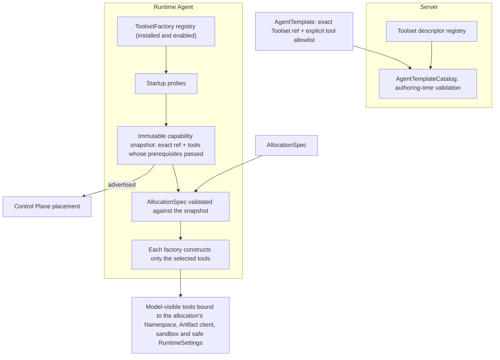
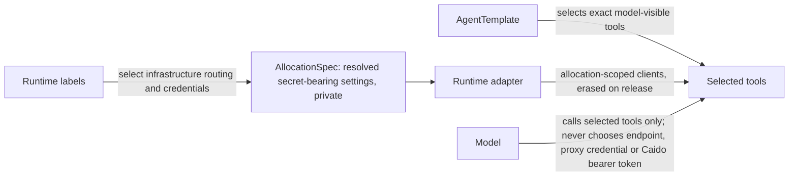

# Toolsets

Requirement prefix: `TLS` · [Specification index](../README.md)

## Purpose and scope

This document owns the contract that every Worker Toolset shares: what a
Toolset is, exact selection of model-visible tools and the model authority
boundary, the independence of tool selection and authorization, internal use
of the private Artifact client by domain Toolsets, the Server's
Toolset descriptor registry and each Runtime Agent's ToolsetFactory registry,
the operation-level positive Toolset capability and its complete-contract rule,
validation and construction of only the selected tools, the infrastructure
channels an exported tool declares, and the wording of model-visible tool
descriptions.
<!-- from: 01#42, 01#53, 01#54, 01#55, 01#56, 01#57, 01#58, 01#69, 01#70, 07#109, 11#4, 11#56 -->

It leaves to other documents:

- The AgentTemplate `spec.toolsets` field, its normalization and digest, and
  the native Agent Skill exception to Toolset selection:
  [AgentTemplates](../configuration/agent-templates.md).
- The built-in current-Run Artifact Toolset `run-artifacts@1`, the kinds of
  model-visible artifact tools, Namespace reservations and the allocation
  write fence: [Artifact store](../artifacts/artifact-store.md).
- Startup capability probes, the build of the capability snapshot and the
  bounded subprocess launcher: [Runtime Agent](../execution/runtime-agent.md).
- Capability advertisement at registration and placement against advertised
  tools: [Control Plane](../execution/control-plane.md).
- Runtime labels, proxy targets and Runtime adapters:
  [Runtime configuration](../configuration/runtime-config.md).
- Tool-call telemetry, redaction of tool arguments and errors, and
  sensitive-output instrumentation: [Observability](../platform/observability.md)
  and [Security](../platform/security.md).
- Tool-error codes and the bounds of individual tools: the
  [errors registry](../platform/errors.md), the [limits registry](../platform/limits.md)
  and each Toolset's own document; the recording of every tool call and its
  outcome, including `tool_call_failed` and `tool_call_cancelled`:
  [Observability](../platform/observability.md).
- Pinning tool declarations in evaluations:
  [Evaluation format](../evals/format.md).
- Individual Toolsets: [Memory](memory.md), [Skills](skills.md),
  [Workspace](workspace.md), [Code analysis](code-analysis.md),
  [HTTP and Caido](http-caido.md), [Scanners](scanners.md) and
  [Code execution](code-execution.md).
- Registries: [limits](../platform/limits.md), [errors](../platform/errors.md),
  [failure model](../platform/failure-model.md) and
  [lifecycle](../platform/lifecycle.md).

<!-- from: 01#47, 02#29, 03#22, 03#23, 04#68, 07#110, 07#115, 10#71, 12#15, 21#13 -->

## Concepts

Terms are defined once in the [glossary](../glossary.md).

| Term | Meaning here |
| --- | --- |
| Toolset | A versioned group of model-visible tools implemented by the selected Worker runtime. |
| Toolset ref | The exact versioned identifier of registered Toolset code, for example `likec4@1`. |
| Exported tool | A tool that one exact Toolset version exports and that an AgentTemplate may select. |
| Toolset selection (`ToolsetSelection`) | An AgentTemplate's choice of one exact Toolset ref plus an explicit allowlist of its exported tools. |
| Toolset descriptor registry | The Server's lightweight registry of Toolset descriptors used for authoring-time validation. |
| ToolsetFactory registry | A Runtime Agent's own registry of installed and enabled Toolset factories. |
| Toolset capability | An exact Toolset ref plus the subset of its exported tools whose prerequisites passed in one Runtime Agent's process environment. |
| Infrastructure channel | A class of allocation-owned handle supplied by Runtime that an exported tool declares it consumes: `runtime-http-client`, `runtime-subprocess-launcher` or `caido-graphql-client`. |
| Local/artifact-only tool | An exported tool that declares no infrastructure channel. |
| Internal helper | Code used by a selected tool that is not itself a model-visible tool. |
| Model authority boundary | AgentTemplate tool selection, which alone decides which tools the model can see and call. |
| Tool description | The English, model-facing description of one selected callable. |

<!-- from: 01#42, 01#54, 01#55, 01#56, 01#58, 01#69, 11#56 -->

## Model

### Registries, capabilities and construction

A Toolset ref names registered code at an exact version. The Server and every
Runtime Agent keep separate registries. The Server's Toolset descriptor
registry serves authoring-time validation of AgentTemplates. Each Runtime
Agent's ToolsetFactory registry holds the factories that Runtime Agent has
installed and enabled; its startup probes derive the Runtime Agent's immutable,
positive capability snapshot from that registry. The snapshot holds one Toolset
capability per advertised ref, and every AllocationSpec is validated against
it before the factories construct the selected tools.
<!-- from: 01#54, 01#56, 01#57, 01#58 -->

<!-- from: 01#54, 01#56, 01#57 -->

Each exported-tool descriptor is registered under the exact Toolset version and
carries the infrastructure channels that tool consumes:

| Channel | Allocation-owned handle supplied by Runtime |
| --- | --- |
| `runtime-http-client` | The Runtime-owned HTTP client |
| `runtime-subprocess-launcher` | The Runtime-owned bounded subprocess launcher |
| `caido-graphql-client` | The Caido GraphQL client of the allocation |

<!-- from: 01#55, 07#109 -->

Registered descriptors and their Runtime counterparts are also where
SandboxProfile/tool compatibility lives; that compatibility is specified in
[Code execution](code-execution.md). Workspace access that a Toolset declares,
such as the optional read access of `openapi@1` for provenance checks, is
specified in [Workspace](workspace.md).
<!-- from: 21#13, 10#71 -->

### Authority boundary

Selecting tools, routing infrastructure and holding secrets are separate
concerns, and none of them is chosen by the model:

<!-- from: 11#4, 11#56, 01#55 -->

## Requirements

### Selection and the model authority boundary

**TLS-R1.** An AgentTemplate chooses both the exact Toolset and an explicit
allowlist of the model-visible tools within it. The shape, normalization and
digest of that selection are specified in
[AgentTemplates](../configuration/agent-templates.md).
<!-- from: 01#42, 11#4 -->

**TLS-R2.** Toolset refs identify registered code. A Workflow or AgentTemplate
cannot name a Python module, callable, executable or shell command.
<!-- from: 01#58 -->

**TLS-R3.** Internal helpers used by a selected tool are not themselves
model-visible tools and do not need to appear in the allowlist.
<!-- from: 01#58 -->

**TLS-R4.** AgentTemplate selection is the model authority boundary. Merely
attaching a `caido` or `debug` Run label configures infrastructure but adds no
tools.
<!-- from: 11#56 -->

**TLS-R5.** A Caido mutation is permitted only when its exact tool name is
selected ([HTTP and Caido](http-caido.md)).
<!-- from: 11#56 -->

**TLS-R6.** No Skill can add a tool that the AgentTemplate omitted
([Skills](skills.md)).
<!-- from: 11#56 -->

Beyond tool selection, the architectural boundary is the same for every Worker
Toolset:

- **TLS-R7.** Runtime labels select infrastructure routing and credentials
  ([Runtime configuration](../configuration/runtime-config.md)).
- **TLS-R8.** The AllocationSpec carries the resolved secret-bearing settings
  privately.
- **TLS-R9.** A Runtime adapter creates allocation-scoped clients and erases
  them on release ([LIFE-RTA-6](../execution/runtime-agent.md)).
- **TLS-R10.** The model never chooses an infrastructure endpoint, proxy
  credential or Caido bearer token.

<!-- from: 11#4 -->

### Selection and authorization

**TLS-R11.** Tool selection controls model-visible interface construction, not
authorization. For example, selecting `write_artifact` cannot broaden the
allocation's Server-side grant, bypass the `outputs` Namespace reservation or
cross the write fence established when the StageExecution enters `finalizing`
or `aborting` ([ART-R35](../artifacts/artifact-store.md),
[ART-R86](../artifacts/artifact-store.md)).
<!-- from: 01#53, 03#31 -->

**TLS-R12.** Conversely, a grant does not make a tool model-visible unless the
AgentTemplate selects it.
<!-- from: 01#53, 03#31 -->

**TLS-R37.** A domain Toolset implementation may use the allocation-bound
private Artifact client internally, within its own registered contract, without
exposing the generic `run-artifacts@1` operations
([ART-R33](../artifacts/artifact-store.md)).
<!-- from: 01#53, 03#24 -->

The built-in current-Run Artifact Toolset `run-artifacts@1` and its exported
operations, the two kinds of model-visible artifact tools an AgentTemplate may
select, and the rule that no generic Artifact tool is injected implicitly are
specified in [Artifact store](../artifacts/artifact-store.md)
([ART-R31](../artifacts/artifact-store.md),
[ART-R32](../artifacts/artifact-store.md)).
<!-- from: 01#47, 03#22, 03#23, 03#24 -->

### Descriptor and factory registries

**TLS-R13.** The Server has a lightweight Toolset descriptor registry for
authoring-time validation.
<!-- from: 01#54 -->

**TLS-R14.** Each Runtime Agent has its own installed and enabled
ToolsetFactory registry and derives a positive capability snapshot from that
registry through its startup probes
([Runtime Agent](../execution/runtime-agent.md)).
<!-- from: 01#54 -->

**TLS-R15.** Installed code alone is not a capability: a Runtime Agent
advertises a Toolset ref only when at least one exported tool (LIM-TLS-1) can
honor its complete contract in that process environment.
<!-- from: 01#54 -->

### Toolset capabilities

**TLS-R16.** A Toolset capability contains the exact ref and the subset of its
exported tools whose prerequisites passed. It deliberately has the same
granularity as `ToolsetSelection`. Placement against advertised tools is
specified in [Control Plane](../execution/control-plane.md).
<!-- from: 01#56 -->

**TLS-R17.** A positive Toolset capability means more than "the function can be
called". If an operation requires an external validator to fulfil its declared
behavior, returning `validator unavailable` is not that operation's successful
startup capability (FAIL-TLS-1).
<!-- from: 02#32 -->

**TLS-R18.** The factory omits such a tool while retaining the independent
tools that passed their own prerequisites (FAIL-TLS-1).
<!-- from: 02#32, 01#56 -->

The Toolset probe that computes the advertised subset, including its local
executable, library, version and workspace-storage prerequisites, is specified
in [Runtime Agent](../execution/runtime-agent.md). A Toolset whose operations
have different prerequisites, such as the shallow and graph operations of
`code-analysis@1`, uses this same operation-level capability model rather than
a separate capability type ([Code analysis](code-analysis.md)).
<!-- from: 02#29, 12#15 -->

### Validation and construction

**TLS-R19.** AgentTemplateCatalog rejects unknown Toolset refs, unknown selected
tool names and cross-Toolset collisions in final model-visible tool names,
independently of the currently connected Runtime fleet.
<!-- from: 01#57 -->

**TLS-R20.** A Runtime Agent validates every AllocationSpec against its
immutable startup capability snapshot.
<!-- from: 01#57 -->

**TLS-R21.** After that validation, the Runtime Agent asks each factory to
construct only the selected tools, with the allocation's Namespace, Artifact
client, sandbox and safe RuntimeSettings. Unselected tools are neither
constructed nor exposed.
<!-- from: 01#57 -->

### Infrastructure channels

**TLS-R22.** Each exported-tool descriptor declares a fixed subset of the
infrastructure channels the tool consumes: `runtime-http-client` and/or
`runtime-subprocess-launcher` and/or `caido-graphql-client`.
<!-- from: 01#55, 07#109 -->

**TLS-R23.** The channel declaration is registered code metadata under the
exact Toolset version, not an AgentTemplate option.
<!-- from: 01#55 -->

**TLS-R24.** Runtime validates each tool's channel declaration against the
factory registration.
<!-- from: 07#109 -->

**TLS-R25.** A selected tool that declares a channel uses only the
allocation-owned handle supplied by Runtime. A tool that declares no channel
remains local/artifact-only.
<!-- from: 01#55 -->

**TLS-R26.** When a selected proxy target applies, a tool that declares the
Runtime-owned HTTP client or the bounded subprocess launcher must use the
injected handle; it cannot create a second ambient HTTP client or invoke a
network subprocess outside that launcher. A local/artifact-only tool may declare
neither channel and is unaffected. The proxy targets are specified in
[Runtime configuration](../configuration/runtime-config.md).
<!-- from: 07#109 -->

**TLS-R27.** Generic HTTP may use its optional proxy channel or a bounded direct
client; Caido's channel is mandatory. The HTTP and Caido tool boundary is
specified in [HTTP and Caido](http-caido.md).
<!-- from: 01#55 -->

**TLS-R28.** Proxy targets are injection contracts, not transparent network
interception.

Rationale: with channels declared per exported tool and enforced through
injected handles, the UI and provenance can say exactly which selected tool
channels were proxied without claiming that arbitrary process traffic was
intercepted.
<!-- from: 07#109 -->

The child-only proxy environment of the bounded subprocess launcher, the
unchanged reporting of the child's own outcome by the calling tool and the
`proxy_subprocess_failed` adapter failure are specified in
[Runtime Agent](../execution/runtime-agent.md).
<!-- from: 07#110 -->

### Model-visible tool descriptions

**TLS-R29.** Tool descriptions are part of the model-facing API. Each selected
callable has one English description (LIM-TLS-2).
<!-- from: 01#69 -->

**TLS-R30.** A description contains a short action summary, the relevant
preconditions and side effects, `Args:` for every model-supplied argument, and
`Returns:` for the actual response fields and incomplete-result indicators.
<!-- from: 01#69 -->

**TLS-R31.** A description documents defaults, units, allowed values, path
scope, revision preconditions and pagination where they affect use.
<!-- from: 01#69 -->

**TLS-R32.** A description omits the injected `tool_context`, and omits `Args:`
when there are no model-supplied arguments.
<!-- from: 01#69 -->

**TLS-R33.** Descriptions must match the selected implementation; they cannot
promise tools, permissions or behavior from another version.
<!-- from: 01#69 -->

**TLS-R34.** Callable Runtime tools keep the description text in `description`
and expose it as `__doc__` to ADK `FunctionTool`. In the pinned ADK 2.8.0
integration the complete docstring becomes the function description; `Args:` is
not extracted into per-parameter descriptions.
<!-- from: 01#70 -->

**TLS-R35.** Native Skill tools use explicit declarations with the same wording
rules ([Skills](skills.md)).
<!-- from: 01#70 -->

**TLS-R36.** Changing descriptions changes model-visible guidance; evaluation
comparisons pin the actual declarations, including docstrings
([Evaluation format](../evals/format.md)).
<!-- from: 01#70 -->

## Interfaces

- The model-facing API of a Toolset is the set of declarations of its selected
  tools, including their descriptions (TLS-R29 to TLS-R36).
- The AgentTemplate `spec.toolsets` wire shape is specified in
  [AgentTemplates](../configuration/agent-templates.md); the capability
  snapshot that a Runtime Agent advertises is specified in
  [Control Plane](../execution/control-plane.md).

<!-- from: 01#42, 01#54, 01#69, 01#70 -->

## Limits, failures and errors

Limits owned by this document, recorded in the
[limits registry](../platform/limits.md):

- LIM-TLS-1 — at least 1 exported tool that honors its complete contract, for
  an advertised Toolset ref (TLS-R15).
- LIM-TLS-2 — exactly 1 English description for a selected callable
  (TLS-R29).

<!-- from: 01#54, 01#69 -->

Failure outcomes ([failure model](../platform/failure-model.md)):

- FAIL-TLS-1 — Toolset startup probe of an exported tool's prerequisites,
  including an external validator. A tool whose prerequisites fail, including
  an operation that could only return `validator unavailable`, is omitted from
  the capability while independent tools that passed stay advertised; a ref
  with no passing tool is not advertised (TLS-R15, TLS-R17, TLS-R18). Probe
  timeouts, cancellation and unexpected exceptions are specified in
  [Runtime Agent](../execution/runtime-agent.md) (FAIL-RTA-1).

<!-- from: 02#32, 01#54, 01#56 -->

Lifecycle ([lifecycle registry](../platform/lifecycle.md)): this document owns
no lifecycle entries. The allocation-scoped clients that a Runtime adapter
creates and erases on release (TLS-R9) are
[LIFE-RTA-6](../execution/runtime-agent.md); the HTTP clients and Caido
sessions of the HTTP and Caido tools are
[LIFE-HTP-4](http-caido.md).

<!-- from: 11#4 -->

This document owns no error codes. Codes recorded at the Toolset boundary are
owned elsewhere: `tool_call_cancelled` and `tool_call_failed` by
[Observability](../platform/observability.md), and `proxy_subprocess_failed` by
[Runtime Agent](../execution/runtime-agent.md).
<!-- from: 04#68, 07#110 -->

## Security

Security-relevant requirements of this document:

- selection versus authorization: TLS-R11, TLS-R12, TLS-R37;
- the model authority boundary: TLS-R4 to TLS-R6;
- secret-bearing settings, clients and credentials: TLS-R8 to TLS-R10;
- registered code and construction of only the selected tools: TLS-R2,
  TLS-R21;
- infrastructure channels and proxy targets: TLS-R22 to TLS-R28.

Redaction of tool arguments and errors and the removal of deployment secrets
are specified in [Security](../platform/security.md) and
[Observability](../platform/observability.md).

<!-- from: 01#53, 01#55, 01#57, 01#58, 04#68, 07#109, 11#4, 11#56 -->

## Observability

Tool-call telemetry is specified in
[Observability](../platform/observability.md): the recording of every started
tool call and the cancellation code `tool_call_cancelled`; the redaction and
bounding of tool arguments and errors, including the stricter projections for
MemoryTools and Agent Skill tools; the default non-retention of full tool
results; and the sensitive-output declaration `contractor_sensitive_output`
with the metadata-only instrumentation it triggers. Provenance of proxied tool
channels follows from TLS-R28.
<!-- from: 04#68, 07#115, 07#109 -->

## Invariants

- Unselected tools are neither constructed nor exposed (TLS-R21). Owning
  tests:
  `test_prepare_is_single_slot_idempotent_and_constructs_only_selected_tools`
  in [runtime/tests/test_allocation.py](../../../runtime/tests/test_allocation.py)
  and `test_unselected_tool_channels_are_not_injected` in
  [runtime/tests/test_adapter_host.py](../../../runtime/tests/test_adapter_host.py).
- No two selected Toolsets contribute the same final model-visible tool name
  (TLS-R19). Owning test: `TestToolsetVisibleNameCollision` in
  [internal/config/config_test.go](../../../internal/config/config_test.go).
- An exported tool's infrastructure channels are fixed metadata of the exact
  Toolset version (TLS-R22, TLS-R23). Owning tests:
  `TestToolsetInfrastructureChannelParityFixture` in
  [internal/config/config_test.go](../../../internal/config/config_test.go) and
  `test_builtin_toolset_infrastructure_channels_match_parity_fixture` in
  [runtime/tests/test_capabilities.py](../../../runtime/tests/test_capabilities.py).

<!-- from: 01#55, 01#57, 07#109 -->

## Examples

### Operation-level capability

An environment without the LikeC4 executable may advertise the editing
operations of `likec4@1` but omit `validate_likec4` when only that operation
depends on the executable. A template that selects `validate_likec4` cannot be
placed there, while a template selecting only the advertised editing operations
can ([Control Plane](../execution/control-plane.md)).
<!-- from: 01#56 -->
