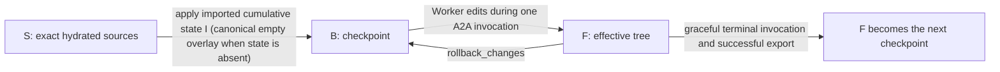
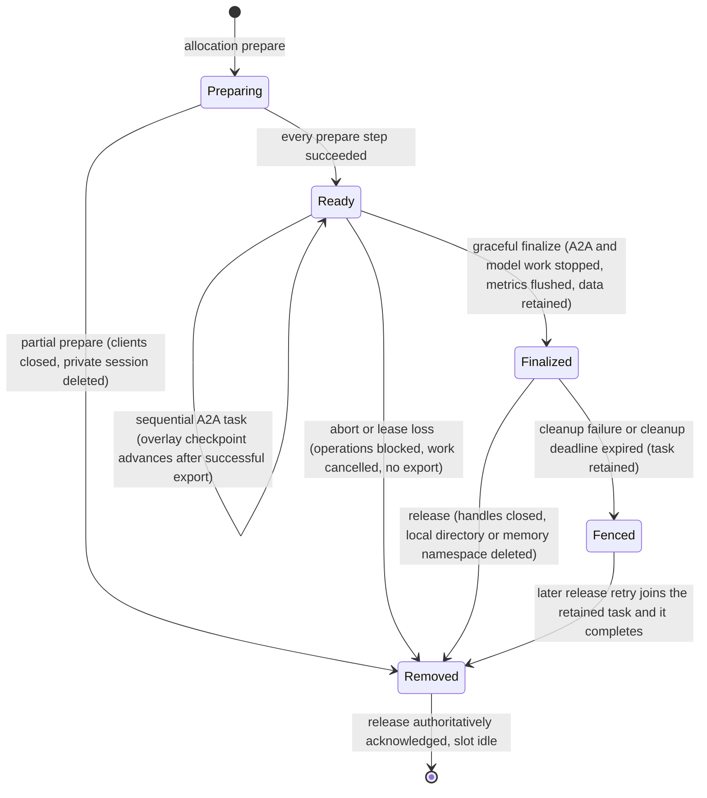
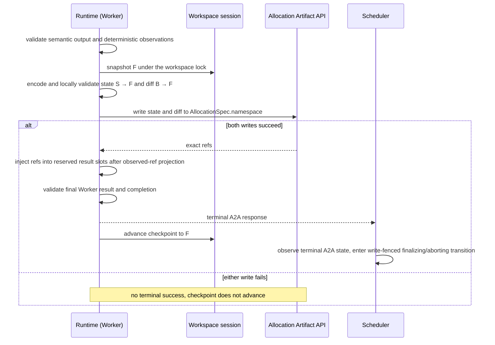

# Run workspaces and filesystem tools

Requirement prefix: `WSP` · [Specification index](../README.md)

## Purpose and scope

This document owns the project workspace contract for source-oriented Workers:
the Stage `context.workspace` declaration, the `workspace` value of the private
allocation manifest, the Runtime's workspace storage configuration and
capability, secure hydration, `direct` and `overlay` semantics including the
local-direct disk-authoritative rule, the cumulative overlay artifact and the
human diff, the model-visible `filesystem@1`, `edit-files@1` and
`workspace-changes@1` Toolsets, pre-terminal auto export, the workspace session
lifecycle and cleanup, the conditions that raise workspace errors, and workspace
telemetry.

It deliberately separates three concerns: the Workflow declares the logical
workspace and the expected workspace results; Scheduler pins exact artifacts
and the Control Plane sends one immutable construction manifest carrying their
exact refs to each allocation; the Runtime Agent privately chooses the physical
implementation and exposes only explicitly selected filesystem tools (WSP-R1 to
WSP-R3).

It leaves to other documents:

- Stage artifact slots, the versionless `from` binding of Stage result
  artifacts and the rest of the Workflow definition:
  [Workflows](../configuration/workflows.md);
- `StageContext` creation and the resolution of every context binding to an
  exact RunScope `ArtifactRef`: [Scheduler](../execution/scheduler.md);
- the Runtime startup probe phase in which the workspace provider is
  initialized, and the allocation preparation steps around hydration:
  [Runtime Agent](../execution/runtime-agent.md);
- allocation placement and Runtime registration:
  [Control plane](../execution/control-plane.md);
- `code-analysis@1`, `taint-annotations@1` and derived analysis caches:
  [Code analysis](code-analysis.md);
- the Podman executor and `exec_command`, including the workspace mode and
  storage they require: [Code execution](code-execution.md);
- workspace observation coverage in Worker results: [Worker](../execution/worker.md);
- the common Toolset contract: [Toolsets](toolsets.md);
- the workspace error codes ([ERR-R10](../platform/errors.md)) and the error
  code registry;
- the generic Artifact payload ceiling and the Artifact API:
  [Artifact store](../artifacts/artifact-store.md);
- Runtime labels: [Runtime configuration](../configuration/runtime-config.md);
- the syntax, precedence and validation of process timeout settings: the
  [operational timeout reference](../../operations/timeout-configuration.md).

## Concepts

Terms are collected in the [glossary](../glossary.md); this document owns the
following ones.

- **Project workspace.** The allocation-private project file tree that a Stage
  declares in `context.workspace`; it is a session separate from the
  `AllocationWorkspace` scratch directory.
- **`run_workdir`.** The single logical root of a project workspace; every
  workspace path is relative to it.
- **Workspace source.** An exact RunScope ZIP artifact used to hydrate a
  subtree of `run_workdir`.
- **Workspace state.** A cumulative text-only overlay artifact which, together
  with the exact sources, reconstructs the effective tree.
- **Workspace mode.** Workflow-selected semantics: `direct` or `overlay`.
- **Workspace storage.** Runtime startup choice: `local` or `memory`.
- **Workspace session.** One allocation-private hydrated tree and its tool
  handles.
- **Checkpoint.** The effective tree from which the current invocation's diff
  and rollback are calculated.
- **Auto export.** Runtime-owned persistence of overlay state and human diff
  into declared Stage result slots before a graceful terminal A2A response.
- **Managed text file.** A workspace file that is strict UTF-8 with no NUL. The
  managed-text projection of a workspace is its set of managed text files.
- **`WorkspaceSnapshot`.** An immutable value of the current managed-text
  projection and its canonical digest, acquired for one operation.
- **Workspace handles.** The narrow `WorkspaceReader`, `WorkspaceWriter` and
  `WorkspaceChanges` interfaces through which tools reach a workspace session.
- **Coordination boundary.** The allocation-owned workspace operation lock that
  serializes Workspace API reads, mutations and snapshot acquisition.
- **Opaque leaf.** An unsupported on-disk entry of a local direct workspace that
  complete acquisition lists but never opens, reads, follows or interprets.
- **Lower and upper.** In overlay mode, the lower is the unchanged hydrated
  base and the upper holds canonical text writes, explicit directories and
  tombstones.
- **Human diff.** The deterministic `text/x-diff` unified diff exported for
  analysis and review.
- **Workspace capability.** The positive, frozen snapshot of storage, supported
  modes and limits that a Runtime reports at registration.

## Model

### Workspace context

A Stage declares its workspace in `context.workspace`, next to
`context.artifacts`. Aliases refer to entries of `context.artifacts`; export
values are Stage result slot names.

```text
WorkspaceContext
  mode: direct | overlay
  sources: 1..32 WorkspaceSource
  state?: WorkspaceStateInput
  export?: WorkspaceExport

WorkspaceSource
  artifact: context artifact alias
  target: normalized relative directory, or "" for the workspace root

WorkspaceStateInput
  artifact: context artifact alias

WorkspaceExport
  state: Stage result slot name
  diff: Stage result slot name
```

The exact refs a workspace uses are the `StageContext` pins that Scheduler
records with the StageExecution when the Stage is made runnable; Workflow
artifact references themselves are logical and carry no revision. Each concrete
`AllocationSpec` carries its own copy of the workspace projection using those
exact refs ([SCH-R15 and SCH-R16](../execution/scheduler.md)).

### Authoritative effective state

| Mode | Storage | Authoritative effective state |
|---|---|---|
| `direct` | `local` | Current files and directories on disk in the allocation's `run_workdir` |
| `direct` | `memory` | Allocation-private managed tree in Runtime memory; no extracted copy |
| `overlay` | `local` | Managed overlay view over the hydrated source tree; no extracted copy |
| `overlay` | `memory` | Managed overlay view over the hydrated source tree; no extracted copy |

### Overlay trees

Overlay mode names four trees. `S` is the exact hydrated sources, `I` the
imported cumulative state, `B` the checkpoint and `F` the effective tree the
Worker produces during one A2A invocation. `diff`, `changed_paths` and the
exported human diff describe `B -> F`; the exported overlay state describes
`S -> F`.



### Workspace session lifecycle



## Requirements

### Ownership and isolation

**WSP-R1.** The Workflow declares which Run artifacts form a
logical workspace and which workspace results are expected, and selects
`direct` or `overlay` semantics.

**WSP-R2.** Scheduler pins exact Run artifacts for the workspace
([Scheduler](../execution/scheduler.md)), and the Control Plane sends one
immutable construction manifest to each allocation.

**WSP-R3.** Runtime startup owns the physical storage: the
Runtime Agent privately chooses a disposable `local` or in-memory (`memory`)
physical implementation, advertises its immutable `local`/`memory` workspace
capability and exposes only explicitly selected filesystem tools.

**WSP-R4.** The Server never mounts an operator project directory.

**WSP-R5.** A Worker never receives an `AgentTemplate`, backend path,
storage option or infrastructure credential as model-visible input. No model
input can select a host path, storage backend or infrastructure credential.

**WSP-R6.** Project filesystem configuration is entirely
Runtime-local. A Runtime label cannot supply a host path, source artifact,
workspace mode or storage override.

**WSP-R7.** A project workspace is a session separate from general
allocation scratch: `AllocationWorkspace` in `contractor_runtime.workspace`
remains the sandbox scratch directory used by skills and existing tools, and the
`local-workdir@1` SandboxProfile owns general allocation scratch
([Runtime Agent](../execution/runtime-agent.md)).

**WSP-R8.** Local storage owns a private `run_workdir` below its
configured provider root; memory storage uses an allocation-private managed
tree.

**WSP-R9.** The Podman executor
([Code execution](code-execution.md)) receives only the local direct project
content directory, not the provider's ownership markers or the allocation's
general scratch.

### Workflow contract

**WSP-R10.** `context.workspace` is optional. A filesystem Toolset
(`filesystem@1`, `edit-files@1` or `workspace-changes@1`) is invalid for a Stage
without `context.workspace`; a workspace without these Toolsets is valid.

**WSP-R11.** `context.workspace` has the `WorkspaceContext` shape of
[Workspace context](#workspace-context): a `mode`, 1 to 32 sources (LIM-WSP-1),
an optional `state` input and an optional `export`.

**WSP-R12.** Every source alias and the optional state alias exist in
`context.artifacts`. Source aliases must be required. State requiredness is
inherited from its artifact entry, so an optional absent state stays absent
from AllocationSpec.

**WSP-R13.** A source target is a normalized relative directory,
or `""` for the workspace root. Targets are UTF-8 NFC relative POSIX
directories. They contain no empty, `.`, `..`, backslash, NUL/control, URI,
Windows drive or UNC component, and have at most 32 components (LIM-WSP-2) and
at most 1024 UTF-8 bytes (LIM-WSP-3). A Windows drive is a first component that
starts with an ASCII letter and a colon; any other letter before a colon is an
ordinary name. The files a Worker reports reading follow the same grammar and
bounds, and Worker State workspace paths follow it with at most 128 components
and 4096 UTF-8 bytes. The Runtime normalizes a project path a model supplies to
NFC before it applies the rule, so a path it uses and records always satisfies
it (U+212A KELVIN SIGN before a colon becomes the drive `K:` and is refused).
Workflow publication, Studio, allocation validation and the Runtime apply one
definition per language, pinned by
`api/testdata/v1alpha1/workspace-path-cases.json`.

**WSP-R14.** Targets are unique and non-overlapping: `backend` and
`backend/api` cannot both be targets.

**WSP-R15.** Archive structure below each target is preserved;
there are no `stripComponents` or include/exclude rules.

**WSP-R16.** `state` is allowed for either mode. In `direct` it
initializes the private tree, and no later overlay state is exported
automatically.

**WSP-R17.** `export` is allowed only for `overlay`, must contain
both fields (`state` and `diff`), and each value must name a distinct Stage
result slot.

**WSP-R18.** The export state slot accepts exactly
`application/vnd.contractor.workspace-overlay+json`; the export diff slot
accepts exactly `text/x-diff`.

**WSP-R19.** `workspace-changes@1` requires `mode: overlay`.
`filesystem@1` and `edit-files@1` work in either mode.

**WSP-R20.** Auto-export result slots are reserved: they cannot be
provided or replaced by model text or ordinary tool observations.

**WSP-R21.** A Runtime-owned overlay `workspace_state` or
`workspace_diff` export slot omits the ordinary `from` binding that a Stage
result artifact otherwise requires ([Workflows](../configuration/workflows.md));
`context.workspace.export` supplies its trusted mapping instead.

**WSP-R22.** Multiple sources create one logical root (see
[Multiple sources under one root](#multiple-sources-under-one-root)).

**WSP-R23.** Every workspace is private to one allocation, including
Router siblings: a Router Stage gives each logical Worker its own physical copy
of the same exact initial source and state refs, and Workers do not share live
filesystem state.

**WSP-R24.** Changes from Worker A become visible to Worker B
only if a later StageExecution explicitly consumes A's persisted overlay state.

### Allocation manifest

**WSP-R25.** The private v2 allocation manifest (`AllocationSpec`) adds
one optional `workspace` value, shaped as in
[AllocationSpec workspace value](#allocationspec-workspace-value).

**WSP-R26.** The `workspace` value is construction data, not task
content. `StageContentRequest` carries the objective, Planner instructions,
string parameters and exact context artifact refs; workspace refs are
duplicated intentionally in the private construction manifest so the Runtime
can be fully ready before exposing the A2A Worker.

**WSP-R27.** Every hydrated input in AllocationSpec is an exact RunScope
ArtifactRef: every source in `AllocationSpec.workspace` is exact, and the
optional state is either absent or exact.

**WSP-R28.** Export destinations are logical Stage result slot names
and therefore have no revision before the Runtime writes them. The allocation
namespace determines the physical bindings, for example
`editor/workspace_state@r8` and `editor/workspace_diff@r8`.

### Runtime storage and capability

**WSP-R29.** The physical workspace implementation is immutable
Runtime process configuration: `storage` (`local` or `memory`), `workRoot` for
local storage, and the limits `maxFiles` (LIM-WSP-4), `maxExpandedBytes`
(LIM-WSP-5), `maxManagedTextBytes` (LIM-WSP-6) and `maxFileBytes` (LIM-WSP-7)
(see [Runtime workspace configuration](#runtime-workspace-configuration)).

**WSP-R30.** `workRoot` is required only for local storage. It is
absolute, dedicated, non-root and not sent over the wire.

**WSP-R31.** Workspace limits must be positive. The operator may
lower or raise them within implementation safety ceilings; Workflow, labels and
model input cannot override them.

**WSP-R32.** The Runtime probes its immutable workspace capability before
registration and reports it as `workspaceCapabilities` with its `storage`,
supported `modes` and `limits` (see [Workspace capability](#workspace-capability)).

**WSP-R33.** The capability snapshot is positive and frozen after
registration.

**WSP-R34.** `storage` is operational diagnostics: placement requires
the requested mode and exact Toolset/tool capabilities, and Scheduler does not
prefer local over memory ([Control plane](../execution/control-plane.md)).

**WSP-R35.** The Runtime repeats the compatibility check during
prepare.

**WSP-R36.** Operations exposes the frozen positive capability
(storage, supported modes and limits) but never workspace refs, paths or
content ([Operations](../operations/operations.md)).

Rationale: this makes a temporary workspace-mode placement wait diagnosable
without weakening allocation isolation.

Workspace-provider initialization during the Runtime startup probe phase, which
hydrates no tree before an allocation, is specified in
[RTA-R19](../execution/runtime-agent.md).

### Secure hydration

**WSP-R37.** Prepare performs the steps WSP-R37 to WSP-R44 in this order.
First, it validates the complete `AllocationSpec` and the local capability.

**WSP-R38.** Second, prepare creates an allocation-private workspace session.

**WSP-R39.** Third, prepare reads the exact source artifacts through the
existing allocation Artifact API.

**WSP-R40.** Fourth, prepare requires `application/zip`, then scans and
extracts each archive under its target.

**WSP-R41.** Fifth, if a state is supplied, prepare reads, validates and
applies the cumulative overlay state.

**WSP-R42.** Sixth, prepare establishes the effective initial tree and, for
overlay, its checkpoint.

**WSP-R43.** Seventh, prepare constructs the selected Toolsets and the Worker.

**WSP-R44.** Eighth, prepare returns ready only after every step succeeds.

**WSP-R45.** Hydration uses no new Artifact endpoint or credential.

**WSP-R46.** ZIP hydration rejects the whole allocation (FAIL-WSP-1)
for:

- absolute, empty, dot, parent, backslash, NUL/control, drive or UNC names;
- duplicate normalized paths and file/directory type conflicts;
- symlink, hard-link, device, socket, FIFO or other special entries;
- a target escape or overlap after prefixing;
- declared/observed size mismatch, corrupt compressed data, compression bomb,
  file/count/depth/expanded byte bound, or deadline exhaustion.

**WSP-R47.** Corrupt compressed data is a non-retryable
`workspace_source_invalid`, whichever codec reports it.

**WSP-R48.** `maxFiles` (LIM-WSP-4) bounds the complete normalized
managed tree: regular files, explicit directories and directories implied by
nested member names all count.

Rationale: this keeps a one-member archive with an extremely deep path from
expanding beyond the capability advertised by the Runtime.

**WSP-R49.** Local storage retains ordinary binary regular files.

**WSP-R50.** Memory storage skips binary files and counts their
bytes toward expanded input but not toward managed text.

**WSP-R51.** Local extraction honours a member's Unix execute bits
(for the classes that can read the file), so `./gradlew` or `./configure` stay
runnable in the sandbox; it never applies setuid, setgid, sticky or extra write
bits from an archive.

**WSP-R52.** A local direct copy keeps the source file's permission
bits without set-id or sticky bits.

**WSP-R53.** A managed text file is strict UTF-8 with no NUL. In
overlay mode only the text projection participates in overlay operations,
state, diff and digests.

**WSP-R54.** Reading or mutating an unmanaged binary path
through text tools returns `binary_file_unsupported`.

### Direct mode

**WSP-R55.** `direct` mutates only the disposable
allocation-private working copy. With local storage this is a private directory
below the Runtime `workRoot`, never an operator checkout; with memory storage it
is an isolated in-process tree.

**WSP-R56.** Local changes are visible to future subprocesses
inside the same allocation. Both storage kinds discard changes on release
(LIFE-WSP-2).

**WSP-R57.** Direct mode has no automatic diff, rollback or
export. A Worker that needs persistence must write an ordinary Run artifact
explicitly.

**WSP-R58.** The authoritative effective state of a workspace is
the one given for its mode and storage in
[Authoritative effective state](#authoritative-effective-state); for local
storage in direct mode it is the on-disk tree.

**WSP-R59.** The local-direct disk-authoritative rule satisfies
the filesystem prerequisite of the execution sandbox
([Code execution](code-execution.md)); it does not by itself enable Podman.

**WSP-R60.** For `direct + local`, hydration and optional state import
initialize disk. After prepare, the original archive, imported state and
retained memory cannot substitute for current files.

**WSP-R61.** Creates, writes, renames, deletes, empty-directory
changes and text/binary transitions completed by another process before an
operation begins must be visible to that operation. No model-visible refresh,
new allocation, executor callback or filesystem watcher is required.

**WSP-R62.** The local-direct disk-authoritative rule changes no
YAML or wire shape, Toolset ref or model-visible signature. Memory storage and
both overlay variants keep the semantics given for them in this document.

#### Reads, edits and snapshots

**WSP-R63.** Tools keep the narrow `WorkspaceReader` and `WorkspaceWriter`
handles, and the local direct implementation obtains the current state from
disk: `read_text` reads the requested regular file with bounded I/O, without
requiring unrelated source texts to be loaded.

**WSP-R64.** In the local direct implementation, listing and globbing use
current entries and types.

**WSP-R65.** In the local direct implementation, line edits, appends and exact
replacements read the current target under the workspace operation lock before
applying the transformation.

**WSP-R66.** In the local direct implementation, copy, move, removal and
directory creation preflight current source and destination state; they never
replay a delta from the hydration tree or resurrect an externally deleted file
from retained memory.

**WSP-R67.** In the local direct implementation, snapshots, observation
metadata, search and analysis obtain the current managed-text projection and
its existing canonical digest.

**WSP-R68.** A `WorkspaceSnapshot` is an immutable value for one
operation, not a second writable filesystem or an overlay checkpoint. Search and
analysis can finish against that value while later edits occur; the next call
acquires a fresh view.

**WSP-R69.** Digest-bound cursors reject a changed projection rather than
combining pages.

**WSP-R70.** The digest describes the managed-text projection, not
all binary contents, permissions or timestamps.

**WSP-R71.** Source contents may be retained while acquiring or
consuming a bounded snapshot, but a persistent source-content cache cannot
determine freshness: remembered size/mtime, successful hydration and
invalidation only after known exec calls are insufficient. The local direct
implementation acquires snapshots from disk on demand.

**WSP-R72.** Derived analysis caches may be reused only after
acquiring the current snapshot digest; those caches belong to
[Code analysis](code-analysis.md).

**WSP-R73.** Complete snapshots respect entry, file and byte
limits and operation deadlines; they never report a partial tree as complete.

**WSP-R74.** Potentially blocking scans, reads and mutations run outside
the asyncio event loop.

**WSP-R75.** Cancellation does not release ownership of an
in-flight mutation or let cleanup race that mutation (FAIL-WSP-3).

#### Concurrency and failures

**WSP-R76.** An allocation-owned coordination boundary serializes Workspace
API reads, mutations and snapshot acquisition. It covers the entire
read/transform/write sequence. Analysis releases it after acquiring its
immutable snapshot.

**WSP-R77.** Completed external changes are supported. Arbitrary
concurrent host writers do not participate in the coordination boundary: there
is no transactional whole-tree snapshot or lost-update guarantee against them.
Coherent multi-file acquisition requires writers to be quiescent or explicitly
coordinated.

**WSP-R78.** Observed disappearance, replacement or type changes
that prevent completing an operation produce a bounded safe failure, never a
fallback to cached contents or an infinite rescan (FAIL-WSP-3).

**WSP-R79.** The executor of [Code execution](code-execution.md)
uses this same coordination boundary through trusted descendant completion.
Cancellation does not hand off the workspace before confirmed stop/removal.

How `exec_command` owns the coordination boundary for its whole command
lifetime, and why a retained snapshot is invalid for a later call after any
command outcome, are specified in [EXE-R79 and EXE-R88](code-execution.md); how
analysis shares the acquisition guard and observes completed command edits is
[CAN-R22 and CAN-R23](code-analysis.md).

**WSP-R80.** Argument, path, type, match and quota validation
precedes mutation.

**WSP-R81.** Single-file text replacement is atomic. Local direct
mode does not provide crash-atomic multi-file transactions.

**WSP-R82.** Recovery after a physical I/O failure is limited to the
operation's own effects and cannot overwrite unrelated external changes.

**WSP-R83.** An unconfirmed mutation or cleanup leaves the workspace
unavailable/fenced; an old memory tree is not evidence that disk state has been
restored (FAIL-WSP-3).

#### On-disk validation and limits

**WSP-R84.** Archive validation does not validate later external
changes. Operations recheck paths and file types on access, including both sides
of copy/move and recursive removal.

**WSP-R85.** All access stays rooted in the allocation content directory.
Descriptor-relative access or an equivalent mechanism must prevent path
replacement from redirecting an operation outside that root; `resolve`-then-open
or string-prefix checks alone are insufficient.

**WSP-R86.** Complete acquisition records unsupported entries as opaque
leaves instead of failing the whole workspace: symlinks, multiply linked regular
files, FIFOs, sockets, devices, regular files larger than `maxFileBytes`
(LIM-WSP-7), entries the Runtime may not open (a workload can revoke its own
permissions) and entries whose on-disk names are not canonical (for example NFD,
control characters). Tools such as `python -m venv` and `npm install` create
such entries.

**WSP-R87.** Opaque leaves are listed like binary files and count
toward `maxFiles` (LIM-WSP-4); a non-canonical name is listed under its NFC form
with invalid characters replaced by U+FFFD.

**WSP-R88.** Opaque leaves are never opened, read, followed or
interpreted as another host path, so a symlinked directory's contents are not
listed and FIFOs never block.

**WSP-R89.** Reads, writes, copies, moves and deletions that touch
an opaque leaf or a path below it fail with `workspace_type_conflict`; a scoped
read of an oversize regular file keeps failing with `workspace_limit_exceeded`.

**WSP-R90.** On-disk names that project onto one listed path, or
that cannot be listed within the path bounds, still fail complete acquisition
with `workspace_path_invalid`, never silent renaming.

**WSP-R91.** Ordinary binary files remain on disk and are
classified as binary.

**WSP-R92.** The workspace limits apply to current-state
acquisition and mutation preflight, not just archive input. Complete acquisition
checks entry count, the bytes of the regular files it reads (opaque leaves are
not read) and managed-text bytes; reads stay bounded if a file grows during
acquisition.

**WSP-R93.** A limit violation yields `workspace_limit_exceeded`,
not stale data, hidden partial success or automatic deletion of external
outputs.

**WSP-R94.** Build and dependency files are not silently excluded
from the complete workspace contract. Scope-limited reads can remain available
within their own bounds without constructing a complete snapshot.

**WSP-R95.** Workspace API limits do not impose disk quotas on
external processes. Capacity controls for command writes belong to the executor
deployment ([Code execution](code-execution.md)).

**WSP-R96.** For local direct mode, text replacement is an atomic
rename relative to opened directory descriptors. Parent traversal does not
follow symlinks, a replaced final symlink is itself replaced rather than
followed, and a failed commit removes its private temporary file (FAIL-WSP-4).

Rationale: this is defense in depth for filesystem races; another same-UID
process with unrestricted access to the Runtime `workRoot` is inside the Runtime
host trust boundary.

**WSP-R97.** Executors must be confined to explicitly exposed
content directories and their approved mounts.

The Podman executor requires `local + direct` and cannot be combined with
Contractor `overlay`; every `podman@1` Worker therefore needs a direct-mode
`context.workspace` on a Runtime with local storage
([EXE-R9 and EXE-R10](code-execution.md)).

### Overlay mode

**WSP-R98.** `overlay` presents a copy-on-write text view over the hydrated
private base. The lower stays unchanged, and overlay changes only its upper,
which contains canonical text writes, explicit directories and tombstones.

**WSP-R99.** All overlay mutations and change operations serialize on
one session lock and are exception- and cancellation-atomic (FAIL-WSP-5).

**WSP-R100.** At prepare, the imported cumulative state `I` is
applied to the sources `S` to establish the checkpoint `B`:

```text
sources S -> apply imported cumulative state I -> checkpoint B
```

**WSP-R101.** When `state` is absent, `I` is the canonical empty
overlay and `B = S`. In that case, when the Workflow declares `export`, an
unchanged invocation still exports a valid cumulative identity state `S -> S`
with an empty operation list and an empty checkpoint diff `S -> S`.

**WSP-R102.** Identity state and empty diff artifacts are explicit internal
Workflow lineage, not evidence that a Worker edited the tree.

**WSP-R103.** During one A2A invocation the Worker produces the effective tree
`F`; `diff` and `changed_paths` describe `B -> F`.

**WSP-R104.** `rollback_changes` restores `B`, not original sources `S`;
restoring one path also recreates its parent directories deleted since `B`, but
fails with `workspace_type_conflict` instead of replacing a parent that became
a file.

**WSP-R105.** Exported overlay state describes the cumulative `S -> F`.

**WSP-R106.** The exported human diff describes the current invocation
`B -> F`.

**WSP-R107.** After a graceful terminal invocation and successful export, `F`
becomes the next checkpoint for another sequential A2A task on the same
allocation.

**WSP-R108.** There is no model-visible or automatic host
`materialize`. Persistence is an artifact export.

**WSP-R109.** Trusted analysis tools may build private analysis
inputs from an immutable snapshot.

**WSP-R110.** An execution sandbox sharing the writable project
workspace requires local direct mode ([Code execution](code-execution.md)).

`taint-annotations@1` requires `context.workspace` but not overlay mode, and a
Workflow that needs durable annotation output selects overlay mode with
workspace `state`/`diff` result slots, so pre-terminal auto export remains the
only persistence path ([CAN-R98 and CAN-R99](code-analysis.md)). The trace
Worker verifies its edits with `changed_paths` and `diff` and never calls a
materialize operation; a later Stage can apply the exported cumulative state,
and the text diff can be analyzed as an ordinary artifact
([CAN-R134](code-analysis.md)).

### Cumulative overlay artifact and human diff

**WSP-R111.** The cumulative overlay state artifact has media type
`application/vnd.contractor.workspace-overlay+json` and the canonical versioned
JSON form shown in
[Cumulative overlay artifact format](#cumulative-overlay-artifact-format).

**WSP-R112.** Operations are sorted into one deterministic canonical
representation and use relative normalized paths.

**WSP-R113.** `write_file.text` is strict UTF-8 without NUL; it does not
encode arbitrary bytes.

**WSP-R114.** Metadata, modes, ownership, timestamps, symlinks and
binary patches are not represented in the overlay state. A future binary patch,
if needed, is a separate artifact/media type.

**WSP-R115.** `baseWorkspaceDigest` hashes the canonical managed-text
projection of the exact hydrated sources `S`; `resultWorkspaceDigest` hashes the
reconstructed managed-text projection after the operations.

**WSP-R116.** Imported state must match the actual base, and its
result digest is recomputed before it is applied (FAIL-WSP-2).

**WSP-R117.** Each operation is checked structurally as it is replayed;
workspace limits bind the reconstructed result once, not intermediate replay
states.

**WSP-R118.** Decoding runs off the Runtime event loop.

**WSP-R119.** State does not contain a previous Artifact revision:
revision is an ArtifactStore concern hidden from the model.

**WSP-R120.** Cumulative state is self-contained relative to the
exact sources and contains text only: given `S` and state revision 8, revision 7
is unnecessary.

**WSP-R121.** The human diff is a deterministic UTF-8 unified diff with
media type `text/x-diff`, relative paths, LF syntax and bounded context.

**WSP-R122.** As in git, only LF ends a line (CR, the CR of CRLF and Unicode
separators such as form feed or U+2028 stay in their line), and a side without a
final newline carries `\ No newline at end of file`, so the text changes apply
with `git apply`.

**WSP-R123.** The human diff is for analysis and review, not
authoritative reconstruction.

**WSP-R124.** Workspace diff matching is limited to 1,000,000
candidate line pairs per path (LIM-WSP-8). Larger inputs use one exact
replacement hunk with three context lines (LIM-WSP-9) after trimming equal ends,
so rendering work stays linear in managed text size. Ordinary inputs keep the
standard unified diff.

**WSP-R125.** The regression budget for repetitive files above 4 MiB
is five seconds, including patch rendering (LIM-WSP-10); byte pagination and
exact patch applicability are preserved.

### Model-visible Toolsets

**WSP-R126.** The optional project-filesystem Toolsets are
`filesystem@1`, `edit-files@1` and `workspace-changes@1`. They follow the same
explicit operation allowlist as every Toolset ([Toolsets](toolsets.md)): the
AgentTemplate selects an exact subset by the normal Toolset allowlist, and none
is injected by a SandboxProfile or instruction.

**WSP-R127.** The AgentTemplate selects only the model-visible
operations. It cannot name an artifact, host path or backend, change workspace
mode, or request persistence outside declared Stage result slots.

**WSP-R128.** Tool implementations receive narrow `WorkspaceReader`,
`WorkspaceWriter` and `WorkspaceChanges` handles, never raw fsspec objects or
host paths.

**WSP-R129.** `openapi@1` declares optional read access for provenance
checks. When a project workspace is present, every `evidence_files` path is
validated against one `WorkspaceReader` snapshot, the same logical tree exposed
through `filesystem@1`, and `openapi@1` must not inspect `AllocationWorkspace`
scratch.

**WSP-R130.** Without a project workspace, `openapi@1` retains the legacy
`source-analysis@1` compatibility path below allocation-private
`scratch/source`.

**WSP-R131.** The project workspace and the
`source-analysis@1` path are never combined, and project-workspace presence
always takes precedence, including for a missing path.

The read-only `code-analysis@1` Toolset consumes the same `WorkspaceReader`
snapshot boundary; neither its Tree-sitter operations nor its local-only
Trailmark allocation child receives the provider's physical root
([CAN-R5 and CAN-R6](code-analysis.md)).

**WSP-R132.** `filesystem@1` provides these tools:

| Tool | Contract |
|---|---|
| `ls(path="", cursor="", limit=100)` | Sorted immediate entries with type and text size; bounded cursor pagination. |
| `glob(pattern, cursor="", limit=100)` | Sorted relative path matches; bounded scan and pagination. |
| `read_file(path, start_line=1, max_lines=200, with_line_numbers=False)` | Bounded text lines with total/next metadata and preserved newline information. `start_line == totalLines + 1` returns an empty page; larger values return `workspace_line_invalid`. Optional true prefixes each text with its absolute `N \| ` line number; prefix UTF-8 bytes count toward the existing output limit. |
| `grep(pattern, path="", glob="**/*", cursor="", limit=100)` | Bounded literal/regex text matches with line and truncated excerpt. |

**WSP-R133.** `edit-files@1` provides these tools:

| Tool | Contract |
|---|---|
| `write_file(path, content)` | Replace/create one text file atomically. |
| `append_file(path, content)` | Append text preserving existing newline style. |
| `mkdir(path, parents=false)` | Create a directory. |
| `rm(path, recursive=false)` | Remove a file or explicit tree. |
| `cp(source, destination, recursive=false)` | Copy within the one workspace root. |
| `mv(source, destination)` | Move within the one workspace root. |
| `insert_line(path, line, content)` | Insert at a 1-based line boundary. |
| `edit(path, old, new, replace_all=false)` | Require exactly one match unless `replace_all`; no fuzzy edits. |
| `replace_range(path, start_line, end_line, content)` | Replace an inclusive 1-based line range. |

**WSP-R134.** `workspace-changes@1` provides these tools:

| Tool | Contract |
|---|---|
| `changed_paths(cursor="", limit=100)` | Sorted created/modified/deleted paths since checkpoint. |
| `diff(path="", cursor="", max_bytes=65536)` | Bounded deterministic `B -> F` unified diff. |
| `rollback_changes(path="")` | Restore checkpoint for one path/subtree or the whole workspace. |

The signature defaults above are registered limits: the page size `limit=100`
of `ls`, `glob`, `grep` and `changed_paths` (LIM-WSP-11), the `read_file` page
`max_lines=200` (LIM-WSP-12) and the `diff` output bound `max_bytes=65536`
(LIM-WSP-13).

**WSP-R135.** All tool paths are relative to the single `run_workdir` root.
A leading `/`, `..`, backslash, URI, drive/UNC, NUL/control and paths above
configured limits are rejected.

**WSP-R136.** Tools never expose a list of host roots, because there
is exactly one logical root.

**WSP-R137.** Read responses are bounded; truncation is explicit and
resumable.

**WSP-R138.** Mutations preflight the resulting file/count/managed-byte
limits before changing state.

**WSP-R139.** Line-oriented edits retain the existing CRLF style.

**WSP-R140.** `edit` cannot silently choose among multiple matches.

Which successful `read_file`, `grep`, `glob`, `ls`, edit, annotation and
`workspace-changes` calls record paths as read, discovered or modified in Worker
results, and how retries count, is specified in
[WRK-R89 to WRK-R95](../execution/worker.md).

### Auto export and A2A ordering

**WSP-R141.** Overlay state has a 16 MiB ceiling (LIM-WSP-14), independent of
the generic Artifact payload ceiling
([LIM-ART-4](../artifacts/artifact-store.md)). The exporter passes the minimum
of that ceiling and the generic Artifact transport limit to export preparation.

**WSP-R142.** Increasing transport capacity must not make
small overlay exports invalid or implicitly raise overlay decode budgets.

**WSP-R143.** For overlay with `export`, the Runtime augments every
successful normal `WorkerResult` after semantic output and deterministic
observations have been validated and before its `WorkerCompletion` becomes
terminal over A2A.

**WSP-R144.** The augmentation of WSP-R143 performs the steps WSP-R144 to
WSP-R149 in this order. First, the Runtime snapshots `F` under the workspace
lock.

**WSP-R145.** Second, the Runtime encodes and locally validates the cumulative
state `S -> F` and the diff `B -> F`.

**WSP-R146.** Third, the Runtime writes state and diff to
`AllocationSpec.namespace` through the current allocation Artifact API.

**WSP-R147.** Fourth, the Runtime injects both exact returned refs into their
reserved result slots after the ordinary observed-ref projection.

**WSP-R148.** Fifth, the Runtime validates the final Worker result/completion;
only then does it publish the terminal A2A response.

**WSP-R149.** Sixth, the Runtime advances the checkpoint to `F` after both
writes have succeeded.



**WSP-R150.** Both artifacts bind the same `resultWorkspaceDigest`;
diff metadata may carry the digest outside the diff text.

**WSP-R151.** If either write fails, no terminal success is returned
and the checkpoint does not advance. A partial artifact revision is harmless
because Scheduler never selects it (FAIL-WSP-6, LIFE-WSP-4).

**WSP-R152.** Temporary Artifact API failures produce a retryable
`workspace_export_failed`; invalid state, quota and fence failures are
classified by their stable cause.

**WSP-R153.** No export occurs for `WorkerFailure`, `INPUT_REQUIRED`
(the allocation continues), lost lease, forced abort/cancel, crash,
missing/unsafe structured semantic output or invocation cancellation.

**WSP-R154.** Overlay persistence uses ordinary artifacts
written before the terminal A2A response: this ordering guarantees that artifact
writes finish before Scheduler observes terminal A2A state and enters its
write-fenced `finalizing`/`aborting` transition
([Scheduler](../execution/scheduler.md)).

### Lifecycle and cleanup

**WSP-R155.** Local direct filesystem work has a process-local
`operation_timeout_seconds`, configured by
`--workspace-operation-timeout-seconds` or
`CONTRACTOR_WORKSPACE_OPERATION_TIMEOUT_SECONDS`, with a default of 30 seconds
(LIM-WSP-15).

**WSP-R156.** The operation timeout must be finite and positive,
and the CLI overrides the environment. An explicit override requires local
storage and is rejected for memory or disabled workspaces.

**WSP-R157.** The operation timeout is neither an advertised
capability nor an AllocationSpec field. Exact configuration rules belong to the
[operational timeout reference](../../operations/timeout-configuration.md).

**WSP-R158.** The operation budget covers local I/O, serialization,
initialization and close waits. Initialization and close use the earlier of
this budget and the enclosing deadline; release, rollback and terminal cleanup
forward their remaining deadline.

**WSP-R159.** A timed-out wait retains ownership of the physical I/O and
disposal task until it ends, and saved finalize/abort deadlines are not reset
(FAIL-WSP-3).

**WSP-R160.** A later release attempt may retry physical cleanup
under its own finite release budget while joining retained work, without reusing
the slot or deleting storage under active I/O.

**WSP-R161.** A partial prepare closes clients and deletes the
private session (LIFE-WSP-1).

**WSP-R162.** Graceful finalize stops A2A/model work and flushes metrics
but retains workspace data until release, for idempotent finalization and
replay (LIFE-WSP-1).

**WSP-R163.** Release closes handles and deletes the private local
directory or memory namespace, then makes the one Runtime slot idle
(LIFE-WSP-1).

**WSP-R164.** Abort or lease loss blocks new workspace operations, cancels
work, performs no export and deletes the session (LIFE-WSP-1).

**WSP-R165.** A cleanup failure fences/drains that Runtime process
and is reported safely; it must not block Scheduler progress for other Runtime
Agents (FAIL-WSP-7).

**WSP-R166.** Startup deletes only stale directories bearing a
valid Contractor ownership marker immediately below the exact configured
`workRoot`. It never performs broad or marker-free recursive cleanup. A stale
directory that cannot be removed is logged and retained, marker included, for
the next start; it does not block initialization or later allocations
(FAIL-WSP-8, LIFE-WSP-3).

**WSP-R167.** Local removal (release and startup) restores owner
`rwx` on directories a same-UID sandbox workload made inaccessible, works
relative to pinned directory descriptors, never follows links and removes the
ownership marker last.

**WSP-R168.** Potentially blocking local filesystem removal never
runs on the Runtime Agent's asyncio event-loop thread.

**WSP-R169.** Release owns one allocation-wide cleanup task covering
Toolset close, project workspace disposal, scratch SandboxProfile cleanup and
RuntimeAdapter rollback. The task is awaited under one finite cleanup deadline.

**WSP-R170.** If the cleanup deadline expires, the request
returns a retryable cleanup failure and the slot remains fenced, while the
still-owned task is retained; a later retry joins that exact task instead of
starting a concurrent second removal of the same tree (FAIL-WSP-7).

**WSP-R171.** No allocation can reuse the slot until the cleanup task
completes and release is authoritatively acknowledged, so release, abort or
lease loss cannot leave a reusable slot with a live workspace.

**WSP-R172.** Abort and lease loss use the same bounded
non-blocking primitives and retain their fail-closed process-exit rule when
teardown cannot be confirmed (FAIL-WSP-7).

### Errors

**WSP-R173.** Workspaces and filesystem tools use the stable error codes of
[ERR-R10](../platform/errors.md); the conditions that raise them and their
retryability are WSP-R47, WSP-R54, WSP-R89, WSP-R90, WSP-R93, WSP-R104,
WSP-R132, WSP-R152 and WSP-R174.

**WSP-R174.** Transient Artifact transport and disk availability
errors are retryable; malformed ZIP/state and deterministic quota violations are
not.

**WSP-R175.** Errors sent to the Server or the model contain only a
stable code, retryability and bounded safe context.

## Interfaces

### AllocationSpec workspace value

The optional `workspace` value of the private allocation manifest carries exact
source and state refs and logical export slot names. Schema:
[`allocation.schema.json`](../../../api/v1alpha1/allocation.schema.json).

```json
{
  "mode": "overlay",
  "sources": [
    {
      "artifact": {
        "namespace": "inputs",
        "name": "backend",
        "revision": "sha256:..."
      },
      "target": "backend"
    }
  ],
  "state": {
    "artifact": {
      "namespace": "analysis",
      "name": "workspace_state",
      "revision": "sha256:..."
    }
  },
  "export": {
    "state": "workspace_state",
    "diff": "workspace_diff"
  }
}
```

### Workspace capability

The capability a Runtime reports at registration, here for local storage.
Schema:
[`agent-registration.schema.json`](../../../api/v1alpha1/agent-registration.schema.json).

```json
{
  "workspaceCapabilities": {
    "storage": "local",
    "modes": ["direct", "overlay"],
    "limits": {
      "maxFiles": 50000,
      "maxExpandedBytes": 2147483648,
      "maxManagedTextBytes": 268435456,
      "maxFileBytes": 16777216
    }
  }
}
```

### Runtime workspace configuration

Runtime process configuration selects the storage, the local `workRoot` and the
limits. With local storage:

```yaml
workspace:
  storage: local
  workRoot: /var/lib/contractor/workspaces
  limits:
    maxFiles: 50000
    maxExpandedBytes: 2147483648
    maxManagedTextBytes: 268435456
    maxFileBytes: 16777216
```

Or with memory storage:

```yaml
workspace:
  storage: memory
  limits:
    maxFiles: 10000
    maxExpandedBytes: 268435456
    maxManagedTextBytes: 67108864
    maxFileBytes: 4194304
```

| Setting | Form | Meaning |
| --- | --- | --- |
| Local workspace operation timeout | `--workspace-operation-timeout-seconds` or `CONTRACTOR_WORKSPACE_OPERATION_TIMEOUT_SECONDS`; default 30 seconds | `operation_timeout_seconds` of local direct filesystem work (WSP-R155 to WSP-R157) |

### Cumulative overlay artifact format

Media type `application/vnd.contractor.workspace-overlay+json`; the canonical
versioned JSON is:

```json
{
  "apiVersion": "contractor.workspace/v1",
  "kind": "WorkspaceOverlay",
  "baseWorkspaceDigest": "sha256:...",
  "resultWorkspaceDigest": "sha256:...",
  "operations": [
    {"op": "create_directory", "path": "backend/new"},
    {"op": "write_file", "path": "backend/new/readme.md", "text": "..."},
    {"op": "delete_path", "path": "backend/old.txt"}
  ]
}
```

### Media types

| Artifact | Media type | Rules |
| --- | --- | --- |
| Workspace source | `application/zip` | WSP-R40, WSP-R46 |
| Workspace state (cumulative overlay) | `application/vnd.contractor.workspace-overlay+json` | WSP-R111 to WSP-R120 |
| Human diff | `text/x-diff` | WSP-R121 to WSP-R125 |

## Limits, failures and errors

Limits ([registry](../platform/limits.md)):

- LIM-WSP-1 — 1 to 32 sources per workspace (WSP-R11).
- LIM-WSP-2 — at most 32 components per source target (WSP-R13).
- LIM-WSP-3 — at most 1024 UTF-8 bytes per source target (WSP-R13).
- LIM-WSP-4 to LIM-WSP-7 — the operator-configured `maxFiles`,
  `maxExpandedBytes`, `maxManagedTextBytes` and `maxFileBytes`
  (WSP-R29, WSP-R31).
- LIM-WSP-8 — 1,000,000 candidate line pairs per path for diff matching
  (WSP-R124).
- LIM-WSP-9 — three context lines in the fallback replacement hunk
  (WSP-R124).
- LIM-WSP-10 — five-second regression budget for repetitive files above 4 MiB
  (WSP-R125).
- LIM-WSP-11 to LIM-WSP-13 — default tool page and output bounds
  (WSP-R132, WSP-R134).
- LIM-WSP-14 — 16 MiB overlay state ceiling (WSP-R141).
- LIM-WSP-15 — 30-second default local workspace operation timeout
  (WSP-R155).
- The generic Artifact payload ceiling (LIM-ART-4) belongs to
  [Artifact store](../artifacts/artifact-store.md); the startup probe bounds
  belong to [Runtime Agent](../execution/runtime-agent.md).

Failure outcomes ([failure model](../platform/failure-model.md)):

- FAIL-WSP-1 — source hydration (WSP-R46, WSP-R47, WSP-R161, WSP-R174).
- FAIL-WSP-2 — overlay state import (WSP-R116).
- FAIL-WSP-3 — local direct acquisition, read and mutation (WSP-R75, WSP-R78,
  WSP-R83, WSP-R159).
- FAIL-WSP-4 — local direct atomic text replacement commit (WSP-R96).
- FAIL-WSP-5 — overlay mutation and change operations (WSP-R99).
- FAIL-WSP-6 — auto-export artifact writes (WSP-R151, WSP-R152).
- FAIL-WSP-7 — release cleanup and workspace disposal (WSP-R165, WSP-R170,
  WSP-R172).
- FAIL-WSP-8 — startup stale-directory cleanup (WSP-R166).

Lifecycle ([registry](../platform/lifecycle.md)):

- LIFE-WSP-1 — workspace session (WSP-R161 to WSP-R164).
- LIFE-WSP-2 — direct-mode working copy changes (WSP-R56).
- LIFE-WSP-3 — stale marker-owned local workspace directory (WSP-R166).
- LIFE-WSP-4 — partial auto-export artifact revision (WSP-R151).

Errors ([registry](../platform/errors.md)): the codes of
[ERR-R10](../platform/errors.md), raised and classified as listed in WSP-R173.

## Security

The workspace security controls are stated as requirements above: no operator
project directory mount and no model-visible infrastructure input (WSP-R4,
WSP-R5, WSP-R6, WSP-R127, WSP-R128); exact pinned inputs (WSP-R27); secure
hydration that rejects unsafe archives and never applies set-id, sticky or extra
write bits (WSP-R46, WSP-R51); rooted, descriptor-relative access (WSP-R84,
WSP-R85), opaque leaves that are never followed (WSP-R88), and symlink-safe text
replacement and removal (WSP-R96, WSP-R167); a single logical root for tool
paths (WSP-R135, WSP-R136); confinement of executors (WSP-R9, WSP-R97);
allocation privacy (WSP-R23); and bounded safe error content (WSP-R175).
Operations never exposes workspace refs, paths or content (WSP-R36). Trust
boundaries and redaction are in [Security](../platform/security.md).

## Observability

**WSP-R176.** Workspace metrics may include storage kind, mode, source
count, file/byte counts, operation name/outcome/duration, changed count and
exported byte counts.

**WSP-R177.** Workspace metrics must not contain file contents,
search patterns, diffs, archive names, host paths, credentials or arbitrary
exceptions.

Telemetry content rules shared by every domain are in
[Observability](../platform/observability.md).

## Invariants

These properties follow from the cited requirements, which are authoritative.

1. Workflow chooses semantics; Runtime startup chooses physical storage
   (WSP-R1, WSP-R3).
2. Every hydrated input in AllocationSpec is an exact RunScope ArtifactRef
   (WSP-R27).
3. Every workspace is private to one allocation, including Router siblings
   (WSP-R23).
4. No model input can select a host path, storage backend or infrastructure
   credential (WSP-R5).
5. Direct mode changes only a disposable copy; overlay changes only its upper
   (WSP-R55, WSP-R98).
6. Overlay persistence uses ordinary artifacts before the terminal A2A response
   (WSP-R154).
7. Cumulative state is self-contained relative to exact sources and contains
   text only (WSP-R120).
8. Release, abort or lease loss cannot leave a reusable slot with a live
   workspace (WSP-R171).
9. Local direct disk state is authoritative; snapshots are derived values, never
   a fallback for failed current-state acquisition (WSP-R58, WSP-R60,
   WSP-R78). Owning test:
   [`project_workspace_matrix.yml`](../../../tests/e2e/project_workspace_matrix.yml).

## Examples

### Workflow Stage with an overlay workspace

```yaml
stages:
  edit:
    context:
      artifacts:
        backend:
          namespace: inputs
          name: backend
          required: true
        previous_state:
          namespace: analysis
          name: workspace_state
          required: false
      workspace:
        mode: overlay
        sources:
          - artifact: backend
            target: backend
        state:
          artifact: previous_state
        export:
          state: workspace_state
          diff: workspace_diff
    result:
      artifacts:
        workspace_state:
          required: true
          mediaTypes: [application/vnd.contractor.workspace-overlay+json]
        workspace_diff:
          required: true
          mediaTypes: [text/x-diff]
```

### Multiple sources under one root

Multiple sources create one logical root, for example:

```text
run_workdir/
  backend/        <- inputs/backend@r7
  frontend/       <- inputs/frontend@r3
  libs/shared/    <- inputs/shared@r11
```

## Non-goals

- Automatic synchronization between Workers inside one StageExecution.
- Remote or shared filesystem backends and Kubernetes volume integration.
- Archive types other than ZIP, and source filters or `stripComponents`.
- Binary overlay patches, metadata and symlink preservation.
- Model-visible materialization into an operator checkout.
- The execution implementation, owned by [Code execution](code-execution.md).
- Cross-Run workspace cache, fork/merge and conflict resolution. No merge or
  join operation of overlay states is defined; a future join must consume exact
  state artifacts explicitly and define conflict semantics separately.
- UI browsing or editing of workspace contents.
