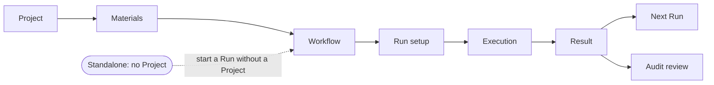
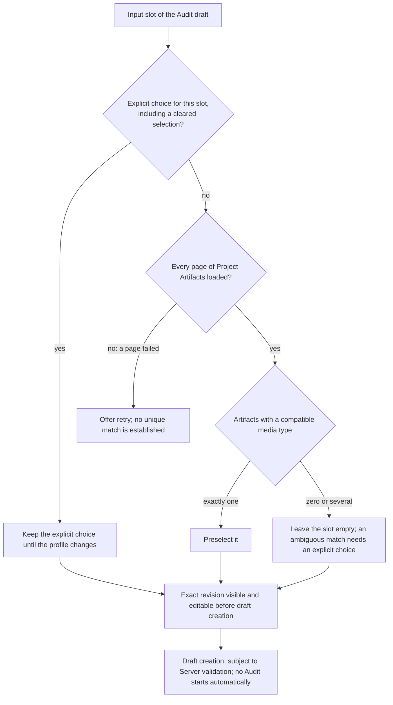
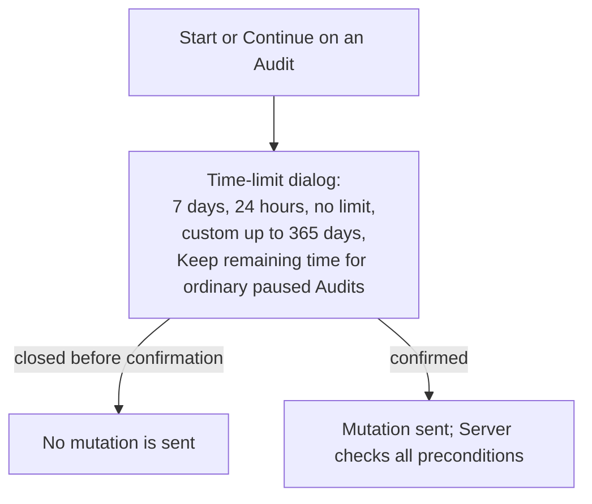

# UI journeys

Requirement prefix: `UIJ` · [Specification index](../README.md)

## Purpose and scope

This document owns the user journeys the Web UI must support: the scenario
roles, the primary Project journey, the capabilities of the Workflow user
surface, and the user stories US-01 to US-11 with their completion criteria.
Within those stories it owns the Audit draft input selection, the Audit Start
and Continue time-limit dialog, the Audit lifecycle controls, finding detail
and navigation between reviews and their subjects.

Other documents own the adjacent concepts:

- UI architecture, the navigation rail and Inbox, routes, the Run setup
  drawer, Workflow discovery cards and version ordering, Project sections and
  Overview, Audit Overview, the configuration workspace dialogs, UI language and
  accessibility: [UI](ui.md).
- Project artifact upload shortcuts, per-slot confirmation of Run-draft
  inputs and the Project HTTP target dialog:
  [Projects](../artifacts/projects.md).
- Project deletion and its confirmation:
  [Retention and deletion](../artifacts/retention-and-deletion.md).
- The Git-import dialog and Git provenance: [Git import](../artifacts/git-import.md).
- The WorkflowRun resource, create idempotency, metadata labels and their
  bounds, cancellation, manual continuation of a failed Run and the
  repeat-draft projection: [Runs](../execution/runs.md).
- StageExecutions, retries and escalation: [Scheduler](../execution/scheduler.md).
- The Stage objective as the global task and Planner subtasks:
  [Planners](../execution/planners.md).
- Workflow input and output slots and the output-slot `primary` marker:
  [Workflows](../configuration/workflows.md).
- ModelPolicy and ExecutionConfig selection and escalation profiles:
  [AgentTemplates](../configuration/agent-templates.md).
- RuntimeConfig, Runtime labels, credentials, explicit-null overlays and the
  effect copy for new Run snapshots versus future allocations:
  [RuntimeConfig](../configuration/runtime-config.md); Caido configuration:
  [HTTP and Caido tools](../tools/http-caido.md).
- The Audit time limit and its semantics: [Audits](../audits/audits.md) and
  [Audit execution](../audits/execution.md).
- The review ledger, finding decisions, proposed report reads and the Reviews
  view actions: [Review and reports](../audits/review-and-reports.md).
- Managed Eval experiments, their denominators, metrics and assessment
  authority: [Managed Evals](../evals/managed-evals.md).
- The Runtime readiness overview, performance metrics and profiling:
  [Operations](../operations/operations.md).

## Concepts

Each term is defined once in the [glossary](../glossary.md).

- **Analyst / researcher** — the scenario role that prepares materials, starts
  analyses, reads results and makes Audit decisions.
- **Workflow / agent author** — the scenario role that selects and checks
  published definitions, reads prompts and compares behavior variants.
- **Operator** — the scenario role that monitors execution and resources,
  changes settings and resolves infrastructure issues that cause waits or
  failures.
- **Primary journey** — the path Project → materials → Workflow → Run setup →
  execution → result → next Run or Audit review.
- **User story** — one user goal with completion criteria, identified as
  US-01 to US-11; US-*nn* corresponds to UC-*nn* of the usability study.
- **Workflow user surface** — the UI capabilities for discovering published
  Workflows and configuring, starting, following and inspecting their Runs
  (UIJ-R5 to UIJ-R20).
- **Format match** — a MIME-based suggestion of an input, which requires user
  review and does not prove semantic suitability.
- **Time-limit dialog** — the dialog that Start and Continue open on an Audit
  to choose its time limit before the mutation is sent.
- **Keep remaining time** — the time-limit option that omits the API override,
  so a paused Audit keeps its remaining allowance or its no-limit mode.

## Model

### Roles

The roles describe user scenarios; UIJ-R1 states how they relate to authorization.

| Role | Activities |
| --- | --- |
| Analyst / researcher | Prepares materials, starts analyses, reads results and makes Audit decisions |
| Workflow / agent author | Selects and checks published definitions, reads prompts and compares behavior variants |
| Operator | Monitors execution and resources, changes settings and resolves infrastructure issues that cause waits or failures |

### Primary journey

### User stories

Each story states a user goal; its completion criteria are the requirements in
the matching subsection of [Requirements](#requirements). US-*nn* corresponds
to UC-*nn* of the usability study.

| Story | Title | Goal |
| --- | --- | --- |
| US-01 | Prepare a Project | As an analyst, I want to collect source code, the target and results in one Project so that I can continue and repeat work on the same subject. |
| US-02 | Choose an analysis by its intended result | As a user, I want to find a Workflow by its purpose and expected result so that I can choose an analysis without first learning about Stages and internal names. |
| US-03 | Configure and start a Run without losing input | As an analyst, I want to select suitable inputs, add a file if necessary and return to unfinished setup so that I do not have to assemble the request again. |
| US-04 | Understand execution progress and waits | As a user, I want to see the current work and the reason for a wait so that I can decide whether to intervene or wait for execution to continue. |
| US-05 | Retrieve and use a result | As an analyst, I want to find the primary result immediately and open a specific document so that I can assess it and continue working with it. |
| US-06 | Fix the cause and repeat an analysis | As a user, I want to open a new draft from a previous Run with the same inputs and parameters so that I can repeat the work after fixing an error. |
| US-07 | Conduct an Audit and make decisions | As a researcher, I want to see check progress, gaps and pending decisions so that I can assess findings against their evidence and accept the report. |
| US-08 | Inspect an agent and its prompt | As a Workflow author, I want to open an exact agent version, read its base prompt, Skills and tools, and see the Workflows that use it so that I can understand its behavior. |
| US-09 | Find and inspect the right file | As an analyst, I want to add a file and see its purpose, revision and provenance so that I can select the right material and reproduce the result. |
| US-10 | Compare variants through Evals | As an agent author, I want to define variants, shared cases and a repeat count so that I can compare results, duration and token usage using comparable data. |
| US-11 | Monitor and configure execution | As an operator, I want to see Runtime readiness, Server load and database state, and understand the impact of settings before changing them, so that I can resolve execution blockers and manage resources. |

### Audit draft input selection

Automatic selection for one input slot of an Audit draft (UIJ-R69 to
UIJ-R74):

### Audit time-limit dialog

## Requirements

### Users and the primary journey

**UIJ-R1.** The analyst, author and operator roles are roles in user
scenarios, not authorization roles: one person can perform all three functions,
and Server continues to determine access.

**UIJ-R2.** The UI supports the primary journey: Project → materials →
Workflow → Run setup → execution → result → next Run or Audit review.

**UIJ-R3.** Starting a Run without a Project is a supported standalone
scenario.

The main navigation, the rule that the user journeys add no navigation items,
and the Inbox at `/` with decisions first, then blocked work, finished results
and running checks, are specified in [UI](ui.md).

**UIJ-R4.** The story identifiers US-01 to US-11 correspond to UC-01 to UC-11
of the usability study and remain stable as the interface changes.

### Workflow user surface

**UIJ-R5.** The Workflow user surface lists published Workflow names and their
exact versions.

**UIJ-R6.** It renders the Run string parameters and input Artifact slots from
the selected Workflow contract.

**UIJ-R7.** For an input, the user can upload a UserScope Artifact or select an
existing exact version.

**UIJ-R8.** When a Run execution override is desired, the user selects
published ModelPolicy, LLMGatewayConfig and credential refs; the surface shows
any Workflow-pinned ExecutionConfig escalation profiles.

**UIJ-R9.** The user can select zero or more active `runtimeLabels`, such as
`debug` or `caido`, for the concrete Run, and the surface shows their exact
pinned RuntimeConfig refs.

**UIJ-R10.** The user can attach bounded immutable key/value metadata labels
to a Run; the surface displays them separately from Runtime configuration and
filters Runs by exact label conjunctions. The label bounds are owned by
[Runs](../execution/runs.md).

**UIJ-R11.** The user can create an idempotent WorkflowRun and cancel a
non-terminal Run.

**UIJ-R12.** The user can explicitly continue an eligible failed Run from its
failed stage, preserving successful stages and pinned inputs and
configuration.

**UIJ-R13.** From a terminal ordinary Run, the user can open a separately
reviewed draft for another Run that uses the available exact original source
refs without changing history.

**UIJ-R14.** The surface lists Runs and shows their durable lifecycle.

**UIJ-R15.** For a Run, the surface shows ordered Stages, attempts,
retry/escalation decisions, effective executionConfig refs, termination
reasons and the currently active StageExecution.

**UIJ-R16.** For the active Stage, the surface shows its immutable objective as
the global task, its ordered validated Planner subtasks, the current subtask
and the optional active logical Worker dispatch.

**UIJ-R17.** Planner subtasks are not rendered as additional Workflow Stages.

**UIJ-R18.** The surface shows exact input, intermediate, frozen output and
lineage metadata.

**UIJ-R19.** The surface previews bounded UTF-8 Markdown, YAML, JSON, OpenAPI
and LikeC4 artifacts, plus selected HTTP exchanges, and retains an explicit
download action for the original bytes.

**UIJ-R20.** The surface shows bounded Planner, Worker and Runtime metrics
without exposing prompts, tool payloads, provider bodies or secrets.

### US-01 — Prepare a Project

**UIJ-R21.** Project sections provide actions to add materials and to choose an
analysis, with clear section navigation.

**UIJ-R22.** After an upload or Git import, the storage scope, the exact
revision and the next step are clear to the user.

**UIJ-R23.** The Project root is a short Overview of decisions, recent results
and activity; what it reads is specified in [UI](ui.md).

**UIJ-R24.** Artifacts, Workflows, Runs, Audits, Findings and Settings are
independent screens with common navigation.

**UIJ-R25.** The Project Run history has Server-backed state filters and
compact rows.

**UIJ-R26.** Upload and exact Project Run setup open on demand.

**UIJ-R27.** Filters, selected versions and return context survive the
corresponding navigation.

The upload shortcuts (Sources, OpenAPI, LikeC4, Docs, Diffs, Other), each
opening the same Project Artifact upload dialog with a reviewable suggested
namespace, media type and icon, are specified with their table in
[Projects](../artifacts/projects.md) (PRJ-R15). The Project target dialog,
which selects or creates an origin credential, clears entered secrets and
recovers from a failed Project CAS update after credential creation without
resubmitting the secret, is specified in [Projects](../artifacts/projects.md)
(PRJ-R87, PRJ-R88, FAIL-PRJ-6).

**UIJ-R28.** Project deletion is available through secondary actions with the
existing confirmation ([DEL-R39](../artifacts/retention-and-deletion.md)).

**UIJ-R29.** Project cards also expose a named Delete icon, whose confirmation
requires the current Project name
([DEL-R39](../artifacts/retention-and-deletion.md)).

**UIJ-R30.** While a Project deletion is pending, the UI disables repeat
submission and provides a link to the deletion status (FAIL-UIJ-6).

**UIJ-R31.** A stale Project revision requires refreshed data and a new
confirmation before deletion (FAIL-UIJ-6).

### US-02 — Choose an analysis by its intended result

**UIJ-R32.** The catalog shows each Workflow's description, required materials
and outputs.

**UIJ-R33.** Catalog search covers all published entries.

**UIJ-R34.** The exact selected version is visible before launch.

**UIJ-R35.** Execution details are available separately.

**UIJ-R36.** A missing description is not replaced by a guess based on the
name.

The default version, the Latest marking and refresh behavior follow the shared
Workflow version ordering of the discovery cards in [UI](ui.md).

### US-03 — Configure and start a Run without losing input

**UIJ-R37.** Local upload, the library and the existing Git import are
available from the relevant input slot.

**UIJ-R38.** Navigating through the application and closing the Run form
preserve the draft in the current tab (LIFE-UI-2 in [UI](ui.md)).

**UIJ-R39.** Returning restores the draft for the same user, Workflow and
version, and Project.

**UIJ-R40.** An explicit reset requires confirmation when input is present.

**UIJ-R41.** A successful launch completes the draft.

**UIJ-R42.** Sensitive input is not automatically written to browser storage.

**UIJ-R43.** MIME-based suggestions are labeled as format matches and require
user review.

**UIJ-R44.** The interface must not claim that a document's semantic
suitability is proven.

**UIJ-R45.** The Run form and its nested dialogs are fully usable with the
keyboard.

Per-slot confirmation of a Run-draft input, including how it behaves when an
inventory refetch or a changed suggestion arrives, is specified in
[Projects](../artifacts/projects.md) (PRJ-R39 to PRJ-R44).

### US-04 — Understand execution progress and waits

**UIJ-R46.** Run and Queue show the reason for a wait known to Server, the next
available step and a link to the relevant diagnostics.

**UIJ-R47.** An already scheduled Scheduler retry, a wait for Runtime capacity
and the option to create another Run are shown as distinct.

**UIJ-R48.** An unknown wait reason remains unknown.

**UIJ-R49.** An idle Runtime is not presented as a guarantee of compatible
capacity.

**UIJ-R50.** Queue and Run triage remain in Runs.

### US-05 — Retrieve and use a result

**UIJ-R51.** Primary outputs are highlighted using the published `primary`
flag ([Workflows](../configuration/workflows.md)).

**UIJ-R52.** A supported small file opens through one explicit action on that
file.

**UIJ-R53.** An unsupported preview offers an explanation and Download.

**UIJ-R54.** All outputs and their exact revisions remain available.

**UIJ-R55.** A missing primary output is not hidden by selecting an arbitrary
file.

**UIJ-R56.** Opening a Run does not require downloading every output.

**UIJ-R112.** Opening HTTP evidence from Run materials or a possible issue
shows the saved request and available response, including missing or incomplete
outcomes, under [UI-R192 to UI-R195](ui.md). Full traffic remains in Caido
when routed through it; unselected traffic is not an ordinary HTTP material.
A large or unsupported preview explains the limit and offers Download.

### US-06 — Fix the cause and repeat an analysis

**UIJ-R57.** The repeat action prefills the available original settings,
preserves the Project context and prompts the user to review them before
launch.

**UIJ-R58.** Unavailable versions, credentials or inputs are clearly marked.

**UIJ-R59.** A missing or invalid saved request blocks Repeat with an
explanation and no draft (FAIL-RUN-8 in [Runs](../execution/runs.md)); the
user can configure a new Run from the Workflow.

**UIJ-R60.** The old Run and its history remain unchanged; repeating creates a
new Run only after explicit submission.

**UIJ-R61.** For an Audit-managed Run, new execution goes through the
controlling Audit, without copying its internal labels into an ordinary user
request.

### US-07 — Conduct an Audit and make decisions

#### Summary and review navigation

**UIJ-R62.** The Audit summary links to the corresponding complete filtered
lists.

**UIJ-R63.** Technical success, coverage completeness and the researcher's
decision are shown separately.

**UIJ-R64.** Each review links directly to its exact finding or proposed
report with retained evidence, so a pending review opens that subject with its
exact evidence in one action.

**UIJ-R65.** The return link from a review subject preserves the queue URL,
filters and cursor.

**UIJ-R66.** A missing subject or a mismatched revision shows an
unavailable/stale state without an actionable decision (FAIL-UIJ-4).

**UIJ-R67.** Approval and rejection of a proposed report are offered alongside
that report, and only for its matching pending request (FAIL-UIJ-4).

**UIJ-R68.** A conflict refreshes the evidence without replaying a mutation
(FAIL-UIJ-4).

The ETag of an exact review read, the proposed report read with its exact
review request and retained bytes under an Audit revision fence, the rule that
historical or unavailable report requests cannot silently decide a replacement
report, and duplicate finding decisions that accept an exact same-Audit target
ID from another page are specified in
[Review and reports](../audits/review-and-reports.md). So are the Reviews view
for pending item-action requests, the `approve`, `reject` and `not_applicable`
actions of applicability reviews, the approve/reject actions of other item and
report reviews, and the proposed report that is readable before acceptance but
never presented as an accepted result.

#### Audit draft inputs

**UIJ-R69.** The Audit draft form loads every page of Project Artifacts before
automatically selecting an input.

**UIJ-R70.** For a slot without an explicit choice, the form preselects the
artifact with a compatible media type only when exactly one exists; zero or
multiple candidates leave the slot empty, and an ambiguous match requires an
explicit choice.

**UIJ-R71.** Explicit choices, including clearing a selection, are preserved
until the profile changes.

**UIJ-R72.** A failed inventory page offers retry and cannot establish a unique
match (FAIL-UIJ-1).

**UIJ-R73.** The selected exact revision remains visible and editable before
draft creation and remains subject to Server validation.

**UIJ-R74.** Media-type compatibility is not semantic validation and never
starts an Audit automatically.

#### Audit controls and time limit

**UIJ-R75.** Audit cards and detail views expose accessible Start, Pause new
Audit Runs, Continue Audit, Cancel and Delete controls where applicable. The
exact pause wording is owned by [UI](ui.md).

**UIJ-R76.** Audit icon actions retain accessible names and explanatory
tooltips.

**UIJ-R77.** Start and Continue open a time-limit dialog offering seven days
(LIM-UIJ-1), 24 hours (LIM-UIJ-2), no limit and a custom duration bounded to
365 days (LIM-AUD-23 in [Audits](../audits/audits.md)).

**UIJ-R78.** Seven days is the UI default for Start and for resuming after the
time limit (LIM-UIJ-1).

**UIJ-R79.** For ordinary paused Audits the dialog defaults to Keep remaining
time, which omits the API override and also preserves no-limit mode.

**UIJ-R80.** The dialog explains that queue waiting consumes time, that Audit
pauses do not consume it, and that reaching the limit pauses new Runs while
in-flight Runs may finish after the limit. These semantics are owned by
[Audits](../audits/audits.md) and [Audit execution](../audits/execution.md).

**UIJ-R81.** Closing or dismissing the time-limit dialog before confirmation
sends no mutation (FAIL-UIJ-2).

**UIJ-R82.** Continue is offered only for paused Audits; terminal Audits
(completed, failed and cancelled) remain final and have no Resume action.

**UIJ-R83.** Server remains authoritative for all preconditions of these
controls (FAIL-UIJ-2).

**UIJ-R84.** Audit cancellation and deletion require a confirmation dialog that
explains the consequences; dismissing the confirmation changes nothing
(FAIL-UIJ-2).

**UIJ-R111.** Delete is offered in every Audit state except `deleting`, as the
Server accepts it: drafts and ended Audits are deleted directly, while running
work is stopped first and the deletion intent kept
([REV-R163](../audits/review-and-reports.md)), also during the report decision
([AUD-R222](../audits/audits.md)). The confirmation says when deleting stops
running work first.

#### Finding detail

**UIJ-R85.** Finding detail offers True positive / False positive, severity
and rationale controls, plus duplicate and reopen actions and the decision
history.

**UIJ-R86.** Finding detail shows the source Workflow and checklist separately
from verification Workflows and attempts.

**UIJ-R87.** Deleted Runs keep readable provenance in finding detail instead
of broken-only links.

**UIJ-R88.** Unreviewed findings display no analyst rating.

**UIJ-R89.** After a conflict, a stale edit refetches the current state and
never silently overwrites another decision (FAIL-UIJ-3).

The analyst verdict and severity model, reopening and duplicate decisions, and
the provenance the Audit retains for deleted Runs are specified in
[Review and reports](../audits/review-and-reports.md).

### US-08 — Inspect an agent and its prompt

**UIJ-R90.** Agent versions are selected from published definitions.

**UIJ-R91.** Agent search is not limited to the current page.

**UIJ-R92.** Agent usage links lead to exact Workflow versions.

**UIJ-R93.** The base prompt is clearly distinguished from the actual context
of an individual invocation.

Agent detail's Preview, Source and Copy actions are specified in [UI](ui.md).

### US-09 — Find and inspect the right file

**UIJ-R94.** A file can be added directly during Run setup.

**UIJ-R95.** A file can be inspected before it is bound to a slot.

**UIJ-R96.** A file opens without unnecessary expansion steps.

**UIJ-R97.** The exact revision and, when present, the Git commit are
available.

**UIJ-R98.** Full history, lineage and diagnostics do not obscure the primary
actions.

**UIJ-R99.** An update conflict offers a way to inspect the current state or
to choose a new name, and never results in a silent overwrite (FAIL-UIJ-5).

### US-10 — Compare variants through Evals

**UIJ-R100.** The Evals journey supports experiment setup and comparison by
case and sample for Workflow or Audit variants, in both native and external
control modes.

**UIJ-R101.** The browser journey supports configure, prepare, start, review
and compare, as designed in the
[Evals experience design](../../evals-experience-design.md).

**UIJ-R102.** Missing, repeated and failed attempts are shown explicitly.

**UIJ-R103.** Quality, token, duration and paired-difference views and the
progress charts use the same complete data as the comparison tables.

That one sample is one Run or one whole Audit and child Runs do not increase
the denominator; that missing metrics are not zero; that successful execution
alone does not imply high quality and quality assessment requires an
explicitly selected evaluator or a human decision; that native execution is
independent of Playground while optional external clients use the same public
protocol; and that grouping ordinary Runs by `eval.*` labels remains available
as legacy history, are specified in [Managed Evals](../evals/managed-evals.md).

### US-11 — Monitor and configure execution

**UIJ-R104.** The Operations overview explains state and availability.

**UIJ-R105.** Configuration forms open through Create and Edit actions.

**UIJ-R106.** Changes and their scope are visible before saving.

**UIJ-R107.** Publishing a RuntimeConfig is not presented as changing an
allocation already in progress.

**UIJ-R108.** Revision and snapshot details are available in diagnostics.

**UIJ-R109.** Permissions and the disabled state of metrics reflect Server's
state.

**UIJ-R110.** RuntimeConfig lists and detail preserve the Caido configuration
and its explicit-null overlay semantics, as defined by
[RuntimeConfig](../configuration/runtime-config.md) and
[HTTP and Caido tools](../tools/http-caido.md).

The readiness overview's observed idle, busy, reserved, draining and fenced
states, and the rule that idle alone does not promise compatible capacity, are
specified in [Operations](../operations/operations.md). The binding forms'
current-versus-proposed display and stale-revision reload, the named icon
actions of the Runs Configuration workspace that open the RuntimeConfig
publication and Runtime credential dialogs, binding dialogs that open for the
exact selected version and show whether bindings already exist, and the
clearing of unsaved secret fields when a credential dialog closes are specified
in [UI](ui.md). The scope copy that distinguishes new Run snapshots from future
Agent-label allocation resolution, with prepared allocations keeping their
pinned settings, is specified in
[RuntimeConfig](../configuration/runtime-config.md).

Server and PostgreSQL charts, final allocation metrics, collection intervals,
disabling metrics and independent Go profiling, including the absence of a
browser pprof toggle, are specified in
[Operations](../operations/operations.md).

## Limits, failures and errors

Limits ([registry](../platform/limits.md)):

- LIM-UIJ-1 — Audit time-limit dialog: seven-day preset, the UI default for
  Start and for resuming after the time limit (UIJ-R77, UIJ-R78).
- LIM-UIJ-2 — Audit time-limit dialog: 24-hour preset (UIJ-R77).

The custom duration's 365-day bound is LIM-AUD-23, owned by
[Audits](../audits/audits.md); the time-limit dialog is one of its enforcement
points (UIJ-R77).

Failure outcomes ([failure model](../platform/failure-model.md)):

- FAIL-UIJ-1 — Audit draft form loading every page of Project Artifacts before
  automatic input selection (UIJ-R72).
- FAIL-UIJ-2 — Audit Start, Continue, Cancel and Delete mutations from the
  Audit controls (UIJ-R81, UIJ-R83, UIJ-R84).
- FAIL-UIJ-3 — finding decision edit from finding detail (verdict, severity,
  rationale, duplicate, reopen) (UIJ-R89).
- FAIL-UIJ-4 — review decision (approval or rejection) offered from review
  navigation (UIJ-R66 to UIJ-R68).
- FAIL-UIJ-5 — Artifact update in the file journey (US-09) (UIJ-R99).
- FAIL-UIJ-6 — Project deletion submitted from a Project card or the Project
  secondary actions (UIJ-R30, UIJ-R31).

The repeat-draft failure is FAIL-RUN-8 ([Runs](../execution/runs.md)); the
Project target credential-then-CAS failure is FAIL-PRJ-6
([Projects](../artifacts/projects.md)); the lost Project DELETE response is
FAIL-DEL-2 ([Retention and deletion](../artifacts/retention-and-deletion.md)).

Lifecycle ([registry](../platform/lifecycle.md)): the in-memory Run draft of
UIJ-R38 to UIJ-R42 is LIFE-UI-2 ([UI](ui.md)); Project deletion is LIFE-DEL-2
([Retention and deletion](../artifacts/retention-and-deletion.md)).

This document owns no error codes.

## Security

Security-relevant requirements: scenario roles grant no authorization and
Server determines access (UIJ-R1); execution overrides select published refs,
including credential refs, rather than secret values (UIJ-R8); displayed
metrics never expose prompts, tool payloads, provider bodies or secrets
(UIJ-R20); sensitive Run-setup input is not automatically written to browser
storage (UIJ-R42); and Server remains authoritative for Audit control
preconditions and draft validation (UIJ-R73, UIJ-R83). The Project target
dialog's secret handling is in [Projects](../artifacts/projects.md) (PRJ-R87,
PRJ-R88) and the credential dialog's secret clearing in [UI](ui.md). Shared
rules are in [Security](../platform/security.md).

## Observability

Run detail shows bounded Planner, Worker and Runtime metrics without prompts,
tool payloads, provider bodies or secrets (UIJ-R20), and the disabled state of
metrics reflects Server's state (UIJ-R109). Metric collection and profiling are
in [Operations](../operations/operations.md); shared rules are in
[observability](../platform/observability.md).

## Invariants

1. The UI starts no work on the user's behalf: Runs are created, continued and
   repeated, and Audits are started, continued, cancelled or deleted, only
   after an explicit user action (UIJ-R11 to UIJ-R13, UIJ-R60, UIJ-R74,
   UIJ-R81, UIJ-R84).
2. Missing information is shown as missing, never guessed: descriptions,
   wait reasons, primary outputs and analyst ratings (UIJ-R36, UIJ-R48,
   UIJ-R55, UIJ-R88).
3. A format match never stands for semantic validation (UIJ-R43, UIJ-R44,
   UIJ-R74).
4. Server remains authoritative for access, validation and preconditions
   (UIJ-R1, UIJ-R73, UIJ-R83).

## Non-goals

- Persistence of a Run draft across a tab reload is not guaranteed, because
  sensitive input is not automatically written to browser storage (UIJ-R42).
- Comparing prompts across Agent versions is not supported.
