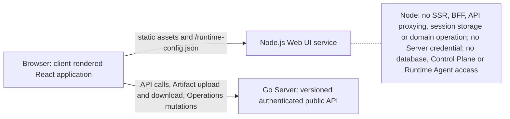
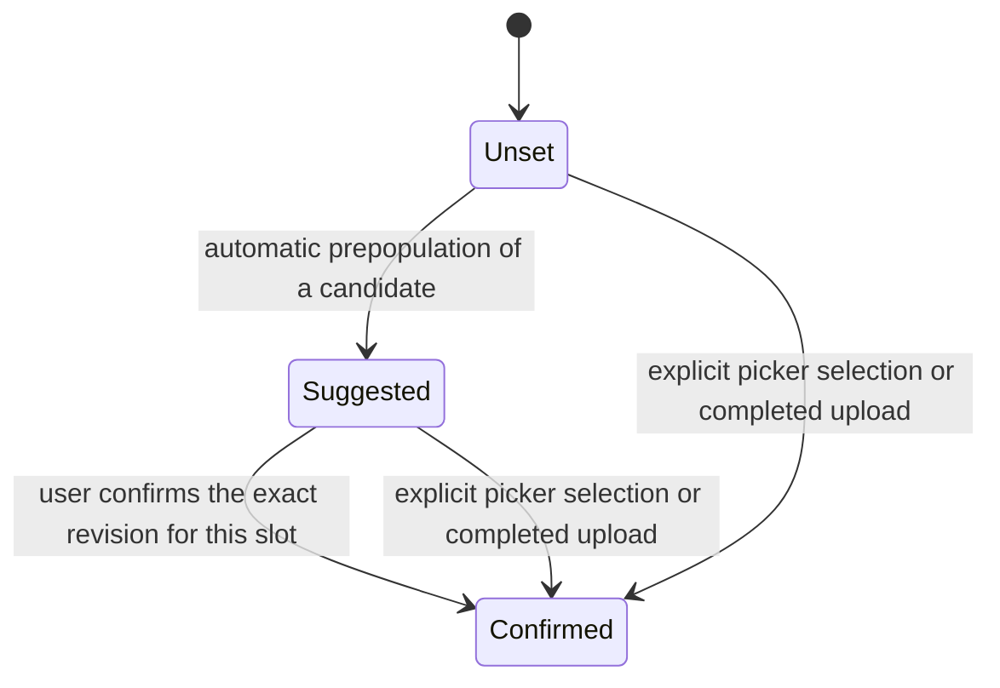
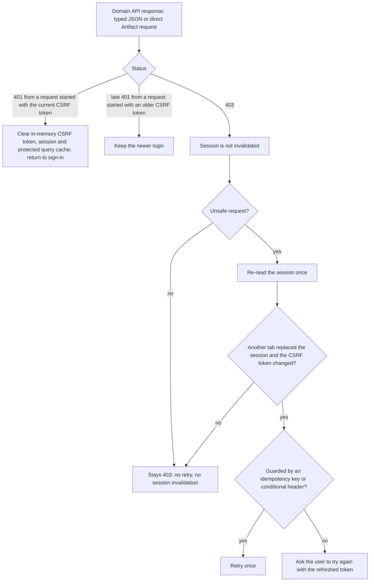

# Web UI

Requirement prefix: `UI` · [Specification index](../README.md)

## Purpose and scope

This document owns the Contractor Web UI: its deployment boundary and frontend
architecture, the shared cache of Server state and data freshness, browser
session recovery, the information architecture (the navigation rail, routes,
the Library, the consolidated Runs surface, Project and Audit sections), UI
vocabulary, accessibility, and the presentation rules of the Catalog, Run
setup, Project, Audit and Operations surfaces.

Other documents own the adjacent concepts:

- The user journeys the UI must support, including the capabilities of the
  Workflow user surface and the primary Project journey:
  [UI journeys](journeys.md).
- Public API conventions (authentication, sessions, CSRF, pagination,
  idempotency, the error envelope, the live event WebSocket), and the rule that
  UI-oriented query endpoints may aggregate existing durable or read-model
  state while mutations call the same domain application services as non-UI
  API clients: [Public API](../api/public-api.md).
- Trust boundaries and the shared security model:
  [Security](../platform/security.md).
- Projects, ProjectScope, the Project artifact shortcuts, Workflow
  recommendations, Evals Projects and the Queue read API:
  [Projects](../artifacts/projects.md).
- The WorkflowRun resource, its lifecycle, resume and metadata labels:
  [Runs](../execution/runs.md).
- Explicit terminal Run deletion and recoverable Project deletion:
  [Retention and deletion](../artifacts/retention-and-deletion.md); the
  durable queue admission gate (owner Queue Pause):
  [Scheduler](../execution/scheduler.md).
- RuntimeConfig versions, label bindings, runtime credentials and Agent labels:
  [RuntimeConfig](../configuration/runtime-config.md).
- The Operations Overview, Runtime Agent cards, the Scheduler settings
  resource, the performance page and allocation history:
  [Operations](../operations/operations.md).
- Git import and the owner Git SSH key: [Git import](../artifacts/git-import.md).
- Agent Skill packages and the SkillCatalog: [Skills](../tools/skills.md).
- Managed Evals: [Managed Evals](../evals/managed-evals.md).
- Audits: [Audits](../audits/audits.md),
  [Audit execution](../audits/execution.md) and
  [Review and reports](../audits/review-and-reports.md).
- AgentTemplates: [AgentTemplates](../configuration/agent-templates.md).
- Artifact list filters and their pagination semantics:
  [ArtifactStore](../artifacts/artifact-store.md).

## Concepts

Each term is defined once in the [glossary](../glossary.md).

- **Web UI** — the separately deployable Node.js service and the
  client-rendered single-page application it serves; it uses the Server's
  public API and is not a second Scheduler, configuration resolver or source of
  lifecycle truth.
- **Runtime config document** — the non-secret `/runtime-config.json` that
  Node serves, holding exactly the UI version, the supported API versions and
  one absolute `apiBaseUrl`.
- **Transport adapter** — the small handwritten adapter around the generated
  TypeScript API client that alone handles the base URL, session cookie, CSRF
  token, idempotency and precondition headers and error mapping.
- **Navigation rail** — the top-level navigation, in three groups: main,
  secondary and bottom.
- **Inbox** — the destination at `/` that lists decisions first, then blocked
  work, finished results and running checks.
- **Library** — the user-facing name of the Catalog, which groups reusable
  execution definitions.
- **Check type** — the user-facing name of an AuditProfile.
- **Runs surface** — the single **Runs** destination with its Queue and
  Completed views.
- **Run draft** — the in-memory, unsubmitted Run request for one exact Workflow
  version and scope, with its slot confirmations.
- **Format-only suggestion** — an automatically prepopulated Artifact candidate
  for a Workflow input slot whose exact revision the user has not confirmed.
- **Run setup drawer** — the Configure Run surface: a drawer on desktop and a
  full-width panel on mobile.
- **Workflow discovery card** — the card that Project and Catalog share for one
  logical Workflow name, with its version selector.
- **Project Overview** — the bounded root page of a Project.
- **Audit workspace snapshot** — the owner-scoped SQL snapshot that
  `GET /v1/audits/{auditId}/workspace` returns for the Audit pages.

## Model

### Deployment structure



### Navigation

The navigation rail has three groups: main (Inbox to Reports), secondary (Runs,
Library, Evals) and bottom (Operations and the Account menu).

```text
Inbox (/)             decisions, blocked work, finished results, running checks
Projects (/projects)
Checks (/checks)      Audits across Projects
Issues (/issues)      findings across Projects
Reports (/reports)    Audit reports across Projects

Runs (/runs)          Queue (default), Completed, Run details
Library (/catalog)    Check types, Workflows, Agents, Skills, Files (/artifacts)
Evals (/evals)

Operations            Runtime Agents, Allocations, LLM configurations,
(/operations)         Credentials, Settings
Account menu          signed-in user, Settings, Theme, Sign out, UI version
```

### Runs surface

```text
Runs
  Queue       default; initializing | pending | running | waiting | cancelling
  Completed   succeeded | failed | cancelled
```

### Run input review

Each Artifact input slot of a Run draft is reviewed separately. A format-only
suggestion becomes a confirmed slot only through the user's action for that
one slot.



Form readiness reports three separate conditions: missing fields, pending input
review, and a request ready for submission.

## Requirements

### Deployment boundary

**UI-R1.** Contractor deployment includes one separately deployable Node.js
Web UI for security Workflows, Project-bound Audits and single-VM operational
visibility.

**UI-R2.** The UI uses the Server's public API; it does not become a second
Scheduler, configuration resolver or source of lifecycle truth.

**UI-R3.** The Web UI is its own Node.js build artifact and runtime service.
The Go Server embeds and serves no HTML, JavaScript, CSS or other frontend
asset.

**UI-R4.** Rebuilding, releasing, restarting or rolling back the Web UI does
not rebuild or restart the Server, and Server startup and health never depend
on UI availability. Both services may run on the same VM.

**UI-R5.** The only product contract between the Web UI and the Server is the
versioned authenticated public Server API.

**UI-R6.** The UI build records its own version and its supported Server API
versions. It must show an explicit incompatible-version error rather than
guessing around a missing or changed field.

**UI-R7.** Additive API changes within a supported version do not require a
coordinated release.

**UI-R8.** The UI is a client-rendered frontend. Node serves its static
assets and a non-secret `/runtime-config.json`; it performs no SSR, BFF, API
proxying, session storage or domain operation.

**UI-R9.** The runtime config contains exactly the UI version, the supported
API versions and one absolute `apiBaseUrl` (LIM-UI-1), so the same UI build
can target another Server without rebuilding.

**UI-R10.** `apiBaseUrl` has no userinfo, query or fragment and uses HTTPS;
HTTP is accepted only for a loopback origin in local development.

**UI-R11.** Browser code, not Node, calls the configured Go Server URL
directly through the authenticated public Server APIs, including for Artifact
upload and download and Operations mutations.

**UI-R12.** Node receives no Server credential and has no database, Control
Plane or Runtime Agent access.

**UI-R13.** Existing API clients can perform the same domain operations
without using the Web UI.

### Frontend implementation

**UI-R14.** The UI is a React single-page application written in TypeScript
with strict type checking. Vite builds the browser bundle.

**UI-R15.** React Router is used in Data Mode with browser history.

**UI-R16.** The Node static server returns `index.html` for known
client-route fallbacks, but never uses that fallback for assets,
`/runtime-config.json` or unknown API-looking paths. A route segment that names
a configuration accepts exactly the grammar of its public schema
(ConfigurationName and ConfigVersion, or RuntimeInfrastructureId and
RuntimeConfigVersion for Runtime configurations), so a direct link to any valid
version, including one with `+`, loads.

**UI-R17.** TanStack Query is the only shared cache of Server state. It owns
API queries, mutations, invalidation, refetch and the selected live-update
policy.

**UI-R18.** Router, form and transient presentation state stay local to the
narrowest route or component that needs them. The UI has no Redux, Zustand or
second client-side copy of the Workflow/Run domain model.

**UI-R19.** The UI build pins the exact public contract and a deterministic
TypeScript client generator. Generated DTO and client files are not
hand-edited, and CI fails when regeneration produces an uncommitted diff.

**UI-R20.** A small handwritten transport adapter around the generated client
is the only place that:

- resolves `apiBaseUrl` from the runtime config;
- opts into the session cookie and attaches the current CSRF token to unsafe
  requests;
- supplies the operation-specific `Idempotency-Key` and `If-Match` values
  provided by the caller;
- maps the specified success and error envelopes into one bounded client error
  type without logging response bodies or secrets.

**UI-R21.** The transport adapter does not implement domain transitions, does
not retry unsafe mutations with a new idempotency key and does not persist
credentials or session material (FAIL-UI-2).

**UI-R22.** Server contract tests exercise request and response examples
against the same OpenAPI document that the UI build pins.

**UI-R23.** Vite's transform is not the type-checking gate: CI separately
runs strict TypeScript checking.

**UI-R24.** Vitest and React Testing Library cover units and routed
components. Playwright covers browser behaviour against the real Node static
service and Go Server, including login and session recovery, CORS and CSRF
failure, one Run lifecycle, Artifact transfer and an authorized Operations
mutation.

**UI-R25.** The Node major version, the package-manager version, the
generator and all frontend dependencies are lockfile-pinned. Their upgrades
and the UI release remain independent of the Go Server release while the
supported API version overlaps.

### Server state and data freshness

**UI-R26.** The UI never predicts an authoritative Run, StageExecution,
allocation, configuration-publication or credential-operation transition.

**UI-R27.** A successful mutation causes the affected query keys to be
invalidated and refetched; only a subsequent Server response establishes the
displayed domain state (FAIL-UI-2).

**UI-R28.** Optimistic updates are allowed for purely local drafts, but not
for execution lifecycle, published configuration or credential state.

**UI-R29.** WebSocket Operations notifications remain hints: after a
process-generation or revision gap the UI refetches the authoritative REST
snapshot (FAIL-UI-8).

**UI-R30.** No mutation is sent over WebSocket.

### Browser session



**UI-R31.** An authoritative `401` from a domain API request clears the SPA's
in-memory CSRF token, authenticated session and protected query cache,
returning the user to sign-in (LIFE-UI-1). This applies to both typed JSON and
direct Artifact requests.

**UI-R32.** A `403` and failed login attempts do not invalidate a session.

**UI-R33.** A late `401` from a request started with an older CSRF token must
not invalidate a newer login.

**UI-R34.** After an unsafe request returns `403`, the SPA re-reads the
session once. If another tab replaced the session and the CSRF token changed,
it retries a request guarded by an idempotency key or conditional header once
(LIM-UI-2); other mutations ask the user to try again with the refreshed token
(FAIL-UI-1).

**UI-R35.** An unrelated origin or capability denial stays `403`, without a
retry loop or session invalidation.

**UI-R36.** This session handling does not require background session polling
that would extend idle expiry.

### Navigation and information architecture

**UI-R37.** The navigation is a rail of three groups (main, secondary,
bottom) with the destinations and routes shown in [Navigation](#navigation).

**UI-R38.** The rail is the main navigation; the user journeys in
[UI journeys](journeys.md) add no navigation items.

**UI-R39.** The Inbox at `/` puts decisions first, then blocked work, finished
results and running checks. Inbox decisions are pending Audit reviews for
finding triage of possible issues, active-check approval, requirement
applicability and report acceptance that can still be decided: the Inbox and
the rail badge read them from `GET /v1/reviews` with `state=pending`, which
leaves out a request past its expiry ([REV-R194](../audits/review-and-reports.md)),
as the workspace's pending count does (UI-R143).

**UI-R40.** An Audit page under `/projects/:projectId/audits/:auditId` marks
Checks as current in the rail.

**UI-R41.** Operations appears only with the `operations` capability;
Settings (`/operations/settings`, with the Git SSH key) does not need it.

**UI-R42.** Every existing destination stays reachable and every existing URL
loads directly.

**UI-R43.** The Catalog's canonical routes are `/catalog/audit-presets`
(Check types), `/catalog/workflows`, `/catalog/agents` and `/catalog/skills`;
`/catalog` opens Workflows. Exact Workflow details use
`/catalog/workflows/:name/:version`.

**UI-R44.** Runtime Agent processes stay in Operations, not in the Catalog.

**UI-R45.** The UI supports an extensible catalog of security checks and
supporting analyses.

**UI-R46.** Project artifact tiles may provide familiar OpenAPI, LikeC4,
source, documentation and diff icons, but they are shortcuts over arbitrary
ArtifactRefs rather than hard-coded Server modes. The shortcut set and its
presentation-only classification are owned by
[Projects](../artifacts/projects.md) (PRJ-R13, PRJ-R15, PRJ-R16).

**UI-R47.** Project Workflows offer Recommended and All Workflow launch
surfaces; their contents follow
[Projects](../artifacts/projects.md) (PRJ-R45, PRJ-R47, PRJ-R49).

**UI-R48.** Evals renders evaluation Projects and eval-specific label
grouping. The [experiment journey](../../evals-experience-design.md) makes
experiments the Evals entry point while preserving legacy workspace routes and
ordinary Run and Audit execution.

Browser Evals setup, launch and comparison, their chart projections and
evidence navigation, and the support for both Workflow and Audit experiments
without Playground are owned by [Managed Evals](../evals/managed-evals.md).

**UI-R49.** Skills is a global owner-level view over `skills/*` UserScope
artifacts and the existing SkillCatalog rules ([Skills](../tools/skills.md)).
A Project may show the Skills required by a candidate Workflow (PRJ-R21) only
read-only; it cannot own, copy or override them.

### Library

**UI-R50.** Agents, in the authenticated Library, lists exact published
AgentTemplate versions, with description and links to a read-only detail at
`/catalog/agents/:name/:version` that exposes the loaded base instruction
text.

**UI-R51.** Agent detail emphasizes the base instructions with Markdown
Preview, literal Source and Copy, alongside Skills, selected tools, Runtime,
sandbox and ModelPolicy.

**UI-R52.** Agent detail is read-only: it does not expose invocation context
or introduce a prompt editor.

**UI-R53.** The displayed instruction text is not an effective invocation
prompt: task context, conversation and expanded Skills are not included.

**UI-R54.** Markdown Preview executes no HTML and loads no remote images.

**UI-R55.** Workflow logical Worker bindings link to the exact AgentTemplate
version.

**UI-R56.** Agent discovery and exact Agent usage keep predecessor cursors for
the same route and filters in page navigation state. Item links and explicit
return links preserve that state, so Previous opens the preceding result page
independently of browser history.

**UI-R57.** Browser Back and Forward restore each visited page's cursor
context.

**UI-R187.** Changing the search or the Agent version resets pagination.

**UI-R58.** A directly opened later page with no known predecessor disables
Previous and offers First page for the same query.

**UI-R59.** Workflow family discovery shows the complete inventory
(UI-R62); its detail links preserve search and return context.

**UI-R60.** Catalog and Audit read projections filter before pagination.

#### Workflow discovery cards

**UI-R61.** Project and Catalog use the same Workflow identity, version
selector and card structure. Each logical name appears once (LIM-UI-3).

**UI-R62.** The Catalog reads all bounded pages before offering a default, so
a later page cannot hide a newer version.

**UI-R63.** Numeric versions, including dot-separated integer components, sort
by components without floating-point conversion; the highest is initially
selected and marked Latest. Other published labels use deterministic natural
ordering without a Latest claim.

**UI-R64.** An explicit older selection survives background refresh.

**UI-R65.** Changing a version changes its displayed inputs, outputs, matching
and exact-version actions together.

**UI-R188.** An already open Run setup remains pinned to its selected version.

**UI-R66.** Catalog cards display input and output contracts, primary-output
flags, formats and parameter counts.

**UI-R182.** Project cards display only the selected version's artifact
matches, ambiguous choices, missing requirements and primary outputs.

**UI-R183.** Matching media types is not proof of semantic suitability or
Runtime capacity.

**UI-R184.** Existing outputs suppress recommendations, but the suppressed
Workflows remain available through **All workflows**.

**UI-R185.** The UI never silently selects an older compatible version.

The Workflow recommendation model and the suppression rule for Workflows whose
primary outputs exist are defined in [Projects](../artifacts/projects.md)
(PRJ-R49).

**UI-R67.** Workflow quick starts use the complete Workflow inventory and the
same numeric version policy as Project and Catalog cards.

**UI-R186.** Project Workflow matching loads every Artifact page before
considering a unique MIME match; incomplete or cyclic pagination displays an
error with explicit retry and supplies no partial match (FAIL-PRJ-3).

#### Workflow detail

**UI-R68.** An exact Workflow detail route starts with an overview: one
identity heading, the version selector, input and output contracts and the
published stage objectives. It uses the Catalog card formats and version
ordering.

**UI-R69.** Loading the version inventory never replaces the version
specified by the URL. Latest and Earlier labels require a complete numeric
family containing that exact version.

**UI-R70.** An inventory failure leaves the exact contract available with an
explicit retry (FAIL-UI-3).

**UI-R71.** Authored descriptions and primary-output flags are shown only
when published.

**UI-R72.** Entry is identified independently of list order; multi-stage
summaries do not imply a linear execution graph.

**UI-R73.** Exact Agents, resolved execution settings and transitions remain
accessible in a disclosure.

### Run setup

The capabilities the Workflow user surface offers (Workflow and version
listing, parameter and input rendering, uploads, execution overrides, Runtime
label selection through `runtimeLabels` such as `debug` or `caido`, metadata
labels, creating, cancelling, continuing and
repeating Runs, Stage and Planner progress, artifact previews and bounded
metrics) are listed in [UI journeys](journeys.md).

**UI-R74.** Configure Run opens a standalone UserScope drawer on desktop and a
full-width panel on mobile.

**UI-R75.** The Workflow detail view itself does not acquire a Run draft or
fetch input inventories until setup opens.

**UI-R76.** Before execution settings, the Run form presents declared
parameters and exact Artifact inputs: Artifact inputs and required parameters
precede collapsed optional parameters and advanced settings.

**UI-R77.** The drawer reuses the shared modal stack, inert background,
keyboard focus containment and focus restoration; closed disclosure contents
are excluded from the focus loop. Nested upload, Git import and discard dialogs
close independently.

**UI-R78.** The `#workflow-run-setup` destination opens the drawer directly,
including for Run-repeat drafts.

**UI-R79.** Closing setup preserves the session-memory draft for its exact
Workflow version and scope (LIFE-UI-2). Included optional values reopen
visibly, including an explicit empty string.

**UI-R80.** The drawer leaves required input review, repeat review,
ambiguous-response recovery and exact-request idempotency unchanged
(FAIL-UI-4).

**UI-R81.** Close and Escape cannot dismiss setup while its submission is
pending.

**UI-R82.** Automatically prepopulated Artifact candidates remain visibly
marked as format-only suggestions until the user confirms their exact revision
for that one slot. Explicit picker selection and a completed upload count as
that slot's confirmation.

**UI-R83.** Readiness separately reports missing fields, pending input review
and a request ready for submission.

**UI-R84.** The retained in-memory draft stores the slot-to-exact-ref
confirmation and enough bounded metadata to keep a confirmed revision
inspectable across ordinary inventory refetches; it stores neither upload bytes
nor secrets (LIFE-UI-2).

**UI-R181.** A media-type recommendation does not establish semantic input
suitability: the retained Run draft requires explicit per-slot review of each
populated exact suggestion without changing Server media-type validation.

The media-type recommendation itself is defined in
[Projects](../artifacts/projects.md).

#### Repeating and continuing Runs

**UI-R85.** A repeat Run uses authorized exact source refs rather than
treating RunScope refs as UserScope or ProjectScope inputs.

**UI-R86.** A draft for another Run opened from a terminal ordinary Run seeds
a separate in-memory draft without replacing a mounted or edited draft for the
same Workflow and scope (LIFE-UI-2).

**UI-R87.** All retained values of a repeat draft require explicit review,
and every exact Artifact selection still requires the ordinary per-slot
confirmation.

**UI-R88.** Submission of a repeat draft uses the normal create endpoint and
a fresh draft idempotency identity; lost-response replay of the unchanged new
request uses that same identity (FAIL-UI-4).

**UI-R89.** A configured Scheduler retry is shown as an attempt within the
existing Run, while a terminal failure has no implied retry.

**UI-R90.** Known placement and Gateway states link only to diagnostics the
current user is authorized to read; unknown causes recommend inspecting the
durable attempt without inventing a capacity or recovery claim.

The **Continue from failed stage** action, its eligibility from
`RunStatus.resumeStageExecutionId`, its confirmation, the resume request
(`POST /v1/runs/{runId}/resume` with the expected `stageExecutionId`), its
idempotency identity and response, the post-request refresh of Run, Queue and
Project queries, and the execution and cleanup rules are specified in
[Runs](../execution/runs.md) (RUN-R55, RUN-R56, RUN-R57).

#### Labels on the Run form

That Run-create, list and detail expose the separate immutable `labels` map,
that its key/value editor and exact filters never share controls with
RuntimeConfig selection, and that conventional `eval.*` shortcuts are
presentation over the generic label query without an eval-only Server
execution path are specified in [Runs](../execution/runs.md) (RUN-R74,
RUN-R76).

**UI-R95.** The Run-create UI presents Runtime labels separately, as
infrastructure configuration.

**UI-R96.** Metadata labels use editable badges: `key:value` creates a pair,
and `key` creates a label with an empty string value. The UI does not offer
them as RuntimeConfig checkboxes.

**UI-R97.** Run list and detail show metadata labels independently from
pinned Runtime configuration provenance.

**UI-R98.** The label filter supports exact conjunctions and may provide
shortcuts for the conventional `purpose=eval`, `eval.name`, `eval.id` and
`eval.leg` keys without changing the generic API.

**UI-R100.** The UI must explain that metadata labels are immutable and
telemetry-visible.

**UI-R101.** The UI must not infer permissions, execution success or A/B
comparability from a label.

How the reserved default Runtime label binding, the default, Run and Agent
layers and the selected Agent labels are shown on the Run page, that a label
without a binding cannot be selected, and that the owner Run surface shows
labels and exact refs and digests rather than resolved credentials or physical
Runtime Agent configuration are owned by
[RuntimeConfig](../configuration/runtime-config.md).

### Runs surface

**UI-R102.** The navigation rail has one **Runs** destination, in its secondary
group, with two views: Queue (default) and Completed, holding the Run states
shown in [Runs surface](#runs-surface).

**UI-R103.** Queue renders the owner-scoped `/v1/queue` read projection of
[Projects](../artifacts/projects.md) (PRJ-R89 to PRJ-R94), including its
optional Project display context.

**UI-R104.** Completed uses the ordinary newest-first `/v1/runs` collection
with an additive `lifecycle=terminal` filter. The Server applies the filter
before keyset pagination; filtering one browser page is incorrect.

**UI-R105.** Exact `state` and metadata label filters may be combined with the
lifecycle filter by intersection, and all filters are bound into the cursor
kind.

**UI-R106.** The Queue and Completed views need not use the same endpoint.

Rationale: their ordering and display projections are different even though
both read `workflow_runs`.

**UI-R107.** The Queue view opens at `/runs`; Queue is not a separate rail
item.

### Projects

**UI-R108.** Project navigation leads to Overview, Artifacts, Workflows, Runs,
Audits, Findings and Settings at independent URLs under `/projects/:projectId`.

**UI-R109.** Add artifact is a contextual Artifacts action; Workflow cards open
exact Run setup.

**UI-R110.** The compact Project actions menu contains metadata refresh and the
existing confirmed deletion action
([Retention and deletion](../artifacts/retention-and-deletion.md)).

**UI-R189.** The Project header carries no duplicate Audits or Run analysis
shortcuts.

**UI-R111.** Cards are content-sized and do not stretch merely to match a
larger neighbouring contract.

**UI-R112.** The Project root is a bounded Overview rather than a concatenation
of every workspace collection. It reads:

- the Project's newest page of Audits, up to 50 (LIM-UI-4), the read the
  cross-project lists share;
- the first page of proposed findings of each of those Audits with the Server's
  total, keyed by the Audit revision, so an unchanged Audit is not read again
  and a changed one stays counted while its new revision loads;
- three Audits waiting for review (LIM-UI-5);
- five recent Runs (LIM-UI-6);
- three successful Runs (LIM-UI-7);
- a sample of current Artifacts: five recent ones and up to three each in
  `sources` and `openapi` (LIM-UI-8);
- the published Audit profiles, for check types whose input formats match.

**UI-R113.** Counts over Audits say when they cover only the 50 newest
(LIM-UI-4); the Run and Artifact samples are not total counts.

**UI-R114.** The Projects list counts each Project's possible issues to review
from the same per-Audit reads, so the list and the Overview agree.

**UI-R115.** Recent results resolve exact successful Run outputs and published
Workflow output roles; missing or unavailable primary outputs are not replaced
with guessed results.

**UI-R190.** Result links retain their RunScope and exact revision.

**UI-R116.** The Overview does not load the complete input or Workflow
inventories.

**UI-R117.** Artifacts, Workflows, Runs, Audits, Findings and Settings mount
only when selected. They share the Project header, actions and section
navigation; mobile navigation uses a labelled select.

**UI-R118.** Project Settings contains metadata and application access.

**UI-R119.** Adding an Artifact opens a chooser with the existing upload and
Git import flows.

**UI-R120.** Project Workflow setup uses the shared drawer in ProjectScope,
retains its ProjectScope form, the selected exact version and exact version
semantics, and keeps its draft across close and section navigation in the
current tab (LIFE-UI-2).

**UI-R121.** Project Runs use pages of 25 (LIM-UI-9) and Server-backed
lifecycle and state filters. Workflow, state, Audit origin and update time
remain visible; full identity and metadata labels are disclosed on demand.

**UI-R122.** No page-local text filter is presented as a complete history
search.

**UI-R123.** Section URLs preserve filters and cursor stacks through reload
and detail return. Navigation between sections retains each section's query in
browser history state; filters and explicit Workflow versions remain in that
section's URL.

**UI-R124.** Links to Project sections use their explicit paths.

**UI-R125.** Eval workspaces retain their existing layout and scope, including
their in-page anchors.

**UI-R126.** The static server accepts direct requests for every section URL.

**UI-R127.** Run and Artifact drill-down links retain the originating URL and
nested return context.

**UI-R128.** Global and Project Artifact namespace and cursor filters are
URL-backed; Artifact revision selection retains the origin.

**UI-R129.** Direct detail links continue to have a deterministic parent
destination.

### Artifacts and uploads

**UI-R130.** The global **Artifacts** route is the owner's general UserScope
library. Its paginated list requests `excludeNamespace=skills`; exclusion is
evaluated by the Server before keyset pagination, so a page cannot become short
or incorrectly claim completion after browser-side filtering. An exact
`namespace` filter and the exclusion are part of the cursor identity.

The Artifact list API and its filter parameters are defined in
[ArtifactStore](../artifacts/artifact-store.md).

**UI-R131.** The **Skills** route requests exactly `namespace=skills` and
remains the single UI surface for creating and listing Skill packages. The
generic Artifacts upload form directs an attempted `skills` namespace to that
route instead of duplicating it.

**UI-R132.** UserScope and ProjectScope uploads share one accessible file-drop
component. Drop and file-picker input select exactly one local file
(LIM-UI-10), show its name and size, enforce the 64 MiB payload limit
(LIM-ART-4) before mutation, derive a safe editable name from the file stem and
infer known media types by browser value or extension.

**UI-R133.** Scope, CAS and mutation endpoints remain owned by the forms that
contain the file-drop component; sharing the drop interaction grants no
cross-scope authority.

What the browser may do with an Agent Skill ZIP
(`application/vnd.contractor.agent-skill+zip`) and what it must not do,
authoritative Skill package validation when a referencing Run initializes and
again in Runtime, and the bundled `configs/skills` sources that only create
missing owner artifacts at startup are specified in [Skills](../tools/skills.md)
(SKL-R63).

**UI-R136.** The personal **Repository access** editor lives directly at
`/operations/settings`, linked from the account menu. It remains available
without the Operations capability; in that case the page omits the server-wide
Scheduler settings and every other Operations section.

**UI-R137.** There is no separate `/settings` route and no compatibility
redirect.

**UI-R138.** Closing the Git-import dialog restores focus.

The shared Git-import dialog, the one owner-scoped encrypted SSH key, exact
revision review before replacement, request cancellation on close without
closing the parent Run form, assignment
of the imported ref to the requested input only and the display of Git
provenance are owned by [Git import](../artifacts/git-import.md) (GIT-R1,
GIT-R3, GIT-R6, GIT-R10, GIT-R11, GIT-R12, GIT-R37, GIT-R88).

### Audits

**UI-R139.** Audit navigation is Project → Audits → Overview / Coverage /
Findings / Checks / Reviews / Runs / Report.

**UI-R140.** Audit pages display technical Run outcome separately from semantic
assessment, and proposed findings separately from confirmed findings.

**UI-R141.** The generic Runs and Queue UI remains authoritative for execution
and links back to the Audit; an Audit does not create a second Runtime queue.

**UI-R142.** The Audit heading combines profile, Project and creation date,
with the exact ID and a copy action.

**UI-R143.** `GET /v1/audits/{auditId}/workspace` returns one owner-scoped SQL
snapshot (`auditRevision`, `asOf`): current-round completed and total checks,
issues, gaps and unchecked work, plus whole-Audit unreviewed findings and
pending reviews. Pending reviews count only requests that can still be
decided: a pending request whose expiry has passed at `asOf` is not counted,
whether or not anything has expired it yet.

**UI-R144.** Completed, gaps and unchecked partition the current round by the
coverage buckets the report concludes with (REV-R193): completed includes
concluded assessments and not-applicable decisions, issues are its `violated`
part, and an item the owner rejected is excluded and counts as a gap. None of
the workspace counts implies accepted findings or an approved report.

**UI-R145.** Audit Overview begins with current-round progress and pending
decisions, based on complete coverage and review collections.

**UI-R146.** Overview counts link to the same result groups used by Coverage,
or to the URL-backed pending review filter. A sole pending review is anchored
directly.

**UI-R147.** Unavailable counts remain unknown; refresh errors identify
retained snapshot counts (FAIL-UI-6).

**UI-R148.** Execution state, coverage assessments and human acceptance remain
separate.

**UI-R149.** Profile and scope remain expanded for drafts; immutable baseline
details are available through disclosure.

**UI-R150.** Audit Overview adds no Evals experiment API or comparison
metrics.

The Findings and Reviews projections (bounded server pages, a `total` over the
entire normalized filter, finding and review filters, `auditRevision` and
`asOf`, revision pins, signed continuation cursors and the revision fence that
returns 409 on concurrent changes), the clearing of incompatible cursors and
revision pins on a filter change, the explicit new context on refresh, and the
summary-revision pin of Coverage links that the UI checks before and after
collecting the current-round coverage pages, rejecting mixed revisions, are
specified in [Review and reports](../audits/review-and-reports.md) (REV-R171,
REV-R172).

**UI-R153.** All activity reads 50 events at a time (LIM-UI-11), exposes Load
older activity, keeps settled events visible on continuation errors and
refreshes the complete loaded cursor chain while the Audit is nonterminal or
after a mutation or reconnect (FAIL-UI-6).

**UI-R154.** The current-state sentence is separate from recorded history.
Per-item activity summarizes its retained attempts and current results, without
claiming an immutable per-item ledger.

**UI-R155.** The UI uses bounded polling of authoritative Audit and profile
reads while an Audit is nonterminal or deleting, keyed by Audit revision or
ETag, and stops when the route is inactive or the Audit is terminal.

**UI-R156.** The UI refetches Audit reads immediately after a mutation and
after browser reconnect.

**UI-R157.** The existing Run event socket is not treated as an Audit
invalidation contract.

### Operations and configuration

The Operations Overview, Runtime Agent cards and their diagnostics disclosure,
the Edit labels dialog, offline identity removal, the `Workflow scheduling`
card of Settings, the performance page and completed allocation history are
owned by [Operations](../operations/operations.md).

Effect copy for new Run snapshots versus future allocations, publishing a
version without changing a binding, the display of the reserved default
binding, replacing a Runtime Agent's complete label set, the absence of a
disable toggle and the non-disclosure of secret payloads are owned by
[RuntimeConfig](../configuration/runtime-config.md).

**UI-R158.** The configuration workspace lists RuntimeConfig versions and
credentials. Publication and credential creation open separate accessible
dialogs through named actions; a version's binding action opens a dialog with
that exact RuntimeConfig preselected. Existing bindings are indicated on the
version row.

Open question: the navigation location and route of the configuration
workspace are not decided. The Runs surface has only the Queue and Completed
views (UI-R102), and the navigation lists LLM configurations and Credentials
under Operations ([Navigation](#navigation)); the client route table gains the
workspace's route once its location is decided.

**UI-R159.** Publishing a version and binding it remain separate actions.

**UI-R160.** Binding and Agent-label dialogs show the current exact version and
digest beside the proposal. A binding dialog lists current bindings
independently of the version used to open it.

**UI-R161.** Binding and Agent-label mutations use independent idempotency keys
plus revision preconditions.

**UI-R162.** A stale revision blocks another write until the authoritative
binding is explicitly reloaded. Reload preserves the proposal for review and
retry, even when another operator moved the binding to a different version,
and never silently submits it (FAIL-UI-7, LIFE-UI-4).

**UI-R163.** Publication errors likewise retain the unpublished proposal
(FAIL-UI-7, LIFE-UI-4).

**UI-R164.** Closing the credential dialog clears its unsaved secret fields.
Secret fields are also cleared on credential submission and kind change,
including rejected submissions (LIFE-UI-3).

**UI-R165.** A committed change of the Scheduler settings emits a typed
Operations invalidation with resource `schedulerSettings` and no resource ID.
The event remains a process-local hint; the UI refetches the authoritative
singleton.

**UI-R166.** A revision conflict on saving the Scheduler settings refetches and
shows the newly saved value instead of silently overwriting another operator's
change (FAIL-UI-5).

### Language

**UI-R167.** UI labels must preserve the execution vocabulary: a Runtime Agent
is the long-running single-slot process, while Worker is its temporary
allocation-scoped role. The UI must not present them as two independently
deployed services.

**UI-R168.** The UI calls the Catalog **Library** and AuditProfiles **Check
types**.

**UI-R169.** Missing authored presentation is not replaced with an invented
purpose or a placeholder paragraph.

**UI-R170.** Audit-specific pause wording remains exactly “Pause new Audit
Runs,” not “Pause execution.”

The Audit pause semantics are specified in
[Audit execution](../audits/execution.md) and the owner Queue Pause gate in
[Scheduler](../execution/scheduler.md).

### Accessibility

**UI-R171.** Section navigation shares control sizing and active and focus
states across Catalog, Runs, Operations, Projects and Audits.

**UI-R191.** Local Project and Audit navigation remains sticky.

**UI-R172.** Project overflow actions support Escape and outside dismissal.

**UI-R173.** Run removal, Project HTTP target configuration and Skill upload
use the shared modal focus containment, inert background and return-focus
behaviour.

**UI-R174.** A keyboard skip link targets the main content.

**UI-R175.** Icon actions retain accessible names and tooltips, and keyboard
focus follows the shared Dialog contract.

**UI-R176.** Preview tabs support arrows, Home and End, and a single tab stop
for the selected tab.

### Secrets and browser state

**UI-R177.** Public read APIs never return raw key material.

**UI-R178.** LiteLLM virtual keys and its master key never appear in durable
execution state, metrics, logs or browser persistence; only generated virtual
keys are encrypted in the LLM credential store.

**UI-R179.** Adapter-specific runtime credentials may be submitted once through
the authenticated write-only Operations boundary defined by
[RuntimeConfig](../configuration/runtime-config.md); they are then likewise
encrypted and never readable.

**UI-R180.** Browser passwords, session cookies and CSRF tokens never reach
Node or durable execution state or storage; the Go Server derives the sole
local principal from its authenticated in-memory session.

## Interfaces

The public API schema is
[contractor-public-v1.yaml](../../../api/openapi/contractor-public-v1.yaml);
public API conventions are in [Public API](../api/public-api.md).

| Interface | Use | Requirements |
| --- | --- | --- |
| `/runtime-config.json` (Node) | UI version, supported API versions, one absolute `apiBaseUrl` | UI-R8, UI-R9, UI-R10 |
| `/v1/queue` | Queue view | UI-R103 |
| `/v1/runs` with `lifecycle=terminal` | Completed view | UI-R104, UI-R105 |
| `GET /v1/audits/{auditId}/workspace` | Audit workspace snapshot | UI-R143, UI-R144 |
| `GET /v1/reviews` with `state=pending` | Inbox decisions and the rail badge | UI-R39 |
| `POST /v1/runs/{runId}/resume` | Continue from failed stage | [Runs](../execution/runs.md) RUN-R55 to RUN-R57 |

Client routes owned here:

| Route | Destination | Requirements |
| --- | --- | --- |
| `/` | Inbox | UI-R39 |
| `/projects`, `/projects/:projectId` | Projects and Project sections | UI-R108 |
| `/projects/:projectId/audits/:auditId` | Audit page | UI-R40, UI-R139 |
| `/checks`, `/issues`, `/reports` | Audits, findings and Audit reports across Projects | UI-R37 |
| `/runs` | Runs surface, Queue view | UI-R107 |
| `/catalog`, `/catalog/audit-presets`, `/catalog/workflows`, `/catalog/agents`, `/catalog/skills` | Library | UI-R43 |
| `/catalog/workflows/:name/:version` | Exact Workflow detail | UI-R43, UI-R68 |
| `/catalog/agents/:name/:version` | Read-only Agent detail | UI-R50 |
| `/artifacts` | Owner UserScope Artifact library | UI-R130 |
| `/evals` | Evals | UI-R48 |
| `/operations`, `/operations/settings` | Operations; Settings with Repository access | UI-R41, UI-R136 |
| `#workflow-run-setup` | Run setup drawer | UI-R78 |

## Limits, failures and errors

Limits ([registry](../platform/limits.md)):

- LIM-UI-1 — runtime config: exactly one absolute `apiBaseUrl` (UI-R9).
- LIM-UI-2 — after a `403` on an unsafe request: one session re-read and one
  retry of a guarded request (UI-R34).
- LIM-UI-3 — Workflow discovery: one card per logical Workflow name
  (UI-R61).
- LIM-UI-4 — Project Overview and cross-project lists: newest page of up to 50
  Audits (UI-R112, UI-R113).
- LIM-UI-5 — Project Overview: three Audits waiting for review (UI-R112).
- LIM-UI-6 — Project Overview: five recent Runs (UI-R112).
- LIM-UI-7 — Project Overview: three successful Runs (UI-R112).
- LIM-UI-8 — Project Overview Artifact sample: five recent, up to three each
  in `sources` and `openapi` (UI-R112).
- LIM-UI-9 — Project Runs page: 25 Runs (UI-R121).
- LIM-UI-10 — file-drop component: exactly one local file per selection
  (UI-R132).
- LIM-UI-11 — Audit activity page: 50 events (UI-R153).

The upload component enforces the generic 64 MiB Artifact payload limit
LIM-ART-4 ([ArtifactStore](../artifacts/artifact-store.md)). The Scheduler
settings range and the performance polling interval are owned by
[Operations](../operations/operations.md).

Failure outcomes ([failure model](../platform/failure-model.md)):

- FAIL-UI-1 — domain API request answered with `401` or `403` (UI-R31 to
  UI-R35).
- FAIL-UI-2 — unsafe mutation through the transport adapter (UI-R21,
  UI-R27).
- FAIL-UI-3 — Workflow version inventory load (UI-R70).
- FAIL-UI-4 — Run creation from a Run draft (UI-R80, UI-R88).
- FAIL-UI-5 — Scheduler settings save (UI-R166).
- FAIL-UI-6 — Audit workspace, coverage and activity reads (UI-R147,
  UI-R153; mixed coverage revisions: REV-R172).
- FAIL-UI-7 — label binding, Agent-label and RuntimeConfig publication
  mutations (UI-R161, UI-R162, UI-R163).
- FAIL-UI-8 — WebSocket Operations notifications (UI-R29).

Project Workflow matching over the Artifact inventory (UI-R186) is registered
as FAIL-PRJ-3 by [Projects](../artifacts/projects.md): incomplete or cyclic
pagination shows an error with explicit retry and supplies no partial match.

Lifecycle ([registry](../platform/lifecycle.md)):

- LIFE-UI-1 — in-memory CSRF token, authenticated session and protected query
  cache (UI-R31).
- LIFE-UI-2 — in-memory Run draft (UI-R79, UI-R84, UI-R86, UI-R120).
- LIFE-UI-3 — unsaved secret fields of the credential dialog (UI-R164).
- LIFE-UI-4 — unsubmitted binding, Agent-label or RuntimeConfig proposal
  (UI-R162, UI-R163).

This document owns no error codes. The meaning of `401`, `403` and `409`
responses is defined in [Public API](../api/public-api.md) and
[Review and reports](../audits/review-and-reports.md); the UI's
incompatible-version error (UI-R6) has no wire code.

## Security

Security-relevant requirements: the Node boundary and the direct browser to
Server path (UI-R8 to UI-R12); the transport adapter's handling of session
cookie, CSRF token and error bodies (UI-R20, UI-R21); session invalidation and
CSRF recovery (UI-R31 to UI-R35); Markdown Preview without HTML execution or
remote images (UI-R54); diagnostics links limited to what the user may read
(UI-R90); Run drafts that never hold upload bytes or secrets (UI-R84);
upload authority (UI-R133); Operations visibility gated by the `operations`
capability (UI-R41); secret field clearing (UI-R164); and key material and
browser credentials (UI-R177 to UI-R180). Trust boundaries, the browser
session and CORS are in [Security](../platform/security.md) and
[Public API](../api/public-api.md).

## Observability

The transport adapter never logs response bodies or secrets (UI-R20).
Metadata labels are telemetry-visible, and the UI says so (UI-R100).
WebSocket Operations notifications are hints; after a gap the UI refetches the
authoritative REST snapshot (UI-R29). Shared rules are in
[observability](../platform/observability.md).

## Invariants

1. The UI can request domain operations but cannot manufacture execution state
   (UI-R2, UI-R26).
2. Run overrides contain exact published refs only; no inline model, budget,
   URL, token or provider parameter is accepted
   ([AgentTemplates](../configuration/agent-templates.md),
   [Runs](../execution/runs.md)).
3. Immutable base and escalation-variant ResolvedExecutionConfigs are
   authoritative after Run creation; an ExecutionConfig ref is never resolved
   during an attempt. The default, Run and Agent infrastructure layers may
   complete or override only a Worker's physical connection settings under
   their separately pinned provenance
   ([AgentTemplates](../configuration/agent-templates.md),
   [RuntimeConfig](../configuration/runtime-config.md)).
4. The Planner and every logical Worker resolve their model policy, Gateway and
   optional matching credential independently
   ([AgentTemplates](../configuration/agent-templates.md)).
5. Published configuration versions and their digests never change in place
   ([Configuration catalog](../configuration/catalog.md)).
6. Public read APIs never return raw key material; LiteLLM keys never reach
   durable execution state, metrics, logs or browser persistence; runtime
   credentials are write-only (UI-R177 to UI-R179).
7. Operations reflects both observed Runtime state and authoritative Control
   Plane state without conflating them
   ([Operations](../operations/operations.md)).
8. LiteLLM, not Contractor, is authoritative for Gateway-wide model access,
   spend and rate limits; ModelPolicy call and token ceilings remain
   authoritative only for bounded execution of their selected Planner or Worker
   ([RuntimeConfig](../configuration/runtime-config.md)).
9. Existing API clients can perform the same domain operations without using
   the Web UI (UI-R13).
10. The Web UI is an independently releasable Node.js service; the Go Server
    never embeds frontend assets or requires UI availability (UI-R3,
    UI-R4).
11. Agent Skill packages use ordinary owner Artifact CAS and history; Runtime
    sees only exact RunScope forks and no owner Artifact authority
    ([Skills](../tools/skills.md)).
12. Node serves only client assets and public runtime configuration; browser
    code, not Node, directly invokes the configured Go Server API (UI-R8,
    UI-R11).
13. Browser passwords, session cookies and CSRF tokens never reach Node or
    durable execution state or storage (UI-R180).

## Non-goals

- React Router Framework Mode, SSR and pre-rendering are out of scope.
- Text search across all Project Runs is deferred pending an explicit Server
  query contract.
- Audit WebSocket subscriptions, their authorization, cursor and sequence
  replay, and resync are deferred as one complete later transport feature.
